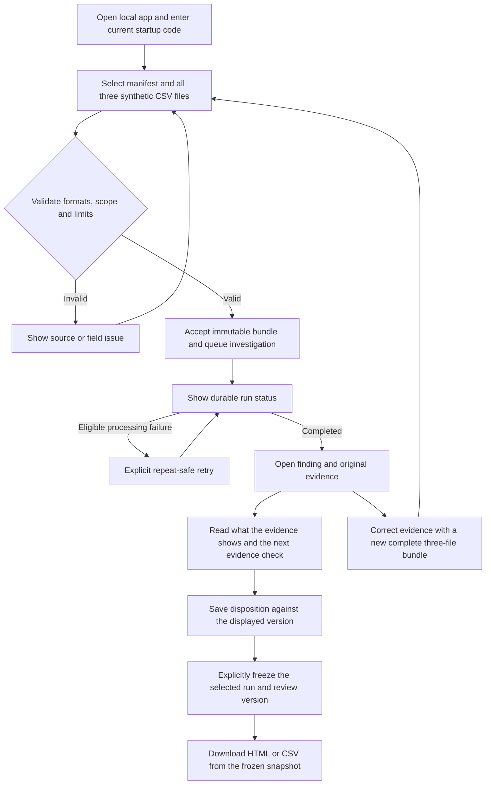

# Equivra

**Follow a payment difference from source evidence to a reviewed, reproducible workpaper.**

Equivra is a planned payments investigation workbench for reviewing differences across payment processor, bank and accounting records. It brings the supplied evidence into one review flow, explains what each finding supports, and preserves the facts behind a frozen report.

**Current stage: planning complete; application implementation has not started.** This repository contains the product specification, architecture, synthetic examples and a 53-ticket development guide. The capabilities below describe the approved build, not a running service.

## What we are building

A local web application where a reviewer can:

1. Import a complete bundle of three documented CSV sources: processor movements, bank activity and accounting activity.
2. Validate the files and preview their contents before accepting an investigation.
3. Follow a durable investigation run into source-linked findings.
4. Inspect exact amounts, references, dates and evidence limits.
5. Read **“What this evidence shows”** and **“Next evidence check”** for a finding.
6. Record a versioned reviewer disposition without changing the source facts.
7. Freeze the selected evidence and review versions into an immutable workpaper, then export HTML or CSV.

The first version uses synthetic data, one modeled client workspace, one processor account and USD. It is designed as a reproducible local demonstration, with business validation alongside development.

## Why build it?

A bank deposit, a processor movement and an accounting entry describe different parts of the same financial story. Refunds, dispute reversals, settlement timing and incomplete exports can make the relationship difficult to explain from a total alone.

Equivra focuses on the investigation: **which supplied records support this relationship, what differs, and what evidence is still needed?** The goal is to turn a selected discrepancy into a traceable review record rather than an unexplained spreadsheet adjustment.

The project also has a portfolio goal: demonstrate exact financial arithmetic, durable background processing, source lineage, safe retries, concurrent review and reproducible reports through one understandable user journey.

## Intended customers and users

The initial commercial hypothesis is **small bookkeeping firms reviewing payment activity for their clients**. This audience has not yet been validated through customer commitments or real-data pilots.

| Person | Their role in the proposed workflow | Intended benefit |
|---|---|---|
| Bookkeeper or reconciliation reviewer | Investigates processor, bank and accounting differences | Inspect related evidence and identify the next evidence check in one place |
| Firm owner or review lead | Reviews the investigation and its supporting workpaper | See what was supplied, what was concluded and what remains unresolved |
| Client or evidence provider | Supplies records or clarifies an unresolved reference | Receive a specific evidence request instead of an unsupported conclusion |
| Founder and portfolio viewer | Uses the initial local synthetic demonstration | Follow the financial story and observe correctness and recovery behavior |

These are modeled participants, not existing customers or separate V1 application accounts. The first application has one local reviewer workflow. Multi-user permissions, customer portals and hosted access require later decisions.

## Where Equivra fits in a customer's work

The proposed fit is an **investigation step within an existing reconciliation or period-close process**:

```text
Processor activity + bank records + accounting records
                         |
             A difference needs investigation
                         |
       Equivra: inspect evidence, review, freeze workpaper
                         |
       Reviewer carries the result into their existing
       accounting process or requests more evidence
```

The processor, bank and accounting system remain the sources of their records. Equivra preserves the supplied exports and the reasoning supported by them. Any accounting correction or financial action takes place separately in the customer's existing process.

V1 accepts files manually in the exact supported profiles. It does not synchronize live accounts, post journal entries or move money. Bookkeeping firms' source availability, recurring investigation needs and willingness to pay remain questions to validate.

## What problems will it address?

| Investigation problem | Planned Equivra behavior |
|---|---|
| Related evidence is spread across exports | Show original source values and stable file/row references alongside each finding |
| Equal amounts look like a match | Use explicit supported references; preserve ambiguity when identity is insufficient |
| A refund appears in processor data but not in supplied books | Show an incomplete-evidence case and the next evidence check; do not claim the real books are wrong |
| Settlement crosses a reporting boundary | Distinguish event, payout, bank and accounting dates and declared coverage |
| A repeated import or interrupted job risks duplicate results | Keep revision ownership and repeat-safe processing with visible recovery status |
| Two review actions use the same old version | Reject stale writes rather than overwrite a newer decision |
| Updated evidence changes a previously shared explanation | Create a new revision and preserve the original frozen workpaper |

The intended value is a clearer, repeatable investigation. Time saved, repeat use, accuracy improvements and commercial demand are **not measured outcomes yet**.

## Updated product workflow



- **Evidence guidance is deterministic.** A fixed lookup from the finding's reason code supplies the explanation and next check. No model call is required. Unknown reasons stay unresolved and offer source-inspection guidance.
- **Review and freeze are separate actions.** A note does not change a financial fact or automatically approve a report. Stale saves/freezes require a deliberate refresh; review drafts are retained on conflict.
- **Corrections preserve history.** A correction submits the complete bundle as a new revision. Repeating identical accepted content reuses its identity; old evidence and frozen reports remain unchanged.
- **Exports preserve the frozen facts.** The new on-screen guidance does not add explanation copy to the frozen exports. Reports retain their existing facts, reason codes, evidence and unresolved labels.

### A concrete example

The synthetic processor records contain a **$100.00 payment**, a supplied **$3.20 fee** and a **$30.00 partial refund**. Their supplied net payout is **$66.80**. A bank deposit explicitly references that payout, while the supplied accounting export contains no refund entry.

Equivra should show the supported $66.80 processor-to-bank relationship and a separate incomplete accounting-evidence finding. The reviewer can inspect the refund's source row and check for the corresponding entry or additional export coverage.

Missing accounting evidence remains **unknown**, not zero and not proof an entry never existed. Adding the refund entry through a corrected complete bundle can change the new investigation; it cannot rewrite an earlier frozen report.

## First-release boundaries

- Local, synthetic-data demonstration; one modeled workspace/account and USD.
- Three exact documented source profiles, with up to **10,000 data rows and 10 MiB per source file**. Reject exceeded limits without truncation.
- Exact integer-cent arithmetic and explicit evidence references.
- Findings use **supported, difference, incomplete, ambiguous or unsupported** states according to the source contract.
- Temporary per-start access code, loopback host exposure and browser Host/Origin protections.
- No real financial data, public signup, SaaS billing, live connectors, multiple currencies, AI drafting, accounting writes or universal import support in V1.

Support for the stated workload must be demonstrated during implementation. No latency, throughput or production-readiness claim is established by this plan.

## Planned architecture

| Layer | Selected design |
|---|---|
| Browser | React and Vite; evidence-first review screens |
| API and worker | One TypeScript backend codebase with separate process entry points; Node.js 24 and Fastify |
| Persistence | PostgreSQL 18 with explicit SQL constraints, transactions and restricted runtime roles |
| Background processing | PostgreSQL-backed pg-boss jobs with guarded publication and finite retries |
| Sources and reports | Immutable original source files, versioned reviews, frozen snapshots and safe HTML/CSV rendering |
| Verification | Node's built-in test runner, real PostgreSQL integration tests and Playwright browser journeys |

These are planning choices. Dependency compatibility, queue behavior, resource limits and recovery still need executable proof. See the [architecture plan](docs/architecture.md) and [engineering review](docs/engineering-review.md).

## Development status and build order

The [development guide](development.md) contains **53 focused tickets**, exact prerequisites, owned files, implementation steps, test cases, recovery instructions and completion evidence. All implementation tickets are currently **Not completed**.

The build proceeds through foundation → source contracts → storage/access/domain rules → jobs/import → review/snapshots → real backend integration → browser workflow → limits, restore and clean local setup.

Start with **T1** and follow the [exact execution flow](development.md#flow). The backend convergence tickets **T47 and T48 run before T41–T46**, so browser acceptance depends on actual provider behavior. Written contracts and mock examples do not count as completed integration.

There is no runnable application or verified installation command yet. The foundation tickets establish those commands; the release tickets prove the complete local walkthrough. GitHub publication of these documents is separate from application implementation, CI acceptance or deployment.

## Project documents

| Document | Read it for |
|---|---|
| [Development guide](development.md) | All 53 small tickets, execution order and acceptance gates |
| [Product requirements](docs/PRD.md) | Approved goals, users, scope and success criteria |
| [Approved workflow design](docs/designs/equivra-payments-workbench.md) | User journey and design decisions |
| [Architecture plan](docs/architecture.md) | Data, runtime, access, job and report boundaries |
| [Contract registry](docs/contracts/registry.md) | Exact source/API/provider handoffs |
| [Synthetic scenarios](docs/demo-scenarios.md) | Financial examples, ambiguity, replay and concurrency expectations |
| [Orchestration plan](docs/orchestration.md) | Parent packets, dependencies and integration checkpoints |
| [Repository context](docs/repo_context.md) | Baseline and verified versus proposed commands |

The near-term goal is a defensible portfolio demonstration. Business validation runs alongside it; real-data pilots, hosting and commercial operation remain separate future decisions.
