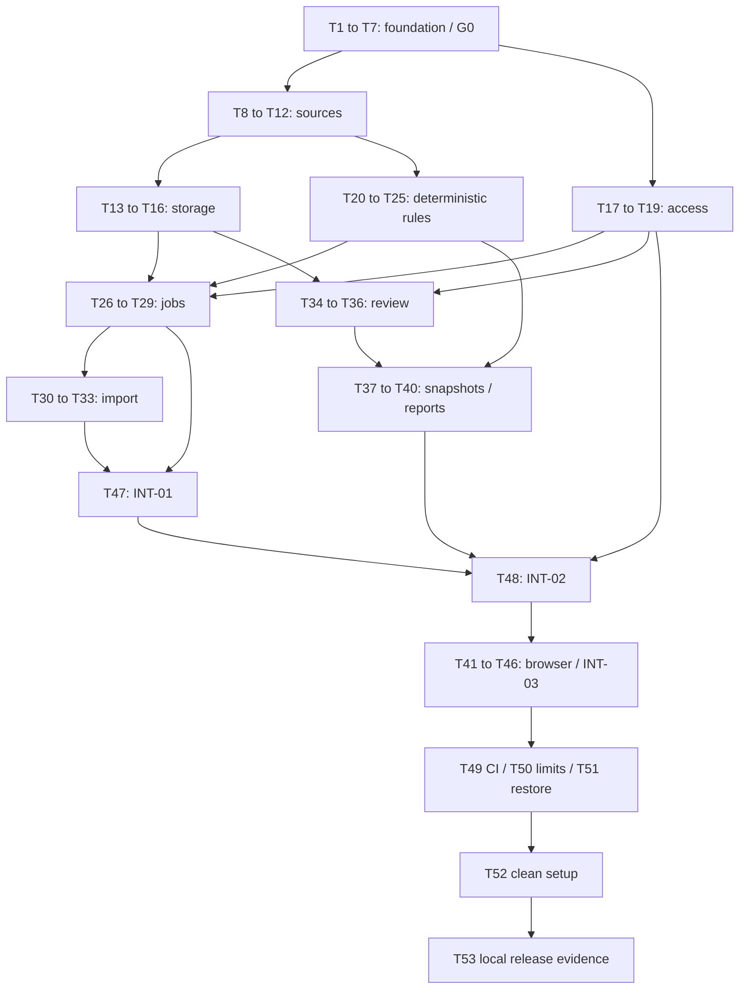

# Equivra — Development guide and intern execution tickets

**Document status:** Written development plan. **Application implementation: Not completed.**
**Verified planning baseline:** 2026-10-15, repository `anmolsansi/Equivra`, current branch `main`, HEAD `aaf4eb3`. Only README.md is tracked in that baseline; existing docs/ are local planning artifacts. No application source/package/test/CI implementation exists at this checkpoint.
**Delivery:** 53 focused tickets. All start **Not completed**. None is completed merely because this guide exists.
**Authority:** approved Equivra product/design decisions, the existing architecture/contracts and the founder's request to create this planning file. No implementation, branch, tracker issue, commit, push, merge or deployment is authorized by the guide.

## Contents

- [1. Start here](#start-here)
- [2. What exists and how to read contracts](#baseline)
- [3. How to execute one ticket](#execute)
- [4. Exact ticket flow](#flow)
- [5. Ticket index and parent mapping](#index)
- [6. Detailed tickets](#tickets)
- [7. Integration and local release gates](#release-gates)
- [8. Risks, decisions and recovery](#risks)
- [9. How this plan was prepared](#method)

<a id="start-here"></a>
## 1. Start here

Equivra is a local payments investigation workbench. A reviewer imports **three synthetic CSV files**: processor movements, bank activity and accounting/book activity. The system compares exact amounts and explicit references, shows the evidence and uncertainty, saves a reviewer disposition, then freezes a report. It does not move money or post accounting entries.

**Portfolio first, business alongside.** The first success is a reproducible demonstration that an interviewer can follow. Commercial demand, prices and customer access remain hypotheses; they are not a reason to add billing, accounts or live connectors to V1.

### Approved scope to preserve

- One TypeScript backend codebase with API and worker processes, React/Vite UI and PostgreSQL. Node24 application baseline; Fastify native validation; node-postgres parameterized SQL; pg-boss12.38.0 planning baseline; csv-parse; Node built-in test runner with Playwright as a browser library.
- Synthetic `demo` workspace/account and USD only. Support exactly the frozen three source profiles, not arbitrary CSVs.
- Each source: up to **10,000 data rows and10MiB (10,485,760 original bytes)**. Reject either exceeded bound; never truncate or claim an unmeasured speed guarantee.
- Corrections re-upload the complete three-file bundle as a new immutable revision. Old source evidence, cases, reviews and reports survive.
- Per-start temporary access code, exact Host/Origin protections and loopback-only host publication.
- Deterministic evidence rules: supported, difference, incomplete, ambiguous and unsupported. A reviewer note never turns insufficient evidence into a supported financial fact.
- Durable, repeat-safe jobs; append-only expected-version review; immutable snapshots and inert HTML/CSV export.

**Excluded:** real financial/customer data, cloud hosting, SaaS accounts/tenancy, billing, multiple currencies, live bank/processor/books connectors, AI explanations/agents, journal posting, tax/accounting certification, fraud detection, external messages and universal adapters.

### Worked story

The example processor files supply a100.00 payment with3.20 fee:96.80 net. A partial refund supplies-30.00 net. Both explicitly belong to the same payout, so the supplied subtotal is **66.80 USD /6680 cents**. One bank deposit explicitly references that payout. Books support the payment but contain no refund row in the declared supplied scope.

Show a supported processor-to-bank relationship and a separate **incomplete books-evidence case** with expected-3000 cents, observed `null` and delta `null`. Do not claim the real books are wrong or treat missing evidence as zero. A corrected complete bundle adds the-3000 books row; its new case may be supported, while the old frozen report stays unchanged.

### Short glossary

- **Contract:** exact input/output/error/ownership agreement between pieces.
- **Fixture:** invented, repeatable input and expected result used by a test.
- **Migration:** deliberately applied database structure change.
- **Transaction:** several DB operations commit together or all roll back.
- **Idempotent/replay-safe:** repeating the same accepted request does not duplicate its effect.
- **Expected version:** the version the reviewer saw; reject a save when a newer version exists.
- **Snapshot:** an immutable copy of the selected facts, evidence and review decisions.
- **Gate:** a mandatory check that must pass before dependent work proceeds.
- **Unit / integration / E2E:** pure-function check / real provider boundary check / actual browser journey.

<a id="baseline"></a>
## 2. What exists and how to read contracts

### Existing planning evidence

| File | Purpose |
|---|---|
| [docs/repo_context.md](docs/repo_context.md) | Repository baseline, selected conventions and later observed commands |
| [docs/PRD.md](docs/PRD.md) | Product goals and scope |
| [Approved design](docs/designs/equivra-payments-workbench.md) | Approved user journey and nine design acceptance criteria |
| [Architecture](docs/architecture.md) | Source/money/API/DB/job/access/report design |
| [Contract registry](docs/contracts/registry.json) | Authoritative ten full planning contract records |
| [Scenario narratives](docs/demo-scenarios.md) | S1–S8 expected behavior |
| [Earlier orchestration](docs/orchestration.md) | Twelve parent packets, invariants and checkpoint design |
| [Engineering review](docs/engineering-review.md) | Findings, written remedies and missing runtime/outside evidence |

The scenario/PRD introductions contain earlier checkpoint wording that predates the contract examples. Existing `docs/contracts/examples/manifest.json`, `stripe.csv`, `bank.csv`, `books.csv`, `books-corrected.csv`, `expected.json`, `api-responses.json` and `snapshot.json` are **planning examples**, not implemented/passing test fixtures. T12 creates executable fixtures. The snapshot example is a deliberately partial wire illustration; it must never cap the complete frozen case inventory.

### Current runtime and command status

Earlier inspection found host Node25.8.1, npm11.11.0 and Docker CLI29.0.1. Those are historical host observations, not proof of the Node24 application/container or a running Docker daemon. T1/T6/T7 recheck them as needed. No npm build/test/typecheck/migration/start command is currently repository-verified. Proposals copied into contracts are not passing commands.

### Numbering and authority

`TASK-01` through `TASK-12` are **parent planning packets**, not small execution tickets. `T1` through `T53` are this guide's execution IDs. For example, parent `TASK-07` maps to T26–T29, not to T7. Embedded provider/consumer fields retain the original parent IDs so the source contracts remain byte-for-byte substantively consistent. Use the index below to translate them.

Each ticket names its complete required contract blocks, pasted in the same-file contract library below. Read the ticket together with those blocks as its self-contained handoff. The ticket's smaller scope decides which portion to implement; copied neighboring routes/schema do not authorize implementing unrelated work. Existing source examples and prerequisite code listed under Files to inspect may also be read. Do not require the intern to infer product or architecture decisions from another ticket.

Where generic plugin guidance conflicts with the approved Equivra contracts, **the approved project contract wins**: use its `{error:{code,message,correlation_id,details?...}}` shape, route-specific status codes, native Node/Playwright runner and safe paired restore. Do not invent a `fields` envelope, add Testing Library/a second runner or roll a history-bearing migration down destructively merely to match a generic checklist.

<a id="execute"></a>
## 3. How to execute one ticket

1. Read this section, the one selected ticket, repo_context and the exact rule files named there. Open its copied contracts and named existing/source files.
2. Verify every prerequisite is actually complete with evidence. A written predecessor ticket is not a completed implementation. At each API/provider handoff compare the merged/current implementation to the copied contract.
3. Confirm owned files. Read shared files before editing; preserve prior ticket behavior and tests. If a needed change lies outside ownership, stop that part and identify the missing ownership rather than editing casually.
4. Arrange the named synthetic input or disposable DB. Run only local resources. If Docker/runtime/required capability is unavailable, record the exact safe error and blocker.
5. Implement one listed outcome and its immediate unit/API/behavior tests. Keep the diff scoped; no unrelated refactor/framework/dependency choice.
6. Run the ticket-specific checks, then affected typecheck/build. Review validation, errors, permissions, exact cents and durable state.
7. Perform manual QA where applicable; record what happened and retain sanitized command/output/assertion evidence.
8. Review documentation impact. Update this ticket's completion evidence/status after proof; describe current behavior in runbook/repo_context only where that ticket owns those files. Avoid adding a task diary to the runtime guide.
9. Review the diff for unrelated changes, credentials, raw source/log dumps and changed frozen contracts. No `.env` contents or private DB/source directory may enter version control.
10. If future coding authorization includes Git publication, use one meaningful commit per ticket where practical, `type(scope): outcome [Tn/53]`, adding a real main issue reference only if one actually exists. No GitHub/Linear issue number or branch is invented here. This planning request creates none.
11. Fill the completion record. Only then mark the ticket Completed and allow downstream work. Failed/missing tests, unresolved contract choice or missing evidence leave it Not completed or explicitly Blocked.

### Universal done record

```text
Ticket: Tn — title
Status: Not completed | Blocked | Completed
Files changed:
Prerequisites checked and evidence:
Command / runtime / date / exit result:
Assertions passed / failed / not run:
Manual QA and visible outcome:
Durable state / security / recovery proof:
Documentation impact:
Contract changes: none, or architect-approved change reference
Commit / issue / CI: actual reference or Not created / Not run
Remaining blocker and next handoff:
```

### Standard verification commands — future interface

After T7 proves their definitions and applicable targets, use the selected Node24 local environment and:

```text
npm run typecheck
npm run build
node --test dist/tests/unit/<owned-file>.test.js
node --test --test-concurrency=1 dist/tests/integration/<owned-file>.test.js
node --test --test-concurrency=1 dist/tests/e2e/workbench.test.js
npm run verify
```

The angle-bracket line is a template, not a literal shell command; each ticket below gives exact owned test paths. Build compiles tests before these direct Node invocations. Run only implemented suites until convergence; absent/zero-test required suites cannot be called green. `npm run db:migrate` needs the validated local migration credential and must target the intended local DB. Do not paste real credentials into shell history or logs. T1 can bootstrap package resolution with an explicitly observed Node24 runtime before the Compose image exists; if it uses Docker, require an operating daemon. T6 does not supply a dependency that T1 must pretend already exists.

### Timing and progress

The earlier parent-packet estimate was166 experienced-engineer hours, roughly17 weeks at10h/week before contingency. The smaller ticket estimates total159 focused hours, with roughly7 hours of the earlier166-hour baseline left for cross-ticket coordination/review. These are preliminary allowances, not a promise of intern speed or measured AI acceleration. Re-estimate after T7, T12 and INT-01. Equal ticket count does not equal equal effort; checkboxes track acceptance, not earned financial value. Keep one builder active on shared files. Take a broader checkpoint after roughly every five tickets actually completed, not merely every fifth numeric ID.

<a id="flow"></a>
## 4. Exact ticket flow

### Default path for one intern

1. Start **T1**.
2. Complete **T2 and T3**, then **T4 and T5**. One person can do them in that order; separate branches are not required.
3. Complete **T6 → T7**. **G0 must pass** before downstream work.
4. Complete **T8 → T9 → T10 → T11 → T12**.
5. Complete the independent branches in any order, doing each branch in its own order:
   - Storage: **T13 → T14 → T15 → T16**.
   - Access: **T17 → T18 → T19**.
   - Domain: **T20 → T21 → T22 → T23 → T24 → T25**.
6. With all three branches complete, do **T26 → T27 → T28 → T29**.
7. Do **T30 → T31 → T32 → T33**.
8. Do **T34 → T35 → T36 → T37 → T38 → T39 → T40**.
9. Do **T47**, then **T48**. These are backend integration tickets and deliberately execute before browser work. **INT-01 and INT-02 must pass.**
10. Do **T41 → T42 → T43 → T44 → T45 → T46**. **INT-03 must pass.**
11. Complete **T49, T50 and T51**, then **T52 → T53**.

Complete default linear order, with every ticket exactly once:


```text
T1 → T2 → T3 → T4 → T5 → T6 → T7 → T8 → T9 → T10 → T11 → T12 → T13 → T14 → T15 → T16 → T17 → T18 → T19 → T20 → T21 → T22 → T23 → T24 → T25 → T26 → T27 → T28 → T29 → T30 → T31 → T32 → T33 → T34 → T35 → T36 → T37 → T38 → T39 → T40 → T47 → T48 → T41 → T42 → T43 → T44 → T45 → T46 → T49 → T50 → T51 → T52 → T53
```

### Why this order

Exact source meanings come before persisted financial interpretation. Storage/access/domain can progress independently after their own prerequisites, but the queue needs all three before it can safely publish. Import needs the queue transaction boundary. Review and freeze need the durable identities/locks. Real-provider API proofs come before UI acceptance, so a convincing mock screen cannot hide a broken backend. Recovery/limit/clean-start proof comes before calling the local demo accepted.

### Dependency diagram



### Shared-file and gate rules

- `server/app.ts`: T2 stub → T18 access → T19 boundary → T48 final mount. No simultaneous edits.
- `server/worker.ts`: T2 stub → T27 publication → T29 terminal status.
- `web/src/App.tsx`: T3 shell → T41 → T42 → T43 → T44 → T45 → T46. Those UI tickets are sequential.
- Source/domain/import/review/report files and each corresponding test file evolve sequentially within their ticket chain. Do not replace earlier passing coverage.
- `db/001_initial.sql`: T14 schema → T15 grants; after schema has been applied to durable evidence, do not rewrite applied history. New schema changes require an architect-approved numbered migration and updated contracts.
- `docs/repo_context.md`: T7 runtime baseline → T52 observed full-system runbook evidence.
- Every ticket may update only its own status/evidence entry in `development.md`; T53 reconciles the final checklist. This administrative evidence update is additional to its implementation-file list, not permission to rewrite contracts.
- Independent ticket branches are scheduling choices. Concurrent agents/worktrees are not required or authorized. Their file ownership must be rechecked before any separately authorized parallel execution.

<a id="index"></a>
## 5. Ticket index and parent mapping

| Ticket | Outcome | Parent | Prerequisites | Focused hours | Status |
|---|---|---|---|---:|---|
| [T1](#t1) | Pin the workspace packages and application dependency versions | TASK-01 | None | 2 | Not completed |
| [T2](#t2) | Compile minimal backend API and worker entry points | TASK-01 | T1 | 2 | Not completed |
| [T3](#t3) | Build the minimal React web shell | TASK-01 | T1 | 2 | Not completed |
| [T4](#t4) | Freeze shared API fixtures and canonical JSON behavior | TASK-01 | T2 | 3 | Not completed |
| [T5](#t5) | Create private local configuration and safe initialization | TASK-01 | T2 | 3 | Not completed |
| [T6](#t6) | Define fixed local containers and loopback host publication | TASK-01 | T3, T5 | 3 | Not completed |
| [T7](#t7) | Record real foundation command evidence and close G0 | TASK-01 | T4, T6 | 2 | Not completed |
| [T8](#t8) | Parse USD amounts into exact signed integer cents | TASK-02 | T7 | 2 | Not completed |
| [T9](#t9) | Validate manifest identity, period and source coverage | TASK-02 | T8 | 2 | Not completed |
| [T10](#t10) | Parse bounded CSV records while preserving original fields | TASK-02 | T9 | 3 | Not completed |
| [T11](#t11) | Normalize exact processor, bank and books source rows | TASK-02 | T10 | 3 | Not completed |
| [T12](#t12) | Freeze executable S1–S8 scenario data and expected results | TASK-02 | T11 | 2 | Not completed |
| [T13](#t13) | Create the PostgreSQL transaction and migration entry points | TASK-03 | T12 | 3 | Not completed |
| [T14](#t14) | Create revision-owned tables, identity constraints and indexes | TASK-03 | T13 | 3 | Not completed |
| [T15](#t15) | Restrict runtime database roles and immutable writes | TASK-03 | T14 | 3 | Not completed |
| [T16](#t16) | Provide safe disposable database fixtures for provider tests | TASK-03 | T15 | 3 | Not completed |
| [T17](#t17) | Generate and validate a temporary current-start access code | TASK-04 | T7 | 2 | Not completed |
| [T18](#t18) | Guard protected routes with exact Host and browser Origin | TASK-04 | T17 | 2 | Not completed |
| [T19](#t19) | Bound failed access attempts and redact boundary errors | TASK-04 | T18 | 2 | Not completed |
| [T20](#t20) | Create stable case identities and exact-reference indexes | TASK-06 | T12 | 3 | Not completed |
| [T21](#t21) | Calculate supplied payout-to-bank relationships | TASK-06 | T20 | 3 | Not completed |
| [T22](#t22) | Calculate exact processor-to-books relationships | TASK-06 | T21 | 3 | Not completed |
| [T23](#t23) | Evaluate supplied partial-refund relationships | TASK-06 | T22 | 3 | Not completed |
| [T24](#t24) | Evaluate dispute withdrawal and reversal identities | TASK-06 | T23 | 3 | Not completed |
| [T25](#t25) | Complete coverage, unsupported and unlinked evidence outcomes | TASK-06 | T24 | 3 | Not completed |
| [T26](#t26) | Prove the pinned queue transaction adapter and setup | TASK-07 | T16, T19, T25 | 4 | Not completed |
| [T27](#t27) | Publish owned worker results atomically | TASK-07 | T26 | 4 | Not completed |
| [T28](#t28) | Retry only eligible failed jobs with durable request replay | TASK-07 | T27 | 3 | Not completed |
| [T29](#t29) | Preserve finite-retry failure status and sanitized diagnostics | TASK-07 | T28 | 3 | Not completed |
| [T30](#t30) | Stage and finalize immutable source bytes safely | TASK-05 | T16, T19, T29 | 4 | Not completed |
| [T31](#t31) | Commit a complete bundle, run and queue job together | TASK-05 | T30 | 4 | Not completed |
| [T32](#t32) | Make import replay and corrected revisions preserve history | TASK-05 | T31 | 3 | Not completed |
| [T33](#t33) | Expose safe bounded bundle/source previews | TASK-05 | T32 | 2 | Not completed |
| [T34](#t34) | Read bounded cases and their owning evidence | TASK-08 | T16, T19 | 3 | Not completed |
| [T35](#t35) | Append a version-checked reviewer disposition | TASK-08 | T34 | 3 | Not completed |
| [T36](#t36) | Prove competing-review and committed-response replay schedules | TASK-08 | T35 | 3 | Not completed |
| [T37](#t37) | Construct a complete canonical workpaper payload | TASK-09 | T16, T25, T36 | 3 | Not completed |
| [T38](#t38) | Freeze snapshots atomically against the selected review version | TASK-09 | T37 | 4 | Not completed |
| [T39](#t39) | Render frozen HTML and CSV as inert user-visible output | TASK-09 | T38 | 3 | Not completed |
| [T40](#t40) | Retrieve immutable snapshots and download report attachments | TASK-09 | T39 | 3 | Not completed |
| [T41](#t41) | Build current-code entry and the memory-only API client | TASK-10 | T48 | 3 | Not completed |
| [T42](#t42) | Build complete-bundle upload and source preview | TASK-10 | T41 | 3 | Not completed |
| [T43](#t43) | Build run status and bounded case browsing | TASK-10 | T42 | 3 | Not completed |
| [T44](#t44) | Build evidence detail and versioned review controls | TASK-10 | T43 | 3 | Not completed |
| [T45](#t45) | Build explicit freeze and selected-snapshot download controls | TASK-10 | T44 | 3 | Not completed |
| [T46](#t46) | Verify the full accessible browser journey and close INT-03 | TASK-10 | T45 | 4 | Not completed |
| [T47](#t47) | Prove real source, storage and job convergence — INT-01 | TASK-11 | T16, T25, T29, T33 | 4 | Not completed |
| [T48](#t48) | Mount actual API providers and prove wire conformance — INT-02 | TASK-11 | T19, T36, T40, T47 | 4 | Not completed |
| [T49](#t49) | Define repeatable local-provider CI checks | TASK-12 | T46 | 3 | Not completed |
| [T50](#t50) | Verify workload limits and record measured resource use | TASK-12 | T46 | 4 | Not completed |
| [T51](#t51) | Prove paired database and raw-source archive recovery | TASK-12 | T46 | 4 | Not completed |
| [T52](#t52) | Write and follow the clean local setup and recovery runbook | TASK-12 | T49, T50, T51 | 4 | Not completed |
| [T53](#t53) | Review all acceptance evidence and write the portfolio walkthrough | TASK-12 | T52 | 3 | Not completed |

### Parent packet coverage

| Parent packet | Smaller tickets | Result before parent can be accepted |
|---|---|---|
| [TASK-01](docs/tasks/TASK-01.md) | T1, T2, T3, T4, T5, T6, T7 | All child criteria plus named real-provider gate; no automatic completion |
| [TASK-02](docs/tasks/TASK-02.md) | T8, T9, T10, T11, T12 | All child criteria plus named real-provider gate; no automatic completion |
| [TASK-03](docs/tasks/TASK-03.md) | T13, T14, T15, T16 | All child criteria plus named real-provider gate; no automatic completion |
| [TASK-04](docs/tasks/TASK-04.md) | T17, T18, T19 | All child criteria plus named real-provider gate; no automatic completion |
| [TASK-05](docs/tasks/TASK-05.md) | T30, T31, T32, T33 | All child criteria plus named real-provider gate; no automatic completion |
| [TASK-06](docs/tasks/TASK-06.md) | T20, T21, T22, T23, T24, T25 | All child criteria plus named real-provider gate; no automatic completion |
| [TASK-07](docs/tasks/TASK-07.md) | T26, T27, T28, T29 | All child criteria plus named real-provider gate; no automatic completion |
| [TASK-08](docs/tasks/TASK-08.md) | T34, T35, T36 | All child criteria plus named real-provider gate; no automatic completion |
| [TASK-09](docs/tasks/TASK-09.md) | T37, T38, T39, T40 | All child criteria plus named real-provider gate; no automatic completion |
| [TASK-10](docs/tasks/TASK-10.md) | T41, T42, T43, T44, T45, T46 | All child criteria plus named real-provider gate; no automatic completion |
| [TASK-11](docs/tasks/TASK-11.md) | T47, T48 | All child criteria plus named real-provider gate; no automatic completion |
| [TASK-12](docs/tasks/TASK-12.md) | T49, T50, T51, T52, T53 | All child criteria plus named real-provider gate; no automatic completion |

<a id="tickets"></a>
## 6. Detailed tickets

Read one ticket at a time. Read its required same-file contract blocks before implementation. Existing parent packets are supplementary context, not a substitute for the smaller acceptance checks.

<a id="t1"></a>
### T1 — Pin the workspace packages and application dependency versions

**Status:** Not completed. **Parent:** TASK-01. **Priority:** P1 before local release. **Focused allowance:** 2 hours; split if the acceptance cannot fit one focused session.

#### Goal and why

Pin the workspace packages and application dependency versions. This gives later tickets a reproducible runtime and exact shared interfaces instead of relying on the current host setup.

#### Prerequisites and starting state

- No implemented predecessor. Verify the README-only baseline and a usable selected Node24 runtime; if Docker is used to bootstrap, first verify its daemon. Do not assume the later Compose image exists.

At the original planning baseline all application paths below are future paths. CREATE/EDIT labels describe their state **after the listed prerequisites**, not claims that those files exist today. Stop if actual contents disagree with this starting state.

#### Files to inspect first

- `docs/repo_context.md`: verify actual runtime, command and directory evidence.
- This ticket, including its required same-file contract records: exact shapes, limits, errors and ownership.
- Each owned file below if present: preserve predecessor behavior and assertions.


Named rule files (existing absolute paths; project contract overrides noted in section2):
- `/Users/mac/.codex/plugins/cache/personal/premium-product-builder/0.1.0/skills/premium-product-builder/model_execution_rules.md`
- `/Users/mac/.codex/plugins/cache/personal/premium-product-builder/0.1.0/skills/premium-product-builder/testing_rules.md`
- `/Users/mac/.codex/plugins/cache/personal/premium-product-builder/0.1.0/skills/premium-product-builder/security_rules.md`
- `/Users/mac/.codex/plugins/cache/personal/premium-product-builder/0.1.0/skills/premium-product-builder/product_quality_bar.md`
- `/Users/mac/.codex/plugins/cache/personal/premium-product-builder/0.1.0/skills/premium-product-builder/frontend_rules.md`

#### Owned files and protected scope

- **CREATE** `package.json`
- **CREATE** `package-lock.json`
- **CREATE** `web/package.json`

Also permitted: update only T1's completion/evidence entry in this guide after checks. No other implementation files are writable for this ticket. Preserve `.git/`, `.gstack/`, `.codex/`, `.agents/`, external attachments, source contract examples and contract registry. If tests expose a provider defect outside ownership, identify its owner and block this part rather than silently changing another contract.

#### User-visible behavior, scope and exclusions

Internal prerequisite; no additional product screen/action is introduced. Its exact downstream benefit is the goal above.

Scope: only the numbered steps and tests below. Out of scope: other tickets, real data, hosting/accounts/billing/AI/live connectors, financial writes, unsupported formats, unrelated refactoring and new architecture. Tests travel with behavior; do not defer its trust-boundary checks.

#### Data, API and integration contracts

Use the complete records in this document’s contract library, linked at the end of this ticket: **C-FOUNDATION**. SQL/fields, method/path, request/response/status, IDs, money/null types, retry/lock semantics, fixtures and lifecycle rules are authoritative. For a pure/internal ticket, only its function/type/storage portion applies; it exposes no extra HTTP route. Do not implement every copied neighboring endpoint.

Inputs: the normalized/source/runtime values described in those records and the completed prerequisite outputs. Outputs: only this ticket's named implementation outcome, owned tests and recorded evidence. No new public API or schema is invented. Parent provider IDs are translated through section5.

#### Implementation steps

1. Read the copied foundation contract. Select compatible exact dependency versions for the fixed Node24/TypeScript/Fastify/React/Vite/PG18/pg-boss12.38.0 design; record the installed result in the lockfile, without changing frameworks.
2. Create the root npm workspace and web package manifest. Declare the exact foundation script interface copied below; targets added by later tickets are allowed to be unavailable now, but must fail clearly rather than succeed with zero tests.
3. Install once under the selected runtime. Confirm a clean npm ci reproduces the lockfile in a disposable checkout; never upgrade unrelated global tools.
4. Add the concrete assertions below beside the owned behavior, run the narrow verification, inspect the diff and retain sanitized evidence. Stop before any dependent handoff if one required check fails.

#### Worked assertions and test cases

1. Node24 reports the selected major version; npm dependency resolution finishes without peer conflicts.
2. A second clean npm ci does not modify the lockfile; package scripts contain no remote database or paid API dependency.

Arrange the named synthetic fixture or disposable DB, execute one behavior, then assert both returned value and durable state where relevant. No test may rely on real bank/Stripe accounts. Unit tests use Node native runner; provider/API tests use real local PostgreSQL; E2E uses Playwright library under Node tests.

#### Validation, errors, permissions and observability

Enforce every relevant exact bound/type/enum in copied contracts at its trust boundary. Monetary amounts stay signed integer-cent strings; unknown observations/deltas stay null. Browser text stays inert. Access checks run before data reads/writes/downloads; worker permissions never permit reviewer decisions/snapshots. Runtime errors expose a safe code/message/correlation reference, not credentials, source text, private paths or stack traces.

A malformed input is visibly rejected rather than coerced/truncated; dependency failure remains a safe failure/retry state; known incomplete/ambiguous evidence is a result state rather than a swallowed exception. Follow the route-specific copied status codes, not a universal422 assumption. Pure functions return diagnostics for the caller to log once. Runtime owners log operation/correlation/bundle/run/job/snapshot IDs, outcome/attempt/duration only where relevant. Never log raw notes/rows or Authorization.

#### UI states

No new screen is owned here. If this ticket supplies an API outcome, the copied wire shape/status is the UI handoff; its later browser ticket owns rendering. Document-only gates do not create UI.

#### Verification commands and manual QA

Bootstrap under an observed Node24 environment: `node --version`, dependency install to resolve the lockfile, then clean `npm ci` in a disposable checkout. Never report a build passing before T2/T3 supply it.

Manual QA / inspectable proof:
1. Prepare the input/precondition from the first assertion above (a fresh local fixture or temporary config for internal work).
2. Perform the first listed action and compare exact expected values/state. Record the observed result.
3. Perform the named rejection/failure assertion above. Confirm safe output and no unintended durable mutation.
4. For browser work additionally check refresh, console errors, keyboard focus and network response shape; for internal work inspect returned diagnostics/DB state instead of inventing click steps.

#### Acceptance criteria and definition of done

- [ ] Node24 reports the selected major version; npm dependency resolution finishes without peer conflicts.
- [ ] A second clean npm ci does not modify the lockfile; package scripts contain no remote database or paid API dependency.
- [ ] All relevant copied contract types/fields/statuses/limits/permissions match; no builder design choice was invented.
- [ ] Owned code/config/tests/docs are complete; required checks have actual passing evidence, and prior relevant assertions still pass.
- [ ] Manual QA/proof and error/no-side-effect assertions are recorded; missing checks are not presented as passing.
- [ ] Diff contains only owned scope, no secrets/private runtime data and no silent contract change.
- [ ] Completion record includes documentation impact, remaining blockers and downstream outputs. Status remains Not completed until all applicable criteria pass.

#### Documentation impact, commit scope and progress

Runtime/source/schema/security behavior is defined by this ticket; record its observed outcome in its completion entry. The clean-system explanation is consolidated by T52 in the owned runtime guide; do not rewrite architecture/contracts to match accidental code.

Future suggested commit scope: one meaningful T1 outcome plus its tests/documentation, `[T1/53]`. Commit only when separately authorized; GitHub/Linear/branch/PR references are Not created unless actually supplied/discovered. Approximate size is one of53 outcomes (~1.9% by count), not an assertion of equal effort.

#### Rollback, risk and escalation

Revert only foundation-owned files; preserve docs and unrelated runtime state. Never reset a DB volume to hide failure. For this smaller ticket, revert only its owned change while preserving prerequisite work. Stop API/worker before coordinated data/schema recovery; retain accepted evidence. Never delete referenced source files, old snapshots or a DB volume to make tests green. Preserve prior tests and error handling.

`Needs Architect Decision:` report the exact incompatible contract/capability/ownership evidence if this ticket cannot be implemented as written. Do not choose another framework, queue strategy, financial interpretation, credential transport, public bind, schema or API. An intern can execute the instructions independently; unexpected architecture/security/financial-contract changes still need review.

#### Downstream handoff and completion record

After all acceptance checks, hand off the actual implemented contract subset and sanitized proof to [T2](#t2), [T3](#t3). Until then this boundary is unavailable, even if its mock/example exists.

```text
Ticket: T1
Status: Not completed
Commands/runtime/date/results: Not run
Assertions/manual QA/recovery proof: Not run
Documentation impact: pending
Contract changes: none authorized
Commit/issue/CI: Not created / Not run
Blocker/handoff: prerequisites and acceptance above
```

<details>
<summary>Complete copied contracts for T1 — expand before implementation</summary>

- [C-FOUNDATION — Runtime and verification interface](#contract-c-foundation) — full record is pasted in this same document; include it when extracting this ticket for an isolated builder session.
</details>

<a id="t2"></a>
### T2 — Compile minimal backend API and worker entry points

**Status:** Not completed. **Parent:** TASK-01. **Priority:** P1 before local release. **Focused allowance:** 2 hours; split if the acceptance cannot fit one focused session.

#### Goal and why

Compile minimal backend API and worker entry points. This gives later tickets a reproducible runtime and exact shared interfaces instead of relying on the current host setup.

#### Prerequisites and starting state

- [T1](#t1) is Completed with its recorded proof. Its runtime/contract output must match the copied design; a written ticket alone does not satisfy this condition.

At the original planning baseline all application paths below are future paths. CREATE/EDIT labels describe their state **after the listed prerequisites**, not claims that those files exist today. Stop if actual contents disagree with this starting state.

#### Files to inspect first

- `docs/repo_context.md`: verify actual runtime, command and directory evidence.
- This ticket, including its required same-file contract records: exact shapes, limits, errors and ownership.
- Each owned file below if present: preserve predecessor behavior and assertions.

- `package-lock.json` from its completed prerequisite: inspect the public outputs used here, not unrelated internals.
- `package.json` from its completed prerequisite: inspect the public outputs used here, not unrelated internals.
- `web/package.json` from its completed prerequisite: inspect the public outputs used here, not unrelated internals.

Named rule files (existing absolute paths; project contract overrides noted in section2):
- `/Users/mac/.codex/plugins/cache/personal/premium-product-builder/0.1.0/skills/premium-product-builder/model_execution_rules.md`
- `/Users/mac/.codex/plugins/cache/personal/premium-product-builder/0.1.0/skills/premium-product-builder/testing_rules.md`
- `/Users/mac/.codex/plugins/cache/personal/premium-product-builder/0.1.0/skills/premium-product-builder/security_rules.md`
- `/Users/mac/.codex/plugins/cache/personal/premium-product-builder/0.1.0/skills/premium-product-builder/product_quality_bar.md`
- `/Users/mac/.codex/plugins/cache/personal/premium-product-builder/0.1.0/skills/premium-product-builder/backend_rules.md`
- `/Users/mac/.codex/plugins/cache/personal/premium-product-builder/0.1.0/skills/premium-product-builder/api_rules.md`

#### Owned files and protected scope

- **CREATE** `tsconfig.server.json`
- **CREATE** `server/main.ts`
- **CREATE** `server/app.ts`
- **CREATE** `server/worker.ts`

Also permitted: update only T2's completion/evidence entry in this guide after checks. No other implementation files are writable for this ticket. Preserve `.git/`, `.gstack/`, `.codex/`, `.agents/`, external attachments, source contract examples and contract registry. If tests expose a provider defect outside ownership, identify its owner and block this part rather than silently changing another contract.

#### User-visible behavior, scope and exclusions

Internal prerequisite; no additional product screen/action is introduced. Its exact downstream benefit is the goal above.

Scope: only the numbered steps and tests below. Out of scope: other tickets, real data, hosting/accounts/billing/AI/live connectors, financial writes, unsupported formats, unrelated refactoring and new architecture. Tests travel with behavior; do not defer its trust-boundary checks.

#### Data, API and integration contracts

Use the complete records in this document’s contract library, linked at the end of this ticket: **C-FOUNDATION, C-API**. SQL/fields, method/path, request/response/status, IDs, money/null types, retry/lock semantics, fixtures and lifecycle rules are authoritative. For a pure/internal ticket, only its function/type/storage portion applies; it exposes no extra HTTP route. Do not implement every copied neighboring endpoint.

Inputs: the normalized/source/runtime values described in those records and the completed prerequisite outputs. Outputs: only this ticket's named implementation outcome, owned tests and recorded evidence. No new public API or schema is invented. Parent provider IDs are translated through section5.

#### Implementation steps

1. Create the compiled ESM server/test/shared/db TypeScript configuration with output under dist; exclude web/build/runtime data. Avoid a separate framework or runtime TS loader.
2. Create a small Fastify app factory and separate API/worker process entry points. At this stage expose no financial data/actions and do not pretend an unconfigured dependency is ready.
3. Wire startup/shutdown so unsuccessful startup exits nonzero and signals close resources. Full provider registration remains T48; real job execution remains T27.
4. Add the concrete assertions below beside the owned behavior, run the narrow verification, inspect the diff and retain sanitized evidence. Stop before any dependent handoff if one required check fails.

#### Worked assertions and test cases

1. The backend compiler succeeds for the minimal entries.
2. Missing required dependencies produce a bounded startup failure; shutdown leaves no started test process.

Arrange the named synthetic fixture or disposable DB, execute one behavior, then assert both returned value and durable state where relevant. No test may rely on real bank/Stripe accounts. Unit tests use Node native runner; provider/API tests use real local PostgreSQL; E2E uses Playwright library under Node tests.

#### Validation, errors, permissions and observability

Enforce every relevant exact bound/type/enum in copied contracts at its trust boundary. Monetary amounts stay signed integer-cent strings; unknown observations/deltas stay null. Browser text stays inert. Access checks run before data reads/writes/downloads; worker permissions never permit reviewer decisions/snapshots. Runtime errors expose a safe code/message/correlation reference, not credentials, source text, private paths or stack traces.

A malformed input is visibly rejected rather than coerced/truncated; dependency failure remains a safe failure/retry state; known incomplete/ambiguous evidence is a result state rather than a swallowed exception. Follow the route-specific copied status codes, not a universal422 assumption. Pure functions return diagnostics for the caller to log once. Runtime owners log operation/correlation/bundle/run/job/snapshot IDs, outcome/attempt/duration only where relevant. Never log raw notes/rows or Authorization.

#### UI states

No new screen is owned here. If this ticket supplies an API outcome, the copied wire shape/status is the UI handoff; its later browser ticket owns rendering. Document-only gates do not create UI.

#### Verification commands and manual QA

Invoke the backend TypeScript compiler through the declared build configuration under Node24. Full root typecheck/build is verified at T7 after both backend and web configuration exist.

Manual QA / inspectable proof:
1. Prepare the input/precondition from the first assertion above (a fresh local fixture or temporary config for internal work).
2. Perform the first listed action and compare exact expected values/state. Record the observed result.
3. Perform the named rejection/failure assertion above. Confirm safe output and no unintended durable mutation.
4. For browser work additionally check refresh, console errors, keyboard focus and network response shape; for internal work inspect returned diagnostics/DB state instead of inventing click steps.

#### Acceptance criteria and definition of done

- [ ] The backend compiler succeeds for the minimal entries.
- [ ] Missing required dependencies produce a bounded startup failure; shutdown leaves no started test process.
- [ ] All relevant copied contract types/fields/statuses/limits/permissions match; no builder design choice was invented.
- [ ] Owned code/config/tests/docs are complete; required checks have actual passing evidence, and prior relevant assertions still pass.
- [ ] Manual QA/proof and error/no-side-effect assertions are recorded; missing checks are not presented as passing.
- [ ] Diff contains only owned scope, no secrets/private runtime data and no silent contract change.
- [ ] Completion record includes documentation impact, remaining blockers and downstream outputs. Status remains Not completed until all applicable criteria pass.

#### Documentation impact, commit scope and progress

Runtime/source/schema/security behavior is defined by this ticket; record its observed outcome in its completion entry. The clean-system explanation is consolidated by T52 in the owned runtime guide; do not rewrite architecture/contracts to match accidental code.

Future suggested commit scope: one meaningful T2 outcome plus its tests/documentation, `[T2/53]`. Commit only when separately authorized; GitHub/Linear/branch/PR references are Not created unless actually supplied/discovered. Approximate size is one of53 outcomes (~1.9% by count), not an assertion of equal effort.

#### Rollback, risk and escalation

Revert only foundation-owned files; preserve docs and unrelated runtime state. Never reset a DB volume to hide failure. For this smaller ticket, revert only its owned change while preserving prerequisite work. Stop API/worker before coordinated data/schema recovery; retain accepted evidence. Never delete referenced source files, old snapshots or a DB volume to make tests green. Preserve prior tests and error handling.

`Needs Architect Decision:` report the exact incompatible contract/capability/ownership evidence if this ticket cannot be implemented as written. Do not choose another framework, queue strategy, financial interpretation, credential transport, public bind, schema or API. An intern can execute the instructions independently; unexpected architecture/security/financial-contract changes still need review.

#### Downstream handoff and completion record

After all acceptance checks, hand off the actual implemented contract subset and sanitized proof to [T4](#t4), [T5](#t5). Until then this boundary is unavailable, even if its mock/example exists.

```text
Ticket: T2
Status: Not completed
Commands/runtime/date/results: Not run
Assertions/manual QA/recovery proof: Not run
Documentation impact: pending
Contract changes: none authorized
Commit/issue/CI: Not created / Not run
Blocker/handoff: prerequisites and acceptance above
```

<details>
<summary>Complete copied contracts for T2 — expand before implementation</summary>

- [C-FOUNDATION — Runtime and verification interface](#contract-c-foundation) — full record is pasted in this same document; include it when extracting this ticket for an isolated builder session.
- [C-API — Browser/API wire protocol and UI state handoff](#contract-c-api) — full record is pasted in this same document; include it when extracting this ticket for an isolated builder session.
</details>

<a id="t3"></a>
### T3 — Build the minimal React web shell

**Status:** Not completed. **Parent:** TASK-01. **Priority:** P1 before local release. **Focused allowance:** 2 hours; split if the acceptance cannot fit one focused session.

#### Goal and why

Build the minimal React web shell. This gives later tickets a reproducible runtime and exact shared interfaces instead of relying on the current host setup.

#### Prerequisites and starting state

- [T1](#t1) is Completed with its recorded proof. Its runtime/contract output must match the copied design; a written ticket alone does not satisfy this condition.

At the original planning baseline all application paths below are future paths. CREATE/EDIT labels describe their state **after the listed prerequisites**, not claims that those files exist today. Stop if actual contents disagree with this starting state.

#### Files to inspect first

- `docs/repo_context.md`: verify actual runtime, command and directory evidence.
- This ticket, including its required same-file contract records: exact shapes, limits, errors and ownership.
- Each owned file below if present: preserve predecessor behavior and assertions.

- `package-lock.json` from its completed prerequisite: inspect the public outputs used here, not unrelated internals.
- `package.json` from its completed prerequisite: inspect the public outputs used here, not unrelated internals.
- `web/package.json` from its completed prerequisite: inspect the public outputs used here, not unrelated internals.

Named rule files (existing absolute paths; project contract overrides noted in section2):
- `/Users/mac/.codex/plugins/cache/personal/premium-product-builder/0.1.0/skills/premium-product-builder/model_execution_rules.md`
- `/Users/mac/.codex/plugins/cache/personal/premium-product-builder/0.1.0/skills/premium-product-builder/testing_rules.md`
- `/Users/mac/.codex/plugins/cache/personal/premium-product-builder/0.1.0/skills/premium-product-builder/security_rules.md`
- `/Users/mac/.codex/plugins/cache/personal/premium-product-builder/0.1.0/skills/premium-product-builder/product_quality_bar.md`
- `/Users/mac/.codex/plugins/cache/personal/premium-product-builder/0.1.0/skills/premium-product-builder/frontend_rules.md`

#### Owned files and protected scope

- **CREATE** `web/tsconfig.json`
- **CREATE** `web/vite.config.ts`
- **CREATE** `web/index.html`
- **CREATE** `web/src/main.tsx`
- **CREATE** `web/src/App.tsx`

Also permitted: update only T3's completion/evidence entry in this guide after checks. No other implementation files are writable for this ticket. Preserve `.git/`, `.gstack/`, `.codex/`, `.agents/`, external attachments, source contract examples and contract registry. If tests expose a provider defect outside ownership, identify its owner and block this part rather than silently changing another contract.

#### User-visible behavior, scope and exclusions

Internal prerequisite; no additional product screen/action is introduced. Its exact downstream benefit is the goal above.

Scope: only the numbered steps and tests below. Out of scope: other tickets, real data, hosting/accounts/billing/AI/live connectors, financial writes, unsupported formats, unrelated refactoring and new architecture. Tests travel with behavior; do not defer its trust-boundary checks.

#### Data, API and integration contracts

Use the complete records in this document’s contract library, linked at the end of this ticket: **C-FOUNDATION**. SQL/fields, method/path, request/response/status, IDs, money/null types, retry/lock semantics, fixtures and lifecycle rules are authoritative. For a pure/internal ticket, only its function/type/storage portion applies; it exposes no extra HTTP route. Do not implement every copied neighboring endpoint.

Inputs: the normalized/source/runtime values described in those records and the completed prerequisite outputs. Outputs: only this ticket's named implementation outcome, owned tests and recorded evidence. No new public API or schema is invented. Parent provider IDs are translated through section5.

#### Implementation steps

1. Create Vite/React/TypeScript configuration and mount a minimal semantic application shell.
2. Use native CSS/HTML and React state. Do not add a router, form/state framework, KPI dashboard or unfinished financial screen.
3. Build assets to the agreed web output directory so the future API can serve them from the same origin; show a synthetic/local scope label.
4. Add the concrete assertions below beside the owned behavior, run the narrow verification, inspect the diff and retain sanitized evidence. Stop before any dependent handoff if one required check fails.

#### Worked assertions and test cases

1. npm --workspace web run build succeeds under the selected runtime.
2. The generated shell loads without browser console errors and labels Equivra as a local synthetic workbench.

Arrange the named synthetic fixture or disposable DB, execute one behavior, then assert both returned value and durable state where relevant. No test may rely on real bank/Stripe accounts. Unit tests use Node native runner; provider/API tests use real local PostgreSQL; E2E uses Playwright library under Node tests.

#### Validation, errors, permissions and observability

Enforce every relevant exact bound/type/enum in copied contracts at its trust boundary. Monetary amounts stay signed integer-cent strings; unknown observations/deltas stay null. Browser text stays inert. Access checks run before data reads/writes/downloads; worker permissions never permit reviewer decisions/snapshots. Runtime errors expose a safe code/message/correlation reference, not credentials, source text, private paths or stack traces.

A malformed input is visibly rejected rather than coerced/truncated; dependency failure remains a safe failure/retry state; known incomplete/ambiguous evidence is a result state rather than a swallowed exception. Follow the route-specific copied status codes, not a universal422 assumption. Pure functions return diagnostics for the caller to log once. Runtime owners log operation/correlation/bundle/run/job/snapshot IDs, outcome/attempt/duration only where relevant. Never log raw notes/rows or Authorization.

#### UI states

No new screen is owned here. If this ticket supplies an API outcome, the copied wire shape/status is the UI handoff; its later browser ticket owns rendering. Document-only gates do not create UI.

#### Verification commands and manual QA

Run the future declared web build command `npm --workspace web run build` under Node24. Load the shell and inspect console output; API/provider readiness is not claimed.

Manual QA / inspectable proof:
1. Prepare the input/precondition from the first assertion above (a fresh local fixture or temporary config for internal work).
2. Perform the first listed action and compare exact expected values/state. Record the observed result.
3. Perform the named rejection/failure assertion above. Confirm safe output and no unintended durable mutation.
4. For browser work additionally check refresh, console errors, keyboard focus and network response shape; for internal work inspect returned diagnostics/DB state instead of inventing click steps.

#### Acceptance criteria and definition of done

- [ ] npm --workspace web run build succeeds under the selected runtime.
- [ ] The generated shell loads without browser console errors and labels Equivra as a local synthetic workbench.
- [ ] All relevant copied contract types/fields/statuses/limits/permissions match; no builder design choice was invented.
- [ ] Owned code/config/tests/docs are complete; required checks have actual passing evidence, and prior relevant assertions still pass.
- [ ] Manual QA/proof and error/no-side-effect assertions are recorded; missing checks are not presented as passing.
- [ ] Diff contains only owned scope, no secrets/private runtime data and no silent contract change.
- [ ] Completion record includes documentation impact, remaining blockers and downstream outputs. Status remains Not completed until all applicable criteria pass.

#### Documentation impact, commit scope and progress

Runtime/source/schema/security behavior is defined by this ticket; record its observed outcome in its completion entry. The clean-system explanation is consolidated by T52 in the owned runtime guide; do not rewrite architecture/contracts to match accidental code.

Future suggested commit scope: one meaningful T3 outcome plus its tests/documentation, `[T3/53]`. Commit only when separately authorized; GitHub/Linear/branch/PR references are Not created unless actually supplied/discovered. Approximate size is one of53 outcomes (~1.9% by count), not an assertion of equal effort.

#### Rollback, risk and escalation

Revert only foundation-owned files; preserve docs and unrelated runtime state. Never reset a DB volume to hide failure. For this smaller ticket, revert only its owned change while preserving prerequisite work. Stop API/worker before coordinated data/schema recovery; retain accepted evidence. Never delete referenced source files, old snapshots or a DB volume to make tests green. Preserve prior tests and error handling.

`Needs Architect Decision:` report the exact incompatible contract/capability/ownership evidence if this ticket cannot be implemented as written. Do not choose another framework, queue strategy, financial interpretation, credential transport, public bind, schema or API. An intern can execute the instructions independently; unexpected architecture/security/financial-contract changes still need review.

#### Downstream handoff and completion record

After all acceptance checks, hand off the actual implemented contract subset and sanitized proof to [T6](#t6). Until then this boundary is unavailable, even if its mock/example exists.

```text
Ticket: T3
Status: Not completed
Commands/runtime/date/results: Not run
Assertions/manual QA/recovery proof: Not run
Documentation impact: pending
Contract changes: none authorized
Commit/issue/CI: Not created / Not run
Blocker/handoff: prerequisites and acceptance above
```

<details>
<summary>Complete copied contracts for T3 — expand before implementation</summary>

- [C-FOUNDATION — Runtime and verification interface](#contract-c-foundation) — full record is pasted in this same document; include it when extracting this ticket for an isolated builder session.
</details>

<a id="t4"></a>
### T4 — Freeze shared API fixtures and canonical JSON behavior

**Status:** Not completed. **Parent:** TASK-01. **Priority:** P1 before local release. **Focused allowance:** 3 hours; split if the acceptance cannot fit one focused session.

#### Goal and why

Freeze shared API fixtures and canonical JSON behavior. This gives later tickets a reproducible runtime and exact shared interfaces instead of relying on the current host setup.

#### Prerequisites and starting state

- [T2](#t2) is Completed with its recorded proof. Its runtime/contract output must match the copied design; a written ticket alone does not satisfy this condition.

At the original planning baseline all application paths below are future paths. CREATE/EDIT labels describe their state **after the listed prerequisites**, not claims that those files exist today. Stop if actual contents disagree with this starting state.

#### Files to inspect first

- `docs/repo_context.md`: verify actual runtime, command and directory evidence.
- This ticket, including its required same-file contract records: exact shapes, limits, errors and ownership.
- Each owned file below if present: preserve predecessor behavior and assertions.

- `server/app.ts` from its completed prerequisite: inspect the public outputs used here, not unrelated internals.
- `server/main.ts` from its completed prerequisite: inspect the public outputs used here, not unrelated internals.
- `server/worker.ts` from its completed prerequisite: inspect the public outputs used here, not unrelated internals.
- `tsconfig.server.json` from its completed prerequisite: inspect the public outputs used here, not unrelated internals.

Named rule files (existing absolute paths; project contract overrides noted in section2):
- `/Users/mac/.codex/plugins/cache/personal/premium-product-builder/0.1.0/skills/premium-product-builder/model_execution_rules.md`
- `/Users/mac/.codex/plugins/cache/personal/premium-product-builder/0.1.0/skills/premium-product-builder/testing_rules.md`
- `/Users/mac/.codex/plugins/cache/personal/premium-product-builder/0.1.0/skills/premium-product-builder/security_rules.md`
- `/Users/mac/.codex/plugins/cache/personal/premium-product-builder/0.1.0/skills/premium-product-builder/product_quality_bar.md`

#### Owned files and protected scope

- **CREATE** `shared/api.ts`
- **CREATE** `shared/canonical.ts`
- **CREATE** `tests/unit/canonical.test.ts`
- **CREATE** `tests/support/mock-api.ts`
- **CREATE** `tests/support/job-contract.ts`

Also permitted: update only T4's completion/evidence entry in this guide after checks. No other implementation files are writable for this ticket. Preserve `.git/`, `.gstack/`, `.codex/`, `.agents/`, external attachments, source contract examples and contract registry. If tests expose a provider defect outside ownership, identify its owner and block this part rather than silently changing another contract.

#### User-visible behavior, scope and exclusions

Internal prerequisite; no additional product screen/action is introduced. Its exact downstream benefit is the goal above.

Scope: only the numbered steps and tests below. Out of scope: other tickets, real data, hosting/accounts/billing/AI/live connectors, financial writes, unsupported formats, unrelated refactoring and new architecture. Tests travel with behavior; do not defer its trust-boundary checks.

#### Data, API and integration contracts

Use the complete records in this document’s contract library, linked at the end of this ticket: **C-FOUNDATION, C-API**. SQL/fields, method/path, request/response/status, IDs, money/null types, retry/lock semantics, fixtures and lifecycle rules are authoritative. For a pure/internal ticket, only its function/type/storage portion applies; it exposes no extra HTTP route. Do not implement every copied neighboring endpoint.

Inputs: the normalized/source/runtime values described in those records and the completed prerequisite outputs. Outputs: only this ticket's named implementation outcome, owned tests and recorded evidence. No new public API or schema is invented. Parent provider IDs are translated through section5.

#### Implementation steps

1. Transcribe the copied wire contract into exported TypeScript boundary types and named normal/error mock fixtures. Preserve UUIDs, money strings, null values and evidence-state enums.
2. Implement one canonicalJson function: recursively sort object keys, preserve array order and emit compact ordinary JSON; reject values outside its supported JSON domain.
3. Use the existing source/wire examples as planning input. Keep snapshot.json explicitly a subset wire illustration; never use it as the expected complete investigation inventory.
4. Add the concrete assertions below beside the owned behavior, run the narrow verification, inspect the diff and retain sanitized evidence. Stop before any dependent handoff if one required check fails.

#### Worked assertions and test cases

1. Different object insertion orders hash identically; changed array order hashes differently; escaping round-trips.
2. Wire fixtures preserve integer-cent strings and null observations; malformed money types or unknown enums are rejected by their schema/type assertions.

Arrange the named synthetic fixture or disposable DB, execute one behavior, then assert both returned value and durable state where relevant. No test may rely on real bank/Stripe accounts. Unit tests use Node native runner; provider/API tests use real local PostgreSQL; E2E uses Playwright library under Node tests.

#### Validation, errors, permissions and observability

Enforce every relevant exact bound/type/enum in copied contracts at its trust boundary. Monetary amounts stay signed integer-cent strings; unknown observations/deltas stay null. Browser text stays inert. Access checks run before data reads/writes/downloads; worker permissions never permit reviewer decisions/snapshots. Runtime errors expose a safe code/message/correlation reference, not credentials, source text, private paths or stack traces.

A malformed input is visibly rejected rather than coerced/truncated; dependency failure remains a safe failure/retry state; known incomplete/ambiguous evidence is a result state rather than a swallowed exception. Follow the route-specific copied status codes, not a universal422 assumption. Pure functions return diagnostics for the caller to log once. Runtime owners log operation/correlation/bundle/run/job/snapshot IDs, outcome/attempt/duration only where relevant. Never log raw notes/rows or Authorization.

#### UI states

No new screen is owned here. If this ticket supplies an API outcome, the copied wire shape/status is the UI handoff; its later browser ticket owns rendering. Document-only gates do not create UI.

#### Verification commands and manual QA

After G0 and required providers are ready, build first, then run these exact relevant suites under Node24:

```text
npm run typecheck
npm run build
node --test dist/tests/unit/canonical.test.js
```

Manual QA / inspectable proof:
1. Prepare the input/precondition from the first assertion above (a fresh local fixture or temporary config for internal work).
2. Perform the first listed action and compare exact expected values/state. Record the observed result.
3. Perform the named rejection/failure assertion above. Confirm safe output and no unintended durable mutation.
4. For browser work additionally check refresh, console errors, keyboard focus and network response shape; for internal work inspect returned diagnostics/DB state instead of inventing click steps.

#### Acceptance criteria and definition of done

- [ ] Different object insertion orders hash identically; changed array order hashes differently; escaping round-trips.
- [ ] Wire fixtures preserve integer-cent strings and null observations; malformed money types or unknown enums are rejected by their schema/type assertions.
- [ ] All relevant copied contract types/fields/statuses/limits/permissions match; no builder design choice was invented.
- [ ] Owned code/config/tests/docs are complete; required checks have actual passing evidence, and prior relevant assertions still pass.
- [ ] Manual QA/proof and error/no-side-effect assertions are recorded; missing checks are not presented as passing.
- [ ] Diff contains only owned scope, no secrets/private runtime data and no silent contract change.
- [ ] Completion record includes documentation impact, remaining blockers and downstream outputs. Status remains Not completed until all applicable criteria pass.

#### Documentation impact, commit scope and progress

Runtime/source/schema/security behavior is defined by this ticket; record its observed outcome in its completion entry. The clean-system explanation is consolidated by T52 in the owned runtime guide; do not rewrite architecture/contracts to match accidental code.

Future suggested commit scope: one meaningful T4 outcome plus its tests/documentation, `[T4/53]`. Commit only when separately authorized; GitHub/Linear/branch/PR references are Not created unless actually supplied/discovered. Approximate size is one of53 outcomes (~1.9% by count), not an assertion of equal effort.

#### Rollback, risk and escalation

Revert only foundation-owned files; preserve docs and unrelated runtime state. Never reset a DB volume to hide failure. For this smaller ticket, revert only its owned change while preserving prerequisite work. Stop API/worker before coordinated data/schema recovery; retain accepted evidence. Never delete referenced source files, old snapshots or a DB volume to make tests green. Preserve prior tests and error handling.

`Needs Architect Decision:` report the exact incompatible contract/capability/ownership evidence if this ticket cannot be implemented as written. Do not choose another framework, queue strategy, financial interpretation, credential transport, public bind, schema or API. An intern can execute the instructions independently; unexpected architecture/security/financial-contract changes still need review.

#### Downstream handoff and completion record

After all acceptance checks, hand off the actual implemented contract subset and sanitized proof to [T7](#t7). Until then this boundary is unavailable, even if its mock/example exists.

```text
Ticket: T4
Status: Not completed
Commands/runtime/date/results: Not run
Assertions/manual QA/recovery proof: Not run
Documentation impact: pending
Contract changes: none authorized
Commit/issue/CI: Not created / Not run
Blocker/handoff: prerequisites and acceptance above
```

<details>
<summary>Complete copied contracts for T4 — expand before implementation</summary>

- [C-FOUNDATION — Runtime and verification interface](#contract-c-foundation) — full record is pasted in this same document; include it when extracting this ticket for an isolated builder session.
- [C-API — Browser/API wire protocol and UI state handoff](#contract-c-api) — full record is pasted in this same document; include it when extracting this ticket for an isolated builder session.
</details>

<a id="t5"></a>
### T5 — Create private local configuration and safe initialization

**Status:** Not completed. **Parent:** TASK-01. **Priority:** P1 before local release. **Focused allowance:** 3 hours; split if the acceptance cannot fit one focused session.

#### Goal and why

Create private local configuration and safe initialization. This gives later tickets a reproducible runtime and exact shared interfaces instead of relying on the current host setup.

#### Prerequisites and starting state

- [T2](#t2) is Completed with its recorded proof. Its runtime/contract output must match the copied design; a written ticket alone does not satisfy this condition.

At the original planning baseline all application paths below are future paths. CREATE/EDIT labels describe their state **after the listed prerequisites**, not claims that those files exist today. Stop if actual contents disagree with this starting state.

#### Files to inspect first

- `docs/repo_context.md`: verify actual runtime, command and directory evidence.
- This ticket, including its required same-file contract records: exact shapes, limits, errors and ownership.
- Each owned file below if present: preserve predecessor behavior and assertions.

- `server/app.ts` from its completed prerequisite: inspect the public outputs used here, not unrelated internals.
- `server/main.ts` from its completed prerequisite: inspect the public outputs used here, not unrelated internals.
- `server/worker.ts` from its completed prerequisite: inspect the public outputs used here, not unrelated internals.
- `tsconfig.server.json` from its completed prerequisite: inspect the public outputs used here, not unrelated internals.

Named rule files (existing absolute paths; project contract overrides noted in section2):
- `/Users/mac/.codex/plugins/cache/personal/premium-product-builder/0.1.0/skills/premium-product-builder/model_execution_rules.md`
- `/Users/mac/.codex/plugins/cache/personal/premium-product-builder/0.1.0/skills/premium-product-builder/testing_rules.md`
- `/Users/mac/.codex/plugins/cache/personal/premium-product-builder/0.1.0/skills/premium-product-builder/security_rules.md`
- `/Users/mac/.codex/plugins/cache/personal/premium-product-builder/0.1.0/skills/premium-product-builder/product_quality_bar.md`
- `/Users/mac/.codex/plugins/cache/personal/premium-product-builder/0.1.0/skills/premium-product-builder/backend_rules.md`
- `/Users/mac/.codex/plugins/cache/personal/premium-product-builder/0.1.0/skills/premium-product-builder/api_rules.md`

#### Owned files and protected scope

- **CREATE** `scripts/init-local.mjs`
- **CREATE** `.env.example`
- **CREATE** `.gitignore`
- **CREATE** `server/config.ts`
- **CREATE** `tests/unit/config.test.ts`

Also permitted: update only T5's completion/evidence entry in this guide after checks. No other implementation files are writable for this ticket. Preserve `.git/`, `.gstack/`, `.codex/`, `.agents/`, external attachments, source contract examples and contract registry. If tests expose a provider defect outside ownership, identify its owner and block this part rather than silently changing another contract.

#### User-visible behavior, scope and exclusions

Internal prerequisite; no additional product screen/action is introduced. Its exact downstream benefit is the goal above.

Scope: only the numbered steps and tests below. Out of scope: other tickets, real data, hosting/accounts/billing/AI/live connectors, financial writes, unsupported formats, unrelated refactoring and new architecture. Tests travel with behavior; do not defer its trust-boundary checks.

#### Data, API and integration contracts

Use the complete records in this document’s contract library, linked at the end of this ticket: **C-FOUNDATION, C-ACCESS**. SQL/fields, method/path, request/response/status, IDs, money/null types, retry/lock semantics, fixtures and lifecycle rules are authoritative. For a pure/internal ticket, only its function/type/storage portion applies; it exposes no extra HTTP route. Do not implement every copied neighboring endpoint.

Inputs: the normalized/source/runtime values described in those records and the completed prerequisite outputs. Outputs: only this ticket's named implementation outcome, owned tests and recorded evidence. No new public API or schema is invented. Parent provider IDs are translated through section5.

#### Implementation steps

1. Implement the standard-library-only init:local utility. Generate separate API/worker/migration DB passwords, create .env with0600 permissions and refuse to overwrite existing configuration; do not print credentials.
2. Implement loadConfig using only the declared local profiles: loopback host-native mode or fixed Compose service hosts; refuse arbitrary remote DB/public-host configuration. Test database names must match equivra_test_<random hex>.
3. Ignore .env, build output, private source data and temporary artifacts. Include configuration names/placeholders only in .env.example; do not place an actual password in this ticket or source.
4. Add the concrete assertions below beside the owned behavior, run the narrow verification, inspect the diff and retain sanitized evidence. Stop before any dependent handoff if one required check fails.

#### Worked assertions and test cases

1. Temporary-directory setup produces owner-only configuration and rejects a second initialization without changing bytes.
2. Remote DB, unsafe test DB and public-host settings fail; fixed local configuration succeeds without leaking secrets to captured diagnostics.

Arrange the named synthetic fixture or disposable DB, execute one behavior, then assert both returned value and durable state where relevant. No test may rely on real bank/Stripe accounts. Unit tests use Node native runner; provider/API tests use real local PostgreSQL; E2E uses Playwright library under Node tests.

#### Validation, errors, permissions and observability

Enforce every relevant exact bound/type/enum in copied contracts at its trust boundary. Monetary amounts stay signed integer-cent strings; unknown observations/deltas stay null. Browser text stays inert. Access checks run before data reads/writes/downloads; worker permissions never permit reviewer decisions/snapshots. Runtime errors expose a safe code/message/correlation reference, not credentials, source text, private paths or stack traces.

A malformed input is visibly rejected rather than coerced/truncated; dependency failure remains a safe failure/retry state; known incomplete/ambiguous evidence is a result state rather than a swallowed exception. Follow the route-specific copied status codes, not a universal422 assumption. Pure functions return diagnostics for the caller to log once. Runtime owners log operation/correlation/bundle/run/job/snapshot IDs, outcome/attempt/duration only where relevant. Never log raw notes/rows or Authorization.

#### UI states

No new screen is owned here. If this ticket supplies an API outcome, the copied wire shape/status is the UI handoff; its later browser ticket owns rendering. Document-only gates do not create UI.

#### Verification commands and manual QA

After G0 and required providers are ready, build first, then run these exact relevant suites under Node24:

```text
npm run typecheck
npm run build
node --test dist/tests/unit/config.test.js
```

Manual QA / inspectable proof:
1. Prepare the input/precondition from the first assertion above (a fresh local fixture or temporary config for internal work).
2. Perform the first listed action and compare exact expected values/state. Record the observed result.
3. Perform the named rejection/failure assertion above. Confirm safe output and no unintended durable mutation.
4. For browser work additionally check refresh, console errors, keyboard focus and network response shape; for internal work inspect returned diagnostics/DB state instead of inventing click steps.

#### Acceptance criteria and definition of done

- [ ] Temporary-directory setup produces owner-only configuration and rejects a second initialization without changing bytes.
- [ ] Remote DB, unsafe test DB and public-host settings fail; fixed local configuration succeeds without leaking secrets to captured diagnostics.
- [ ] All relevant copied contract types/fields/statuses/limits/permissions match; no builder design choice was invented.
- [ ] Owned code/config/tests/docs are complete; required checks have actual passing evidence, and prior relevant assertions still pass.
- [ ] Manual QA/proof and error/no-side-effect assertions are recorded; missing checks are not presented as passing.
- [ ] Diff contains only owned scope, no secrets/private runtime data and no silent contract change.
- [ ] Completion record includes documentation impact, remaining blockers and downstream outputs. Status remains Not completed until all applicable criteria pass.

#### Documentation impact, commit scope and progress

Runtime/source/schema/security behavior is defined by this ticket; record its observed outcome in its completion entry. The clean-system explanation is consolidated by T52 in the owned runtime guide; do not rewrite architecture/contracts to match accidental code.

Future suggested commit scope: one meaningful T5 outcome plus its tests/documentation, `[T5/53]`. Commit only when separately authorized; GitHub/Linear/branch/PR references are Not created unless actually supplied/discovered. Approximate size is one of53 outcomes (~1.9% by count), not an assertion of equal effort.

#### Rollback, risk and escalation

Revert only foundation-owned files; preserve docs and unrelated runtime state. Never reset a DB volume to hide failure. For this smaller ticket, revert only its owned change while preserving prerequisite work. Stop API/worker before coordinated data/schema recovery; retain accepted evidence. Never delete referenced source files, old snapshots or a DB volume to make tests green. Preserve prior tests and error handling.

`Needs Architect Decision:` report the exact incompatible contract/capability/ownership evidence if this ticket cannot be implemented as written. Do not choose another framework, queue strategy, financial interpretation, credential transport, public bind, schema or API. An intern can execute the instructions independently; unexpected architecture/security/financial-contract changes still need review.

#### Downstream handoff and completion record

After all acceptance checks, hand off the actual implemented contract subset and sanitized proof to [T6](#t6). Until then this boundary is unavailable, even if its mock/example exists.

```text
Ticket: T5
Status: Not completed
Commands/runtime/date/results: Not run
Assertions/manual QA/recovery proof: Not run
Documentation impact: pending
Contract changes: none authorized
Commit/issue/CI: Not created / Not run
Blocker/handoff: prerequisites and acceptance above
```

<details>
<summary>Complete copied contracts for T5 — expand before implementation</summary>

- [C-FOUNDATION — Runtime and verification interface](#contract-c-foundation) — full record is pasted in this same document; include it when extracting this ticket for an isolated builder session.
- [C-ACCESS — Local current-start access and browser boundary](#contract-c-access) — full record is pasted in this same document; include it when extracting this ticket for an isolated builder session.
</details>

<a id="t6"></a>
### T6 — Define fixed local containers and loopback host publication

**Status:** Not completed. **Parent:** TASK-01. **Priority:** P1 before local release. **Focused allowance:** 3 hours; split if the acceptance cannot fit one focused session.

#### Goal and why

Define fixed local containers and loopback host publication. This gives later tickets a reproducible runtime and exact shared interfaces instead of relying on the current host setup.

#### Prerequisites and starting state

- [T3](#t3) is Completed with its recorded proof. Its runtime/contract output must match the copied design; a written ticket alone does not satisfy this condition.
- [T5](#t5) is Completed with its recorded proof. Its runtime/contract output must match the copied design; a written ticket alone does not satisfy this condition.

At the original planning baseline all application paths below are future paths. CREATE/EDIT labels describe their state **after the listed prerequisites**, not claims that those files exist today. Stop if actual contents disagree with this starting state.

#### Files to inspect first

- `docs/repo_context.md`: verify actual runtime, command and directory evidence.
- This ticket, including its required same-file contract records: exact shapes, limits, errors and ownership.
- Each owned file below if present: preserve predecessor behavior and assertions.

- `.env.example` from its completed prerequisite: inspect the public outputs used here, not unrelated internals.
- `.gitignore` from its completed prerequisite: inspect the public outputs used here, not unrelated internals.
- `scripts/init-local.mjs` from its completed prerequisite: inspect the public outputs used here, not unrelated internals.
- `server/config.ts` from its completed prerequisite: inspect the public outputs used here, not unrelated internals.
- `tests/unit/config.test.ts` from its completed prerequisite: inspect the public outputs used here, not unrelated internals.
- `web/index.html` from its completed prerequisite: inspect the public outputs used here, not unrelated internals.
- `web/src/App.tsx` from its completed prerequisite: inspect the public outputs used here, not unrelated internals.
- `web/src/main.tsx` from its completed prerequisite: inspect the public outputs used here, not unrelated internals.
- `web/tsconfig.json` from its completed prerequisite: inspect the public outputs used here, not unrelated internals.
- `web/vite.config.ts` from its completed prerequisite: inspect the public outputs used here, not unrelated internals.

Named rule files (existing absolute paths; project contract overrides noted in section2):
- `/Users/mac/.codex/plugins/cache/personal/premium-product-builder/0.1.0/skills/premium-product-builder/model_execution_rules.md`
- `/Users/mac/.codex/plugins/cache/personal/premium-product-builder/0.1.0/skills/premium-product-builder/testing_rules.md`
- `/Users/mac/.codex/plugins/cache/personal/premium-product-builder/0.1.0/skills/premium-product-builder/security_rules.md`
- `/Users/mac/.codex/plugins/cache/personal/premium-product-builder/0.1.0/skills/premium-product-builder/product_quality_bar.md`

#### Owned files and protected scope

- **CREATE** `Dockerfile`
- **CREATE** `compose.yaml`

Also permitted: update only T6's completion/evidence entry in this guide after checks. No other implementation files are writable for this ticket. Preserve `.git/`, `.gstack/`, `.codex/`, `.agents/`, external attachments, source contract examples and contract registry. If tests expose a provider defect outside ownership, identify its owner and block this part rather than silently changing another contract.

#### User-visible behavior, scope and exclusions

Internal prerequisite; no additional product screen/action is introduced. Its exact downstream benefit is the goal above.

Scope: only the numbered steps and tests below. Out of scope: other tickets, real data, hosting/accounts/billing/AI/live connectors, financial writes, unsupported formats, unrelated refactoring and new architecture. Tests travel with behavior; do not defer its trust-boundary checks.

#### Data, API and integration contracts

Use the complete records in this document’s contract library, linked at the end of this ticket: **C-FOUNDATION, C-ACCESS**. SQL/fields, method/path, request/response/status, IDs, money/null types, retry/lock semantics, fixtures and lifecycle rules are authoritative. For a pure/internal ticket, only its function/type/storage portion applies; it exposes no extra HTTP route. Do not implement every copied neighboring endpoint.

Inputs: the normalized/source/runtime values described in those records and the completed prerequisite outputs. Outputs: only this ticket's named implementation outcome, owned tests and recorded evidence. No new public API or schema is invented. Parent provider IDs are translated through section5.

#### Implementation steps

1. Build a shared pinned Node24 application image for API/worker and a PostgreSQL18 service. Use the generated role credentials and persistent local DB/source volumes.
2. Publish the API as127.0.0.1:4310:4310. Its fixed container listener may use0.0.0.0 internally; host-native mode remains127.0.0.1. Publish DB only on host loopback; never trust container peer IP as access authorization.
3. Keep migration a deliberate startup step and normal API/worker startup separate. Do not run down -v or automatically reset data. Verify configuration with quiet validation so resolved secrets are not printed.
4. Add the concrete assertions below beside the owned behavior, run the narrow verification, inspect the diff and retain sanitized evidence. Stop before any dependent handoff if one required check fails.

#### Worked assertions and test cases

1. docker compose config --quiet succeeds without a credential dump.
2. Inspect selected image versions and port bindings: no all-interface host port is exposed. Actual app startup remains blocked on missing DB/provider work.

Arrange the named synthetic fixture or disposable DB, execute one behavior, then assert both returned value and durable state where relevant. No test may rely on real bank/Stripe accounts. Unit tests use Node native runner; provider/API tests use real local PostgreSQL; E2E uses Playwright library under Node tests.

#### Validation, errors, permissions and observability

Enforce every relevant exact bound/type/enum in copied contracts at its trust boundary. Monetary amounts stay signed integer-cent strings; unknown observations/deltas stay null. Browser text stays inert. Access checks run before data reads/writes/downloads; worker permissions never permit reviewer decisions/snapshots. Runtime errors expose a safe code/message/correlation reference, not credentials, source text, private paths or stack traces.

A malformed input is visibly rejected rather than coerced/truncated; dependency failure remains a safe failure/retry state; known incomplete/ambiguous evidence is a result state rather than a swallowed exception. Follow the route-specific copied status codes, not a universal422 assumption. Pure functions return diagnostics for the caller to log once. Runtime owners log operation/correlation/bundle/run/job/snapshot IDs, outcome/attempt/duration only where relevant. Never log raw notes/rows or Authorization.

#### UI states

No new screen is owned here. If this ticket supplies an API outcome, the copied wire shape/status is the UI handoff; its later browser ticket owns rendering. Document-only gates do not create UI.

#### Verification commands and manual QA

Run `docker version` and `docker compose config --quiet`; inspect fixed port publication without printing resolved configuration secrets. Build the image after T1/T2/T3 exist. Full DB/application startup remains gated by migration/provider tickets.

Manual QA / inspectable proof:
1. Prepare the input/precondition from the first assertion above (a fresh local fixture or temporary config for internal work).
2. Perform the first listed action and compare exact expected values/state. Record the observed result.
3. Perform the named rejection/failure assertion above. Confirm safe output and no unintended durable mutation.
4. For browser work additionally check refresh, console errors, keyboard focus and network response shape; for internal work inspect returned diagnostics/DB state instead of inventing click steps.

#### Acceptance criteria and definition of done

- [ ] docker compose config --quiet succeeds without a credential dump.
- [ ] Inspect selected image versions and port bindings: no all-interface host port is exposed. Actual app startup remains blocked on missing DB/provider work.
- [ ] All relevant copied contract types/fields/statuses/limits/permissions match; no builder design choice was invented.
- [ ] Owned code/config/tests/docs are complete; required checks have actual passing evidence, and prior relevant assertions still pass.
- [ ] Manual QA/proof and error/no-side-effect assertions are recorded; missing checks are not presented as passing.
- [ ] Diff contains only owned scope, no secrets/private runtime data and no silent contract change.
- [ ] Completion record includes documentation impact, remaining blockers and downstream outputs. Status remains Not completed until all applicable criteria pass.

#### Documentation impact, commit scope and progress

Runtime/source/schema/security behavior is defined by this ticket; record its observed outcome in its completion entry. The clean-system explanation is consolidated by T52 in the owned runtime guide; do not rewrite architecture/contracts to match accidental code.

Future suggested commit scope: one meaningful T6 outcome plus its tests/documentation, `[T6/53]`. Commit only when separately authorized; GitHub/Linear/branch/PR references are Not created unless actually supplied/discovered. Approximate size is one of53 outcomes (~1.9% by count), not an assertion of equal effort.

#### Rollback, risk and escalation

Revert only foundation-owned files; preserve docs and unrelated runtime state. Never reset a DB volume to hide failure. For this smaller ticket, revert only its owned change while preserving prerequisite work. Stop API/worker before coordinated data/schema recovery; retain accepted evidence. Never delete referenced source files, old snapshots or a DB volume to make tests green. Preserve prior tests and error handling.

`Needs Architect Decision:` report the exact incompatible contract/capability/ownership evidence if this ticket cannot be implemented as written. Do not choose another framework, queue strategy, financial interpretation, credential transport, public bind, schema or API. An intern can execute the instructions independently; unexpected architecture/security/financial-contract changes still need review.

#### Downstream handoff and completion record

After all acceptance checks, hand off the actual implemented contract subset and sanitized proof to [T7](#t7). Until then this boundary is unavailable, even if its mock/example exists.

```text
Ticket: T6
Status: Not completed
Commands/runtime/date/results: Not run
Assertions/manual QA/recovery proof: Not run
Documentation impact: pending
Contract changes: none authorized
Commit/issue/CI: Not created / Not run
Blocker/handoff: prerequisites and acceptance above
```

<details>
<summary>Complete copied contracts for T6 — expand before implementation</summary>

- [C-FOUNDATION — Runtime and verification interface](#contract-c-foundation) — full record is pasted in this same document; include it when extracting this ticket for an isolated builder session.
- [C-ACCESS — Local current-start access and browser boundary](#contract-c-access) — full record is pasted in this same document; include it when extracting this ticket for an isolated builder session.
</details>

<a id="t7"></a>
### T7 — Record real foundation command evidence and close G0

**Status:** Not completed. **Parent:** TASK-01. **Priority:** P1 before local release. **Focused allowance:** 2 hours; split if the acceptance cannot fit one focused session.

#### Goal and why

Record real foundation command evidence and close G0. This gives later tickets a reproducible runtime and exact shared interfaces instead of relying on the current host setup.

#### Prerequisites and starting state

- [T4](#t4) is Completed with its recorded proof. Its runtime/contract output must match the copied design; a written ticket alone does not satisfy this condition.
- [T6](#t6) is Completed with its recorded proof. Its runtime/contract output must match the copied design; a written ticket alone does not satisfy this condition.

At the original planning baseline all application paths below are future paths. CREATE/EDIT labels describe their state **after the listed prerequisites**, not claims that those files exist today. Stop if actual contents disagree with this starting state.

#### Files to inspect first

- `docs/repo_context.md`: verify actual runtime, command and directory evidence.
- This ticket, including its required same-file contract records: exact shapes, limits, errors and ownership.
- Each owned file below if present: preserve predecessor behavior and assertions.

- `Dockerfile` from its completed prerequisite: inspect the public outputs used here, not unrelated internals.
- `compose.yaml` from its completed prerequisite: inspect the public outputs used here, not unrelated internals.
- `shared/api.ts` from its completed prerequisite: inspect the public outputs used here, not unrelated internals.
- `shared/canonical.ts` from its completed prerequisite: inspect the public outputs used here, not unrelated internals.
- `tests/support/job-contract.ts` from its completed prerequisite: inspect the public outputs used here, not unrelated internals.
- `tests/support/mock-api.ts` from its completed prerequisite: inspect the public outputs used here, not unrelated internals.
- `tests/unit/canonical.test.ts` from its completed prerequisite: inspect the public outputs used here, not unrelated internals.

Named rule files (existing absolute paths; project contract overrides noted in section2):
- `/Users/mac/.codex/plugins/cache/personal/premium-product-builder/0.1.0/skills/premium-product-builder/model_execution_rules.md`
- `/Users/mac/.codex/plugins/cache/personal/premium-product-builder/0.1.0/skills/premium-product-builder/testing_rules.md`
- `/Users/mac/.codex/plugins/cache/personal/premium-product-builder/0.1.0/skills/premium-product-builder/security_rules.md`
- `/Users/mac/.codex/plugins/cache/personal/premium-product-builder/0.1.0/skills/premium-product-builder/product_quality_bar.md`

#### Owned files and protected scope

- **EDIT** `docs/repo_context.md`

Also permitted: update only T7's completion/evidence entry in this guide after checks. No other implementation files are writable for this ticket. Preserve `.git/`, `.gstack/`, `.codex/`, `.agents/`, external attachments, source contract examples and contract registry. If tests expose a provider defect outside ownership, identify its owner and block this part rather than silently changing another contract.

#### User-visible behavior, scope and exclusions

Internal prerequisite; no additional product screen/action is introduced. Its exact downstream benefit is the goal above.

Scope: only the numbered steps and tests below. Out of scope: other tickets, real data, hosting/accounts/billing/AI/live connectors, financial writes, unsupported formats, unrelated refactoring and new architecture. Tests travel with behavior; do not defer its trust-boundary checks.

#### Data, API and integration contracts

Use the complete records in this document’s contract library, linked at the end of this ticket: **C-FOUNDATION**. SQL/fields, method/path, request/response/status, IDs, money/null types, retry/lock semantics, fixtures and lifecycle rules are authoritative. For a pure/internal ticket, only its function/type/storage portion applies; it exposes no extra HTTP route. Do not implement every copied neighboring endpoint.

Inputs: the normalized/source/runtime values described in those records and the completed prerequisite outputs. Outputs: only this ticket's named implementation outcome, owned tests and recorded evidence. No new public API or schema is invented. Parent provider IDs are translated through section5.

#### Implementation steps

1. Run the available typecheck/build/config/canonical checks in the selected Node24 environment; record exact command, runtime, date, outcome and missing prerequisites.
2. Check Docker daemon availability separately from the existence of the Docker CLI. A failure blocks local integration; never substitute a remote resource.
3. Document each command family as available/passing, available/failing or not implemented. G0 permits later ticket work only when foundation build/typecheck/tests and command definitions are proven; future integration/browser suites must not get a zero-test PASS.
4. Add the concrete assertions below beside the owned behavior, run the narrow verification, inspect the diff and retain sanitized evidence. Stop before any dependent handoff if one required check fails.

#### Worked assertions and test cases

1. Saved observations distinguish host Node25 from the chosen Node24 app runtime.
2. No absent integration/E2E/migration family is labeled passing; all actual foundation failures are resolved or explicitly block G0.

Arrange the named synthetic fixture or disposable DB, execute one behavior, then assert both returned value and durable state where relevant. No test may rely on real bank/Stripe accounts. Unit tests use Node native runner; provider/API tests use real local PostgreSQL; E2E uses Playwright library under Node tests.

#### Validation, errors, permissions and observability

Enforce every relevant exact bound/type/enum in copied contracts at its trust boundary. Monetary amounts stay signed integer-cent strings; unknown observations/deltas stay null. Browser text stays inert. Access checks run before data reads/writes/downloads; worker permissions never permit reviewer decisions/snapshots. Runtime errors expose a safe code/message/correlation reference, not credentials, source text, private paths or stack traces.

A malformed input is visibly rejected rather than coerced/truncated; dependency failure remains a safe failure/retry state; known incomplete/ambiguous evidence is a result state rather than a swallowed exception. Follow the route-specific copied status codes, not a universal422 assumption. Pure functions return diagnostics for the caller to log once. Runtime owners log operation/correlation/bundle/run/job/snapshot IDs, outcome/attempt/duration only where relevant. Never log raw notes/rows or Authorization.

#### UI states

No new screen is owned here. If this ticket supplies an API outcome, the copied wire shape/status is the UI handoff; its later browser ticket owns rendering. Document-only gates do not create UI.

#### Verification commands and manual QA

Run the actual applicable commands established in repo_context, never infer them from this plan. Record command-family outcomes individually; missing suites cannot be reported passing.

Manual QA / inspectable proof:
1. Prepare the input/precondition from the first assertion above (a fresh local fixture or temporary config for internal work).
2. Perform the first listed action and compare exact expected values/state. Record the observed result.
3. Perform the named rejection/failure assertion above. Confirm safe output and no unintended durable mutation.
4. For browser work additionally check refresh, console errors, keyboard focus and network response shape; for internal work inspect returned diagnostics/DB state instead of inventing click steps.

#### Acceptance criteria and definition of done

- [ ] Saved observations distinguish host Node25 from the chosen Node24 app runtime.
- [ ] No absent integration/E2E/migration family is labeled passing; all actual foundation failures are resolved or explicitly block G0.
- [ ] All relevant copied contract types/fields/statuses/limits/permissions match; no builder design choice was invented.
- [ ] Owned code/config/tests/docs are complete; required checks have actual passing evidence, and prior relevant assertions still pass.
- [ ] Manual QA/proof and error/no-side-effect assertions are recorded; missing checks are not presented as passing.
- [ ] Diff contains only owned scope, no secrets/private runtime data and no silent contract change.
- [ ] Completion record includes documentation impact, remaining blockers and downstream outputs. Status remains Not completed until all applicable criteria pass.

#### Documentation impact, commit scope and progress

This ticket directly owns verification/configuration or user documentation. Explain actual observed behavior, how to repeat it and what is still unverified; CI definition is not a hosted green run.

Future suggested commit scope: one meaningful T7 outcome plus its tests/documentation, `[T7/53]`. Commit only when separately authorized; GitHub/Linear/branch/PR references are Not created unless actually supplied/discovered. Approximate size is one of53 outcomes (~1.9% by count), not an assertion of equal effort.

#### Rollback, risk and escalation

Revert only foundation-owned files; preserve docs and unrelated runtime state. Never reset a DB volume to hide failure. For this smaller ticket, revert only its owned change while preserving prerequisite work. Stop API/worker before coordinated data/schema recovery; retain accepted evidence. Never delete referenced source files, old snapshots or a DB volume to make tests green. Preserve prior tests and error handling.

`Needs Architect Decision:` report the exact incompatible contract/capability/ownership evidence if this ticket cannot be implemented as written. Do not choose another framework, queue strategy, financial interpretation, credential transport, public bind, schema or API. An intern can execute the instructions independently; unexpected architecture/security/financial-contract changes still need review.

#### Downstream handoff and completion record

After all acceptance checks, hand off the actual implemented contract subset and sanitized proof to [T8](#t8), [T17](#t17). Until then this boundary is unavailable, even if its mock/example exists.

```text
Ticket: T7
Status: Not completed
Commands/runtime/date/results: Not run
Assertions/manual QA/recovery proof: Not run
Documentation impact: pending
Contract changes: none authorized
Commit/issue/CI: Not created / Not run
Blocker/handoff: prerequisites and acceptance above
```

<details>
<summary>Complete copied contracts for T7 — expand before implementation</summary>

- [C-FOUNDATION — Runtime and verification interface](#contract-c-foundation) — full record is pasted in this same document; include it when extracting this ticket for an isolated builder session.
</details>

<a id="t8"></a>
### T8 — Parse USD amounts into exact signed integer cents

**Status:** Not completed. **Parent:** TASK-02. **Priority:** P1 before local release. **Focused allowance:** 2 hours; split if the acceptance cannot fit one focused session.

#### Goal and why

Parse USD amounts into exact signed integer cents. Financial conclusions are unsafe until source identity, exact cents and supplied evidence scope have one meaning.

#### Prerequisites and starting state

- [T7](#t7) is Completed with its recorded proof. Its runtime/contract output must match the copied design; a written ticket alone does not satisfy this condition.

At the original planning baseline all application paths below are future paths. CREATE/EDIT labels describe their state **after the listed prerequisites**, not claims that those files exist today. Stop if actual contents disagree with this starting state.

#### Files to inspect first

- `docs/repo_context.md`: verify actual runtime, command and directory evidence.
- This ticket, including its required same-file contract records: exact shapes, limits, errors and ownership.
- Each owned file below if present: preserve predecessor behavior and assertions.

- `docs/repo_context.md` from its completed prerequisite: inspect the public outputs used here, not unrelated internals.
- Existing synthetic examples: `docs/contracts/examples/manifest.json`, `docs/contracts/examples/stripe.csv`, `docs/contracts/examples/bank.csv`, `docs/contracts/examples/books.csv`, `docs/contracts/examples/books-corrected.csv`, `docs/contracts/examples/expected.json`, `docs/contracts/examples/api-responses.json`, `docs/contracts/examples/snapshot.json`. These are invented data; snapshot.json is not the complete expected case inventory.

Named rule files (existing absolute paths; project contract overrides noted in section2):
- `/Users/mac/.codex/plugins/cache/personal/premium-product-builder/0.1.0/skills/premium-product-builder/model_execution_rules.md`
- `/Users/mac/.codex/plugins/cache/personal/premium-product-builder/0.1.0/skills/premium-product-builder/testing_rules.md`
- `/Users/mac/.codex/plugins/cache/personal/premium-product-builder/0.1.0/skills/premium-product-builder/security_rules.md`
- `/Users/mac/.codex/plugins/cache/personal/premium-product-builder/0.1.0/skills/premium-product-builder/product_quality_bar.md`

#### Owned files and protected scope

- **CREATE** `shared/money.ts`
- **CREATE** `tests/unit/money.test.ts`

Also permitted: update only T8's completion/evidence entry in this guide after checks. No other implementation files are writable for this ticket. Preserve `.git/`, `.gstack/`, `.codex/`, `.agents/`, external attachments, source contract examples and contract registry. If tests expose a provider defect outside ownership, identify its owner and block this part rather than silently changing another contract.

#### User-visible behavior, scope and exclusions

Internal prerequisite; no additional product screen/action is introduced. Its exact downstream benefit is the goal above.

Scope: only the numbered steps and tests below. Out of scope: other tickets, real data, hosting/accounts/billing/AI/live connectors, financial writes, unsupported formats, unrelated refactoring and new architecture. Tests travel with behavior; do not defer its trust-boundary checks.

#### Data, API and integration contracts

Use the complete records in this document’s contract library, linked at the end of this ticket: **C-SOURCE**. SQL/fields, method/path, request/response/status, IDs, money/null types, retry/lock semantics, fixtures and lifecycle rules are authoritative. For a pure/internal ticket, only its function/type/storage portion applies; it exposes no extra HTTP route. Do not implement every copied neighboring endpoint.

Inputs: the normalized/source/runtime values described in those records and the completed prerequisite outputs. Outputs: only this ticket's named implementation outcome, owned tests and recorded evidence. No new public API or schema is invented. Parent provider IDs are translated through section5.

#### Implementation steps

1. Implement the C-SOURCE decimal grammar using string validation and BigInt arithmetic. Return wire-safe integer-cent strings, never floating-point dollars.
2. Preserve supplied signs and enforce the exact decimal magnitude/precision bounds; reject exponent notation, thousands separators and forbidden whitespace.
3. Add table-driven valid/invalid cases and reusable exact arithmetic assertions. Do not infer fee-refund or exchange-rate policies.
4. Add the concrete assertions below beside the owned behavior, run the narrow verification, inspect the diff and retain sanitized evidence. Stop before any dependent handoff if one required check fails.

#### Worked assertions and test cases

1. 100.00 becomes10000; -30.00 becomes-3000;96.80 becomes9680.
2. Excess precision, exponent, comma, unsupported currency and values outside9999999999.99 are rejected without rounding.

Arrange the named synthetic fixture or disposable DB, execute one behavior, then assert both returned value and durable state where relevant. No test may rely on real bank/Stripe accounts. Unit tests use Node native runner; provider/API tests use real local PostgreSQL; E2E uses Playwright library under Node tests.

#### Validation, errors, permissions and observability

Enforce every relevant exact bound/type/enum in copied contracts at its trust boundary. Monetary amounts stay signed integer-cent strings; unknown observations/deltas stay null. Browser text stays inert. Access checks run before data reads/writes/downloads; worker permissions never permit reviewer decisions/snapshots. Runtime errors expose a safe code/message/correlation reference, not credentials, source text, private paths or stack traces.

A malformed input is visibly rejected rather than coerced/truncated; dependency failure remains a safe failure/retry state; known incomplete/ambiguous evidence is a result state rather than a swallowed exception. Follow the route-specific copied status codes, not a universal422 assumption. Pure functions return diagnostics for the caller to log once. Runtime owners log operation/correlation/bundle/run/job/snapshot IDs, outcome/attempt/duration only where relevant. Never log raw notes/rows or Authorization.

#### UI states

No new screen is owned here. If this ticket supplies an API outcome, the copied wire shape/status is the UI handoff; its later browser ticket owns rendering. Document-only gates do not create UI.

#### Verification commands and manual QA

After G0 and required providers are ready, build first, then run these exact relevant suites under Node24:

```text
npm run typecheck
npm run build
node --test dist/tests/unit/money.test.js
```

Manual QA / inspectable proof:
1. Prepare the input/precondition from the first assertion above (a fresh local fixture or temporary config for internal work).
2. Perform the first listed action and compare exact expected values/state. Record the observed result.
3. Perform the named rejection/failure assertion above. Confirm safe output and no unintended durable mutation.
4. For browser work additionally check refresh, console errors, keyboard focus and network response shape; for internal work inspect returned diagnostics/DB state instead of inventing click steps.

#### Acceptance criteria and definition of done

- [ ] 100.00 becomes10000; -30.00 becomes-3000;96.80 becomes9680.
- [ ] Excess precision, exponent, comma, unsupported currency and values outside9999999999.99 are rejected without rounding.
- [ ] All relevant copied contract types/fields/statuses/limits/permissions match; no builder design choice was invented.
- [ ] Owned code/config/tests/docs are complete; required checks have actual passing evidence, and prior relevant assertions still pass.
- [ ] Manual QA/proof and error/no-side-effect assertions are recorded; missing checks are not presented as passing.
- [ ] Diff contains only owned scope, no secrets/private runtime data and no silent contract change.
- [ ] Completion record includes documentation impact, remaining blockers and downstream outputs. Status remains Not completed until all applicable criteria pass.

#### Documentation impact, commit scope and progress

Runtime/source/schema/security behavior is defined by this ticket; record its observed outcome in its completion entry. The clean-system explanation is consolidated by T52 in the owned runtime guide; do not rewrite architecture/contracts to match accidental code.

Future suggested commit scope: one meaningful T8 outcome plus its tests/documentation, `[T8/53]`. Commit only when separately authorized; GitHub/Linear/branch/PR references are Not created unless actually supplied/discovered. Approximate size is one of53 outcomes (~1.9% by count), not an assertion of equal effort.

#### Rollback, risk and escalation

Version profile and update all consumers/fixtures for changes; never reinterpret accepted old source bytes silently. For this smaller ticket, revert only its owned change while preserving prerequisite work. Stop API/worker before coordinated data/schema recovery; retain accepted evidence. Never delete referenced source files, old snapshots or a DB volume to make tests green. Preserve prior tests and error handling.

`Needs Architect Decision:` report the exact incompatible contract/capability/ownership evidence if this ticket cannot be implemented as written. Do not choose another framework, queue strategy, financial interpretation, credential transport, public bind, schema or API. An intern can execute the instructions independently; unexpected architecture/security/financial-contract changes still need review.

#### Downstream handoff and completion record

After all acceptance checks, hand off the actual implemented contract subset and sanitized proof to [T9](#t9). Until then this boundary is unavailable, even if its mock/example exists.

```text
Ticket: T8
Status: Not completed
Commands/runtime/date/results: Not run
Assertions/manual QA/recovery proof: Not run
Documentation impact: pending
Contract changes: none authorized
Commit/issue/CI: Not created / Not run
Blocker/handoff: prerequisites and acceptance above
```

<details>
<summary>Complete copied contracts for T8 — expand before implementation</summary>

- [C-SOURCE — Three source profiles and exact normalization](#contract-c-source) — full record is pasted in this same document; include it when extracting this ticket for an isolated builder session.
</details>

<a id="t9"></a>
### T9 — Validate manifest identity, period and source coverage

**Status:** Not completed. **Parent:** TASK-02. **Priority:** P1 before local release. **Focused allowance:** 2 hours; split if the acceptance cannot fit one focused session.

#### Goal and why

Validate manifest identity, period and source coverage. Financial conclusions are unsafe until source identity, exact cents and supplied evidence scope have one meaning.

#### Prerequisites and starting state

- [T8](#t8) is Completed with its recorded proof. Its runtime/contract output must match the copied design; a written ticket alone does not satisfy this condition.

At the original planning baseline all application paths below are future paths. CREATE/EDIT labels describe their state **after the listed prerequisites**, not claims that those files exist today. Stop if actual contents disagree with this starting state.

#### Files to inspect first

- `docs/repo_context.md`: verify actual runtime, command and directory evidence.
- This ticket, including its required same-file contract records: exact shapes, limits, errors and ownership.
- Each owned file below if present: preserve predecessor behavior and assertions.

- `shared/money.ts` from its completed prerequisite: inspect the public outputs used here, not unrelated internals.
- `tests/unit/money.test.ts` from its completed prerequisite: inspect the public outputs used here, not unrelated internals.
- Existing synthetic examples: `docs/contracts/examples/manifest.json`, `docs/contracts/examples/stripe.csv`, `docs/contracts/examples/bank.csv`, `docs/contracts/examples/books.csv`, `docs/contracts/examples/books-corrected.csv`, `docs/contracts/examples/expected.json`, `docs/contracts/examples/api-responses.json`, `docs/contracts/examples/snapshot.json`. These are invented data; snapshot.json is not the complete expected case inventory.

Named rule files (existing absolute paths; project contract overrides noted in section2):
- `/Users/mac/.codex/plugins/cache/personal/premium-product-builder/0.1.0/skills/premium-product-builder/model_execution_rules.md`
- `/Users/mac/.codex/plugins/cache/personal/premium-product-builder/0.1.0/skills/premium-product-builder/testing_rules.md`
- `/Users/mac/.codex/plugins/cache/personal/premium-product-builder/0.1.0/skills/premium-product-builder/security_rules.md`
- `/Users/mac/.codex/plugins/cache/personal/premium-product-builder/0.1.0/skills/premium-product-builder/product_quality_bar.md`

#### Owned files and protected scope

- **CREATE** `shared/source.ts`
- **CREATE** `tests/unit/source.test.ts`

Also permitted: update only T9's completion/evidence entry in this guide after checks. No other implementation files are writable for this ticket. Preserve `.git/`, `.gstack/`, `.codex/`, `.agents/`, external attachments, source contract examples and contract registry. If tests expose a provider defect outside ownership, identify its owner and block this part rather than silently changing another contract.

#### User-visible behavior, scope and exclusions

Internal prerequisite; no additional product screen/action is introduced. Its exact downstream benefit is the goal above.

Scope: only the numbered steps and tests below. Out of scope: other tickets, real data, hosting/accounts/billing/AI/live connectors, financial writes, unsupported formats, unrelated refactoring and new architecture. Tests travel with behavior; do not defer its trust-boundary checks.

#### Data, API and integration contracts

Use the complete records in this document’s contract library, linked at the end of this ticket: **C-SOURCE**. SQL/fields, method/path, request/response/status, IDs, money/null types, retry/lock semantics, fixtures and lifecycle rules are authoritative. For a pure/internal ticket, only its function/type/storage portion applies; it exposes no extra HTTP route. Do not implement every copied neighboring endpoint.

Inputs: the normalized/source/runtime values described in those records and the completed prerequisite outputs. Outputs: only this ticket's named implementation outcome, owned tests and recorded evidence. No new public API or schema is invented. Parent provider IDs are translated through section5.

#### Implementation steps

1. Implement the exact manifest schema and profile version from C-SOURCE, using the source fixture as the worked example.
2. Validate fixed synthetic workspace/account/USD and UTC half-open date intervals; declared period must be contained in each source coverage and span no more than370 days.
3. Return bounded source/field diagnostics. A declaration describes supplied scope only and does not prove complete real books.
4. Add the concrete assertions below beside the owned behavior, run the narrow verification, inspect the diff and retain sanitized evidence. Stop before any dependent handoff if one required check fails.

#### Worked assertions and test cases

1. The documented September/adjacent October example is accepted.
2. Wrong workspace/account/currency/version, reversed dates, uncovered period and overlong coverage produce the specified invalid-manifest/source result.

Arrange the named synthetic fixture or disposable DB, execute one behavior, then assert both returned value and durable state where relevant. No test may rely on real bank/Stripe accounts. Unit tests use Node native runner; provider/API tests use real local PostgreSQL; E2E uses Playwright library under Node tests.

#### Validation, errors, permissions and observability

Enforce every relevant exact bound/type/enum in copied contracts at its trust boundary. Monetary amounts stay signed integer-cent strings; unknown observations/deltas stay null. Browser text stays inert. Access checks run before data reads/writes/downloads; worker permissions never permit reviewer decisions/snapshots. Runtime errors expose a safe code/message/correlation reference, not credentials, source text, private paths or stack traces.

A malformed input is visibly rejected rather than coerced/truncated; dependency failure remains a safe failure/retry state; known incomplete/ambiguous evidence is a result state rather than a swallowed exception. Follow the route-specific copied status codes, not a universal422 assumption. Pure functions return diagnostics for the caller to log once. Runtime owners log operation/correlation/bundle/run/job/snapshot IDs, outcome/attempt/duration only where relevant. Never log raw notes/rows or Authorization.

#### UI states

No new screen is owned here. If this ticket supplies an API outcome, the copied wire shape/status is the UI handoff; its later browser ticket owns rendering. Document-only gates do not create UI.

#### Verification commands and manual QA

After G0 and required providers are ready, build first, then run these exact relevant suites under Node24:

```text
npm run typecheck
npm run build
node --test dist/tests/unit/source.test.js
```

Manual QA / inspectable proof:
1. Prepare the input/precondition from the first assertion above (a fresh local fixture or temporary config for internal work).
2. Perform the first listed action and compare exact expected values/state. Record the observed result.
3. Perform the named rejection/failure assertion above. Confirm safe output and no unintended durable mutation.
4. For browser work additionally check refresh, console errors, keyboard focus and network response shape; for internal work inspect returned diagnostics/DB state instead of inventing click steps.

#### Acceptance criteria and definition of done

- [ ] The documented September/adjacent October example is accepted.
- [ ] Wrong workspace/account/currency/version, reversed dates, uncovered period and overlong coverage produce the specified invalid-manifest/source result.
- [ ] All relevant copied contract types/fields/statuses/limits/permissions match; no builder design choice was invented.
- [ ] Owned code/config/tests/docs are complete; required checks have actual passing evidence, and prior relevant assertions still pass.
- [ ] Manual QA/proof and error/no-side-effect assertions are recorded; missing checks are not presented as passing.
- [ ] Diff contains only owned scope, no secrets/private runtime data and no silent contract change.
- [ ] Completion record includes documentation impact, remaining blockers and downstream outputs. Status remains Not completed until all applicable criteria pass.

#### Documentation impact, commit scope and progress

Runtime/source/schema/security behavior is defined by this ticket; record its observed outcome in its completion entry. The clean-system explanation is consolidated by T52 in the owned runtime guide; do not rewrite architecture/contracts to match accidental code.

Future suggested commit scope: one meaningful T9 outcome plus its tests/documentation, `[T9/53]`. Commit only when separately authorized; GitHub/Linear/branch/PR references are Not created unless actually supplied/discovered. Approximate size is one of53 outcomes (~1.9% by count), not an assertion of equal effort.

#### Rollback, risk and escalation

Version profile and update all consumers/fixtures for changes; never reinterpret accepted old source bytes silently. For this smaller ticket, revert only its owned change while preserving prerequisite work. Stop API/worker before coordinated data/schema recovery; retain accepted evidence. Never delete referenced source files, old snapshots or a DB volume to make tests green. Preserve prior tests and error handling.

`Needs Architect Decision:` report the exact incompatible contract/capability/ownership evidence if this ticket cannot be implemented as written. Do not choose another framework, queue strategy, financial interpretation, credential transport, public bind, schema or API. An intern can execute the instructions independently; unexpected architecture/security/financial-contract changes still need review.

#### Downstream handoff and completion record

After all acceptance checks, hand off the actual implemented contract subset and sanitized proof to [T10](#t10). Until then this boundary is unavailable, even if its mock/example exists.

```text
Ticket: T9
Status: Not completed
Commands/runtime/date/results: Not run
Assertions/manual QA/recovery proof: Not run
Documentation impact: pending
Contract changes: none authorized
Commit/issue/CI: Not created / Not run
Blocker/handoff: prerequisites and acceptance above
```

<details>
<summary>Complete copied contracts for T9 — expand before implementation</summary>

- [C-SOURCE — Three source profiles and exact normalization](#contract-c-source) — full record is pasted in this same document; include it when extracting this ticket for an isolated builder session.
</details>

<a id="t10"></a>
### T10 — Parse bounded CSV records while preserving original fields

**Status:** Not completed. **Parent:** TASK-02. **Priority:** P1 before local release. **Focused allowance:** 3 hours; split if the acceptance cannot fit one focused session.

#### Goal and why

Parse bounded CSV records while preserving original fields. Financial conclusions are unsafe until source identity, exact cents and supplied evidence scope have one meaning.

#### Prerequisites and starting state

- [T9](#t9) is Completed with its recorded proof. Its runtime/contract output must match the copied design; a written ticket alone does not satisfy this condition.

At the original planning baseline all application paths below are future paths. CREATE/EDIT labels describe their state **after the listed prerequisites**, not claims that those files exist today. Stop if actual contents disagree with this starting state.

#### Files to inspect first

- `docs/repo_context.md`: verify actual runtime, command and directory evidence.
- This ticket, including its required same-file contract records: exact shapes, limits, errors and ownership.
- Each owned file below if present: preserve predecessor behavior and assertions.

- Existing synthetic examples: `docs/contracts/examples/manifest.json`, `docs/contracts/examples/stripe.csv`, `docs/contracts/examples/bank.csv`, `docs/contracts/examples/books.csv`, `docs/contracts/examples/books-corrected.csv`, `docs/contracts/examples/expected.json`, `docs/contracts/examples/api-responses.json`, `docs/contracts/examples/snapshot.json`. These are invented data; snapshot.json is not the complete expected case inventory.

Named rule files (existing absolute paths; project contract overrides noted in section2):
- `/Users/mac/.codex/plugins/cache/personal/premium-product-builder/0.1.0/skills/premium-product-builder/model_execution_rules.md`
- `/Users/mac/.codex/plugins/cache/personal/premium-product-builder/0.1.0/skills/premium-product-builder/testing_rules.md`
- `/Users/mac/.codex/plugins/cache/personal/premium-product-builder/0.1.0/skills/premium-product-builder/security_rules.md`
- `/Users/mac/.codex/plugins/cache/personal/premium-product-builder/0.1.0/skills/premium-product-builder/product_quality_bar.md`

#### Owned files and protected scope

- **EDIT** `shared/source.ts`
- **EDIT** `tests/unit/source.test.ts`

Also permitted: update only T10's completion/evidence entry in this guide after checks. No other implementation files are writable for this ticket. Preserve `.git/`, `.gstack/`, `.codex/`, `.agents/`, external attachments, source contract examples and contract registry. If tests expose a provider defect outside ownership, identify its owner and block this part rather than silently changing another contract.

#### User-visible behavior, scope and exclusions

Internal prerequisite; no additional product screen/action is introduced. Its exact downstream benefit is the goal above.

Scope: only the numbered steps and tests below. Out of scope: other tickets, real data, hosting/accounts/billing/AI/live connectors, financial writes, unsupported formats, unrelated refactoring and new architecture. Tests travel with behavior; do not defer its trust-boundary checks.

#### Data, API and integration contracts

Use the complete records in this document’s contract library, linked at the end of this ticket: **C-SOURCE**. SQL/fields, method/path, request/response/status, IDs, money/null types, retry/lock semantics, fixtures and lifecycle rules are authoritative. For a pure/internal ticket, only its function/type/storage portion applies; it exposes no extra HTTP route. Do not implement every copied neighboring endpoint.

Inputs: the normalized/source/runtime values described in those records and the completed prerequisite outputs. Outputs: only this ticket's named implementation outcome, owned tests and recorded evidence. No new public API or schema is invented. Parent provider IDs are translated through section5.

#### Implementation steps

1. Use csv-parse in streaming mode; validate UTF8, optional BOM, comma-delimited quoting and the exact source header set.
2. Count data rows independently from physical lines so a quoted multiline field is one logical record. Enforce10MiB/10000 rows and record/field/description limits while parsing.
3. Keep original field strings and stable1-based data-row references; distinguish zero-byte invalid input from a valid header-only declared zero-observation source.
4. Add the concrete assertions below beside the owned behavior, run the narrow verification, inspect the diff and retain sanitized evidence. Stop before any dependent handoff if one required check fails.

#### Worked assertions and test cases

1. BOM, quoted comma/newline and header-only cases normalize without losing raw text or row identity.
2. Malformed quoting/encoding/NUL/duplicate headers/oversize record and each one-over bound yield bounded rejection without truncation.

Arrange the named synthetic fixture or disposable DB, execute one behavior, then assert both returned value and durable state where relevant. No test may rely on real bank/Stripe accounts. Unit tests use Node native runner; provider/API tests use real local PostgreSQL; E2E uses Playwright library under Node tests.

#### Validation, errors, permissions and observability

Enforce every relevant exact bound/type/enum in copied contracts at its trust boundary. Monetary amounts stay signed integer-cent strings; unknown observations/deltas stay null. Browser text stays inert. Access checks run before data reads/writes/downloads; worker permissions never permit reviewer decisions/snapshots. Runtime errors expose a safe code/message/correlation reference, not credentials, source text, private paths or stack traces.

A malformed input is visibly rejected rather than coerced/truncated; dependency failure remains a safe failure/retry state; known incomplete/ambiguous evidence is a result state rather than a swallowed exception. Follow the route-specific copied status codes, not a universal422 assumption. Pure functions return diagnostics for the caller to log once. Runtime owners log operation/correlation/bundle/run/job/snapshot IDs, outcome/attempt/duration only where relevant. Never log raw notes/rows or Authorization.

#### UI states

No new screen is owned here. If this ticket supplies an API outcome, the copied wire shape/status is the UI handoff; its later browser ticket owns rendering. Document-only gates do not create UI.

#### Verification commands and manual QA

After G0 and required providers are ready, build first, then run these exact relevant suites under Node24:

```text
npm run typecheck
npm run build
node --test dist/tests/unit/source.test.js
```

Manual QA / inspectable proof:
1. Prepare the input/precondition from the first assertion above (a fresh local fixture or temporary config for internal work).
2. Perform the first listed action and compare exact expected values/state. Record the observed result.
3. Perform the named rejection/failure assertion above. Confirm safe output and no unintended durable mutation.
4. For browser work additionally check refresh, console errors, keyboard focus and network response shape; for internal work inspect returned diagnostics/DB state instead of inventing click steps.

#### Acceptance criteria and definition of done

- [ ] BOM, quoted comma/newline and header-only cases normalize without losing raw text or row identity.
- [ ] Malformed quoting/encoding/NUL/duplicate headers/oversize record and each one-over bound yield bounded rejection without truncation.
- [ ] All relevant copied contract types/fields/statuses/limits/permissions match; no builder design choice was invented.
- [ ] Owned code/config/tests/docs are complete; required checks have actual passing evidence, and prior relevant assertions still pass.
- [ ] Manual QA/proof and error/no-side-effect assertions are recorded; missing checks are not presented as passing.
- [ ] Diff contains only owned scope, no secrets/private runtime data and no silent contract change.
- [ ] Completion record includes documentation impact, remaining blockers and downstream outputs. Status remains Not completed until all applicable criteria pass.

#### Documentation impact, commit scope and progress

Runtime/source/schema/security behavior is defined by this ticket; record its observed outcome in its completion entry. The clean-system explanation is consolidated by T52 in the owned runtime guide; do not rewrite architecture/contracts to match accidental code.

Future suggested commit scope: one meaningful T10 outcome plus its tests/documentation, `[T10/53]`. Commit only when separately authorized; GitHub/Linear/branch/PR references are Not created unless actually supplied/discovered. Approximate size is one of53 outcomes (~1.9% by count), not an assertion of equal effort.

#### Rollback, risk and escalation

Version profile and update all consumers/fixtures for changes; never reinterpret accepted old source bytes silently. For this smaller ticket, revert only its owned change while preserving prerequisite work. Stop API/worker before coordinated data/schema recovery; retain accepted evidence. Never delete referenced source files, old snapshots or a DB volume to make tests green. Preserve prior tests and error handling.

`Needs Architect Decision:` report the exact incompatible contract/capability/ownership evidence if this ticket cannot be implemented as written. Do not choose another framework, queue strategy, financial interpretation, credential transport, public bind, schema or API. An intern can execute the instructions independently; unexpected architecture/security/financial-contract changes still need review.

#### Downstream handoff and completion record

After all acceptance checks, hand off the actual implemented contract subset and sanitized proof to [T11](#t11). Until then this boundary is unavailable, even if its mock/example exists.

```text
Ticket: T10
Status: Not completed
Commands/runtime/date/results: Not run
Assertions/manual QA/recovery proof: Not run
Documentation impact: pending
Contract changes: none authorized
Commit/issue/CI: Not created / Not run
Blocker/handoff: prerequisites and acceptance above
```

<details>
<summary>Complete copied contracts for T10 — expand before implementation</summary>

- [C-SOURCE — Three source profiles and exact normalization](#contract-c-source) — full record is pasted in this same document; include it when extracting this ticket for an isolated builder session.
</details>

<a id="t11"></a>
### T11 — Normalize exact processor, bank and books source rows

**Status:** Not completed. **Parent:** TASK-02. **Priority:** P1 before local release. **Focused allowance:** 3 hours; split if the acceptance cannot fit one focused session.

#### Goal and why

Normalize exact processor, bank and books source rows. Financial conclusions are unsafe until source identity, exact cents and supplied evidence scope have one meaning.

#### Prerequisites and starting state

- [T10](#t10) is Completed with its recorded proof. Its runtime/contract output must match the copied design; a written ticket alone does not satisfy this condition.

At the original planning baseline all application paths below are future paths. CREATE/EDIT labels describe their state **after the listed prerequisites**, not claims that those files exist today. Stop if actual contents disagree with this starting state.

#### Files to inspect first

- `docs/repo_context.md`: verify actual runtime, command and directory evidence.
- This ticket, including its required same-file contract records: exact shapes, limits, errors and ownership.
- Each owned file below if present: preserve predecessor behavior and assertions.

- Existing synthetic examples: `docs/contracts/examples/manifest.json`, `docs/contracts/examples/stripe.csv`, `docs/contracts/examples/bank.csv`, `docs/contracts/examples/books.csv`, `docs/contracts/examples/books-corrected.csv`, `docs/contracts/examples/expected.json`, `docs/contracts/examples/api-responses.json`, `docs/contracts/examples/snapshot.json`. These are invented data; snapshot.json is not the complete expected case inventory.

Named rule files (existing absolute paths; project contract overrides noted in section2):
- `/Users/mac/.codex/plugins/cache/personal/premium-product-builder/0.1.0/skills/premium-product-builder/model_execution_rules.md`
- `/Users/mac/.codex/plugins/cache/personal/premium-product-builder/0.1.0/skills/premium-product-builder/testing_rules.md`
- `/Users/mac/.codex/plugins/cache/personal/premium-product-builder/0.1.0/skills/premium-product-builder/security_rules.md`
- `/Users/mac/.codex/plugins/cache/personal/premium-product-builder/0.1.0/skills/premium-product-builder/product_quality_bar.md`

#### Owned files and protected scope

- **EDIT** `shared/source.ts`
- **EDIT** `tests/unit/source.test.ts`

Also permitted: update only T11's completion/evidence entry in this guide after checks. No other implementation files are writable for this ticket. Preserve `.git/`, `.gstack/`, `.codex/`, `.agents/`, external attachments, source contract examples and contract registry. If tests expose a provider defect outside ownership, identify its owner and block this part rather than silently changing another contract.

#### User-visible behavior, scope and exclusions

Internal prerequisite; no additional product screen/action is introduced. Its exact downstream benefit is the goal above.

Scope: only the numbered steps and tests below. Out of scope: other tickets, real data, hosting/accounts/billing/AI/live connectors, financial writes, unsupported formats, unrelated refactoring and new architecture. Tests travel with behavior; do not defer its trust-boundary checks.

#### Data, API and integration contracts

Use the complete records in this document’s contract library, linked at the end of this ticket: **C-SOURCE**. SQL/fields, method/path, request/response/status, IDs, money/null types, retry/lock semantics, fixtures and lifecycle rules are authoritative. For a pure/internal ticket, only its function/type/storage portion applies; it exposes no extra HTTP route. Do not implement every copied neighboring endpoint.

Inputs: the normalized/source/runtime values described in those records and the completed prerequisite outputs. Outputs: only this ticket's named implementation outcome, owned tests and recorded evidence. No new public API or schema is invented. Parent provider IDs are translated through section5.

#### Implementation steps

1. Map only the frozen three header profiles, dates, IDs and signed money fields; do not guess column names or use amount as identity.
2. Validate gross-fee=net exactly for processor rows, preserve supported/unsupported category information and reject duplicate external IDs within a source.
3. Keep source kind, original raw fields and normalized values together. Different IDs with equal amounts must remain separate observations.
4. Add the concrete assertions below beside the owned behavior, run the narrow verification, inspect the diff and retain sanitized evidence. Stop before any dependent handoff if one required check fails.

#### Worked assertions and test cases

1. The supplied processor rows produce9680 and-3000 net cents and preserve their original IDs/dates.
2. An inconsistent net, invalid date/ID, duplicate ID or unsupported currency fails; distinct equal-value records survive.

Arrange the named synthetic fixture or disposable DB, execute one behavior, then assert both returned value and durable state where relevant. No test may rely on real bank/Stripe accounts. Unit tests use Node native runner; provider/API tests use real local PostgreSQL; E2E uses Playwright library under Node tests.

#### Validation, errors, permissions and observability

Enforce every relevant exact bound/type/enum in copied contracts at its trust boundary. Monetary amounts stay signed integer-cent strings; unknown observations/deltas stay null. Browser text stays inert. Access checks run before data reads/writes/downloads; worker permissions never permit reviewer decisions/snapshots. Runtime errors expose a safe code/message/correlation reference, not credentials, source text, private paths or stack traces.

A malformed input is visibly rejected rather than coerced/truncated; dependency failure remains a safe failure/retry state; known incomplete/ambiguous evidence is a result state rather than a swallowed exception. Follow the route-specific copied status codes, not a universal422 assumption. Pure functions return diagnostics for the caller to log once. Runtime owners log operation/correlation/bundle/run/job/snapshot IDs, outcome/attempt/duration only where relevant. Never log raw notes/rows or Authorization.

#### UI states

No new screen is owned here. If this ticket supplies an API outcome, the copied wire shape/status is the UI handoff; its later browser ticket owns rendering. Document-only gates do not create UI.

#### Verification commands and manual QA

After G0 and required providers are ready, build first, then run these exact relevant suites under Node24:

```text
npm run typecheck
npm run build
node --test dist/tests/unit/source.test.js
```

Manual QA / inspectable proof:
1. Prepare the input/precondition from the first assertion above (a fresh local fixture or temporary config for internal work).
2. Perform the first listed action and compare exact expected values/state. Record the observed result.
3. Perform the named rejection/failure assertion above. Confirm safe output and no unintended durable mutation.
4. For browser work additionally check refresh, console errors, keyboard focus and network response shape; for internal work inspect returned diagnostics/DB state instead of inventing click steps.

#### Acceptance criteria and definition of done

- [ ] The supplied processor rows produce9680 and-3000 net cents and preserve their original IDs/dates.
- [ ] An inconsistent net, invalid date/ID, duplicate ID or unsupported currency fails; distinct equal-value records survive.
- [ ] All relevant copied contract types/fields/statuses/limits/permissions match; no builder design choice was invented.
- [ ] Owned code/config/tests/docs are complete; required checks have actual passing evidence, and prior relevant assertions still pass.
- [ ] Manual QA/proof and error/no-side-effect assertions are recorded; missing checks are not presented as passing.
- [ ] Diff contains only owned scope, no secrets/private runtime data and no silent contract change.
- [ ] Completion record includes documentation impact, remaining blockers and downstream outputs. Status remains Not completed until all applicable criteria pass.

#### Documentation impact, commit scope and progress

Runtime/source/schema/security behavior is defined by this ticket; record its observed outcome in its completion entry. The clean-system explanation is consolidated by T52 in the owned runtime guide; do not rewrite architecture/contracts to match accidental code.

Future suggested commit scope: one meaningful T11 outcome plus its tests/documentation, `[T11/53]`. Commit only when separately authorized; GitHub/Linear/branch/PR references are Not created unless actually supplied/discovered. Approximate size is one of53 outcomes (~1.9% by count), not an assertion of equal effort.

#### Rollback, risk and escalation

Version profile and update all consumers/fixtures for changes; never reinterpret accepted old source bytes silently. For this smaller ticket, revert only its owned change while preserving prerequisite work. Stop API/worker before coordinated data/schema recovery; retain accepted evidence. Never delete referenced source files, old snapshots or a DB volume to make tests green. Preserve prior tests and error handling.

`Needs Architect Decision:` report the exact incompatible contract/capability/ownership evidence if this ticket cannot be implemented as written. Do not choose another framework, queue strategy, financial interpretation, credential transport, public bind, schema or API. An intern can execute the instructions independently; unexpected architecture/security/financial-contract changes still need review.

#### Downstream handoff and completion record

After all acceptance checks, hand off the actual implemented contract subset and sanitized proof to [T12](#t12). Until then this boundary is unavailable, even if its mock/example exists.

```text
Ticket: T11
Status: Not completed
Commands/runtime/date/results: Not run
Assertions/manual QA/recovery proof: Not run
Documentation impact: pending
Contract changes: none authorized
Commit/issue/CI: Not created / Not run
Blocker/handoff: prerequisites and acceptance above
```

<details>
<summary>Complete copied contracts for T11 — expand before implementation</summary>

- [C-SOURCE — Three source profiles and exact normalization](#contract-c-source) — full record is pasted in this same document; include it when extracting this ticket for an isolated builder session.
</details>

<a id="t12"></a>
### T12 — Freeze executable S1–S8 scenario data and expected results

**Status:** Not completed. **Parent:** TASK-02. **Priority:** P1 before local release. **Focused allowance:** 2 hours; split if the acceptance cannot fit one focused session.

#### Goal and why

Freeze executable S1–S8 scenario data and expected results. Financial conclusions are unsafe until source identity, exact cents and supplied evidence scope have one meaning.

#### Prerequisites and starting state

- [T11](#t11) is Completed with its recorded proof. Its runtime/contract output must match the copied design; a written ticket alone does not satisfy this condition.

At the original planning baseline all application paths below are future paths. CREATE/EDIT labels describe their state **after the listed prerequisites**, not claims that those files exist today. Stop if actual contents disagree with this starting state.

#### Files to inspect first

- `docs/repo_context.md`: verify actual runtime, command and directory evidence.
- This ticket, including its required same-file contract records: exact shapes, limits, errors and ownership.
- Each owned file below if present: preserve predecessor behavior and assertions.

- `shared/source.ts` from its completed prerequisite: inspect the public outputs used here, not unrelated internals.
- Existing synthetic examples: `docs/contracts/examples/manifest.json`, `docs/contracts/examples/stripe.csv`, `docs/contracts/examples/bank.csv`, `docs/contracts/examples/books.csv`, `docs/contracts/examples/books-corrected.csv`, `docs/contracts/examples/expected.json`, `docs/contracts/examples/api-responses.json`, `docs/contracts/examples/snapshot.json`. These are invented data; snapshot.json is not the complete expected case inventory.

Named rule files (existing absolute paths; project contract overrides noted in section2):
- `/Users/mac/.codex/plugins/cache/personal/premium-product-builder/0.1.0/skills/premium-product-builder/model_execution_rules.md`
- `/Users/mac/.codex/plugins/cache/personal/premium-product-builder/0.1.0/skills/premium-product-builder/testing_rules.md`
- `/Users/mac/.codex/plugins/cache/personal/premium-product-builder/0.1.0/skills/premium-product-builder/security_rules.md`
- `/Users/mac/.codex/plugins/cache/personal/premium-product-builder/0.1.0/skills/premium-product-builder/product_quality_bar.md`

#### Owned files and protected scope

- **CREATE** `tests/fixtures/scenarios.json`
- **EDIT** `tests/unit/source.test.ts`
- **EDIT** `tests/unit/money.test.ts`

Also permitted: update only T12's completion/evidence entry in this guide after checks. No other implementation files are writable for this ticket. Preserve `.git/`, `.gstack/`, `.codex/`, `.agents/`, external attachments, source contract examples and contract registry. If tests expose a provider defect outside ownership, identify its owner and block this part rather than silently changing another contract.

#### User-visible behavior, scope and exclusions

Internal prerequisite; no additional product screen/action is introduced. Its exact downstream benefit is the goal above.

Scope: only the numbered steps and tests below. Out of scope: other tickets, real data, hosting/accounts/billing/AI/live connectors, financial writes, unsupported formats, unrelated refactoring and new architecture. Tests travel with behavior; do not defer its trust-boundary checks.

#### Data, API and integration contracts

Use the complete records in this document’s contract library, linked at the end of this ticket: **C-SOURCE, C-DOMAIN**. SQL/fields, method/path, request/response/status, IDs, money/null types, retry/lock semantics, fixtures and lifecycle rules are authoritative. For a pure/internal ticket, only its function/type/storage portion applies; it exposes no extra HTTP route. Do not implement every copied neighboring endpoint.

Inputs: the normalized/source/runtime values described in those records and the completed prerequisite outputs. Outputs: only this ticket's named implementation outcome, owned tests and recorded evidence. No new public API or schema is invented. Parent provider IDs are translated through section5.

#### Implementation steps

1. Build named valid/invalid scenario fixtures from the approved narratives and exact current source contract, including the complete corrected three-file bundle.
2. Encode expected facts and unresolved reasons, not only HTTP shapes. Preserve supplied6680 payout subtotal and missing refund observation/delta as null.
3. Cover equal-value distinct IDs, disputed identity limits, header-only scope, correction and malformed/limit cases. Generated boundary bytes may be assembled in tests instead of committing huge CSV files.
4. Add the concrete assertions below beside the owned behavior, run the narrow verification, inspect the diff and retain sanitized evidence. Stop before any dependent handoff if one required check fails.

#### Worked assertions and test cases

1. Every S1–S8 narrative has named fixture inputs and explicit expected outcomes or boundary-test recipe.
2. Existing example hashes match exact bytes; corrected books adds-3000; no scenario invents fee policy or declares real-book completeness.

Arrange the named synthetic fixture or disposable DB, execute one behavior, then assert both returned value and durable state where relevant. No test may rely on real bank/Stripe accounts. Unit tests use Node native runner; provider/API tests use real local PostgreSQL; E2E uses Playwright library under Node tests.

#### Validation, errors, permissions and observability

Enforce every relevant exact bound/type/enum in copied contracts at its trust boundary. Monetary amounts stay signed integer-cent strings; unknown observations/deltas stay null. Browser text stays inert. Access checks run before data reads/writes/downloads; worker permissions never permit reviewer decisions/snapshots. Runtime errors expose a safe code/message/correlation reference, not credentials, source text, private paths or stack traces.

A malformed input is visibly rejected rather than coerced/truncated; dependency failure remains a safe failure/retry state; known incomplete/ambiguous evidence is a result state rather than a swallowed exception. Follow the route-specific copied status codes, not a universal422 assumption. Pure functions return diagnostics for the caller to log once. Runtime owners log operation/correlation/bundle/run/job/snapshot IDs, outcome/attempt/duration only where relevant. Never log raw notes/rows or Authorization.

#### UI states

No new screen is owned here. If this ticket supplies an API outcome, the copied wire shape/status is the UI handoff; its later browser ticket owns rendering. Document-only gates do not create UI.

#### Verification commands and manual QA

After G0 and required providers are ready, build first, then run these exact relevant suites under Node24:

```text
npm run typecheck
npm run build
node --test dist/tests/unit/source.test.js
node --test dist/tests/unit/money.test.js
```

Manual QA / inspectable proof:
1. Prepare the input/precondition from the first assertion above (a fresh local fixture or temporary config for internal work).
2. Perform the first listed action and compare exact expected values/state. Record the observed result.
3. Perform the named rejection/failure assertion above. Confirm safe output and no unintended durable mutation.
4. For browser work additionally check refresh, console errors, keyboard focus and network response shape; for internal work inspect returned diagnostics/DB state instead of inventing click steps.

#### Acceptance criteria and definition of done

- [ ] Every S1–S8 narrative has named fixture inputs and explicit expected outcomes or boundary-test recipe.
- [ ] Existing example hashes match exact bytes; corrected books adds-3000; no scenario invents fee policy or declares real-book completeness.
- [ ] All relevant copied contract types/fields/statuses/limits/permissions match; no builder design choice was invented.
- [ ] Owned code/config/tests/docs are complete; required checks have actual passing evidence, and prior relevant assertions still pass.
- [ ] Manual QA/proof and error/no-side-effect assertions are recorded; missing checks are not presented as passing.
- [ ] Diff contains only owned scope, no secrets/private runtime data and no silent contract change.
- [ ] Completion record includes documentation impact, remaining blockers and downstream outputs. Status remains Not completed until all applicable criteria pass.

#### Documentation impact, commit scope and progress

Runtime/source/schema/security behavior is defined by this ticket; record its observed outcome in its completion entry. The clean-system explanation is consolidated by T52 in the owned runtime guide; do not rewrite architecture/contracts to match accidental code.

Future suggested commit scope: one meaningful T12 outcome plus its tests/documentation, `[T12/53]`. Commit only when separately authorized; GitHub/Linear/branch/PR references are Not created unless actually supplied/discovered. Approximate size is one of53 outcomes (~1.9% by count), not an assertion of equal effort.

#### Rollback, risk and escalation

Version profile and update all consumers/fixtures for changes; never reinterpret accepted old source bytes silently. For this smaller ticket, revert only its owned change while preserving prerequisite work. Stop API/worker before coordinated data/schema recovery; retain accepted evidence. Never delete referenced source files, old snapshots or a DB volume to make tests green. Preserve prior tests and error handling.

`Needs Architect Decision:` report the exact incompatible contract/capability/ownership evidence if this ticket cannot be implemented as written. Do not choose another framework, queue strategy, financial interpretation, credential transport, public bind, schema or API. An intern can execute the instructions independently; unexpected architecture/security/financial-contract changes still need review.

#### Downstream handoff and completion record

After all acceptance checks, hand off the actual implemented contract subset and sanitized proof to [T13](#t13), [T20](#t20). Until then this boundary is unavailable, even if its mock/example exists.

```text
Ticket: T12
Status: Not completed
Commands/runtime/date/results: Not run
Assertions/manual QA/recovery proof: Not run
Documentation impact: pending
Contract changes: none authorized
Commit/issue/CI: Not created / Not run
Blocker/handoff: prerequisites and acceptance above
```

<details>
<summary>Complete copied contracts for T12 — expand before implementation</summary>

- [C-SOURCE — Three source profiles and exact normalization](#contract-c-source) — full record is pasted in this same document; include it when extracting this ticket for an isolated builder session.
- [C-DOMAIN — Deterministic evidence investigation](#contract-c-domain) — full record is pasted in this same document; include it when extracting this ticket for an isolated builder session.
</details>

<a id="t13"></a>
### T13 — Create the PostgreSQL transaction and migration entry points

**Status:** Not completed. **Parent:** TASK-03. **Priority:** P1 before local release. **Focused allowance:** 3 hours; split if the acceptance cannot fit one focused session.

#### Goal and why

Create the PostgreSQL transaction and migration entry points. Accepted evidence and history must survive failures and reject cross-revision or unauthorized writes.

#### Prerequisites and starting state

- [T12](#t12) is Completed with its recorded proof. Its runtime/contract output must match the copied design; a written ticket alone does not satisfy this condition.

At the original planning baseline all application paths below are future paths. CREATE/EDIT labels describe their state **after the listed prerequisites**, not claims that those files exist today. Stop if actual contents disagree with this starting state.

#### Files to inspect first

- `docs/repo_context.md`: verify actual runtime, command and directory evidence.
- This ticket, including its required same-file contract records: exact shapes, limits, errors and ownership.
- Each owned file below if present: preserve predecessor behavior and assertions.

- `tests/fixtures/scenarios.json` from its completed prerequisite: inspect the public outputs used here, not unrelated internals.
- `tests/unit/money.test.ts` from its completed prerequisite: inspect the public outputs used here, not unrelated internals.
- `tests/unit/source.test.ts` from its completed prerequisite: inspect the public outputs used here, not unrelated internals.

Named rule files (existing absolute paths; project contract overrides noted in section2):
- `/Users/mac/.codex/plugins/cache/personal/premium-product-builder/0.1.0/skills/premium-product-builder/model_execution_rules.md`
- `/Users/mac/.codex/plugins/cache/personal/premium-product-builder/0.1.0/skills/premium-product-builder/testing_rules.md`
- `/Users/mac/.codex/plugins/cache/personal/premium-product-builder/0.1.0/skills/premium-product-builder/security_rules.md`
- `/Users/mac/.codex/plugins/cache/personal/premium-product-builder/0.1.0/skills/premium-product-builder/product_quality_bar.md`
- `/Users/mac/.codex/plugins/cache/personal/premium-product-builder/0.1.0/skills/premium-product-builder/backend_rules.md`
- `/Users/mac/.codex/plugins/cache/personal/premium-product-builder/0.1.0/skills/premium-product-builder/api_rules.md`
- `/Users/mac/.codex/plugins/cache/personal/premium-product-builder/0.1.0/skills/premium-product-builder/database_rules.md`

#### Owned files and protected scope

- **CREATE** `server/db.ts`
- **CREATE** `db/migrate.ts`
- **CREATE** `tests/integration/storage.test.ts`

Also permitted: update only T13's completion/evidence entry in this guide after checks. No other implementation files are writable for this ticket. Preserve `.git/`, `.gstack/`, `.codex/`, `.agents/`, external attachments, source contract examples and contract registry. If tests expose a provider defect outside ownership, identify its owner and block this part rather than silently changing another contract.

#### User-visible behavior, scope and exclusions

Internal prerequisite; no additional product screen/action is introduced. Its exact downstream benefit is the goal above.

Scope: only the numbered steps and tests below. Out of scope: other tickets, real data, hosting/accounts/billing/AI/live connectors, financial writes, unsupported formats, unrelated refactoring and new architecture. Tests travel with behavior; do not defer its trust-boundary checks.

#### Data, API and integration contracts

Use the complete records in this document’s contract library, linked at the end of this ticket: **C-FOUNDATION, C-DB**. SQL/fields, method/path, request/response/status, IDs, money/null types, retry/lock semantics, fixtures and lifecycle rules are authoritative. For a pure/internal ticket, only its function/type/storage portion applies; it exposes no extra HTTP route. Do not implement every copied neighboring endpoint.

Inputs: the normalized/source/runtime values described in those records and the completed prerequisite outputs. Outputs: only this ticket's named implementation outcome, owned tests and recorded evidence. No new public API or schema is invented. Parent provider IDs are translated through section5.

#### Implementation steps

1. Implement openDb and withTransaction using parameterized node-postgres operations and guaranteed release/rollback on exceptions.
2. Implement the coordinated numbered SQL migration entry point with a separate migration credential and serialized version handling; normal API/worker do not run silent migrations.
3. Test only against disposable local PostgreSQL using a temporary named DB created explicitly for this ticket; T16 will standardize the reusable test helper.
4. Add the concrete assertions below beside the owned behavior, run the narrow verification, inspect the diff and retain sanitized evidence. Stop before any dependent handoff if one required check fails.

#### Worked assertions and test cases

1. A successful transaction commits; a forced second-write failure leaves neither write and releases the connection.
2. A migration failure is visible/nonzero and cannot be interpreted as a ready schema; no primary DB reset is performed.

Arrange the named synthetic fixture or disposable DB, execute one behavior, then assert both returned value and durable state where relevant. No test may rely on real bank/Stripe accounts. Unit tests use Node native runner; provider/API tests use real local PostgreSQL; E2E uses Playwright library under Node tests.

#### Validation, errors, permissions and observability

Enforce every relevant exact bound/type/enum in copied contracts at its trust boundary. Monetary amounts stay signed integer-cent strings; unknown observations/deltas stay null. Browser text stays inert. Access checks run before data reads/writes/downloads; worker permissions never permit reviewer decisions/snapshots. Runtime errors expose a safe code/message/correlation reference, not credentials, source text, private paths or stack traces.

A malformed input is visibly rejected rather than coerced/truncated; dependency failure remains a safe failure/retry state; known incomplete/ambiguous evidence is a result state rather than a swallowed exception. Follow the route-specific copied status codes, not a universal422 assumption. Pure functions return diagnostics for the caller to log once. Runtime owners log operation/correlation/bundle/run/job/snapshot IDs, outcome/attempt/duration only where relevant. Never log raw notes/rows or Authorization.

#### UI states

No new screen is owned here. If this ticket supplies an API outcome, the copied wire shape/status is the UI handoff; its later browser ticket owns rendering. Document-only gates do not create UI.

#### Verification commands and manual QA

After G0 and required providers are ready, build first, then run these exact relevant suites under Node24:

```text
npm run typecheck
npm run build
node --test --test-concurrency=1 dist/tests/integration/storage.test.js
```

Manual QA / inspectable proof:
1. Prepare the input/precondition from the first assertion above (a fresh local fixture or temporary config for internal work).
2. Perform the first listed action and compare exact expected values/state. Record the observed result.
3. Perform the named rejection/failure assertion above. Confirm safe output and no unintended durable mutation.
4. For browser work additionally check refresh, console errors, keyboard focus and network response shape; for internal work inspect returned diagnostics/DB state instead of inventing click steps.

#### Acceptance criteria and definition of done

- [ ] A successful transaction commits; a forced second-write failure leaves neither write and releases the connection.
- [ ] A migration failure is visible/nonzero and cannot be interpreted as a ready schema; no primary DB reset is performed.
- [ ] All relevant copied contract types/fields/statuses/limits/permissions match; no builder design choice was invented.
- [ ] Owned code/config/tests/docs are complete; required checks have actual passing evidence, and prior relevant assertions still pass.
- [ ] Manual QA/proof and error/no-side-effect assertions are recorded; missing checks are not presented as passing.
- [ ] Diff contains only owned scope, no secrets/private runtime data and no silent contract change.
- [ ] Completion record includes documentation impact, remaining blockers and downstream outputs. Status remains Not completed until all applicable criteria pass.

#### Documentation impact, commit scope and progress

Runtime/source/schema/security behavior is defined by this ticket; record its observed outcome in its completion entry. The clean-system explanation is consolidated by T52 in the owned runtime guide; do not rewrite architecture/contracts to match accidental code.

Future suggested commit scope: one meaningful T13 outcome plus its tests/documentation, `[T13/53]`. Commit only when separately authorized; GitHub/Linear/branch/PR references are Not created unless actually supplied/discovered. Approximate size is one of53 outcomes (~1.9% by count), not an assertion of equal effort.

#### Rollback, risk and escalation

Stop API/worker; preserve paired DB+source archive; restore compatible schema/application pair instead of deleting history. For this smaller ticket, revert only its owned change while preserving prerequisite work. Stop API/worker before coordinated data/schema recovery; retain accepted evidence. Never delete referenced source files, old snapshots or a DB volume to make tests green. Preserve prior tests and error handling.

`Needs Architect Decision:` report the exact incompatible contract/capability/ownership evidence if this ticket cannot be implemented as written. Do not choose another framework, queue strategy, financial interpretation, credential transport, public bind, schema or API. An intern can execute the instructions independently; unexpected architecture/security/financial-contract changes still need review.

#### Downstream handoff and completion record

After all acceptance checks, hand off the actual implemented contract subset and sanitized proof to [T14](#t14). Until then this boundary is unavailable, even if its mock/example exists.

```text
Ticket: T13
Status: Not completed
Commands/runtime/date/results: Not run
Assertions/manual QA/recovery proof: Not run
Documentation impact: pending
Contract changes: none authorized
Commit/issue/CI: Not created / Not run
Blocker/handoff: prerequisites and acceptance above
```

<details>
<summary>Complete copied contracts for T13 — expand before implementation</summary>

- [C-FOUNDATION — Runtime and verification interface](#contract-c-foundation) — full record is pasted in this same document; include it when extracting this ticket for an isolated builder session.
- [C-DB — Revision-owned durable storage and transaction boundary](#contract-c-db) — full record is pasted in this same document; include it when extracting this ticket for an isolated builder session.
</details>

<a id="t14"></a>
### T14 — Create revision-owned tables, identity constraints and indexes

**Status:** Not completed. **Parent:** TASK-03. **Priority:** P1 before local release. **Focused allowance:** 3 hours; split if the acceptance cannot fit one focused session.

#### Goal and why

Create revision-owned tables, identity constraints and indexes. Accepted evidence and history must survive failures and reject cross-revision or unauthorized writes.

#### Prerequisites and starting state

- [T13](#t13) is Completed with its recorded proof. Its runtime/contract output must match the copied design; a written ticket alone does not satisfy this condition.

At the original planning baseline all application paths below are future paths. CREATE/EDIT labels describe their state **after the listed prerequisites**, not claims that those files exist today. Stop if actual contents disagree with this starting state.

#### Files to inspect first

- `docs/repo_context.md`: verify actual runtime, command and directory evidence.
- This ticket, including its required same-file contract records: exact shapes, limits, errors and ownership.
- Each owned file below if present: preserve predecessor behavior and assertions.

- `db/migrate.ts` from its completed prerequisite: inspect the public outputs used here, not unrelated internals.
- `server/db.ts` from its completed prerequisite: inspect the public outputs used here, not unrelated internals.

Named rule files (existing absolute paths; project contract overrides noted in section2):
- `/Users/mac/.codex/plugins/cache/personal/premium-product-builder/0.1.0/skills/premium-product-builder/model_execution_rules.md`
- `/Users/mac/.codex/plugins/cache/personal/premium-product-builder/0.1.0/skills/premium-product-builder/testing_rules.md`
- `/Users/mac/.codex/plugins/cache/personal/premium-product-builder/0.1.0/skills/premium-product-builder/security_rules.md`
- `/Users/mac/.codex/plugins/cache/personal/premium-product-builder/0.1.0/skills/premium-product-builder/product_quality_bar.md`
- `/Users/mac/.codex/plugins/cache/personal/premium-product-builder/0.1.0/skills/premium-product-builder/backend_rules.md`
- `/Users/mac/.codex/plugins/cache/personal/premium-product-builder/0.1.0/skills/premium-product-builder/api_rules.md`
- `/Users/mac/.codex/plugins/cache/personal/premium-product-builder/0.1.0/skills/premium-product-builder/database_rules.md`

#### Owned files and protected scope

- **CREATE** `db/001_initial.sql`
- **EDIT** `tests/integration/storage.test.ts`

Also permitted: update only T14's completion/evidence entry in this guide after checks. No other implementation files are writable for this ticket. Preserve `.git/`, `.gstack/`, `.codex/`, `.agents/`, external attachments, source contract examples and contract registry. If tests expose a provider defect outside ownership, identify its owner and block this part rather than silently changing another contract.

#### User-visible behavior, scope and exclusions

Internal prerequisite; no additional product screen/action is introduced. Its exact downstream benefit is the goal above.

Scope: only the numbered steps and tests below. Out of scope: other tickets, real data, hosting/accounts/billing/AI/live connectors, financial writes, unsupported formats, unrelated refactoring and new architecture. Tests travel with behavior; do not defer its trust-boundary checks.

#### Data, API and integration contracts

Use the complete records in this document’s contract library, linked at the end of this ticket: **C-DB**. SQL/fields, method/path, request/response/status, IDs, money/null types, retry/lock semantics, fixtures and lifecycle rules are authoritative. For a pure/internal ticket, only its function/type/storage portion applies; it exposes no extra HTTP route. Do not implement every copied neighboring endpoint.

Inputs: the normalized/source/runtime values described in those records and the completed prerequisite outputs. Outputs: only this ticket's named implementation outcome, owned tests and recorded evidence. No new public API or schema is invented. Parent provider IDs are translated through section5.

#### Implementation steps

1. Transcribe the full C-DB schema for source lineage, runs/cases, append-only decisions, snapshots, request results and sanitized audit metadata.
2. Apply UUID/FK/CHECK/UNIQUE/NOT NULL constraints and RESTRICT history relationships. Reuse indexes already supplied by unique constraints.
3. Add cross-reference and duplicate fixtures. Enforce same-revision evidence in the publication/freeze transaction where JSON references cannot be expressed by a simple FK.
4. Add the concrete assertions below beside the owned behavior, run the narrow verification, inspect the diff and retain sanitized evidence. Stop before any dependent handoff if one required check fails.

#### Worked assertions and test cases

1. Schema applies/rechecks in a disposable DB and required indexes/constraints exist.
2. Invalid source sizes/counts, cross-owner relationships, duplicate content/run/case/snapshot identities and history-deleting cascades are rejected or absent as specified.

Arrange the named synthetic fixture or disposable DB, execute one behavior, then assert both returned value and durable state where relevant. No test may rely on real bank/Stripe accounts. Unit tests use Node native runner; provider/API tests use real local PostgreSQL; E2E uses Playwright library under Node tests.

#### Validation, errors, permissions and observability

Enforce every relevant exact bound/type/enum in copied contracts at its trust boundary. Monetary amounts stay signed integer-cent strings; unknown observations/deltas stay null. Browser text stays inert. Access checks run before data reads/writes/downloads; worker permissions never permit reviewer decisions/snapshots. Runtime errors expose a safe code/message/correlation reference, not credentials, source text, private paths or stack traces.

A malformed input is visibly rejected rather than coerced/truncated; dependency failure remains a safe failure/retry state; known incomplete/ambiguous evidence is a result state rather than a swallowed exception. Follow the route-specific copied status codes, not a universal422 assumption. Pure functions return diagnostics for the caller to log once. Runtime owners log operation/correlation/bundle/run/job/snapshot IDs, outcome/attempt/duration only where relevant. Never log raw notes/rows or Authorization.

#### UI states

No new screen is owned here. If this ticket supplies an API outcome, the copied wire shape/status is the UI handoff; its later browser ticket owns rendering. Document-only gates do not create UI.

#### Verification commands and manual QA

After G0 and required providers are ready, build first, then run these exact relevant suites under Node24:

```text
npm run typecheck
npm run build
node --test --test-concurrency=1 dist/tests/integration/storage.test.js
```

Manual QA / inspectable proof:
1. Prepare the input/precondition from the first assertion above (a fresh local fixture or temporary config for internal work).
2. Perform the first listed action and compare exact expected values/state. Record the observed result.
3. Perform the named rejection/failure assertion above. Confirm safe output and no unintended durable mutation.
4. For browser work additionally check refresh, console errors, keyboard focus and network response shape; for internal work inspect returned diagnostics/DB state instead of inventing click steps.

#### Acceptance criteria and definition of done

- [ ] Schema applies/rechecks in a disposable DB and required indexes/constraints exist.
- [ ] Invalid source sizes/counts, cross-owner relationships, duplicate content/run/case/snapshot identities and history-deleting cascades are rejected or absent as specified.
- [ ] All relevant copied contract types/fields/statuses/limits/permissions match; no builder design choice was invented.
- [ ] Owned code/config/tests/docs are complete; required checks have actual passing evidence, and prior relevant assertions still pass.
- [ ] Manual QA/proof and error/no-side-effect assertions are recorded; missing checks are not presented as passing.
- [ ] Diff contains only owned scope, no secrets/private runtime data and no silent contract change.
- [ ] Completion record includes documentation impact, remaining blockers and downstream outputs. Status remains Not completed until all applicable criteria pass.

#### Documentation impact, commit scope and progress

Runtime/source/schema/security behavior is defined by this ticket; record its observed outcome in its completion entry. The clean-system explanation is consolidated by T52 in the owned runtime guide; do not rewrite architecture/contracts to match accidental code.

Future suggested commit scope: one meaningful T14 outcome plus its tests/documentation, `[T14/53]`. Commit only when separately authorized; GitHub/Linear/branch/PR references are Not created unless actually supplied/discovered. Approximate size is one of53 outcomes (~1.9% by count), not an assertion of equal effort.

#### Rollback, risk and escalation

Stop API/worker; preserve paired DB+source archive; restore compatible schema/application pair instead of deleting history. For this smaller ticket, revert only its owned change while preserving prerequisite work. Stop API/worker before coordinated data/schema recovery; retain accepted evidence. Never delete referenced source files, old snapshots or a DB volume to make tests green. Preserve prior tests and error handling.

`Needs Architect Decision:` report the exact incompatible contract/capability/ownership evidence if this ticket cannot be implemented as written. Do not choose another framework, queue strategy, financial interpretation, credential transport, public bind, schema or API. An intern can execute the instructions independently; unexpected architecture/security/financial-contract changes still need review.

#### Downstream handoff and completion record

After all acceptance checks, hand off the actual implemented contract subset and sanitized proof to [T15](#t15). Until then this boundary is unavailable, even if its mock/example exists.

```text
Ticket: T14
Status: Not completed
Commands/runtime/date/results: Not run
Assertions/manual QA/recovery proof: Not run
Documentation impact: pending
Contract changes: none authorized
Commit/issue/CI: Not created / Not run
Blocker/handoff: prerequisites and acceptance above
```

<details>
<summary>Complete copied contracts for T14 — expand before implementation</summary>

- [C-DB — Revision-owned durable storage and transaction boundary](#contract-c-db) — full record is pasted in this same document; include it when extracting this ticket for an isolated builder session.
</details>

<a id="t15"></a>
### T15 — Restrict runtime database roles and immutable writes

**Status:** Not completed. **Parent:** TASK-03. **Priority:** P1 before local release. **Focused allowance:** 3 hours; split if the acceptance cannot fit one focused session.

#### Goal and why

Restrict runtime database roles and immutable writes. Accepted evidence and history must survive failures and reject cross-revision or unauthorized writes.

#### Prerequisites and starting state

- [T14](#t14) is Completed with its recorded proof. Its runtime/contract output must match the copied design; a written ticket alone does not satisfy this condition.

At the original planning baseline all application paths below are future paths. CREATE/EDIT labels describe their state **after the listed prerequisites**, not claims that those files exist today. Stop if actual contents disagree with this starting state.

#### Files to inspect first

- `docs/repo_context.md`: verify actual runtime, command and directory evidence.
- This ticket, including its required same-file contract records: exact shapes, limits, errors and ownership.
- Each owned file below if present: preserve predecessor behavior and assertions.


Named rule files (existing absolute paths; project contract overrides noted in section2):
- `/Users/mac/.codex/plugins/cache/personal/premium-product-builder/0.1.0/skills/premium-product-builder/model_execution_rules.md`
- `/Users/mac/.codex/plugins/cache/personal/premium-product-builder/0.1.0/skills/premium-product-builder/testing_rules.md`
- `/Users/mac/.codex/plugins/cache/personal/premium-product-builder/0.1.0/skills/premium-product-builder/security_rules.md`
- `/Users/mac/.codex/plugins/cache/personal/premium-product-builder/0.1.0/skills/premium-product-builder/product_quality_bar.md`
- `/Users/mac/.codex/plugins/cache/personal/premium-product-builder/0.1.0/skills/premium-product-builder/backend_rules.md`
- `/Users/mac/.codex/plugins/cache/personal/premium-product-builder/0.1.0/skills/premium-product-builder/api_rules.md`
- `/Users/mac/.codex/plugins/cache/personal/premium-product-builder/0.1.0/skills/premium-product-builder/database_rules.md`

#### Owned files and protected scope

- **EDIT** `db/001_initial.sql`
- **EDIT** `db/migrate.ts`
- **EDIT** `tests/integration/storage.test.ts`

Also permitted: update only T15's completion/evidence entry in this guide after checks. No other implementation files are writable for this ticket. Preserve `.git/`, `.gstack/`, `.codex/`, `.agents/`, external attachments, source contract examples and contract registry. If tests expose a provider defect outside ownership, identify its owner and block this part rather than silently changing another contract.

#### User-visible behavior, scope and exclusions

Internal prerequisite; no additional product screen/action is introduced. Its exact downstream benefit is the goal above.

Scope: only the numbered steps and tests below. Out of scope: other tickets, real data, hosting/accounts/billing/AI/live connectors, financial writes, unsupported formats, unrelated refactoring and new architecture. Tests travel with behavior; do not defer its trust-boundary checks.

#### Data, API and integration contracts

Use the complete records in this document’s contract library, linked at the end of this ticket: **C-DB, C-JOBS**. SQL/fields, method/path, request/response/status, IDs, money/null types, retry/lock semantics, fixtures and lifecycle rules are authoritative. For a pure/internal ticket, only its function/type/storage portion applies; it exposes no extra HTTP route. Do not implement every copied neighboring endpoint.

Inputs: the normalized/source/runtime values described in those records and the completed prerequisite outputs. Outputs: only this ticket's named implementation outcome, owned tests and recorded evidence. No new public API or schema is invented. Parent provider IDs are translated through section5.

#### Implementation steps

1. Create/configure the separate migration, API and worker roles using safely quoted generated credentials, without committing passwords.
2. Apply only the grants listed in C-DB. Worker cannot insert decision/snapshot/request_result or change run.review_version; runtime roles cannot mutate/delete immutable history.
3. Run allow/deny operations using the real role credentials, not a mocked permission helper. Queue schema grants/install must follow the pinned library requirement without granting migration powers at runtime.
4. Add the concrete assertions below beside the owned behavior, run the narrow verification, inspect the diff and retain sanitized evidence. Stop before any dependent handoff if one required check fails.

#### Worked assertions and test cases

1. Each role can perform its permitted operation and receives DB denial for every prohibited write tested.
2. Restart/recheck preserves grants; role creation emits no credential in SQL files, logs or output.

Arrange the named synthetic fixture or disposable DB, execute one behavior, then assert both returned value and durable state where relevant. No test may rely on real bank/Stripe accounts. Unit tests use Node native runner; provider/API tests use real local PostgreSQL; E2E uses Playwright library under Node tests.

#### Validation, errors, permissions and observability

Enforce every relevant exact bound/type/enum in copied contracts at its trust boundary. Monetary amounts stay signed integer-cent strings; unknown observations/deltas stay null. Browser text stays inert. Access checks run before data reads/writes/downloads; worker permissions never permit reviewer decisions/snapshots. Runtime errors expose a safe code/message/correlation reference, not credentials, source text, private paths or stack traces.

A malformed input is visibly rejected rather than coerced/truncated; dependency failure remains a safe failure/retry state; known incomplete/ambiguous evidence is a result state rather than a swallowed exception. Follow the route-specific copied status codes, not a universal422 assumption. Pure functions return diagnostics for the caller to log once. Runtime owners log operation/correlation/bundle/run/job/snapshot IDs, outcome/attempt/duration only where relevant. Never log raw notes/rows or Authorization.

#### UI states

No new screen is owned here. If this ticket supplies an API outcome, the copied wire shape/status is the UI handoff; its later browser ticket owns rendering. Document-only gates do not create UI.

#### Verification commands and manual QA

After G0 and required providers are ready, build first, then run these exact relevant suites under Node24:

```text
npm run typecheck
npm run build
node --test --test-concurrency=1 dist/tests/integration/storage.test.js
```

Manual QA / inspectable proof:
1. Prepare the input/precondition from the first assertion above (a fresh local fixture or temporary config for internal work).
2. Perform the first listed action and compare exact expected values/state. Record the observed result.
3. Perform the named rejection/failure assertion above. Confirm safe output and no unintended durable mutation.
4. For browser work additionally check refresh, console errors, keyboard focus and network response shape; for internal work inspect returned diagnostics/DB state instead of inventing click steps.

#### Acceptance criteria and definition of done

- [ ] Each role can perform its permitted operation and receives DB denial for every prohibited write tested.
- [ ] Restart/recheck preserves grants; role creation emits no credential in SQL files, logs or output.
- [ ] All relevant copied contract types/fields/statuses/limits/permissions match; no builder design choice was invented.
- [ ] Owned code/config/tests/docs are complete; required checks have actual passing evidence, and prior relevant assertions still pass.
- [ ] Manual QA/proof and error/no-side-effect assertions are recorded; missing checks are not presented as passing.
- [ ] Diff contains only owned scope, no secrets/private runtime data and no silent contract change.
- [ ] Completion record includes documentation impact, remaining blockers and downstream outputs. Status remains Not completed until all applicable criteria pass.

#### Documentation impact, commit scope and progress

Runtime/source/schema/security behavior is defined by this ticket; record its observed outcome in its completion entry. The clean-system explanation is consolidated by T52 in the owned runtime guide; do not rewrite architecture/contracts to match accidental code.

Future suggested commit scope: one meaningful T15 outcome plus its tests/documentation, `[T15/53]`. Commit only when separately authorized; GitHub/Linear/branch/PR references are Not created unless actually supplied/discovered. Approximate size is one of53 outcomes (~1.9% by count), not an assertion of equal effort.

#### Rollback, risk and escalation

Stop API/worker; preserve paired DB+source archive; restore compatible schema/application pair instead of deleting history. For this smaller ticket, revert only its owned change while preserving prerequisite work. Stop API/worker before coordinated data/schema recovery; retain accepted evidence. Never delete referenced source files, old snapshots or a DB volume to make tests green. Preserve prior tests and error handling.

`Needs Architect Decision:` report the exact incompatible contract/capability/ownership evidence if this ticket cannot be implemented as written. Do not choose another framework, queue strategy, financial interpretation, credential transport, public bind, schema or API. An intern can execute the instructions independently; unexpected architecture/security/financial-contract changes still need review.

#### Downstream handoff and completion record

After all acceptance checks, hand off the actual implemented contract subset and sanitized proof to [T16](#t16). Until then this boundary is unavailable, even if its mock/example exists.

```text
Ticket: T15
Status: Not completed
Commands/runtime/date/results: Not run
Assertions/manual QA/recovery proof: Not run
Documentation impact: pending
Contract changes: none authorized
Commit/issue/CI: Not created / Not run
Blocker/handoff: prerequisites and acceptance above
```

<details>
<summary>Complete copied contracts for T15 — expand before implementation</summary>

- [C-DB — Revision-owned durable storage and transaction boundary](#contract-c-db) — full record is pasted in this same document; include it when extracting this ticket for an isolated builder session.
- [C-JOBS — Transactional enqueue, retries and publication](#contract-c-jobs) — full record is pasted in this same document; include it when extracting this ticket for an isolated builder session.
</details>

<a id="t16"></a>
### T16 — Provide safe disposable database fixtures for provider tests

**Status:** Not completed. **Parent:** TASK-03. **Priority:** P1 before local release. **Focused allowance:** 3 hours; split if the acceptance cannot fit one focused session.

#### Goal and why

Provide safe disposable database fixtures for provider tests. Accepted evidence and history must survive failures and reject cross-revision or unauthorized writes.

#### Prerequisites and starting state

- [T15](#t15) is Completed with its recorded proof. Its runtime/contract output must match the copied design; a written ticket alone does not satisfy this condition.

At the original planning baseline all application paths below are future paths. CREATE/EDIT labels describe their state **after the listed prerequisites**, not claims that those files exist today. Stop if actual contents disagree with this starting state.

#### Files to inspect first

- `docs/repo_context.md`: verify actual runtime, command and directory evidence.
- This ticket, including its required same-file contract records: exact shapes, limits, errors and ownership.
- Each owned file below if present: preserve predecessor behavior and assertions.

- `db/001_initial.sql` from its completed prerequisite: inspect the public outputs used here, not unrelated internals.
- `db/migrate.ts` from its completed prerequisite: inspect the public outputs used here, not unrelated internals.

Named rule files (existing absolute paths; project contract overrides noted in section2):
- `/Users/mac/.codex/plugins/cache/personal/premium-product-builder/0.1.0/skills/premium-product-builder/model_execution_rules.md`
- `/Users/mac/.codex/plugins/cache/personal/premium-product-builder/0.1.0/skills/premium-product-builder/testing_rules.md`
- `/Users/mac/.codex/plugins/cache/personal/premium-product-builder/0.1.0/skills/premium-product-builder/security_rules.md`
- `/Users/mac/.codex/plugins/cache/personal/premium-product-builder/0.1.0/skills/premium-product-builder/product_quality_bar.md`
- `/Users/mac/.codex/plugins/cache/personal/premium-product-builder/0.1.0/skills/premium-product-builder/database_rules.md`

#### Owned files and protected scope

- **CREATE** `tests/support/database.ts`
- **EDIT** `tests/integration/storage.test.ts`

Also permitted: update only T16's completion/evidence entry in this guide after checks. No other implementation files are writable for this ticket. Preserve `.git/`, `.gstack/`, `.codex/`, `.agents/`, external attachments, source contract examples and contract registry. If tests expose a provider defect outside ownership, identify its owner and block this part rather than silently changing another contract.

#### User-visible behavior, scope and exclusions

Internal prerequisite; no additional product screen/action is introduced. Its exact downstream benefit is the goal above.

Scope: only the numbered steps and tests below. Out of scope: other tickets, real data, hosting/accounts/billing/AI/live connectors, financial writes, unsupported formats, unrelated refactoring and new architecture. Tests travel with behavior; do not defer its trust-boundary checks.

#### Data, API and integration contracts

Use the complete records in this document’s contract library, linked at the end of this ticket: **C-DB, C-SOURCE**. SQL/fields, method/path, request/response/status, IDs, money/null types, retry/lock semantics, fixtures and lifecycle rules are authoritative. For a pure/internal ticket, only its function/type/storage portion applies; it exposes no extra HTTP route. Do not implement every copied neighboring endpoint.

Inputs: the normalized/source/runtime values described in those records and the completed prerequisite outputs. Outputs: only this ticket's named implementation outcome, owned tests and recorded evidence. No new public API or schema is invented. Parent provider IDs are translated through section5.

#### Implementation steps

1. Create a reusable local test DB helper requiring equivra_test_<random hex>, explicit local host and separate role connections.
2. Apply the migration/queue setup sequence and seed source/run/evidence identities from frozen fixtures. Give every test isolated state and explicit teardown.
3. Refuse destructive setup/cleanup for the primary DB, remote hosts, missing explicit test identity or an already mismatched schema.
4. Add the concrete assertions below beside the owned behavior, run the narrow verification, inspect the diff and retain sanitized evidence. Stop before any dependent handoff if one required check fails.

#### Worked assertions and test cases

1. Two isolated fixture databases do not share rows or role state.
2. Unsafe host/name/primary-target cases fail before reset; transaction/role suites run using the helper without manual state cleanup.

Arrange the named synthetic fixture or disposable DB, execute one behavior, then assert both returned value and durable state where relevant. No test may rely on real bank/Stripe accounts. Unit tests use Node native runner; provider/API tests use real local PostgreSQL; E2E uses Playwright library under Node tests.

#### Validation, errors, permissions and observability

Enforce every relevant exact bound/type/enum in copied contracts at its trust boundary. Monetary amounts stay signed integer-cent strings; unknown observations/deltas stay null. Browser text stays inert. Access checks run before data reads/writes/downloads; worker permissions never permit reviewer decisions/snapshots. Runtime errors expose a safe code/message/correlation reference, not credentials, source text, private paths or stack traces.

A malformed input is visibly rejected rather than coerced/truncated; dependency failure remains a safe failure/retry state; known incomplete/ambiguous evidence is a result state rather than a swallowed exception. Follow the route-specific copied status codes, not a universal422 assumption. Pure functions return diagnostics for the caller to log once. Runtime owners log operation/correlation/bundle/run/job/snapshot IDs, outcome/attempt/duration only where relevant. Never log raw notes/rows or Authorization.

#### UI states

No new screen is owned here. If this ticket supplies an API outcome, the copied wire shape/status is the UI handoff; its later browser ticket owns rendering. Document-only gates do not create UI.

#### Verification commands and manual QA

After G0 and required providers are ready, build first, then run these exact relevant suites under Node24:

```text
npm run typecheck
npm run build
node --test --test-concurrency=1 dist/tests/integration/storage.test.js
```

Manual QA / inspectable proof:
1. Prepare the input/precondition from the first assertion above (a fresh local fixture or temporary config for internal work).
2. Perform the first listed action and compare exact expected values/state. Record the observed result.
3. Perform the named rejection/failure assertion above. Confirm safe output and no unintended durable mutation.
4. For browser work additionally check refresh, console errors, keyboard focus and network response shape; for internal work inspect returned diagnostics/DB state instead of inventing click steps.

#### Acceptance criteria and definition of done

- [ ] Two isolated fixture databases do not share rows or role state.
- [ ] Unsafe host/name/primary-target cases fail before reset; transaction/role suites run using the helper without manual state cleanup.
- [ ] All relevant copied contract types/fields/statuses/limits/permissions match; no builder design choice was invented.
- [ ] Owned code/config/tests/docs are complete; required checks have actual passing evidence, and prior relevant assertions still pass.
- [ ] Manual QA/proof and error/no-side-effect assertions are recorded; missing checks are not presented as passing.
- [ ] Diff contains only owned scope, no secrets/private runtime data and no silent contract change.
- [ ] Completion record includes documentation impact, remaining blockers and downstream outputs. Status remains Not completed until all applicable criteria pass.

#### Documentation impact, commit scope and progress

Runtime/source/schema/security behavior is defined by this ticket; record its observed outcome in its completion entry. The clean-system explanation is consolidated by T52 in the owned runtime guide; do not rewrite architecture/contracts to match accidental code.

Future suggested commit scope: one meaningful T16 outcome plus its tests/documentation, `[T16/53]`. Commit only when separately authorized; GitHub/Linear/branch/PR references are Not created unless actually supplied/discovered. Approximate size is one of53 outcomes (~1.9% by count), not an assertion of equal effort.

#### Rollback, risk and escalation

Stop API/worker; preserve paired DB+source archive; restore compatible schema/application pair instead of deleting history. For this smaller ticket, revert only its owned change while preserving prerequisite work. Stop API/worker before coordinated data/schema recovery; retain accepted evidence. Never delete referenced source files, old snapshots or a DB volume to make tests green. Preserve prior tests and error handling.

`Needs Architect Decision:` report the exact incompatible contract/capability/ownership evidence if this ticket cannot be implemented as written. Do not choose another framework, queue strategy, financial interpretation, credential transport, public bind, schema or API. An intern can execute the instructions independently; unexpected architecture/security/financial-contract changes still need review.

#### Downstream handoff and completion record

After all acceptance checks, hand off the actual implemented contract subset and sanitized proof to [T26](#t26), [T30](#t30), [T34](#t34), [T37](#t37), [T47](#t47). Until then this boundary is unavailable, even if its mock/example exists.

```text
Ticket: T16
Status: Not completed
Commands/runtime/date/results: Not run
Assertions/manual QA/recovery proof: Not run
Documentation impact: pending
Contract changes: none authorized
Commit/issue/CI: Not created / Not run
Blocker/handoff: prerequisites and acceptance above
```

<details>
<summary>Complete copied contracts for T16 — expand before implementation</summary>

- [C-DB — Revision-owned durable storage and transaction boundary](#contract-c-db) — full record is pasted in this same document; include it when extracting this ticket for an isolated builder session.
- [C-SOURCE — Three source profiles and exact normalization](#contract-c-source) — full record is pasted in this same document; include it when extracting this ticket for an isolated builder session.
</details>

<a id="t17"></a>
### T17 — Generate and validate a temporary current-start access code

**Status:** Not completed. **Parent:** TASK-04. **Priority:** P1 before local release. **Focused allowance:** 2 hours; split if the acceptance cannot fit one focused session.

#### Goal and why

Generate and validate a temporary current-start access code. The local viewer must never read or change application evidence without the current startup code and browser boundary.

#### Prerequisites and starting state

- [T7](#t7) is Completed with its recorded proof. Its runtime/contract output must match the copied design; a written ticket alone does not satisfy this condition.

At the original planning baseline all application paths below are future paths. CREATE/EDIT labels describe their state **after the listed prerequisites**, not claims that those files exist today. Stop if actual contents disagree with this starting state.

#### Files to inspect first

- `docs/repo_context.md`: verify actual runtime, command and directory evidence.
- This ticket, including its required same-file contract records: exact shapes, limits, errors and ownership.
- Each owned file below if present: preserve predecessor behavior and assertions.

- `docs/repo_context.md` from its completed prerequisite: inspect the public outputs used here, not unrelated internals.

Named rule files (existing absolute paths; project contract overrides noted in section2):
- `/Users/mac/.codex/plugins/cache/personal/premium-product-builder/0.1.0/skills/premium-product-builder/model_execution_rules.md`
- `/Users/mac/.codex/plugins/cache/personal/premium-product-builder/0.1.0/skills/premium-product-builder/testing_rules.md`
- `/Users/mac/.codex/plugins/cache/personal/premium-product-builder/0.1.0/skills/premium-product-builder/security_rules.md`
- `/Users/mac/.codex/plugins/cache/personal/premium-product-builder/0.1.0/skills/premium-product-builder/product_quality_bar.md`
- `/Users/mac/.codex/plugins/cache/personal/premium-product-builder/0.1.0/skills/premium-product-builder/backend_rules.md`
- `/Users/mac/.codex/plugins/cache/personal/premium-product-builder/0.1.0/skills/premium-product-builder/api_rules.md`

#### Owned files and protected scope

- **CREATE** `server/access.ts`
- **CREATE** `tests/unit/access.test.ts`

Also permitted: update only T17's completion/evidence entry in this guide after checks. No other implementation files are writable for this ticket. Preserve `.git/`, `.gstack/`, `.codex/`, `.agents/`, external attachments, source contract examples and contract registry. If tests expose a provider defect outside ownership, identify its owner and block this part rather than silently changing another contract.

#### User-visible behavior, scope and exclusions

The user sees only the route/view/error states specified by this ticket and copied contracts. Missing, malformed, wrong-length and wrong/current values return the contract outcome.

Scope: only the numbered steps and tests below. Out of scope: other tickets, real data, hosting/accounts/billing/AI/live connectors, financial writes, unsupported formats, unrelated refactoring and new architecture. Tests travel with behavior; do not defer its trust-boundary checks.

#### Data, API and integration contracts

Use the complete records in this document’s contract library, linked at the end of this ticket: **C-ACCESS, C-API**. SQL/fields, method/path, request/response/status, IDs, money/null types, retry/lock semantics, fixtures and lifecycle rules are authoritative. For a pure/internal ticket, only its function/type/storage portion applies; it exposes no extra HTTP route. Do not implement every copied neighboring endpoint.

Inputs: the normalized/source/runtime values described in those records and the completed prerequisite outputs. Outputs: only this ticket's named implementation outcome, owned tests and recorded evidence. No new public API or schema is invented. Parent provider IDs are translated through section5.

#### Implementation steps

1. Generate32 random bytes encoded base64url once per API process start. Implement bounded Bearer parsing and constant-time comparison after length checks.
2. Expose the value only through the intentional interactive startup display pathway; do not include it in URLs, returned JSON, health output or structured logs.
3. Define restart behavior explicitly: a newly created process code replaces the old one, without a password database or persistent session.
4. Add the concrete assertions below beside the owned behavior, run the narrow verification, inspect the diff and retain sanitized evidence. Stop before any dependent handoff if one required check fails.

#### Worked assertions and test cases

1. Missing, malformed, wrong-length and wrong/current values return the contract outcome.
2. A new process instance rejects the old code; captured ordinary diagnostics contain no code.

Arrange the named synthetic fixture or disposable DB, execute one behavior, then assert both returned value and durable state where relevant. No test may rely on real bank/Stripe accounts. Unit tests use Node native runner; provider/API tests use real local PostgreSQL; E2E uses Playwright library under Node tests.

#### Validation, errors, permissions and observability

Enforce every relevant exact bound/type/enum in copied contracts at its trust boundary. Monetary amounts stay signed integer-cent strings; unknown observations/deltas stay null. Browser text stays inert. Access checks run before data reads/writes/downloads; worker permissions never permit reviewer decisions/snapshots. Runtime errors expose a safe code/message/correlation reference, not credentials, source text, private paths or stack traces.

A malformed input is visibly rejected rather than coerced/truncated; dependency failure remains a safe failure/retry state; known incomplete/ambiguous evidence is a result state rather than a swallowed exception. Follow the route-specific copied status codes, not a universal422 assumption. Pure functions return diagnostics for the caller to log once. Runtime owners log operation/correlation/bundle/run/job/snapshot IDs, outcome/attempt/duration only where relevant. Never log raw notes/rows or Authorization.

#### UI states

No new screen is owned here. If this ticket supplies an API outcome, the copied wire shape/status is the UI handoff; its later browser ticket owns rendering. Document-only gates do not create UI.

#### Verification commands and manual QA

After G0 and required providers are ready, build first, then run these exact relevant suites under Node24:

```text
npm run typecheck
npm run build
node --test dist/tests/unit/access.test.js
```

Manual QA / inspectable proof:
1. Prepare the input/precondition from the first assertion above (a fresh local fixture or temporary config for internal work).
2. Perform the first listed action and compare exact expected values/state. Record the observed result.
3. Perform the named rejection/failure assertion above. Confirm safe output and no unintended durable mutation.
4. For browser work additionally check refresh, console errors, keyboard focus and network response shape; for internal work inspect returned diagnostics/DB state instead of inventing click steps.

#### Acceptance criteria and definition of done

- [ ] Missing, malformed, wrong-length and wrong/current values return the contract outcome.
- [ ] A new process instance rejects the old code; captured ordinary diagnostics contain no code.
- [ ] All relevant copied contract types/fields/statuses/limits/permissions match; no builder design choice was invented.
- [ ] Owned code/config/tests/docs are complete; required checks have actual passing evidence, and prior relevant assertions still pass.
- [ ] Manual QA/proof and error/no-side-effect assertions are recorded; missing checks are not presented as passing.
- [ ] Diff contains only owned scope, no secrets/private runtime data and no silent contract change.
- [ ] Completion record includes documentation impact, remaining blockers and downstream outputs. Status remains Not completed until all applicable criteria pass.

#### Documentation impact, commit scope and progress

Runtime/source/schema/security behavior is defined by this ticket; record its observed outcome in its completion entry. The clean-system explanation is consolidated by T52 in the owned runtime guide; do not rewrite architecture/contracts to match accidental code.

Future suggested commit scope: one meaningful T17 outcome plus its tests/documentation, `[T17/53]`. Commit only when separately authorized; GitHub/Linear/branch/PR references are Not created unless actually supplied/discovered. Approximate size is one of53 outcomes (~1.9% by count), not an assertion of equal effort.

#### Rollback, risk and escalation

Stop local API to revoke code; keep data intact; never fallback to an unguarded mode. For this smaller ticket, revert only its owned change while preserving prerequisite work. Stop API/worker before coordinated data/schema recovery; retain accepted evidence. Never delete referenced source files, old snapshots or a DB volume to make tests green. Preserve prior tests and error handling.

`Needs Architect Decision:` report the exact incompatible contract/capability/ownership evidence if this ticket cannot be implemented as written. Do not choose another framework, queue strategy, financial interpretation, credential transport, public bind, schema or API. An intern can execute the instructions independently; unexpected architecture/security/financial-contract changes still need review.

#### Downstream handoff and completion record

After all acceptance checks, hand off the actual implemented contract subset and sanitized proof to [T18](#t18). Until then this boundary is unavailable, even if its mock/example exists.

```text
Ticket: T17
Status: Not completed
Commands/runtime/date/results: Not run
Assertions/manual QA/recovery proof: Not run
Documentation impact: pending
Contract changes: none authorized
Commit/issue/CI: Not created / Not run
Blocker/handoff: prerequisites and acceptance above
```

<details>
<summary>Complete copied contracts for T17 — expand before implementation</summary>

- [C-ACCESS — Local current-start access and browser boundary](#contract-c-access) — full record is pasted in this same document; include it when extracting this ticket for an isolated builder session.
- [C-API — Browser/API wire protocol and UI state handoff](#contract-c-api) — full record is pasted in this same document; include it when extracting this ticket for an isolated builder session.
</details>

<a id="t18"></a>
### T18 — Guard protected routes with exact Host and browser Origin

**Status:** Not completed. **Parent:** TASK-04. **Priority:** P1 before local release. **Focused allowance:** 2 hours; split if the acceptance cannot fit one focused session.

#### Goal and why

Guard protected routes with exact Host and browser Origin. The local viewer must never read or change application evidence without the current startup code and browser boundary.

#### Prerequisites and starting state

- [T17](#t17) is Completed with its recorded proof. Its runtime/contract output must match the copied design; a written ticket alone does not satisfy this condition.

At the original planning baseline all application paths below are future paths. CREATE/EDIT labels describe their state **after the listed prerequisites**, not claims that those files exist today. Stop if actual contents disagree with this starting state.

#### Files to inspect first

- `docs/repo_context.md`: verify actual runtime, command and directory evidence.
- This ticket, including its required same-file contract records: exact shapes, limits, errors and ownership.
- Each owned file below if present: preserve predecessor behavior and assertions.

- `tests/unit/access.test.ts` from its completed prerequisite: inspect the public outputs used here, not unrelated internals.

Named rule files (existing absolute paths; project contract overrides noted in section2):
- `/Users/mac/.codex/plugins/cache/personal/premium-product-builder/0.1.0/skills/premium-product-builder/model_execution_rules.md`
- `/Users/mac/.codex/plugins/cache/personal/premium-product-builder/0.1.0/skills/premium-product-builder/testing_rules.md`
- `/Users/mac/.codex/plugins/cache/personal/premium-product-builder/0.1.0/skills/premium-product-builder/security_rules.md`
- `/Users/mac/.codex/plugins/cache/personal/premium-product-builder/0.1.0/skills/premium-product-builder/product_quality_bar.md`
- `/Users/mac/.codex/plugins/cache/personal/premium-product-builder/0.1.0/skills/premium-product-builder/backend_rules.md`
- `/Users/mac/.codex/plugins/cache/personal/premium-product-builder/0.1.0/skills/premium-product-builder/api_rules.md`

#### Owned files and protected scope

- **EDIT** `server/access.ts`
- **EDIT** `server/app.ts`
- **CREATE** `tests/integration/access.test.ts`

Also permitted: update only T18's completion/evidence entry in this guide after checks. No other implementation files are writable for this ticket. Preserve `.git/`, `.gstack/`, `.codex/`, `.agents/`, external attachments, source contract examples and contract registry. If tests expose a provider defect outside ownership, identify its owner and block this part rather than silently changing another contract.

#### User-visible behavior, scope and exclusions

The user sees only the route/view/error states specified by this ticket and copied contracts. Missing/old code401 and hostile Host/Origin403 cause no handler mutation.

Scope: only the numbered steps and tests below. Out of scope: other tickets, real data, hosting/accounts/billing/AI/live connectors, financial writes, unsupported formats, unrelated refactoring and new architecture. Tests travel with behavior; do not defer its trust-boundary checks.

#### Data, API and integration contracts

Use the complete records in this document’s contract library, linked at the end of this ticket: **C-ACCESS, C-API**. SQL/fields, method/path, request/response/status, IDs, money/null types, retry/lock semantics, fixtures and lifecycle rules are authoritative. For a pure/internal ticket, only its function/type/storage portion applies; it exposes no extra HTTP route. Do not implement every copied neighboring endpoint.

Inputs: the normalized/source/runtime values described in those records and the completed prerequisite outputs. Outputs: only this ticket's named implementation outcome, owned tests and recorded evidence. No new public API or schema is invented. Parent provider IDs are translated through section5.

#### Implementation steps

1. Apply the current-code guard to all application reads/writes/downloads before their route handlers. Public shell and minimal health expose no financial data.
2. Validate exact127.0.0.1:4310 Host, configured mutating Origin and Sec-Fetch-Site rules; reject null/unapproved mutation origins even when the Bearer code is valid.
3. Keep fixed Compose host publication separate from its internal listener; do not trust proxy headers or infer authorization from container peer addresses.
4. Add the concrete assertions below beside the owned behavior, run the narrow verification, inspect the diff and retain sanitized evidence. Stop before any dependent handoff if one required check fails.

#### Worked assertions and test cases

1. Missing/old code401 and hostile Host/Origin403 cause no handler mutation.
2. Current code plus allowed browser boundary reaches a dummy protected handler; health/static responses contain no source or secret.

Arrange the named synthetic fixture or disposable DB, execute one behavior, then assert both returned value and durable state where relevant. No test may rely on real bank/Stripe accounts. Unit tests use Node native runner; provider/API tests use real local PostgreSQL; E2E uses Playwright library under Node tests.

#### Validation, errors, permissions and observability

Enforce every relevant exact bound/type/enum in copied contracts at its trust boundary. Monetary amounts stay signed integer-cent strings; unknown observations/deltas stay null. Browser text stays inert. Access checks run before data reads/writes/downloads; worker permissions never permit reviewer decisions/snapshots. Runtime errors expose a safe code/message/correlation reference, not credentials, source text, private paths or stack traces.

A malformed input is visibly rejected rather than coerced/truncated; dependency failure remains a safe failure/retry state; known incomplete/ambiguous evidence is a result state rather than a swallowed exception. Follow the route-specific copied status codes, not a universal422 assumption. Pure functions return diagnostics for the caller to log once. Runtime owners log operation/correlation/bundle/run/job/snapshot IDs, outcome/attempt/duration only where relevant. Never log raw notes/rows or Authorization.

#### UI states

No new screen is owned here. If this ticket supplies an API outcome, the copied wire shape/status is the UI handoff; its later browser ticket owns rendering. Document-only gates do not create UI.

#### Verification commands and manual QA

After G0 and required providers are ready, build first, then run these exact relevant suites under Node24:

```text
npm run typecheck
npm run build
node --test --test-concurrency=1 dist/tests/integration/access.test.js
```

Manual QA / inspectable proof:
1. Prepare the input/precondition from the first assertion above (a fresh local fixture or temporary config for internal work).
2. Perform the first listed action and compare exact expected values/state. Record the observed result.
3. Perform the named rejection/failure assertion above. Confirm safe output and no unintended durable mutation.
4. For browser work additionally check refresh, console errors, keyboard focus and network response shape; for internal work inspect returned diagnostics/DB state instead of inventing click steps.

#### Acceptance criteria and definition of done

- [ ] Missing/old code401 and hostile Host/Origin403 cause no handler mutation.
- [ ] Current code plus allowed browser boundary reaches a dummy protected handler; health/static responses contain no source or secret.
- [ ] All relevant copied contract types/fields/statuses/limits/permissions match; no builder design choice was invented.
- [ ] Owned code/config/tests/docs are complete; required checks have actual passing evidence, and prior relevant assertions still pass.
- [ ] Manual QA/proof and error/no-side-effect assertions are recorded; missing checks are not presented as passing.
- [ ] Diff contains only owned scope, no secrets/private runtime data and no silent contract change.
- [ ] Completion record includes documentation impact, remaining blockers and downstream outputs. Status remains Not completed until all applicable criteria pass.

#### Documentation impact, commit scope and progress

Runtime/source/schema/security behavior is defined by this ticket; record its observed outcome in its completion entry. The clean-system explanation is consolidated by T52 in the owned runtime guide; do not rewrite architecture/contracts to match accidental code.

Future suggested commit scope: one meaningful T18 outcome plus its tests/documentation, `[T18/53]`. Commit only when separately authorized; GitHub/Linear/branch/PR references are Not created unless actually supplied/discovered. Approximate size is one of53 outcomes (~1.9% by count), not an assertion of equal effort.

#### Rollback, risk and escalation

Stop local API to revoke code; keep data intact; never fallback to an unguarded mode. For this smaller ticket, revert only its owned change while preserving prerequisite work. Stop API/worker before coordinated data/schema recovery; retain accepted evidence. Never delete referenced source files, old snapshots or a DB volume to make tests green. Preserve prior tests and error handling.

`Needs Architect Decision:` report the exact incompatible contract/capability/ownership evidence if this ticket cannot be implemented as written. Do not choose another framework, queue strategy, financial interpretation, credential transport, public bind, schema or API. An intern can execute the instructions independently; unexpected architecture/security/financial-contract changes still need review.

#### Downstream handoff and completion record

After all acceptance checks, hand off the actual implemented contract subset and sanitized proof to [T19](#t19). Until then this boundary is unavailable, even if its mock/example exists.

```text
Ticket: T18
Status: Not completed
Commands/runtime/date/results: Not run
Assertions/manual QA/recovery proof: Not run
Documentation impact: pending
Contract changes: none authorized
Commit/issue/CI: Not created / Not run
Blocker/handoff: prerequisites and acceptance above
```

<details>
<summary>Complete copied contracts for T18 — expand before implementation</summary>

- [C-ACCESS — Local current-start access and browser boundary](#contract-c-access) — full record is pasted in this same document; include it when extracting this ticket for an isolated builder session.
- [C-API — Browser/API wire protocol and UI state handoff](#contract-c-api) — full record is pasted in this same document; include it when extracting this ticket for an isolated builder session.
</details>

<a id="t19"></a>
### T19 — Bound failed access attempts and redact boundary errors

**Status:** Not completed. **Parent:** TASK-04. **Priority:** P1 before local release. **Focused allowance:** 2 hours; split if the acceptance cannot fit one focused session.

#### Goal and why

Bound failed access attempts and redact boundary errors. The local viewer must never read or change application evidence without the current startup code and browser boundary.

#### Prerequisites and starting state

- [T18](#t18) is Completed with its recorded proof. Its runtime/contract output must match the copied design; a written ticket alone does not satisfy this condition.

At the original planning baseline all application paths below are future paths. CREATE/EDIT labels describe their state **after the listed prerequisites**, not claims that those files exist today. Stop if actual contents disagree with this starting state.

#### Files to inspect first

- `docs/repo_context.md`: verify actual runtime, command and directory evidence.
- This ticket, including its required same-file contract records: exact shapes, limits, errors and ownership.
- Each owned file below if present: preserve predecessor behavior and assertions.


Named rule files (existing absolute paths; project contract overrides noted in section2):
- `/Users/mac/.codex/plugins/cache/personal/premium-product-builder/0.1.0/skills/premium-product-builder/model_execution_rules.md`
- `/Users/mac/.codex/plugins/cache/personal/premium-product-builder/0.1.0/skills/premium-product-builder/testing_rules.md`
- `/Users/mac/.codex/plugins/cache/personal/premium-product-builder/0.1.0/skills/premium-product-builder/security_rules.md`
- `/Users/mac/.codex/plugins/cache/personal/premium-product-builder/0.1.0/skills/premium-product-builder/product_quality_bar.md`
- `/Users/mac/.codex/plugins/cache/personal/premium-product-builder/0.1.0/skills/premium-product-builder/backend_rules.md`
- `/Users/mac/.codex/plugins/cache/personal/premium-product-builder/0.1.0/skills/premium-product-builder/api_rules.md`

#### Owned files and protected scope

- **EDIT** `server/access.ts`
- **EDIT** `server/app.ts`
- **EDIT** `tests/unit/access.test.ts`
- **EDIT** `tests/integration/access.test.ts`

Also permitted: update only T19's completion/evidence entry in this guide after checks. No other implementation files are writable for this ticket. Preserve `.git/`, `.gstack/`, `.codex/`, `.agents/`, external attachments, source contract examples and contract registry. If tests expose a provider defect outside ownership, identify its owner and block this part rather than silently changing another contract.

#### User-visible behavior, scope and exclusions

The user sees only the route/view/error states specified by this ticket and copied contracts. Threshold/window-expiry tests are deterministic and do not sleep for60 seconds.

Scope: only the numbered steps and tests below. Out of scope: other tickets, real data, hosting/accounts/billing/AI/live connectors, financial writes, unsupported formats, unrelated refactoring and new architecture. Tests travel with behavior; do not defer its trust-boundary checks.

#### Data, API and integration contracts

Use the complete records in this document’s contract library, linked at the end of this ticket: **C-ACCESS, C-API**. SQL/fields, method/path, request/response/status, IDs, money/null types, retry/lock semantics, fixtures and lifecycle rules are authoritative. For a pure/internal ticket, only its function/type/storage portion applies; it exposes no extra HTTP route. Do not implement every copied neighboring endpoint.

Inputs: the normalized/source/runtime values described in those records and the completed prerequisite outputs. Outputs: only this ticket's named implementation outcome, owned tests and recorded evidence. No new public API or schema is invented. Parent provider IDs are translated through section5.

#### Implementation steps

1. Implement the declared bounded process-local failed-code counter:30 failures in60 seconds yields429, with a controlled clock in unit tests.
2. Apply safe correlation-based error responses and authorization/source-field redaction; reject unsupported methods/content types before writes.
3. Keep JSON64KiB and multipart aggregate31MiB/manifest64KiB limits in the actual configured boundary. Per-source parsing limits remain source/import-owned.
4. Add the concrete assertions below beside the owned behavior, run the narrow verification, inspect the diff and retain sanitized evidence. Stop before any dependent handoff if one required check fails.

#### Worked assertions and test cases

1. Threshold/window-expiry tests are deterministic and do not sleep for60 seconds.
2. Captured errors/logs contain correlation/error metadata and no access code, raw source, private path or stack trace.

Arrange the named synthetic fixture or disposable DB, execute one behavior, then assert both returned value and durable state where relevant. No test may rely on real bank/Stripe accounts. Unit tests use Node native runner; provider/API tests use real local PostgreSQL; E2E uses Playwright library under Node tests.

#### Validation, errors, permissions and observability

Enforce every relevant exact bound/type/enum in copied contracts at its trust boundary. Monetary amounts stay signed integer-cent strings; unknown observations/deltas stay null. Browser text stays inert. Access checks run before data reads/writes/downloads; worker permissions never permit reviewer decisions/snapshots. Runtime errors expose a safe code/message/correlation reference, not credentials, source text, private paths or stack traces.

A malformed input is visibly rejected rather than coerced/truncated; dependency failure remains a safe failure/retry state; known incomplete/ambiguous evidence is a result state rather than a swallowed exception. Follow the route-specific copied status codes, not a universal422 assumption. Pure functions return diagnostics for the caller to log once. Runtime owners log operation/correlation/bundle/run/job/snapshot IDs, outcome/attempt/duration only where relevant. Never log raw notes/rows or Authorization.

#### UI states

No new screen is owned here. If this ticket supplies an API outcome, the copied wire shape/status is the UI handoff; its later browser ticket owns rendering. Document-only gates do not create UI.

#### Verification commands and manual QA

After G0 and required providers are ready, build first, then run these exact relevant suites under Node24:

```text
npm run typecheck
npm run build
node --test dist/tests/unit/access.test.js
node --test --test-concurrency=1 dist/tests/integration/access.test.js
```

Manual QA / inspectable proof:
1. Prepare the input/precondition from the first assertion above (a fresh local fixture or temporary config for internal work).
2. Perform the first listed action and compare exact expected values/state. Record the observed result.
3. Perform the named rejection/failure assertion above. Confirm safe output and no unintended durable mutation.
4. For browser work additionally check refresh, console errors, keyboard focus and network response shape; for internal work inspect returned diagnostics/DB state instead of inventing click steps.

#### Acceptance criteria and definition of done

- [ ] Threshold/window-expiry tests are deterministic and do not sleep for60 seconds.
- [ ] Captured errors/logs contain correlation/error metadata and no access code, raw source, private path or stack trace.
- [ ] All relevant copied contract types/fields/statuses/limits/permissions match; no builder design choice was invented.
- [ ] Owned code/config/tests/docs are complete; required checks have actual passing evidence, and prior relevant assertions still pass.
- [ ] Manual QA/proof and error/no-side-effect assertions are recorded; missing checks are not presented as passing.
- [ ] Diff contains only owned scope, no secrets/private runtime data and no silent contract change.
- [ ] Completion record includes documentation impact, remaining blockers and downstream outputs. Status remains Not completed until all applicable criteria pass.

#### Documentation impact, commit scope and progress

Runtime/source/schema/security behavior is defined by this ticket; record its observed outcome in its completion entry. The clean-system explanation is consolidated by T52 in the owned runtime guide; do not rewrite architecture/contracts to match accidental code.

Future suggested commit scope: one meaningful T19 outcome plus its tests/documentation, `[T19/53]`. Commit only when separately authorized; GitHub/Linear/branch/PR references are Not created unless actually supplied/discovered. Approximate size is one of53 outcomes (~1.9% by count), not an assertion of equal effort.

#### Rollback, risk and escalation

Stop local API to revoke code; keep data intact; never fallback to an unguarded mode. For this smaller ticket, revert only its owned change while preserving prerequisite work. Stop API/worker before coordinated data/schema recovery; retain accepted evidence. Never delete referenced source files, old snapshots or a DB volume to make tests green. Preserve prior tests and error handling.

`Needs Architect Decision:` report the exact incompatible contract/capability/ownership evidence if this ticket cannot be implemented as written. Do not choose another framework, queue strategy, financial interpretation, credential transport, public bind, schema or API. An intern can execute the instructions independently; unexpected architecture/security/financial-contract changes still need review.

#### Downstream handoff and completion record

After all acceptance checks, hand off the actual implemented contract subset and sanitized proof to [T26](#t26), [T30](#t30), [T34](#t34), [T48](#t48). Until then this boundary is unavailable, even if its mock/example exists.

```text
Ticket: T19
Status: Not completed
Commands/runtime/date/results: Not run
Assertions/manual QA/recovery proof: Not run
Documentation impact: pending
Contract changes: none authorized
Commit/issue/CI: Not created / Not run
Blocker/handoff: prerequisites and acceptance above
```

<details>
<summary>Complete copied contracts for T19 — expand before implementation</summary>

- [C-ACCESS — Local current-start access and browser boundary](#contract-c-access) — full record is pasted in this same document; include it when extracting this ticket for an isolated builder session.
- [C-API — Browser/API wire protocol and UI state handoff](#contract-c-api) — full record is pasted in this same document; include it when extracting this ticket for an isolated builder session.
</details>

<a id="t20"></a>
### T20 — Create stable case identities and exact-reference indexes

**Status:** Not completed. **Parent:** TASK-06. **Priority:** P1 before local release. **Focused allowance:** 3 hours; split if the acceptance cannot fit one focused session.

#### Goal and why

Create stable case identities and exact-reference indexes. The portfolio must explain supplied financial evidence without guessing relationships or inventing missing amounts.

#### Prerequisites and starting state

- [T12](#t12) is Completed with its recorded proof. Its runtime/contract output must match the copied design; a written ticket alone does not satisfy this condition.

At the original planning baseline all application paths below are future paths. CREATE/EDIT labels describe their state **after the listed prerequisites**, not claims that those files exist today. Stop if actual contents disagree with this starting state.

#### Files to inspect first

- `docs/repo_context.md`: verify actual runtime, command and directory evidence.
- This ticket, including its required same-file contract records: exact shapes, limits, errors and ownership.
- Each owned file below if present: preserve predecessor behavior and assertions.

- `tests/fixtures/scenarios.json` from its completed prerequisite: inspect the public outputs used here, not unrelated internals.
- `tests/unit/money.test.ts` from its completed prerequisite: inspect the public outputs used here, not unrelated internals.
- `tests/unit/source.test.ts` from its completed prerequisite: inspect the public outputs used here, not unrelated internals.
- Existing synthetic examples: `docs/contracts/examples/manifest.json`, `docs/contracts/examples/stripe.csv`, `docs/contracts/examples/bank.csv`, `docs/contracts/examples/books.csv`, `docs/contracts/examples/books-corrected.csv`, `docs/contracts/examples/expected.json`, `docs/contracts/examples/api-responses.json`, `docs/contracts/examples/snapshot.json`. These are invented data; snapshot.json is not the complete expected case inventory.

Named rule files (existing absolute paths; project contract overrides noted in section2):
- `/Users/mac/.codex/plugins/cache/personal/premium-product-builder/0.1.0/skills/premium-product-builder/model_execution_rules.md`
- `/Users/mac/.codex/plugins/cache/personal/premium-product-builder/0.1.0/skills/premium-product-builder/testing_rules.md`
- `/Users/mac/.codex/plugins/cache/personal/premium-product-builder/0.1.0/skills/premium-product-builder/security_rules.md`
- `/Users/mac/.codex/plugins/cache/personal/premium-product-builder/0.1.0/skills/premium-product-builder/product_quality_bar.md`

#### Owned files and protected scope

- **CREATE** `shared/investigate.ts`
- **CREATE** `tests/unit/investigate.test.ts`

Also permitted: update only T20's completion/evidence entry in this guide after checks. No other implementation files are writable for this ticket. Preserve `.git/`, `.gstack/`, `.codex/`, `.agents/`, external attachments, source contract examples and contract registry. If tests expose a provider defect outside ownership, identify its owner and block this part rather than silently changing another contract.

#### User-visible behavior, scope and exclusions

Internal prerequisite; no additional product screen/action is introduced. Its exact downstream benefit is the goal above.

Scope: only the numbered steps and tests below. Out of scope: other tickets, real data, hosting/accounts/billing/AI/live connectors, financial writes, unsupported formats, unrelated refactoring and new architecture. Tests travel with behavior; do not defer its trust-boundary checks.

#### Data, API and integration contracts

Use the complete records in this document’s contract library, linked at the end of this ticket: **C-DOMAIN, C-SOURCE**. SQL/fields, method/path, request/response/status, IDs, money/null types, retry/lock semantics, fixtures and lifecycle rules are authoritative. For a pure/internal ticket, only its function/type/storage portion applies; it exposes no extra HTTP route. Do not implement every copied neighboring endpoint.

Inputs: the normalized/source/runtime values described in those records and the completed prerequisite outputs. Outputs: only this ticket's named implementation outcome, owned tests and recorded evidence. No new public API or schema is invented. Parent provider IDs are translated through section5.

#### Implementation steps

1. Create pure investigation input/output functions matching C-DOMAIN; accept normalized supplied rows and coverage, never HTTP/DB/file handles.
2. Build bounded maps by exact source identities and explicit relationship IDs. Establish stable case_key and output ordering with traceable source refs.
3. Keep distinct IDs/equal values; missing observations remain null, never an invented zero. Use exact integer-cent arithmetic only.
4. Add the concrete assertions below beside the owned behavior, run the narrow verification, inspect the diff and retain sanitized evidence. Stop before any dependent handoff if one required check fails.

#### Worked assertions and test cases

1. Reversing source input order preserves case identities and order.
2. Two distinct equal-value rows survive and no amount-only match is introduced.

Arrange the named synthetic fixture or disposable DB, execute one behavior, then assert both returned value and durable state where relevant. No test may rely on real bank/Stripe accounts. Unit tests use Node native runner; provider/API tests use real local PostgreSQL; E2E uses Playwright library under Node tests.

#### Validation, errors, permissions and observability

Enforce every relevant exact bound/type/enum in copied contracts at its trust boundary. Monetary amounts stay signed integer-cent strings; unknown observations/deltas stay null. Browser text stays inert. Access checks run before data reads/writes/downloads; worker permissions never permit reviewer decisions/snapshots. Runtime errors expose a safe code/message/correlation reference, not credentials, source text, private paths or stack traces.

A malformed input is visibly rejected rather than coerced/truncated; dependency failure remains a safe failure/retry state; known incomplete/ambiguous evidence is a result state rather than a swallowed exception. Follow the route-specific copied status codes, not a universal422 assumption. Pure functions return diagnostics for the caller to log once. Runtime owners log operation/correlation/bundle/run/job/snapshot IDs, outcome/attempt/duration only where relevant. Never log raw notes/rows or Authorization.

#### UI states

No new screen is owned here. If this ticket supplies an API outcome, the copied wire shape/status is the UI handoff; its later browser ticket owns rendering. Document-only gates do not create UI.

#### Verification commands and manual QA

After G0 and required providers are ready, build first, then run these exact relevant suites under Node24:

```text
npm run typecheck
npm run build
node --test dist/tests/unit/investigate.test.js
```

Manual QA / inspectable proof:
1. Prepare the input/precondition from the first assertion above (a fresh local fixture or temporary config for internal work).
2. Perform the first listed action and compare exact expected values/state. Record the observed result.
3. Perform the named rejection/failure assertion above. Confirm safe output and no unintended durable mutation.
4. For browser work additionally check refresh, console errors, keyboard focus and network response shape; for internal work inspect returned diagnostics/DB state instead of inventing click steps.

#### Acceptance criteria and definition of done

- [ ] Reversing source input order preserves case identities and order.
- [ ] Two distinct equal-value rows survive and no amount-only match is introduced.
- [ ] All relevant copied contract types/fields/statuses/limits/permissions match; no builder design choice was invented.
- [ ] Owned code/config/tests/docs are complete; required checks have actual passing evidence, and prior relevant assertions still pass.
- [ ] Manual QA/proof and error/no-side-effect assertions are recorded; missing checks are not presented as passing.
- [ ] Diff contains only owned scope, no secrets/private runtime data and no silent contract change.
- [ ] Completion record includes documentation impact, remaining blockers and downstream outputs. Status remains Not completed until all applicable criteria pass.

#### Documentation impact, commit scope and progress

Runtime/source/schema/security behavior is defined by this ticket; record its observed outcome in its completion entry. The clean-system explanation is consolidated by T52 in the owned runtime guide; do not rewrite architecture/contracts to match accidental code.

Future suggested commit scope: one meaningful T20 outcome plus its tests/documentation, `[T20/53]`. Commit only when separately authorized; GitHub/Linear/branch/PR references are Not created unless actually supplied/discovered. Approximate size is one of53 outcomes (~1.9% by count), not an assertion of equal effort.

#### Rollback, risk and escalation

Changed rules need new rule/run version and consumer fixtures; never mutate historical output. For this smaller ticket, revert only its owned change while preserving prerequisite work. Stop API/worker before coordinated data/schema recovery; retain accepted evidence. Never delete referenced source files, old snapshots or a DB volume to make tests green. Preserve prior tests and error handling.

`Needs Architect Decision:` report the exact incompatible contract/capability/ownership evidence if this ticket cannot be implemented as written. Do not choose another framework, queue strategy, financial interpretation, credential transport, public bind, schema or API. An intern can execute the instructions independently; unexpected architecture/security/financial-contract changes still need review.

#### Downstream handoff and completion record

After all acceptance checks, hand off the actual implemented contract subset and sanitized proof to [T21](#t21). Until then this boundary is unavailable, even if its mock/example exists.

```text
Ticket: T20
Status: Not completed
Commands/runtime/date/results: Not run
Assertions/manual QA/recovery proof: Not run
Documentation impact: pending
Contract changes: none authorized
Commit/issue/CI: Not created / Not run
Blocker/handoff: prerequisites and acceptance above
```

<details>
<summary>Complete copied contracts for T20 — expand before implementation</summary>

- [C-DOMAIN — Deterministic evidence investigation](#contract-c-domain) — full record is pasted in this same document; include it when extracting this ticket for an isolated builder session.
- [C-SOURCE — Three source profiles and exact normalization](#contract-c-source) — full record is pasted in this same document; include it when extracting this ticket for an isolated builder session.
</details>

<a id="t21"></a>
### T21 — Calculate supplied payout-to-bank relationships

**Status:** Not completed. **Parent:** TASK-06. **Priority:** P1 before local release. **Focused allowance:** 3 hours; split if the acceptance cannot fit one focused session.

#### Goal and why

Calculate supplied payout-to-bank relationships. The portfolio must explain supplied financial evidence without guessing relationships or inventing missing amounts.

#### Prerequisites and starting state

- [T20](#t20) is Completed with its recorded proof. Its runtime/contract output must match the copied design; a written ticket alone does not satisfy this condition.

At the original planning baseline all application paths below are future paths. CREATE/EDIT labels describe their state **after the listed prerequisites**, not claims that those files exist today. Stop if actual contents disagree with this starting state.

#### Files to inspect first

- `docs/repo_context.md`: verify actual runtime, command and directory evidence.
- This ticket, including its required same-file contract records: exact shapes, limits, errors and ownership.
- Each owned file below if present: preserve predecessor behavior and assertions.

- Existing synthetic examples: `docs/contracts/examples/manifest.json`, `docs/contracts/examples/stripe.csv`, `docs/contracts/examples/bank.csv`, `docs/contracts/examples/books.csv`, `docs/contracts/examples/books-corrected.csv`, `docs/contracts/examples/expected.json`, `docs/contracts/examples/api-responses.json`, `docs/contracts/examples/snapshot.json`. These are invented data; snapshot.json is not the complete expected case inventory.

Named rule files (existing absolute paths; project contract overrides noted in section2):
- `/Users/mac/.codex/plugins/cache/personal/premium-product-builder/0.1.0/skills/premium-product-builder/model_execution_rules.md`
- `/Users/mac/.codex/plugins/cache/personal/premium-product-builder/0.1.0/skills/premium-product-builder/testing_rules.md`
- `/Users/mac/.codex/plugins/cache/personal/premium-product-builder/0.1.0/skills/premium-product-builder/security_rules.md`
- `/Users/mac/.codex/plugins/cache/personal/premium-product-builder/0.1.0/skills/premium-product-builder/product_quality_bar.md`

#### Owned files and protected scope

- **EDIT** `shared/investigate.ts`
- **EDIT** `tests/unit/investigate.test.ts`

Also permitted: update only T21's completion/evidence entry in this guide after checks. No other implementation files are writable for this ticket. Preserve `.git/`, `.gstack/`, `.codex/`, `.agents/`, external attachments, source contract examples and contract registry. If tests expose a provider defect outside ownership, identify its owner and block this part rather than silently changing another contract.

#### User-visible behavior, scope and exclusions

Internal prerequisite; no additional product screen/action is introduced. Its exact downstream benefit is the goal above.

Scope: only the numbered steps and tests below. Out of scope: other tickets, real data, hosting/accounts/billing/AI/live connectors, financial writes, unsupported formats, unrelated refactoring and new architecture. Tests travel with behavior; do not defer its trust-boundary checks.

#### Data, API and integration contracts

Use the complete records in this document’s contract library, linked at the end of this ticket: **C-DOMAIN, C-SOURCE**. SQL/fields, method/path, request/response/status, IDs, money/null types, retry/lock semantics, fixtures and lifecycle rules are authoritative. For a pure/internal ticket, only its function/type/storage portion applies; it exposes no extra HTTP route. Do not implement every copied neighboring endpoint.

Inputs: the normalized/source/runtime values described in those records and the completed prerequisite outputs. Outputs: only this ticket's named implementation outcome, owned tests and recorded evidence. No new public API or schema is invented. Parent provider IDs are translated through section5.

#### Implementation steps

1. Sum supplied processor net rows with explicit payout membership and compare to bank rows with the exact payout reference.
2. Apply the frozen states: exactly one equal matching row=supported supplied-scope relationship; no row=incomplete; multiple candidates=ambiguous; known unequal amount=difference.
3. Preserve event/payout/bank date distinctions and adjacent-period coverage; cross-period posting alone is not missing money.
4. Add the concrete assertions below beside the owned behavior, run the narrow verification, inspect the diff and retain sanitized evidence. Stop before any dependent handoff if one required check fails.

#### Worked assertions and test cases

1. S1 yields6680 subtotal and an explicitly referenced supported bank relationship.
2. Missing, multiple, unequal and adjacent-period cases return their defined states/reasons without first-row matching.

Arrange the named synthetic fixture or disposable DB, execute one behavior, then assert both returned value and durable state where relevant. No test may rely on real bank/Stripe accounts. Unit tests use Node native runner; provider/API tests use real local PostgreSQL; E2E uses Playwright library under Node tests.

#### Validation, errors, permissions and observability

Enforce every relevant exact bound/type/enum in copied contracts at its trust boundary. Monetary amounts stay signed integer-cent strings; unknown observations/deltas stay null. Browser text stays inert. Access checks run before data reads/writes/downloads; worker permissions never permit reviewer decisions/snapshots. Runtime errors expose a safe code/message/correlation reference, not credentials, source text, private paths or stack traces.

A malformed input is visibly rejected rather than coerced/truncated; dependency failure remains a safe failure/retry state; known incomplete/ambiguous evidence is a result state rather than a swallowed exception. Follow the route-specific copied status codes, not a universal422 assumption. Pure functions return diagnostics for the caller to log once. Runtime owners log operation/correlation/bundle/run/job/snapshot IDs, outcome/attempt/duration only where relevant. Never log raw notes/rows or Authorization.

#### UI states

No new screen is owned here. If this ticket supplies an API outcome, the copied wire shape/status is the UI handoff; its later browser ticket owns rendering. Document-only gates do not create UI.

#### Verification commands and manual QA

After G0 and required providers are ready, build first, then run these exact relevant suites under Node24:

```text
npm run typecheck
npm run build
node --test dist/tests/unit/investigate.test.js
```

Manual QA / inspectable proof:
1. Prepare the input/precondition from the first assertion above (a fresh local fixture or temporary config for internal work).
2. Perform the first listed action and compare exact expected values/state. Record the observed result.
3. Perform the named rejection/failure assertion above. Confirm safe output and no unintended durable mutation.
4. For browser work additionally check refresh, console errors, keyboard focus and network response shape; for internal work inspect returned diagnostics/DB state instead of inventing click steps.

#### Acceptance criteria and definition of done

- [ ] S1 yields6680 subtotal and an explicitly referenced supported bank relationship.
- [ ] Missing, multiple, unequal and adjacent-period cases return their defined states/reasons without first-row matching.
- [ ] All relevant copied contract types/fields/statuses/limits/permissions match; no builder design choice was invented.
- [ ] Owned code/config/tests/docs are complete; required checks have actual passing evidence, and prior relevant assertions still pass.
- [ ] Manual QA/proof and error/no-side-effect assertions are recorded; missing checks are not presented as passing.
- [ ] Diff contains only owned scope, no secrets/private runtime data and no silent contract change.
- [ ] Completion record includes documentation impact, remaining blockers and downstream outputs. Status remains Not completed until all applicable criteria pass.

#### Documentation impact, commit scope and progress

Runtime/source/schema/security behavior is defined by this ticket; record its observed outcome in its completion entry. The clean-system explanation is consolidated by T52 in the owned runtime guide; do not rewrite architecture/contracts to match accidental code.

Future suggested commit scope: one meaningful T21 outcome plus its tests/documentation, `[T21/53]`. Commit only when separately authorized; GitHub/Linear/branch/PR references are Not created unless actually supplied/discovered. Approximate size is one of53 outcomes (~1.9% by count), not an assertion of equal effort.

#### Rollback, risk and escalation

Changed rules need new rule/run version and consumer fixtures; never mutate historical output. For this smaller ticket, revert only its owned change while preserving prerequisite work. Stop API/worker before coordinated data/schema recovery; retain accepted evidence. Never delete referenced source files, old snapshots or a DB volume to make tests green. Preserve prior tests and error handling.

`Needs Architect Decision:` report the exact incompatible contract/capability/ownership evidence if this ticket cannot be implemented as written. Do not choose another framework, queue strategy, financial interpretation, credential transport, public bind, schema or API. An intern can execute the instructions independently; unexpected architecture/security/financial-contract changes still need review.

#### Downstream handoff and completion record

After all acceptance checks, hand off the actual implemented contract subset and sanitized proof to [T22](#t22). Until then this boundary is unavailable, even if its mock/example exists.

```text
Ticket: T21
Status: Not completed
Commands/runtime/date/results: Not run
Assertions/manual QA/recovery proof: Not run
Documentation impact: pending
Contract changes: none authorized
Commit/issue/CI: Not created / Not run
Blocker/handoff: prerequisites and acceptance above
```

<details>
<summary>Complete copied contracts for T21 — expand before implementation</summary>

- [C-DOMAIN — Deterministic evidence investigation](#contract-c-domain) — full record is pasted in this same document; include it when extracting this ticket for an isolated builder session.
- [C-SOURCE — Three source profiles and exact normalization](#contract-c-source) — full record is pasted in this same document; include it when extracting this ticket for an isolated builder session.
</details>

<a id="t22"></a>
### T22 — Calculate exact processor-to-books relationships

**Status:** Not completed. **Parent:** TASK-06. **Priority:** P1 before local release. **Focused allowance:** 3 hours; split if the acceptance cannot fit one focused session.

#### Goal and why

Calculate exact processor-to-books relationships. The portfolio must explain supplied financial evidence without guessing relationships or inventing missing amounts.

#### Prerequisites and starting state

- [T21](#t21) is Completed with its recorded proof. Its runtime/contract output must match the copied design; a written ticket alone does not satisfy this condition.

At the original planning baseline all application paths below are future paths. CREATE/EDIT labels describe their state **after the listed prerequisites**, not claims that those files exist today. Stop if actual contents disagree with this starting state.

#### Files to inspect first

- `docs/repo_context.md`: verify actual runtime, command and directory evidence.
- This ticket, including its required same-file contract records: exact shapes, limits, errors and ownership.
- Each owned file below if present: preserve predecessor behavior and assertions.

- Existing synthetic examples: `docs/contracts/examples/manifest.json`, `docs/contracts/examples/stripe.csv`, `docs/contracts/examples/bank.csv`, `docs/contracts/examples/books.csv`, `docs/contracts/examples/books-corrected.csv`, `docs/contracts/examples/expected.json`, `docs/contracts/examples/api-responses.json`, `docs/contracts/examples/snapshot.json`. These are invented data; snapshot.json is not the complete expected case inventory.

Named rule files (existing absolute paths; project contract overrides noted in section2):
- `/Users/mac/.codex/plugins/cache/personal/premium-product-builder/0.1.0/skills/premium-product-builder/model_execution_rules.md`
- `/Users/mac/.codex/plugins/cache/personal/premium-product-builder/0.1.0/skills/premium-product-builder/testing_rules.md`
- `/Users/mac/.codex/plugins/cache/personal/premium-product-builder/0.1.0/skills/premium-product-builder/security_rules.md`
- `/Users/mac/.codex/plugins/cache/personal/premium-product-builder/0.1.0/skills/premium-product-builder/product_quality_bar.md`

#### Owned files and protected scope

- **EDIT** `shared/investigate.ts`
- **EDIT** `tests/unit/investigate.test.ts`

Also permitted: update only T22's completion/evidence entry in this guide after checks. No other implementation files are writable for this ticket. Preserve `.git/`, `.gstack/`, `.codex/`, `.agents/`, external attachments, source contract examples and contract registry. If tests expose a provider defect outside ownership, identify its owner and block this part rather than silently changing another contract.

#### User-visible behavior, scope and exclusions

Internal prerequisite; no additional product screen/action is introduced. Its exact downstream benefit is the goal above.

Scope: only the numbered steps and tests below. Out of scope: other tickets, real data, hosting/accounts/billing/AI/live connectors, financial writes, unsupported formats, unrelated refactoring and new architecture. Tests travel with behavior; do not defer its trust-boundary checks.

#### Data, API and integration contracts

Use the complete records in this document’s contract library, linked at the end of this ticket: **C-DOMAIN, C-SOURCE**. SQL/fields, method/path, request/response/status, IDs, money/null types, retry/lock semantics, fixtures and lifecycle rules are authoritative. For a pure/internal ticket, only its function/type/storage portion applies; it exposes no extra HTTP route. Do not implement every copied neighboring endpoint.

Inputs: the normalized/source/runtime values described in those records and the completed prerequisite outputs. Outputs: only this ticket's named implementation outcome, owned tests and recorded evidence. No new public API or schema is invented. Parent provider IDs are translated through section5.

#### Implementation steps

1. Match books.processor_ref only to its documented processor balance transaction identity; sum multiple lines sharing the explicit reference.
2. Compare known sums to supplied net values with observed-expected delta. Leave observed/delta null when evidence is absent.
3. Keep this synthetic net clearing activity model separate from full general-ledger or payout-journal semantics.
4. Add the concrete assertions below beside the owned behavior, run the narrow verification, inspect the diff and retain sanitized evidence. Stop before any dependent handoff if one required check fails.

#### Worked assertions and test cases

1. Charge evidence supports9680; missing refund book evidence yields incomplete with expected-3000 and observed/delta null.
2. Equal amounts with missing/wrong reference do not become a match; multiple correctly referenced lines sum exactly.

Arrange the named synthetic fixture or disposable DB, execute one behavior, then assert both returned value and durable state where relevant. No test may rely on real bank/Stripe accounts. Unit tests use Node native runner; provider/API tests use real local PostgreSQL; E2E uses Playwright library under Node tests.

#### Validation, errors, permissions and observability

Enforce every relevant exact bound/type/enum in copied contracts at its trust boundary. Monetary amounts stay signed integer-cent strings; unknown observations/deltas stay null. Browser text stays inert. Access checks run before data reads/writes/downloads; worker permissions never permit reviewer decisions/snapshots. Runtime errors expose a safe code/message/correlation reference, not credentials, source text, private paths or stack traces.

A malformed input is visibly rejected rather than coerced/truncated; dependency failure remains a safe failure/retry state; known incomplete/ambiguous evidence is a result state rather than a swallowed exception. Follow the route-specific copied status codes, not a universal422 assumption. Pure functions return diagnostics for the caller to log once. Runtime owners log operation/correlation/bundle/run/job/snapshot IDs, outcome/attempt/duration only where relevant. Never log raw notes/rows or Authorization.

#### UI states

No new screen is owned here. If this ticket supplies an API outcome, the copied wire shape/status is the UI handoff; its later browser ticket owns rendering. Document-only gates do not create UI.

#### Verification commands and manual QA

After G0 and required providers are ready, build first, then run these exact relevant suites under Node24:

```text
npm run typecheck
npm run build
node --test dist/tests/unit/investigate.test.js
```

Manual QA / inspectable proof:
1. Prepare the input/precondition from the first assertion above (a fresh local fixture or temporary config for internal work).
2. Perform the first listed action and compare exact expected values/state. Record the observed result.
3. Perform the named rejection/failure assertion above. Confirm safe output and no unintended durable mutation.
4. For browser work additionally check refresh, console errors, keyboard focus and network response shape; for internal work inspect returned diagnostics/DB state instead of inventing click steps.

#### Acceptance criteria and definition of done

- [ ] Charge evidence supports9680; missing refund book evidence yields incomplete with expected-3000 and observed/delta null.
- [ ] Equal amounts with missing/wrong reference do not become a match; multiple correctly referenced lines sum exactly.
- [ ] All relevant copied contract types/fields/statuses/limits/permissions match; no builder design choice was invented.
- [ ] Owned code/config/tests/docs are complete; required checks have actual passing evidence, and prior relevant assertions still pass.
- [ ] Manual QA/proof and error/no-side-effect assertions are recorded; missing checks are not presented as passing.
- [ ] Diff contains only owned scope, no secrets/private runtime data and no silent contract change.
- [ ] Completion record includes documentation impact, remaining blockers and downstream outputs. Status remains Not completed until all applicable criteria pass.

#### Documentation impact, commit scope and progress

Runtime/source/schema/security behavior is defined by this ticket; record its observed outcome in its completion entry. The clean-system explanation is consolidated by T52 in the owned runtime guide; do not rewrite architecture/contracts to match accidental code.

Future suggested commit scope: one meaningful T22 outcome plus its tests/documentation, `[T22/53]`. Commit only when separately authorized; GitHub/Linear/branch/PR references are Not created unless actually supplied/discovered. Approximate size is one of53 outcomes (~1.9% by count), not an assertion of equal effort.

#### Rollback, risk and escalation

Changed rules need new rule/run version and consumer fixtures; never mutate historical output. For this smaller ticket, revert only its owned change while preserving prerequisite work. Stop API/worker before coordinated data/schema recovery; retain accepted evidence. Never delete referenced source files, old snapshots or a DB volume to make tests green. Preserve prior tests and error handling.

`Needs Architect Decision:` report the exact incompatible contract/capability/ownership evidence if this ticket cannot be implemented as written. Do not choose another framework, queue strategy, financial interpretation, credential transport, public bind, schema or API. An intern can execute the instructions independently; unexpected architecture/security/financial-contract changes still need review.

#### Downstream handoff and completion record

After all acceptance checks, hand off the actual implemented contract subset and sanitized proof to [T23](#t23). Until then this boundary is unavailable, even if its mock/example exists.

```text
Ticket: T22
Status: Not completed
Commands/runtime/date/results: Not run
Assertions/manual QA/recovery proof: Not run
Documentation impact: pending
Contract changes: none authorized
Commit/issue/CI: Not created / Not run
Blocker/handoff: prerequisites and acceptance above
```

<details>
<summary>Complete copied contracts for T22 — expand before implementation</summary>

- [C-DOMAIN — Deterministic evidence investigation](#contract-c-domain) — full record is pasted in this same document; include it when extracting this ticket for an isolated builder session.
- [C-SOURCE — Three source profiles and exact normalization](#contract-c-source) — full record is pasted in this same document; include it when extracting this ticket for an isolated builder session.
</details>

<a id="t23"></a>
### T23 — Evaluate supplied partial-refund relationships

**Status:** Not completed. **Parent:** TASK-06. **Priority:** P1 before local release. **Focused allowance:** 3 hours; split if the acceptance cannot fit one focused session.

#### Goal and why

Evaluate supplied partial-refund relationships. The portfolio must explain supplied financial evidence without guessing relationships or inventing missing amounts.

#### Prerequisites and starting state

- [T22](#t22) is Completed with its recorded proof. Its runtime/contract output must match the copied design; a written ticket alone does not satisfy this condition.

At the original planning baseline all application paths below are future paths. CREATE/EDIT labels describe their state **after the listed prerequisites**, not claims that those files exist today. Stop if actual contents disagree with this starting state.

#### Files to inspect first

- `docs/repo_context.md`: verify actual runtime, command and directory evidence.
- This ticket, including its required same-file contract records: exact shapes, limits, errors and ownership.
- Each owned file below if present: preserve predecessor behavior and assertions.

- Existing synthetic examples: `docs/contracts/examples/manifest.json`, `docs/contracts/examples/stripe.csv`, `docs/contracts/examples/bank.csv`, `docs/contracts/examples/books.csv`, `docs/contracts/examples/books-corrected.csv`, `docs/contracts/examples/expected.json`, `docs/contracts/examples/api-responses.json`, `docs/contracts/examples/snapshot.json`. These are invented data; snapshot.json is not the complete expected case inventory.

Named rule files (existing absolute paths; project contract overrides noted in section2):
- `/Users/mac/.codex/plugins/cache/personal/premium-product-builder/0.1.0/skills/premium-product-builder/model_execution_rules.md`
- `/Users/mac/.codex/plugins/cache/personal/premium-product-builder/0.1.0/skills/premium-product-builder/testing_rules.md`
- `/Users/mac/.codex/plugins/cache/personal/premium-product-builder/0.1.0/skills/premium-product-builder/security_rules.md`
- `/Users/mac/.codex/plugins/cache/personal/premium-product-builder/0.1.0/skills/premium-product-builder/product_quality_bar.md`

#### Owned files and protected scope

- **EDIT** `shared/investigate.ts`
- **EDIT** `tests/unit/investigate.test.ts`

Also permitted: update only T23's completion/evidence entry in this guide after checks. No other implementation files are writable for this ticket. Preserve `.git/`, `.gstack/`, `.codex/`, `.agents/`, external attachments, source contract examples and contract registry. If tests expose a provider defect outside ownership, identify its owner and block this part rather than silently changing another contract.

#### User-visible behavior, scope and exclusions

Internal prerequisite; no additional product screen/action is introduced. Its exact downstream benefit is the goal above.

Scope: only the numbered steps and tests below. Out of scope: other tickets, real data, hosting/accounts/billing/AI/live connectors, financial writes, unsupported formats, unrelated refactoring and new architecture. Tests travel with behavior; do not defer its trust-boundary checks.

#### Data, API and integration contracts

Use the complete records in this document’s contract library, linked at the end of this ticket: **C-DOMAIN, C-SOURCE**. SQL/fields, method/path, request/response/status, IDs, money/null types, retry/lock semantics, fixtures and lifecycle rules are authoritative. For a pure/internal ticket, only its function/type/storage portion applies; it exposes no extra HTTP route. Do not implement every copied neighboring endpoint.

Inputs: the normalized/source/runtime values described in those records and the completed prerequisite outputs. Outputs: only this ticket's named implementation outcome, owned tests and recorded evidence. No new public API or schema is invented. Parent provider IDs are translated through section5.

#### Implementation steps

1. Group refunds only by supported original charge reference and use supplied gross principal values for the declared partial-refund rule.
2. Compare the absolute supplied refund principal sum with known original charge gross; distinguish supported supplied scope, exceedance difference and missing original evidence.
3. Keep supplied fee facts separate; no fee refund or real-book conclusion is inferred.
4. Add the concrete assertions below beside the owned behavior, run the narrow verification, inspect the diff and retain sanitized evidence. Stop before any dependent handoff if one required check fails.

#### Worked assertions and test cases

1. 10000 original principal with-3000 refund is supported within supplied scope.
2. Exceeding refunds produce difference; missing original charge produces incomplete; changed supplied fee changes only the documented fee fact.

Arrange the named synthetic fixture or disposable DB, execute one behavior, then assert both returned value and durable state where relevant. No test may rely on real bank/Stripe accounts. Unit tests use Node native runner; provider/API tests use real local PostgreSQL; E2E uses Playwright library under Node tests.

#### Validation, errors, permissions and observability

Enforce every relevant exact bound/type/enum in copied contracts at its trust boundary. Monetary amounts stay signed integer-cent strings; unknown observations/deltas stay null. Browser text stays inert. Access checks run before data reads/writes/downloads; worker permissions never permit reviewer decisions/snapshots. Runtime errors expose a safe code/message/correlation reference, not credentials, source text, private paths or stack traces.

A malformed input is visibly rejected rather than coerced/truncated; dependency failure remains a safe failure/retry state; known incomplete/ambiguous evidence is a result state rather than a swallowed exception. Follow the route-specific copied status codes, not a universal422 assumption. Pure functions return diagnostics for the caller to log once. Runtime owners log operation/correlation/bundle/run/job/snapshot IDs, outcome/attempt/duration only where relevant. Never log raw notes/rows or Authorization.

#### UI states

No new screen is owned here. If this ticket supplies an API outcome, the copied wire shape/status is the UI handoff; its later browser ticket owns rendering. Document-only gates do not create UI.

#### Verification commands and manual QA

After G0 and required providers are ready, build first, then run these exact relevant suites under Node24:

```text
npm run typecheck
npm run build
node --test dist/tests/unit/investigate.test.js
```

Manual QA / inspectable proof:
1. Prepare the input/precondition from the first assertion above (a fresh local fixture or temporary config for internal work).
2. Perform the first listed action and compare exact expected values/state. Record the observed result.
3. Perform the named rejection/failure assertion above. Confirm safe output and no unintended durable mutation.
4. For browser work additionally check refresh, console errors, keyboard focus and network response shape; for internal work inspect returned diagnostics/DB state instead of inventing click steps.

#### Acceptance criteria and definition of done

- [ ] 10000 original principal with-3000 refund is supported within supplied scope.
- [ ] Exceeding refunds produce difference; missing original charge produces incomplete; changed supplied fee changes only the documented fee fact.
- [ ] All relevant copied contract types/fields/statuses/limits/permissions match; no builder design choice was invented.
- [ ] Owned code/config/tests/docs are complete; required checks have actual passing evidence, and prior relevant assertions still pass.
- [ ] Manual QA/proof and error/no-side-effect assertions are recorded; missing checks are not presented as passing.
- [ ] Diff contains only owned scope, no secrets/private runtime data and no silent contract change.
- [ ] Completion record includes documentation impact, remaining blockers and downstream outputs. Status remains Not completed until all applicable criteria pass.

#### Documentation impact, commit scope and progress

Runtime/source/schema/security behavior is defined by this ticket; record its observed outcome in its completion entry. The clean-system explanation is consolidated by T52 in the owned runtime guide; do not rewrite architecture/contracts to match accidental code.

Future suggested commit scope: one meaningful T23 outcome plus its tests/documentation, `[T23/53]`. Commit only when separately authorized; GitHub/Linear/branch/PR references are Not created unless actually supplied/discovered. Approximate size is one of53 outcomes (~1.9% by count), not an assertion of equal effort.

#### Rollback, risk and escalation

Changed rules need new rule/run version and consumer fixtures; never mutate historical output. For this smaller ticket, revert only its owned change while preserving prerequisite work. Stop API/worker before coordinated data/schema recovery; retain accepted evidence. Never delete referenced source files, old snapshots or a DB volume to make tests green. Preserve prior tests and error handling.

`Needs Architect Decision:` report the exact incompatible contract/capability/ownership evidence if this ticket cannot be implemented as written. Do not choose another framework, queue strategy, financial interpretation, credential transport, public bind, schema or API. An intern can execute the instructions independently; unexpected architecture/security/financial-contract changes still need review.

#### Downstream handoff and completion record

After all acceptance checks, hand off the actual implemented contract subset and sanitized proof to [T24](#t24). Until then this boundary is unavailable, even if its mock/example exists.

```text
Ticket: T23
Status: Not completed
Commands/runtime/date/results: Not run
Assertions/manual QA/recovery proof: Not run
Documentation impact: pending
Contract changes: none authorized
Commit/issue/CI: Not created / Not run
Blocker/handoff: prerequisites and acceptance above
```

<details>
<summary>Complete copied contracts for T23 — expand before implementation</summary>

- [C-DOMAIN — Deterministic evidence investigation](#contract-c-domain) — full record is pasted in this same document; include it when extracting this ticket for an isolated builder session.
- [C-SOURCE — Three source profiles and exact normalization](#contract-c-source) — full record is pasted in this same document; include it when extracting this ticket for an isolated builder session.
</details>

<a id="t24"></a>
### T24 — Evaluate dispute withdrawal and reversal identities

**Status:** Not completed. **Parent:** TASK-06. **Priority:** P1 before local release. **Focused allowance:** 3 hours; split if the acceptance cannot fit one focused session.

#### Goal and why

Evaluate dispute withdrawal and reversal identities. The portfolio must explain supplied financial evidence without guessing relationships or inventing missing amounts.

#### Prerequisites and starting state

- [T23](#t23) is Completed with its recorded proof. Its runtime/contract output must match the copied design; a written ticket alone does not satisfy this condition.

At the original planning baseline all application paths below are future paths. CREATE/EDIT labels describe their state **after the listed prerequisites**, not claims that those files exist today. Stop if actual contents disagree with this starting state.

#### Files to inspect first

- `docs/repo_context.md`: verify actual runtime, command and directory evidence.
- This ticket, including its required same-file contract records: exact shapes, limits, errors and ownership.
- Each owned file below if present: preserve predecessor behavior and assertions.

- Existing synthetic examples: `docs/contracts/examples/manifest.json`, `docs/contracts/examples/stripe.csv`, `docs/contracts/examples/bank.csv`, `docs/contracts/examples/books.csv`, `docs/contracts/examples/books-corrected.csv`, `docs/contracts/examples/expected.json`, `docs/contracts/examples/api-responses.json`, `docs/contracts/examples/snapshot.json`. These are invented data; snapshot.json is not the complete expected case inventory.

Named rule files (existing absolute paths; project contract overrides noted in section2):
- `/Users/mac/.codex/plugins/cache/personal/premium-product-builder/0.1.0/skills/premium-product-builder/model_execution_rules.md`
- `/Users/mac/.codex/plugins/cache/personal/premium-product-builder/0.1.0/skills/premium-product-builder/testing_rules.md`
- `/Users/mac/.codex/plugins/cache/personal/premium-product-builder/0.1.0/skills/premium-product-builder/security_rules.md`
- `/Users/mac/.codex/plugins/cache/personal/premium-product-builder/0.1.0/skills/premium-product-builder/product_quality_bar.md`

#### Owned files and protected scope

- **EDIT** `shared/investigate.ts`
- **EDIT** `tests/unit/investigate.test.ts`

Also permitted: update only T24's completion/evidence entry in this guide after checks. No other implementation files are writable for this ticket. Preserve `.git/`, `.gstack/`, `.codex/`, `.agents/`, external attachments, source contract examples and contract registry. If tests expose a provider defect outside ownership, identify its owner and block this part rather than silently changing another contract.

#### User-visible behavior, scope and exclusions

Internal prerequisite; no additional product screen/action is introduced. Its exact downstream benefit is the goal above.

Scope: only the numbered steps and tests below. Out of scope: other tickets, real data, hosting/accounts/billing/AI/live connectors, financial writes, unsupported formats, unrelated refactoring and new architecture. Tests travel with behavior; do not defer its trust-boundary checks.

#### Data, API and integration contracts

Use the complete records in this document’s contract library, linked at the end of this ticket: **C-DOMAIN, C-SOURCE**. SQL/fields, method/path, request/response/status, IDs, money/null types, retry/lock semantics, fixtures and lifecycle rules are authoritative. For a pure/internal ticket, only its function/type/storage portion applies; it exposes no extra HTTP route. Do not implement every copied neighboring endpoint.

Inputs: the normalized/source/runtime values described in those records and the completed prerequisite outputs. Outputs: only this ticket's named implementation outcome, owned tests and recorded evidence. No new public API or schema is invented. Parent provider IDs are translated through section5.

#### Implementation steps

1. Pair supported dispute movements only using exact documented dispute source identity, including the dp_ requirement; shared charge identity alone is insufficient.
2. Preserve withdrawal and reversal events individually, show the principal calculation and use only separately supplied fee evidence.
3. Classify missing later evidence/multiple candidates explicitly. Do not call a reversal a sale, a win or every withdrawal a permanent loss.
4. Add the concrete assertions below beside the owned behavior, run the narrow verification, inspect the diff and retain sanitized evidence. Stop before any dependent handoff if one required check fails.

#### Worked assertions and test cases

1. One matching withdrawal/reversal yields zero supplied principal sum while retaining both rows.
2. Same charge/different or missing dispute identity remains ambiguous/incomplete as specified; unsupported fee/category treatment is explicit.

Arrange the named synthetic fixture or disposable DB, execute one behavior, then assert both returned value and durable state where relevant. No test may rely on real bank/Stripe accounts. Unit tests use Node native runner; provider/API tests use real local PostgreSQL; E2E uses Playwright library under Node tests.

#### Validation, errors, permissions and observability

Enforce every relevant exact bound/type/enum in copied contracts at its trust boundary. Monetary amounts stay signed integer-cent strings; unknown observations/deltas stay null. Browser text stays inert. Access checks run before data reads/writes/downloads; worker permissions never permit reviewer decisions/snapshots. Runtime errors expose a safe code/message/correlation reference, not credentials, source text, private paths or stack traces.

A malformed input is visibly rejected rather than coerced/truncated; dependency failure remains a safe failure/retry state; known incomplete/ambiguous evidence is a result state rather than a swallowed exception. Follow the route-specific copied status codes, not a universal422 assumption. Pure functions return diagnostics for the caller to log once. Runtime owners log operation/correlation/bundle/run/job/snapshot IDs, outcome/attempt/duration only where relevant. Never log raw notes/rows or Authorization.

#### UI states

No new screen is owned here. If this ticket supplies an API outcome, the copied wire shape/status is the UI handoff; its later browser ticket owns rendering. Document-only gates do not create UI.

#### Verification commands and manual QA

After G0 and required providers are ready, build first, then run these exact relevant suites under Node24:

```text
npm run typecheck
npm run build
node --test dist/tests/unit/investigate.test.js
```

Manual QA / inspectable proof:
1. Prepare the input/precondition from the first assertion above (a fresh local fixture or temporary config for internal work).
2. Perform the first listed action and compare exact expected values/state. Record the observed result.
3. Perform the named rejection/failure assertion above. Confirm safe output and no unintended durable mutation.
4. For browser work additionally check refresh, console errors, keyboard focus and network response shape; for internal work inspect returned diagnostics/DB state instead of inventing click steps.

#### Acceptance criteria and definition of done

- [ ] One matching withdrawal/reversal yields zero supplied principal sum while retaining both rows.
- [ ] Same charge/different or missing dispute identity remains ambiguous/incomplete as specified; unsupported fee/category treatment is explicit.
- [ ] All relevant copied contract types/fields/statuses/limits/permissions match; no builder design choice was invented.
- [ ] Owned code/config/tests/docs are complete; required checks have actual passing evidence, and prior relevant assertions still pass.
- [ ] Manual QA/proof and error/no-side-effect assertions are recorded; missing checks are not presented as passing.
- [ ] Diff contains only owned scope, no secrets/private runtime data and no silent contract change.
- [ ] Completion record includes documentation impact, remaining blockers and downstream outputs. Status remains Not completed until all applicable criteria pass.

#### Documentation impact, commit scope and progress

Runtime/source/schema/security behavior is defined by this ticket; record its observed outcome in its completion entry. The clean-system explanation is consolidated by T52 in the owned runtime guide; do not rewrite architecture/contracts to match accidental code.

Future suggested commit scope: one meaningful T24 outcome plus its tests/documentation, `[T24/53]`. Commit only when separately authorized; GitHub/Linear/branch/PR references are Not created unless actually supplied/discovered. Approximate size is one of53 outcomes (~1.9% by count), not an assertion of equal effort.

#### Rollback, risk and escalation

Changed rules need new rule/run version and consumer fixtures; never mutate historical output. For this smaller ticket, revert only its owned change while preserving prerequisite work. Stop API/worker before coordinated data/schema recovery; retain accepted evidence. Never delete referenced source files, old snapshots or a DB volume to make tests green. Preserve prior tests and error handling.

`Needs Architect Decision:` report the exact incompatible contract/capability/ownership evidence if this ticket cannot be implemented as written. Do not choose another framework, queue strategy, financial interpretation, credential transport, public bind, schema or API. An intern can execute the instructions independently; unexpected architecture/security/financial-contract changes still need review.

#### Downstream handoff and completion record

After all acceptance checks, hand off the actual implemented contract subset and sanitized proof to [T25](#t25). Until then this boundary is unavailable, even if its mock/example exists.

```text
Ticket: T24
Status: Not completed
Commands/runtime/date/results: Not run
Assertions/manual QA/recovery proof: Not run
Documentation impact: pending
Contract changes: none authorized
Commit/issue/CI: Not created / Not run
Blocker/handoff: prerequisites and acceptance above
```

<details>
<summary>Complete copied contracts for T24 — expand before implementation</summary>

- [C-DOMAIN — Deterministic evidence investigation](#contract-c-domain) — full record is pasted in this same document; include it when extracting this ticket for an isolated builder session.
- [C-SOURCE — Three source profiles and exact normalization](#contract-c-source) — full record is pasted in this same document; include it when extracting this ticket for an isolated builder session.
</details>

<a id="t25"></a>
### T25 — Complete coverage, unsupported and unlinked evidence outcomes

**Status:** Not completed. **Parent:** TASK-06. **Priority:** P1 before local release. **Focused allowance:** 3 hours; split if the acceptance cannot fit one focused session.

#### Goal and why

Complete coverage, unsupported and unlinked evidence outcomes. The portfolio must explain supplied financial evidence without guessing relationships or inventing missing amounts.

#### Prerequisites and starting state

- [T24](#t24) is Completed with its recorded proof. Its runtime/contract output must match the copied design; a written ticket alone does not satisfy this condition.

At the original planning baseline all application paths below are future paths. CREATE/EDIT labels describe their state **after the listed prerequisites**, not claims that those files exist today. Stop if actual contents disagree with this starting state.

#### Files to inspect first

- `docs/repo_context.md`: verify actual runtime, command and directory evidence.
- This ticket, including its required same-file contract records: exact shapes, limits, errors and ownership.
- Each owned file below if present: preserve predecessor behavior and assertions.

- Existing synthetic examples: `docs/contracts/examples/manifest.json`, `docs/contracts/examples/stripe.csv`, `docs/contracts/examples/bank.csv`, `docs/contracts/examples/books.csv`, `docs/contracts/examples/books-corrected.csv`, `docs/contracts/examples/expected.json`, `docs/contracts/examples/api-responses.json`, `docs/contracts/examples/snapshot.json`. These are invented data; snapshot.json is not the complete expected case inventory.

Named rule files (existing absolute paths; project contract overrides noted in section2):
- `/Users/mac/.codex/plugins/cache/personal/premium-product-builder/0.1.0/skills/premium-product-builder/model_execution_rules.md`
- `/Users/mac/.codex/plugins/cache/personal/premium-product-builder/0.1.0/skills/premium-product-builder/testing_rules.md`
- `/Users/mac/.codex/plugins/cache/personal/premium-product-builder/0.1.0/skills/premium-product-builder/security_rules.md`
- `/Users/mac/.codex/plugins/cache/personal/premium-product-builder/0.1.0/skills/premium-product-builder/product_quality_bar.md`

#### Owned files and protected scope

- **EDIT** `shared/investigate.ts`
- **EDIT** `tests/unit/investigate.test.ts`

Also permitted: update only T25's completion/evidence entry in this guide after checks. No other implementation files are writable for this ticket. Preserve `.git/`, `.gstack/`, `.codex/`, `.agents/`, external attachments, source contract examples and contract registry. If tests expose a provider defect outside ownership, identify its owner and block this part rather than silently changing another contract.

#### User-visible behavior, scope and exclusions

Internal prerequisite; no additional product screen/action is introduced. Its exact downstream benefit is the goal above.

Scope: only the numbered steps and tests below. Out of scope: other tickets, real data, hosting/accounts/billing/AI/live connectors, financial writes, unsupported formats, unrelated refactoring and new architecture. Tests travel with behavior; do not defer its trust-boundary checks.

#### Data, API and integration contracts

Use the complete records in this document’s contract library, linked at the end of this ticket: **C-DOMAIN, C-SOURCE**. SQL/fields, method/path, request/response/status, IDs, money/null types, retry/lock semantics, fixtures and lifecycle rules are authoritative. For a pure/internal ticket, only its function/type/storage portion applies; it exposes no extra HTTP route. Do not implement every copied neighboring endpoint.

Inputs: the normalized/source/runtime values described in those records and the completed prerequisite outputs. Outputs: only this ticket's named implementation outcome, owned tests and recorded evidence. No new public API or schema is invented. Parent provider IDs are translated through section5.

#### Implementation steps

1. Emit all C-DOMAIN rule outcomes, including unsupported categories/unlinked observations and supplied-coverage labels, without dropping unmatched source records.
2. Keep supported/difference/incomplete/ambiguous/unsupported separate from worker failure. Every financial fact must point to source evidence or an exact named calculation.
3. Run the complete domain fixture set in original/reversed order and ensure stable cases, reason codes, sums and null semantics.
4. Add the concrete assertions below beside the owned behavior, run the narrow verification, inspect the diff and retain sanitized evidence. Stop before any dependent handoff if one required check fails.

#### Worked assertions and test cases

1. All applicable S1–S8 domain expectations pass with stable outputs and source-reference closure.
2. Header-only data cannot certify complete real books; unknown category and extra records remain visible.

Arrange the named synthetic fixture or disposable DB, execute one behavior, then assert both returned value and durable state where relevant. No test may rely on real bank/Stripe accounts. Unit tests use Node native runner; provider/API tests use real local PostgreSQL; E2E uses Playwright library under Node tests.

#### Validation, errors, permissions and observability

Enforce every relevant exact bound/type/enum in copied contracts at its trust boundary. Monetary amounts stay signed integer-cent strings; unknown observations/deltas stay null. Browser text stays inert. Access checks run before data reads/writes/downloads; worker permissions never permit reviewer decisions/snapshots. Runtime errors expose a safe code/message/correlation reference, not credentials, source text, private paths or stack traces.

A malformed input is visibly rejected rather than coerced/truncated; dependency failure remains a safe failure/retry state; known incomplete/ambiguous evidence is a result state rather than a swallowed exception. Follow the route-specific copied status codes, not a universal422 assumption. Pure functions return diagnostics for the caller to log once. Runtime owners log operation/correlation/bundle/run/job/snapshot IDs, outcome/attempt/duration only where relevant. Never log raw notes/rows or Authorization.

#### UI states

No new screen is owned here. If this ticket supplies an API outcome, the copied wire shape/status is the UI handoff; its later browser ticket owns rendering. Document-only gates do not create UI.

#### Verification commands and manual QA

After G0 and required providers are ready, build first, then run these exact relevant suites under Node24:

```text
npm run typecheck
npm run build
node --test dist/tests/unit/investigate.test.js
```

Manual QA / inspectable proof:
1. Prepare the input/precondition from the first assertion above (a fresh local fixture or temporary config for internal work).
2. Perform the first listed action and compare exact expected values/state. Record the observed result.
3. Perform the named rejection/failure assertion above. Confirm safe output and no unintended durable mutation.
4. For browser work additionally check refresh, console errors, keyboard focus and network response shape; for internal work inspect returned diagnostics/DB state instead of inventing click steps.

#### Acceptance criteria and definition of done

- [ ] All applicable S1–S8 domain expectations pass with stable outputs and source-reference closure.
- [ ] Header-only data cannot certify complete real books; unknown category and extra records remain visible.
- [ ] All relevant copied contract types/fields/statuses/limits/permissions match; no builder design choice was invented.
- [ ] Owned code/config/tests/docs are complete; required checks have actual passing evidence, and prior relevant assertions still pass.
- [ ] Manual QA/proof and error/no-side-effect assertions are recorded; missing checks are not presented as passing.
- [ ] Diff contains only owned scope, no secrets/private runtime data and no silent contract change.
- [ ] Completion record includes documentation impact, remaining blockers and downstream outputs. Status remains Not completed until all applicable criteria pass.

#### Documentation impact, commit scope and progress

Runtime/source/schema/security behavior is defined by this ticket; record its observed outcome in its completion entry. The clean-system explanation is consolidated by T52 in the owned runtime guide; do not rewrite architecture/contracts to match accidental code.

Future suggested commit scope: one meaningful T25 outcome plus its tests/documentation, `[T25/53]`. Commit only when separately authorized; GitHub/Linear/branch/PR references are Not created unless actually supplied/discovered. Approximate size is one of53 outcomes (~1.9% by count), not an assertion of equal effort.

#### Rollback, risk and escalation

Changed rules need new rule/run version and consumer fixtures; never mutate historical output. For this smaller ticket, revert only its owned change while preserving prerequisite work. Stop API/worker before coordinated data/schema recovery; retain accepted evidence. Never delete referenced source files, old snapshots or a DB volume to make tests green. Preserve prior tests and error handling.

`Needs Architect Decision:` report the exact incompatible contract/capability/ownership evidence if this ticket cannot be implemented as written. Do not choose another framework, queue strategy, financial interpretation, credential transport, public bind, schema or API. An intern can execute the instructions independently; unexpected architecture/security/financial-contract changes still need review.

#### Downstream handoff and completion record

After all acceptance checks, hand off the actual implemented contract subset and sanitized proof to [T26](#t26), [T37](#t37), [T47](#t47). Until then this boundary is unavailable, even if its mock/example exists.

```text
Ticket: T25
Status: Not completed
Commands/runtime/date/results: Not run
Assertions/manual QA/recovery proof: Not run
Documentation impact: pending
Contract changes: none authorized
Commit/issue/CI: Not created / Not run
Blocker/handoff: prerequisites and acceptance above
```

<details>
<summary>Complete copied contracts for T25 — expand before implementation</summary>

- [C-DOMAIN — Deterministic evidence investigation](#contract-c-domain) — full record is pasted in this same document; include it when extracting this ticket for an isolated builder session.
- [C-SOURCE — Three source profiles and exact normalization](#contract-c-source) — full record is pasted in this same document; include it when extracting this ticket for an isolated builder session.
</details>

<a id="t26"></a>
### T26 — Prove the pinned queue transaction adapter and setup

**Status:** Not completed. **Parent:** TASK-07. **Priority:** P1 before local release. **Focused allowance:** 4 hours; split if the acceptance cannot fit one focused session.

#### Goal and why

Prove the pinned queue transaction adapter and setup. A process restart or repeated request must not duplicate financial results or erase the visible failure.

#### Prerequisites and starting state

- [T16](#t16) is Completed with its recorded proof. Its runtime/contract output must match the copied design; a written ticket alone does not satisfy this condition.
- [T19](#t19) is Completed with its recorded proof. Its runtime/contract output must match the copied design; a written ticket alone does not satisfy this condition.
- [T25](#t25) is Completed with its recorded proof. Its runtime/contract output must match the copied design; a written ticket alone does not satisfy this condition.

At the original planning baseline all application paths below are future paths. CREATE/EDIT labels describe their state **after the listed prerequisites**, not claims that those files exist today. Stop if actual contents disagree with this starting state.

#### Files to inspect first

- `docs/repo_context.md`: verify actual runtime, command and directory evidence.
- This ticket, including its required same-file contract records: exact shapes, limits, errors and ownership.
- Each owned file below if present: preserve predecessor behavior and assertions.

- `server/access.ts` from its completed prerequisite: inspect the public outputs used here, not unrelated internals.
- `server/app.ts` from its completed prerequisite: inspect the public outputs used here, not unrelated internals.
- `shared/investigate.ts` from its completed prerequisite: inspect the public outputs used here, not unrelated internals.
- `tests/integration/access.test.ts` from its completed prerequisite: inspect the public outputs used here, not unrelated internals.
- `tests/integration/storage.test.ts` from its completed prerequisite: inspect the public outputs used here, not unrelated internals.
- `tests/support/database.ts` from its completed prerequisite: inspect the public outputs used here, not unrelated internals.
- `tests/unit/access.test.ts` from its completed prerequisite: inspect the public outputs used here, not unrelated internals.
- `tests/unit/investigate.test.ts` from its completed prerequisite: inspect the public outputs used here, not unrelated internals.

Named rule files (existing absolute paths; project contract overrides noted in section2):
- `/Users/mac/.codex/plugins/cache/personal/premium-product-builder/0.1.0/skills/premium-product-builder/model_execution_rules.md`
- `/Users/mac/.codex/plugins/cache/personal/premium-product-builder/0.1.0/skills/premium-product-builder/testing_rules.md`
- `/Users/mac/.codex/plugins/cache/personal/premium-product-builder/0.1.0/skills/premium-product-builder/security_rules.md`
- `/Users/mac/.codex/plugins/cache/personal/premium-product-builder/0.1.0/skills/premium-product-builder/product_quality_bar.md`
- `/Users/mac/.codex/plugins/cache/personal/premium-product-builder/0.1.0/skills/premium-product-builder/backend_rules.md`
- `/Users/mac/.codex/plugins/cache/personal/premium-product-builder/0.1.0/skills/premium-product-builder/api_rules.md`
- `/Users/mac/.codex/plugins/cache/personal/premium-product-builder/0.1.0/skills/premium-product-builder/database_rules.md`

#### Owned files and protected scope

- **CREATE** `server/jobs.ts`
- **CREATE** `tests/integration/jobs.test.ts`

Also permitted: update only T26's completion/evidence entry in this guide after checks. No other implementation files are writable for this ticket. Preserve `.git/`, `.gstack/`, `.codex/`, `.agents/`, external attachments, source contract examples and contract registry. If tests expose a provider defect outside ownership, identify its owner and block this part rather than silently changing another contract.

#### User-visible behavior, scope and exclusions

Internal prerequisite; no additional product screen/action is introduced. Its exact downstream benefit is the goal above.

Scope: only the numbered steps and tests below. Out of scope: other tickets, real data, hosting/accounts/billing/AI/live connectors, financial writes, unsupported formats, unrelated refactoring and new architecture. Tests travel with behavior; do not defer its trust-boundary checks.

#### Data, API and integration contracts

Use the complete records in this document’s contract library, linked at the end of this ticket: **C-JOBS, C-DB, C-DOMAIN**. SQL/fields, method/path, request/response/status, IDs, money/null types, retry/lock semantics, fixtures and lifecycle rules are authoritative. For a pure/internal ticket, only its function/type/storage portion applies; it exposes no extra HTTP route. Do not implement every copied neighboring endpoint.

Inputs: the normalized/source/runtime values described in those records and the completed prerequisite outputs. Outputs: only this ticket's named implementation outcome, owned tests and recorded evidence. No new public API or schema is invented. Parent provider IDs are translated through section5.

#### Implementation steps

1. Implement the exact same-client Db.executeSql adapter and queue installation/options from C-JOBS using pg-boss12.38.0. Use no direct queue-table mutation.
2. Prove enqueue participates in an existing PostgreSQL transaction: rollback removes the inserted application/queue work; commit makes both visible.
3. Probe the transactional worker completion, ownership, retention and terminal-state APIs required by later tickets. If any capability cannot represent the contract, stop with evidence for the architect; do not replace the library or silently weaken atomicity.
4. Add the concrete assertions below beside the owned behavior, run the narrow verification, inspect the diff and retain sanitized evidence. Stop before any dependent handoff if one required check fails.

#### Worked assertions and test cases

1. Forced enqueue rollback leaves no accepted queue job and a successful transaction leaves one.
2. The actual installed APIs support each required claim or this ticket remains blocked; documentation alone is not executable proof.

Arrange the named synthetic fixture or disposable DB, execute one behavior, then assert both returned value and durable state where relevant. No test may rely on real bank/Stripe accounts. Unit tests use Node native runner; provider/API tests use real local PostgreSQL; E2E uses Playwright library under Node tests.

#### Validation, errors, permissions and observability

Enforce every relevant exact bound/type/enum in copied contracts at its trust boundary. Monetary amounts stay signed integer-cent strings; unknown observations/deltas stay null. Browser text stays inert. Access checks run before data reads/writes/downloads; worker permissions never permit reviewer decisions/snapshots. Runtime errors expose a safe code/message/correlation reference, not credentials, source text, private paths or stack traces.

A malformed input is visibly rejected rather than coerced/truncated; dependency failure remains a safe failure/retry state; known incomplete/ambiguous evidence is a result state rather than a swallowed exception. Follow the route-specific copied status codes, not a universal422 assumption. Pure functions return diagnostics for the caller to log once. Runtime owners log operation/correlation/bundle/run/job/snapshot IDs, outcome/attempt/duration only where relevant. Never log raw notes/rows or Authorization.

#### UI states

No new screen is owned here. If this ticket supplies an API outcome, the copied wire shape/status is the UI handoff; its later browser ticket owns rendering. Document-only gates do not create UI.

#### Verification commands and manual QA

After G0 and required providers are ready, build first, then run these exact relevant suites under Node24:

```text
npm run typecheck
npm run build
node --test --test-concurrency=1 dist/tests/integration/jobs.test.js
```

Manual QA / inspectable proof:
1. Prepare the input/precondition from the first assertion above (a fresh local fixture or temporary config for internal work).
2. Perform the first listed action and compare exact expected values/state. Record the observed result.
3. Perform the named rejection/failure assertion above. Confirm safe output and no unintended durable mutation.
4. For browser work additionally check refresh, console errors, keyboard focus and network response shape; for internal work inspect returned diagnostics/DB state instead of inventing click steps.

#### Acceptance criteria and definition of done

- [ ] Forced enqueue rollback leaves no accepted queue job and a successful transaction leaves one.
- [ ] The actual installed APIs support each required claim or this ticket remains blocked; documentation alone is not executable proof.
- [ ] All relevant copied contract types/fields/statuses/limits/permissions match; no builder design choice was invented.
- [ ] Owned code/config/tests/docs are complete; required checks have actual passing evidence, and prior relevant assertions still pass.
- [ ] Manual QA/proof and error/no-side-effect assertions are recorded; missing checks are not presented as passing.
- [ ] Diff contains only owned scope, no secrets/private runtime data and no silent contract change.
- [ ] Completion record includes documentation impact, remaining blockers and downstream outputs. Status remains Not completed until all applicable criteria pass.

#### Documentation impact, commit scope and progress

Runtime/source/schema/security behavior is defined by this ticket; record its observed outcome in its completion entry. The clean-system explanation is consolidated by T52 in the owned runtime guide; do not rewrite architecture/contracts to match accidental code.

Future suggested commit scope: one meaningful T26 outcome plus its tests/documentation, `[T26/53]`. Commit only when separately authorized; GitHub/Linear/branch/PR references are Not created unless actually supplied/discovered. Approximate size is one of53 outcomes (~1.9% by count), not an assertion of equal effort.

#### Rollback, risk and escalation

Stop worker, preserve source/results/snapshots; retry only eligible owned failure via declared route/library; restore compatible archive for invariant violation. For this smaller ticket, revert only its owned change while preserving prerequisite work. Stop API/worker before coordinated data/schema recovery; retain accepted evidence. Never delete referenced source files, old snapshots or a DB volume to make tests green. Preserve prior tests and error handling.

`Needs Architect Decision:` report the exact incompatible contract/capability/ownership evidence if this ticket cannot be implemented as written. Do not choose another framework, queue strategy, financial interpretation, credential transport, public bind, schema or API. An intern can execute the instructions independently; unexpected architecture/security/financial-contract changes still need review.

#### Downstream handoff and completion record

After all acceptance checks, hand off the actual implemented contract subset and sanitized proof to [T27](#t27). Until then this boundary is unavailable, even if its mock/example exists.

```text
Ticket: T26
Status: Not completed
Commands/runtime/date/results: Not run
Assertions/manual QA/recovery proof: Not run
Documentation impact: pending
Contract changes: none authorized
Commit/issue/CI: Not created / Not run
Blocker/handoff: prerequisites and acceptance above
```

<details>
<summary>Complete copied contracts for T26 — expand before implementation</summary>

- [C-JOBS — Transactional enqueue, retries and publication](#contract-c-jobs) — full record is pasted in this same document; include it when extracting this ticket for an isolated builder session.
- [C-DB — Revision-owned durable storage and transaction boundary](#contract-c-db) — full record is pasted in this same document; include it when extracting this ticket for an isolated builder session.
- [C-DOMAIN — Deterministic evidence investigation](#contract-c-domain) — full record is pasted in this same document; include it when extracting this ticket for an isolated builder session.
</details>

<a id="t27"></a>
### T27 — Publish owned worker results atomically

**Status:** Not completed. **Parent:** TASK-07. **Priority:** P1 before local release. **Focused allowance:** 4 hours; split if the acceptance cannot fit one focused session.

#### Goal and why

Publish owned worker results atomically. A process restart or repeated request must not duplicate financial results or erase the visible failure.

#### Prerequisites and starting state

- [T26](#t26) is Completed with its recorded proof. Its runtime/contract output must match the copied design; a written ticket alone does not satisfy this condition.

At the original planning baseline all application paths below are future paths. CREATE/EDIT labels describe their state **after the listed prerequisites**, not claims that those files exist today. Stop if actual contents disagree with this starting state.

#### Files to inspect first

- `docs/repo_context.md`: verify actual runtime, command and directory evidence.
- This ticket, including its required same-file contract records: exact shapes, limits, errors and ownership.
- Each owned file below if present: preserve predecessor behavior and assertions.


Named rule files (existing absolute paths; project contract overrides noted in section2):
- `/Users/mac/.codex/plugins/cache/personal/premium-product-builder/0.1.0/skills/premium-product-builder/model_execution_rules.md`
- `/Users/mac/.codex/plugins/cache/personal/premium-product-builder/0.1.0/skills/premium-product-builder/testing_rules.md`
- `/Users/mac/.codex/plugins/cache/personal/premium-product-builder/0.1.0/skills/premium-product-builder/security_rules.md`
- `/Users/mac/.codex/plugins/cache/personal/premium-product-builder/0.1.0/skills/premium-product-builder/product_quality_bar.md`
- `/Users/mac/.codex/plugins/cache/personal/premium-product-builder/0.1.0/skills/premium-product-builder/backend_rules.md`
- `/Users/mac/.codex/plugins/cache/personal/premium-product-builder/0.1.0/skills/premium-product-builder/api_rules.md`
- `/Users/mac/.codex/plugins/cache/personal/premium-product-builder/0.1.0/skills/premium-product-builder/database_rules.md`

#### Owned files and protected scope

- **EDIT** `server/jobs.ts`
- **EDIT** `server/worker.ts`
- **EDIT** `tests/integration/jobs.test.ts`

Also permitted: update only T27's completion/evidence entry in this guide after checks. No other implementation files are writable for this ticket. Preserve `.git/`, `.gstack/`, `.codex/`, `.agents/`, external attachments, source contract examples and contract registry. If tests expose a provider defect outside ownership, identify its owner and block this part rather than silently changing another contract.

#### User-visible behavior, scope and exclusions

Internal prerequisite; no additional product screen/action is introduced. Its exact downstream benefit is the goal above.

Scope: only the numbered steps and tests below. Out of scope: other tickets, real data, hosting/accounts/billing/AI/live connectors, financial writes, unsupported formats, unrelated refactoring and new architecture. Tests travel with behavior; do not defer its trust-boundary checks.

#### Data, API and integration contracts

Use the complete records in this document’s contract library, linked at the end of this ticket: **C-JOBS, C-DB, C-DOMAIN**. SQL/fields, method/path, request/response/status, IDs, money/null types, retry/lock semantics, fixtures and lifecycle rules are authoritative. For a pure/internal ticket, only its function/type/storage portion applies; it exposes no extra HTTP route. Do not implement every copied neighboring endpoint.

Inputs: the normalized/source/runtime values described in those records and the completed prerequisite outputs. Outputs: only this ticket's named implementation outcome, owned tests and recorded evidence. No new public API or schema is invented. Parent provider IDs are translated through section5.

#### Implementation steps

1. Load the pinned revision and invoke the pure investigation function. Use the worker-supplied transaction for all run/case/result writes and job completion.
2. Validate current job/run ownership and all same-revision evidence before publication. Unique constraints supplement ownership; they do not replace it.
3. Add explicit failure/interruption barriers before and after commit and stale-claim schedules. Never use sleeps to pretend a race schedule was demonstrated.
4. Add the concrete assertions below beside the owned behavior, run the narrow verification, inspect the diff and retain sanitized evidence. Stop before any dependent handoff if one required check fails.

#### Worked assertions and test cases

1. Before-commit interruption rolls back all publication; after-commit replay returns one completed owning result.
2. Lost/stale job cannot publish into another/newer revision; no partially written case set is visible as completed.

Arrange the named synthetic fixture or disposable DB, execute one behavior, then assert both returned value and durable state where relevant. No test may rely on real bank/Stripe accounts. Unit tests use Node native runner; provider/API tests use real local PostgreSQL; E2E uses Playwright library under Node tests.

#### Validation, errors, permissions and observability

Enforce every relevant exact bound/type/enum in copied contracts at its trust boundary. Monetary amounts stay signed integer-cent strings; unknown observations/deltas stay null. Browser text stays inert. Access checks run before data reads/writes/downloads; worker permissions never permit reviewer decisions/snapshots. Runtime errors expose a safe code/message/correlation reference, not credentials, source text, private paths or stack traces.

A malformed input is visibly rejected rather than coerced/truncated; dependency failure remains a safe failure/retry state; known incomplete/ambiguous evidence is a result state rather than a swallowed exception. Follow the route-specific copied status codes, not a universal422 assumption. Pure functions return diagnostics for the caller to log once. Runtime owners log operation/correlation/bundle/run/job/snapshot IDs, outcome/attempt/duration only where relevant. Never log raw notes/rows or Authorization.

#### UI states

No new screen is owned here. If this ticket supplies an API outcome, the copied wire shape/status is the UI handoff; its later browser ticket owns rendering. Document-only gates do not create UI.

#### Verification commands and manual QA

After G0 and required providers are ready, build first, then run these exact relevant suites under Node24:

```text
npm run typecheck
npm run build
node --test --test-concurrency=1 dist/tests/integration/jobs.test.js
```

Manual QA / inspectable proof:
1. Prepare the input/precondition from the first assertion above (a fresh local fixture or temporary config for internal work).
2. Perform the first listed action and compare exact expected values/state. Record the observed result.
3. Perform the named rejection/failure assertion above. Confirm safe output and no unintended durable mutation.
4. For browser work additionally check refresh, console errors, keyboard focus and network response shape; for internal work inspect returned diagnostics/DB state instead of inventing click steps.

#### Acceptance criteria and definition of done

- [ ] Before-commit interruption rolls back all publication; after-commit replay returns one completed owning result.
- [ ] Lost/stale job cannot publish into another/newer revision; no partially written case set is visible as completed.
- [ ] All relevant copied contract types/fields/statuses/limits/permissions match; no builder design choice was invented.
- [ ] Owned code/config/tests/docs are complete; required checks have actual passing evidence, and prior relevant assertions still pass.
- [ ] Manual QA/proof and error/no-side-effect assertions are recorded; missing checks are not presented as passing.
- [ ] Diff contains only owned scope, no secrets/private runtime data and no silent contract change.
- [ ] Completion record includes documentation impact, remaining blockers and downstream outputs. Status remains Not completed until all applicable criteria pass.

#### Documentation impact, commit scope and progress

Runtime/source/schema/security behavior is defined by this ticket; record its observed outcome in its completion entry. The clean-system explanation is consolidated by T52 in the owned runtime guide; do not rewrite architecture/contracts to match accidental code.

Future suggested commit scope: one meaningful T27 outcome plus its tests/documentation, `[T27/53]`. Commit only when separately authorized; GitHub/Linear/branch/PR references are Not created unless actually supplied/discovered. Approximate size is one of53 outcomes (~1.9% by count), not an assertion of equal effort.

#### Rollback, risk and escalation

Stop worker, preserve source/results/snapshots; retry only eligible owned failure via declared route/library; restore compatible archive for invariant violation. For this smaller ticket, revert only its owned change while preserving prerequisite work. Stop API/worker before coordinated data/schema recovery; retain accepted evidence. Never delete referenced source files, old snapshots or a DB volume to make tests green. Preserve prior tests and error handling.

`Needs Architect Decision:` report the exact incompatible contract/capability/ownership evidence if this ticket cannot be implemented as written. Do not choose another framework, queue strategy, financial interpretation, credential transport, public bind, schema or API. An intern can execute the instructions independently; unexpected architecture/security/financial-contract changes still need review.

#### Downstream handoff and completion record

After all acceptance checks, hand off the actual implemented contract subset and sanitized proof to [T28](#t28). Until then this boundary is unavailable, even if its mock/example exists.

```text
Ticket: T27
Status: Not completed
Commands/runtime/date/results: Not run
Assertions/manual QA/recovery proof: Not run
Documentation impact: pending
Contract changes: none authorized
Commit/issue/CI: Not created / Not run
Blocker/handoff: prerequisites and acceptance above
```

<details>
<summary>Complete copied contracts for T27 — expand before implementation</summary>

- [C-JOBS — Transactional enqueue, retries and publication](#contract-c-jobs) — full record is pasted in this same document; include it when extracting this ticket for an isolated builder session.
- [C-DB — Revision-owned durable storage and transaction boundary](#contract-c-db) — full record is pasted in this same document; include it when extracting this ticket for an isolated builder session.
- [C-DOMAIN — Deterministic evidence investigation](#contract-c-domain) — full record is pasted in this same document; include it when extracting this ticket for an isolated builder session.
</details>

<a id="t28"></a>
### T28 — Retry only eligible failed jobs with durable request replay

**Status:** Not completed. **Parent:** TASK-07. **Priority:** P1 before local release. **Focused allowance:** 3 hours; split if the acceptance cannot fit one focused session.

#### Goal and why

Retry only eligible failed jobs with durable request replay. A process restart or repeated request must not duplicate financial results or erase the visible failure.

#### Prerequisites and starting state

- [T27](#t27) is Completed with its recorded proof. Its runtime/contract output must match the copied design; a written ticket alone does not satisfy this condition.

At the original planning baseline all application paths below are future paths. CREATE/EDIT labels describe their state **after the listed prerequisites**, not claims that those files exist today. Stop if actual contents disagree with this starting state.

#### Files to inspect first

- `docs/repo_context.md`: verify actual runtime, command and directory evidence.
- This ticket, including its required same-file contract records: exact shapes, limits, errors and ownership.
- Each owned file below if present: preserve predecessor behavior and assertions.

- `server/worker.ts` from its completed prerequisite: inspect the public outputs used here, not unrelated internals.

Named rule files (existing absolute paths; project contract overrides noted in section2):
- `/Users/mac/.codex/plugins/cache/personal/premium-product-builder/0.1.0/skills/premium-product-builder/model_execution_rules.md`
- `/Users/mac/.codex/plugins/cache/personal/premium-product-builder/0.1.0/skills/premium-product-builder/testing_rules.md`
- `/Users/mac/.codex/plugins/cache/personal/premium-product-builder/0.1.0/skills/premium-product-builder/security_rules.md`
- `/Users/mac/.codex/plugins/cache/personal/premium-product-builder/0.1.0/skills/premium-product-builder/product_quality_bar.md`
- `/Users/mac/.codex/plugins/cache/personal/premium-product-builder/0.1.0/skills/premium-product-builder/backend_rules.md`
- `/Users/mac/.codex/plugins/cache/personal/premium-product-builder/0.1.0/skills/premium-product-builder/api_rules.md`
- `/Users/mac/.codex/plugins/cache/personal/premium-product-builder/0.1.0/skills/premium-product-builder/database_rules.md`

#### Owned files and protected scope

- **EDIT** `server/jobs.ts`
- **EDIT** `tests/integration/jobs.test.ts`

Also permitted: update only T28's completion/evidence entry in this guide after checks. No other implementation files are writable for this ticket. Preserve `.git/`, `.gstack/`, `.codex/`, `.agents/`, external attachments, source contract examples and contract registry. If tests expose a provider defect outside ownership, identify its owner and block this part rather than silently changing another contract.

#### User-visible behavior, scope and exclusions

The user sees only the route/view/error states specified by this ticket and copied contracts. An eligible retry returns202/fresh job; identical lost-response replay returns the original queued response.

Scope: only the numbered steps and tests below. Out of scope: other tickets, real data, hosting/accounts/billing/AI/live connectors, financial writes, unsupported formats, unrelated refactoring and new architecture. Tests travel with behavior; do not defer its trust-boundary checks.

#### Data, API and integration contracts

Use the complete records in this document’s contract library, linked at the end of this ticket: **C-JOBS, C-API, C-DB, C-ACCESS**. SQL/fields, method/path, request/response/status, IDs, money/null types, retry/lock semantics, fixtures and lifecycle rules are authoritative. For a pure/internal ticket, only its function/type/storage portion applies; it exposes no extra HTTP route. Do not implement every copied neighboring endpoint.

Inputs: the normalized/source/runtime values described in those records and the completed prerequisite outputs. Outputs: only this ticket's named implementation outcome, owned tests and recorded evidence. No new public API or schema is invented. Parent provider IDs are translated through section5.

#### Implementation steps

1. Implement POST /api/v1/runs/:id/retry with expected_job_id and Idempotency-Key from the copied contract.
2. Lock the owning run, verify terminal transient failure/current job and atomically create a fresh job/update owning identity/store request result. Keep the same run/bundle/rule version.
3. Lookup matching committed request results before stale validation. Reject key/body mismatch, active/completed jobs and malformed/integrity-invalid runs.
4. Add the concrete assertions below beside the owned behavior, run the narrow verification, inspect the diff and retain sanitized evidence. Stop before any dependent handoff if one required check fails.

#### Worked assertions and test cases

1. An eligible retry returns202/fresh job; identical lost-response replay returns the original queued response.
2. Active/completed/integrity-invalid or stale expected job returns its defined409 and causes no new job.

Arrange the named synthetic fixture or disposable DB, execute one behavior, then assert both returned value and durable state where relevant. No test may rely on real bank/Stripe accounts. Unit tests use Node native runner; provider/API tests use real local PostgreSQL; E2E uses Playwright library under Node tests.

#### Validation, errors, permissions and observability

Enforce every relevant exact bound/type/enum in copied contracts at its trust boundary. Monetary amounts stay signed integer-cent strings; unknown observations/deltas stay null. Browser text stays inert. Access checks run before data reads/writes/downloads; worker permissions never permit reviewer decisions/snapshots. Runtime errors expose a safe code/message/correlation reference, not credentials, source text, private paths or stack traces.

A malformed input is visibly rejected rather than coerced/truncated; dependency failure remains a safe failure/retry state; known incomplete/ambiguous evidence is a result state rather than a swallowed exception. Follow the route-specific copied status codes, not a universal422 assumption. Pure functions return diagnostics for the caller to log once. Runtime owners log operation/correlation/bundle/run/job/snapshot IDs, outcome/attempt/duration only where relevant. Never log raw notes/rows or Authorization.

#### UI states

No new screen is owned here. If this ticket supplies an API outcome, the copied wire shape/status is the UI handoff; its later browser ticket owns rendering. Document-only gates do not create UI.

#### Verification commands and manual QA

After G0 and required providers are ready, build first, then run these exact relevant suites under Node24:

```text
npm run typecheck
npm run build
node --test --test-concurrency=1 dist/tests/integration/jobs.test.js
```

Manual QA / inspectable proof:
1. Prepare the input/precondition from the first assertion above (a fresh local fixture or temporary config for internal work).
2. Perform the first listed action and compare exact expected values/state. Record the observed result.
3. Perform the named rejection/failure assertion above. Confirm safe output and no unintended durable mutation.
4. For browser work additionally check refresh, console errors, keyboard focus and network response shape; for internal work inspect returned diagnostics/DB state instead of inventing click steps.

#### Acceptance criteria and definition of done

- [ ] An eligible retry returns202/fresh job; identical lost-response replay returns the original queued response.
- [ ] Active/completed/integrity-invalid or stale expected job returns its defined409 and causes no new job.
- [ ] All relevant copied contract types/fields/statuses/limits/permissions match; no builder design choice was invented.
- [ ] Owned code/config/tests/docs are complete; required checks have actual passing evidence, and prior relevant assertions still pass.
- [ ] Manual QA/proof and error/no-side-effect assertions are recorded; missing checks are not presented as passing.
- [ ] Diff contains only owned scope, no secrets/private runtime data and no silent contract change.
- [ ] Completion record includes documentation impact, remaining blockers and downstream outputs. Status remains Not completed until all applicable criteria pass.

#### Documentation impact, commit scope and progress

Runtime/source/schema/security behavior is defined by this ticket; record its observed outcome in its completion entry. The clean-system explanation is consolidated by T52 in the owned runtime guide; do not rewrite architecture/contracts to match accidental code.

Future suggested commit scope: one meaningful T28 outcome plus its tests/documentation, `[T28/53]`. Commit only when separately authorized; GitHub/Linear/branch/PR references are Not created unless actually supplied/discovered. Approximate size is one of53 outcomes (~1.9% by count), not an assertion of equal effort.

#### Rollback, risk and escalation

Stop worker, preserve source/results/snapshots; retry only eligible owned failure via declared route/library; restore compatible archive for invariant violation. For this smaller ticket, revert only its owned change while preserving prerequisite work. Stop API/worker before coordinated data/schema recovery; retain accepted evidence. Never delete referenced source files, old snapshots or a DB volume to make tests green. Preserve prior tests and error handling.

`Needs Architect Decision:` report the exact incompatible contract/capability/ownership evidence if this ticket cannot be implemented as written. Do not choose another framework, queue strategy, financial interpretation, credential transport, public bind, schema or API. An intern can execute the instructions independently; unexpected architecture/security/financial-contract changes still need review.

#### Downstream handoff and completion record

After all acceptance checks, hand off the actual implemented contract subset and sanitized proof to [T29](#t29). Until then this boundary is unavailable, even if its mock/example exists.

```text
Ticket: T28
Status: Not completed
Commands/runtime/date/results: Not run
Assertions/manual QA/recovery proof: Not run
Documentation impact: pending
Contract changes: none authorized
Commit/issue/CI: Not created / Not run
Blocker/handoff: prerequisites and acceptance above
```

<details>
<summary>Complete copied contracts for T28 — expand before implementation</summary>

- [C-JOBS — Transactional enqueue, retries and publication](#contract-c-jobs) — full record is pasted in this same document; include it when extracting this ticket for an isolated builder session.
- [C-API — Browser/API wire protocol and UI state handoff](#contract-c-api) — full record is pasted in this same document; include it when extracting this ticket for an isolated builder session.
- [C-DB — Revision-owned durable storage and transaction boundary](#contract-c-db) — full record is pasted in this same document; include it when extracting this ticket for an isolated builder session.
- [C-ACCESS — Local current-start access and browser boundary](#contract-c-access) — full record is pasted in this same document; include it when extracting this ticket for an isolated builder session.
</details>

<a id="t29"></a>
### T29 — Preserve finite-retry failure status and sanitized diagnostics

**Status:** Not completed. **Parent:** TASK-07. **Priority:** P1 before local release. **Focused allowance:** 3 hours; split if the acceptance cannot fit one focused session.

#### Goal and why

Preserve finite-retry failure status and sanitized diagnostics. A process restart or repeated request must not duplicate financial results or erase the visible failure.

#### Prerequisites and starting state

- [T28](#t28) is Completed with its recorded proof. Its runtime/contract output must match the copied design; a written ticket alone does not satisfy this condition.

At the original planning baseline all application paths below are future paths. CREATE/EDIT labels describe their state **after the listed prerequisites**, not claims that those files exist today. Stop if actual contents disagree with this starting state.

#### Files to inspect first

- `docs/repo_context.md`: verify actual runtime, command and directory evidence.
- This ticket, including its required same-file contract records: exact shapes, limits, errors and ownership.
- Each owned file below if present: preserve predecessor behavior and assertions.


Named rule files (existing absolute paths; project contract overrides noted in section2):
- `/Users/mac/.codex/plugins/cache/personal/premium-product-builder/0.1.0/skills/premium-product-builder/model_execution_rules.md`
- `/Users/mac/.codex/plugins/cache/personal/premium-product-builder/0.1.0/skills/premium-product-builder/testing_rules.md`
- `/Users/mac/.codex/plugins/cache/personal/premium-product-builder/0.1.0/skills/premium-product-builder/security_rules.md`
- `/Users/mac/.codex/plugins/cache/personal/premium-product-builder/0.1.0/skills/premium-product-builder/product_quality_bar.md`
- `/Users/mac/.codex/plugins/cache/personal/premium-product-builder/0.1.0/skills/premium-product-builder/backend_rules.md`
- `/Users/mac/.codex/plugins/cache/personal/premium-product-builder/0.1.0/skills/premium-product-builder/api_rules.md`
- `/Users/mac/.codex/plugins/cache/personal/premium-product-builder/0.1.0/skills/premium-product-builder/database_rules.md`

#### Owned files and protected scope

- **EDIT** `server/jobs.ts`
- **EDIT** `server/worker.ts`
- **EDIT** `tests/integration/jobs.test.ts`

Also permitted: update only T29's completion/evidence entry in this guide after checks. No other implementation files are writable for this ticket. Preserve `.git/`, `.gstack/`, `.codex/`, `.agents/`, external attachments, source contract examples and contract registry. If tests expose a provider defect outside ownership, identify its owner and block this part rather than silently changing another contract.

#### User-visible behavior, scope and exclusions

The user sees only the route/view/error states specified by this ticket and copied contracts. Transient attempts exhaust within the defined policy and yield a visible failed outcome.

Scope: only the numbered steps and tests below. Out of scope: other tickets, real data, hosting/accounts/billing/AI/live connectors, financial writes, unsupported formats, unrelated refactoring and new architecture. Tests travel with behavior; do not defer its trust-boundary checks.

#### Data, API and integration contracts

Use the complete records in this document’s contract library, linked at the end of this ticket: **C-JOBS, C-API, C-DB**. SQL/fields, method/path, request/response/status, IDs, money/null types, retry/lock semantics, fixtures and lifecycle rules are authoritative. For a pure/internal ticket, only its function/type/storage portion applies; it exposes no extra HTTP route. Do not implement every copied neighboring endpoint.

Inputs: the normalized/source/runtime values described in those records and the completed prerequisite outputs. Outputs: only this ticket's named implementation outcome, owned tests and recorded evidence. No new public API or schema is invented. Parent provider IDs are translated through section5.

#### Implementation steps

1. Apply finite queue attempts/deadlines/backoff exactly as C-JOBS. Persist sanitized application terminal outcome before queue retention can discard the needed status.
2. Expose run queued/running/retrying/failed/completed status from durable owning run/queue facts; a missing queue record must never imply completion.
3. Emit correlation/run/job/attempt/duration/error metadata once at the owning boundary and redact raw source/access values.
4. Add the concrete assertions below beside the owned behavior, run the narrow verification, inspect the diff and retain sanitized evidence. Stop before any dependent handoff if one required check fails.

#### Worked assertions and test cases

1. Transient attempts exhaust within the defined policy and yield a visible failed outcome.
2. Retention/missing job status does not erase the terminal application failure or fabricate success; captured diagnostics are safe.

Arrange the named synthetic fixture or disposable DB, execute one behavior, then assert both returned value and durable state where relevant. No test may rely on real bank/Stripe accounts. Unit tests use Node native runner; provider/API tests use real local PostgreSQL; E2E uses Playwright library under Node tests.

#### Validation, errors, permissions and observability

Enforce every relevant exact bound/type/enum in copied contracts at its trust boundary. Monetary amounts stay signed integer-cent strings; unknown observations/deltas stay null. Browser text stays inert. Access checks run before data reads/writes/downloads; worker permissions never permit reviewer decisions/snapshots. Runtime errors expose a safe code/message/correlation reference, not credentials, source text, private paths or stack traces.

A malformed input is visibly rejected rather than coerced/truncated; dependency failure remains a safe failure/retry state; known incomplete/ambiguous evidence is a result state rather than a swallowed exception. Follow the route-specific copied status codes, not a universal422 assumption. Pure functions return diagnostics for the caller to log once. Runtime owners log operation/correlation/bundle/run/job/snapshot IDs, outcome/attempt/duration only where relevant. Never log raw notes/rows or Authorization.

#### UI states

No new screen is owned here. If this ticket supplies an API outcome, the copied wire shape/status is the UI handoff; its later browser ticket owns rendering. Document-only gates do not create UI.

#### Verification commands and manual QA

After G0 and required providers are ready, build first, then run these exact relevant suites under Node24:

```text
npm run typecheck
npm run build
node --test --test-concurrency=1 dist/tests/integration/jobs.test.js
```

Manual QA / inspectable proof:
1. Prepare the input/precondition from the first assertion above (a fresh local fixture or temporary config for internal work).
2. Perform the first listed action and compare exact expected values/state. Record the observed result.
3. Perform the named rejection/failure assertion above. Confirm safe output and no unintended durable mutation.
4. For browser work additionally check refresh, console errors, keyboard focus and network response shape; for internal work inspect returned diagnostics/DB state instead of inventing click steps.

#### Acceptance criteria and definition of done

- [ ] Transient attempts exhaust within the defined policy and yield a visible failed outcome.
- [ ] Retention/missing job status does not erase the terminal application failure or fabricate success; captured diagnostics are safe.
- [ ] All relevant copied contract types/fields/statuses/limits/permissions match; no builder design choice was invented.
- [ ] Owned code/config/tests/docs are complete; required checks have actual passing evidence, and prior relevant assertions still pass.
- [ ] Manual QA/proof and error/no-side-effect assertions are recorded; missing checks are not presented as passing.
- [ ] Diff contains only owned scope, no secrets/private runtime data and no silent contract change.
- [ ] Completion record includes documentation impact, remaining blockers and downstream outputs. Status remains Not completed until all applicable criteria pass.

#### Documentation impact, commit scope and progress

Runtime/source/schema/security behavior is defined by this ticket; record its observed outcome in its completion entry. The clean-system explanation is consolidated by T52 in the owned runtime guide; do not rewrite architecture/contracts to match accidental code.

Future suggested commit scope: one meaningful T29 outcome plus its tests/documentation, `[T29/53]`. Commit only when separately authorized; GitHub/Linear/branch/PR references are Not created unless actually supplied/discovered. Approximate size is one of53 outcomes (~1.9% by count), not an assertion of equal effort.

#### Rollback, risk and escalation

Stop worker, preserve source/results/snapshots; retry only eligible owned failure via declared route/library; restore compatible archive for invariant violation. For this smaller ticket, revert only its owned change while preserving prerequisite work. Stop API/worker before coordinated data/schema recovery; retain accepted evidence. Never delete referenced source files, old snapshots or a DB volume to make tests green. Preserve prior tests and error handling.

`Needs Architect Decision:` report the exact incompatible contract/capability/ownership evidence if this ticket cannot be implemented as written. Do not choose another framework, queue strategy, financial interpretation, credential transport, public bind, schema or API. An intern can execute the instructions independently; unexpected architecture/security/financial-contract changes still need review.

#### Downstream handoff and completion record

After all acceptance checks, hand off the actual implemented contract subset and sanitized proof to [T30](#t30), [T47](#t47). Until then this boundary is unavailable, even if its mock/example exists.

```text
Ticket: T29
Status: Not completed
Commands/runtime/date/results: Not run
Assertions/manual QA/recovery proof: Not run
Documentation impact: pending
Contract changes: none authorized
Commit/issue/CI: Not created / Not run
Blocker/handoff: prerequisites and acceptance above
```

<details>
<summary>Complete copied contracts for T29 — expand before implementation</summary>

- [C-JOBS — Transactional enqueue, retries and publication](#contract-c-jobs) — full record is pasted in this same document; include it when extracting this ticket for an isolated builder session.
- [C-API — Browser/API wire protocol and UI state handoff](#contract-c-api) — full record is pasted in this same document; include it when extracting this ticket for an isolated builder session.
- [C-DB — Revision-owned durable storage and transaction boundary](#contract-c-db) — full record is pasted in this same document; include it when extracting this ticket for an isolated builder session.
</details>

<a id="t30"></a>
### T30 — Stage and finalize immutable source bytes safely

**Status:** Not completed. **Parent:** TASK-05. **Priority:** P1 before local release. **Focused allowance:** 4 hours; split if the acceptance cannot fit one focused session.

#### Goal and why

Stage and finalize immutable source bytes safely. The viewer needs a complete immutable revision, not a mixture of old/new files or an acknowledged half-upload.

#### Prerequisites and starting state

- [T16](#t16) is Completed with its recorded proof. Its runtime/contract output must match the copied design; a written ticket alone does not satisfy this condition.
- [T19](#t19) is Completed with its recorded proof. Its runtime/contract output must match the copied design; a written ticket alone does not satisfy this condition.
- [T29](#t29) is Completed with its recorded proof. Its runtime/contract output must match the copied design; a written ticket alone does not satisfy this condition.

At the original planning baseline all application paths below are future paths. CREATE/EDIT labels describe their state **after the listed prerequisites**, not claims that those files exist today. Stop if actual contents disagree with this starting state.

#### Files to inspect first

- `docs/repo_context.md`: verify actual runtime, command and directory evidence.
- This ticket, including its required same-file contract records: exact shapes, limits, errors and ownership.
- Each owned file below if present: preserve predecessor behavior and assertions.

- `server/access.ts` from its completed prerequisite: inspect the public outputs used here, not unrelated internals.
- `server/app.ts` from its completed prerequisite: inspect the public outputs used here, not unrelated internals.
- `server/jobs.ts` from its completed prerequisite: inspect the public outputs used here, not unrelated internals.
- `server/worker.ts` from its completed prerequisite: inspect the public outputs used here, not unrelated internals.
- `tests/integration/access.test.ts` from its completed prerequisite: inspect the public outputs used here, not unrelated internals.
- `tests/integration/jobs.test.ts` from its completed prerequisite: inspect the public outputs used here, not unrelated internals.
- `tests/integration/storage.test.ts` from its completed prerequisite: inspect the public outputs used here, not unrelated internals.
- `tests/support/database.ts` from its completed prerequisite: inspect the public outputs used here, not unrelated internals.
- `tests/unit/access.test.ts` from its completed prerequisite: inspect the public outputs used here, not unrelated internals.
- Existing synthetic examples: `docs/contracts/examples/manifest.json`, `docs/contracts/examples/stripe.csv`, `docs/contracts/examples/bank.csv`, `docs/contracts/examples/books.csv`, `docs/contracts/examples/books-corrected.csv`, `docs/contracts/examples/expected.json`, `docs/contracts/examples/api-responses.json`, `docs/contracts/examples/snapshot.json`. These are invented data; snapshot.json is not the complete expected case inventory.

Named rule files (existing absolute paths; project contract overrides noted in section2):
- `/Users/mac/.codex/plugins/cache/personal/premium-product-builder/0.1.0/skills/premium-product-builder/model_execution_rules.md`
- `/Users/mac/.codex/plugins/cache/personal/premium-product-builder/0.1.0/skills/premium-product-builder/testing_rules.md`
- `/Users/mac/.codex/plugins/cache/personal/premium-product-builder/0.1.0/skills/premium-product-builder/security_rules.md`
- `/Users/mac/.codex/plugins/cache/personal/premium-product-builder/0.1.0/skills/premium-product-builder/product_quality_bar.md`
- `/Users/mac/.codex/plugins/cache/personal/premium-product-builder/0.1.0/skills/premium-product-builder/backend_rules.md`
- `/Users/mac/.codex/plugins/cache/personal/premium-product-builder/0.1.0/skills/premium-product-builder/api_rules.md`
- `/Users/mac/.codex/plugins/cache/personal/premium-product-builder/0.1.0/skills/premium-product-builder/database_rules.md`

#### Owned files and protected scope

- **CREATE** `server/imports.ts`
- **CREATE** `tests/integration/imports.test.ts`

Also permitted: update only T30's completion/evidence entry in this guide after checks. No other implementation files are writable for this ticket. Preserve `.git/`, `.gstack/`, `.codex/`, `.agents/`, external attachments, source contract examples and contract registry. If tests expose a provider defect outside ownership, identify its owner and block this part rather than silently changing another contract.

#### User-visible behavior, scope and exclusions

The user sees only the route/view/error states specified by this ticket and copied contracts. Wrong/missing/additional source, malicious filename or exceeded bound creates no runnable accepted revision.

Scope: only the numbered steps and tests below. Out of scope: other tickets, real data, hosting/accounts/billing/AI/live connectors, financial writes, unsupported formats, unrelated refactoring and new architecture. Tests travel with behavior; do not defer its trust-boundary checks.

#### Data, API and integration contracts

Use the complete records in this document’s contract library, linked at the end of this ticket: **C-IMPORT, C-SOURCE, C-DB, C-ACCESS**. SQL/fields, method/path, request/response/status, IDs, money/null types, retry/lock semantics, fixtures and lifecycle rules are authoritative. For a pure/internal ticket, only its function/type/storage portion applies; it exposes no extra HTTP route. Do not implement every copied neighboring endpoint.

Inputs: the normalized/source/runtime values described in those records and the completed prerequisite outputs. Outputs: only this ticket's named implementation outcome, owned tests and recorded evidence. No new public API or schema is invented. Parent provider IDs are translated through section5.

#### Implementation steps

1. Accept only the exact multipart manifest plus three source kinds; run the frozen bounded parser before acceptance. Client filenames never become storage paths.
2. Hash original bytes and fsync/rename to generated bundle/kind/hash paths under server-owned storage before accepting the DB transaction.
3. On failure, retain referenced files and clean only positively unreferenced staging with verified DB state; handle disk errors without accepting dangling evidence.
4. Add the concrete assertions below beside the owned behavior, run the narrow verification, inspect the diff and retain sanitized evidence. Stop before any dependent handoff if one required check fails.

#### Worked assertions and test cases

1. Wrong/missing/additional source, malicious filename or exceeded bound creates no runnable accepted revision.
2. Forced disk failure and DB failure after finalization leave no acknowledged missing file; cleanup never removes referenced evidence.

Arrange the named synthetic fixture or disposable DB, execute one behavior, then assert both returned value and durable state where relevant. No test may rely on real bank/Stripe accounts. Unit tests use Node native runner; provider/API tests use real local PostgreSQL; E2E uses Playwright library under Node tests.

#### Validation, errors, permissions and observability

Enforce every relevant exact bound/type/enum in copied contracts at its trust boundary. Monetary amounts stay signed integer-cent strings; unknown observations/deltas stay null. Browser text stays inert. Access checks run before data reads/writes/downloads; worker permissions never permit reviewer decisions/snapshots. Runtime errors expose a safe code/message/correlation reference, not credentials, source text, private paths or stack traces.

A malformed input is visibly rejected rather than coerced/truncated; dependency failure remains a safe failure/retry state; known incomplete/ambiguous evidence is a result state rather than a swallowed exception. Follow the route-specific copied status codes, not a universal422 assumption. Pure functions return diagnostics for the caller to log once. Runtime owners log operation/correlation/bundle/run/job/snapshot IDs, outcome/attempt/duration only where relevant. Never log raw notes/rows or Authorization.

#### UI states

No new screen is owned here. If this ticket supplies an API outcome, the copied wire shape/status is the UI handoff; its later browser ticket owns rendering. Document-only gates do not create UI.

#### Verification commands and manual QA

After G0 and required providers are ready, build first, then run these exact relevant suites under Node24:

```text
npm run typecheck
npm run build
node --test --test-concurrency=1 dist/tests/integration/imports.test.js
```

Manual QA / inspectable proof:
1. Prepare the input/precondition from the first assertion above (a fresh local fixture or temporary config for internal work).
2. Perform the first listed action and compare exact expected values/state. Record the observed result.
3. Perform the named rejection/failure assertion above. Confirm safe output and no unintended durable mutation.
4. For browser work additionally check refresh, console errors, keyboard focus and network response shape; for internal work inspect returned diagnostics/DB state instead of inventing click steps.

#### Acceptance criteria and definition of done

- [ ] Wrong/missing/additional source, malicious filename or exceeded bound creates no runnable accepted revision.
- [ ] Forced disk failure and DB failure after finalization leave no acknowledged missing file; cleanup never removes referenced evidence.
- [ ] All relevant copied contract types/fields/statuses/limits/permissions match; no builder design choice was invented.
- [ ] Owned code/config/tests/docs are complete; required checks have actual passing evidence, and prior relevant assertions still pass.
- [ ] Manual QA/proof and error/no-side-effect assertions are recorded; missing checks are not presented as passing.
- [ ] Diff contains only owned scope, no secrets/private runtime data and no silent contract change.
- [ ] Completion record includes documentation impact, remaining blockers and downstream outputs. Status remains Not completed until all applicable criteria pass.

#### Documentation impact, commit scope and progress

Runtime/source/schema/security behavior is defined by this ticket; record its observed outcome in its completion entry. The clean-system explanation is consolidated by T52 in the owned runtime guide; do not rewrite architecture/contracts to match accidental code.

Future suggested commit scope: one meaningful T30 outcome plus its tests/documentation, `[T30/53]`. Commit only when separately authorized; GitHub/Linear/branch/PR references are Not created unless actually supplied/discovered. Approximate size is one of53 outcomes (~1.9% by count), not an assertion of equal effort.

#### Rollback, risk and escalation

Stop/disable endpoint; retain all referenced source revisions; only verified orphan staging may be removed. For this smaller ticket, revert only its owned change while preserving prerequisite work. Stop API/worker before coordinated data/schema recovery; retain accepted evidence. Never delete referenced source files, old snapshots or a DB volume to make tests green. Preserve prior tests and error handling.

`Needs Architect Decision:` report the exact incompatible contract/capability/ownership evidence if this ticket cannot be implemented as written. Do not choose another framework, queue strategy, financial interpretation, credential transport, public bind, schema or API. An intern can execute the instructions independently; unexpected architecture/security/financial-contract changes still need review.

#### Downstream handoff and completion record

After all acceptance checks, hand off the actual implemented contract subset and sanitized proof to [T31](#t31). Until then this boundary is unavailable, even if its mock/example exists.

```text
Ticket: T30
Status: Not completed
Commands/runtime/date/results: Not run
Assertions/manual QA/recovery proof: Not run
Documentation impact: pending
Contract changes: none authorized
Commit/issue/CI: Not created / Not run
Blocker/handoff: prerequisites and acceptance above
```

<details>
<summary>Complete copied contracts for T30 — expand before implementation</summary>

- [C-IMPORT — Accepted immutable bundle and preview API](#contract-c-import) — full record is pasted in this same document; include it when extracting this ticket for an isolated builder session.
- [C-SOURCE — Three source profiles and exact normalization](#contract-c-source) — full record is pasted in this same document; include it when extracting this ticket for an isolated builder session.
- [C-DB — Revision-owned durable storage and transaction boundary](#contract-c-db) — full record is pasted in this same document; include it when extracting this ticket for an isolated builder session.
- [C-ACCESS — Local current-start access and browser boundary](#contract-c-access) — full record is pasted in this same document; include it when extracting this ticket for an isolated builder session.
</details>

<a id="t31"></a>
### T31 — Commit a complete bundle, run and queue job together

**Status:** Not completed. **Parent:** TASK-05. **Priority:** P1 before local release. **Focused allowance:** 4 hours; split if the acceptance cannot fit one focused session.

#### Goal and why

Commit a complete bundle, run and queue job together. The viewer needs a complete immutable revision, not a mixture of old/new files or an acknowledged half-upload.

#### Prerequisites and starting state

- [T30](#t30) is Completed with its recorded proof. Its runtime/contract output must match the copied design; a written ticket alone does not satisfy this condition.

At the original planning baseline all application paths below are future paths. CREATE/EDIT labels describe their state **after the listed prerequisites**, not claims that those files exist today. Stop if actual contents disagree with this starting state.

#### Files to inspect first

- `docs/repo_context.md`: verify actual runtime, command and directory evidence.
- This ticket, including its required same-file contract records: exact shapes, limits, errors and ownership.
- Each owned file below if present: preserve predecessor behavior and assertions.

- Existing synthetic examples: `docs/contracts/examples/manifest.json`, `docs/contracts/examples/stripe.csv`, `docs/contracts/examples/bank.csv`, `docs/contracts/examples/books.csv`, `docs/contracts/examples/books-corrected.csv`, `docs/contracts/examples/expected.json`, `docs/contracts/examples/api-responses.json`, `docs/contracts/examples/snapshot.json`. These are invented data; snapshot.json is not the complete expected case inventory.

Named rule files (existing absolute paths; project contract overrides noted in section2):
- `/Users/mac/.codex/plugins/cache/personal/premium-product-builder/0.1.0/skills/premium-product-builder/model_execution_rules.md`
- `/Users/mac/.codex/plugins/cache/personal/premium-product-builder/0.1.0/skills/premium-product-builder/testing_rules.md`
- `/Users/mac/.codex/plugins/cache/personal/premium-product-builder/0.1.0/skills/premium-product-builder/security_rules.md`
- `/Users/mac/.codex/plugins/cache/personal/premium-product-builder/0.1.0/skills/premium-product-builder/product_quality_bar.md`
- `/Users/mac/.codex/plugins/cache/personal/premium-product-builder/0.1.0/skills/premium-product-builder/backend_rules.md`
- `/Users/mac/.codex/plugins/cache/personal/premium-product-builder/0.1.0/skills/premium-product-builder/api_rules.md`
- `/Users/mac/.codex/plugins/cache/personal/premium-product-builder/0.1.0/skills/premium-product-builder/database_rules.md`

#### Owned files and protected scope

- **EDIT** `server/imports.ts`
- **EDIT** `tests/integration/imports.test.ts`

Also permitted: update only T31's completion/evidence entry in this guide after checks. No other implementation files are writable for this ticket. Preserve `.git/`, `.gstack/`, `.codex/`, `.agents/`, external attachments, source contract examples and contract registry. If tests expose a provider defect outside ownership, identify its owner and block this part rather than silently changing another contract.

#### User-visible behavior, scope and exclusions

The user sees only the route/view/error states specified by this ticket and copied contracts. Sample bundle returns202 with exactly three source_file records and one owning run/job.

Scope: only the numbered steps and tests below. Out of scope: other tickets, real data, hosting/accounts/billing/AI/live connectors, financial writes, unsupported formats, unrelated refactoring and new architecture. Tests travel with behavior; do not defer its trust-boundary checks.

#### Data, API and integration contracts

Use the complete records in this document’s contract library, linked at the end of this ticket: **C-IMPORT, C-SOURCE, C-DB, C-JOBS, C-ACCESS**. SQL/fields, method/path, request/response/status, IDs, money/null types, retry/lock semantics, fixtures and lifecycle rules are authoritative. For a pure/internal ticket, only its function/type/storage portion applies; it exposes no extra HTTP route. Do not implement every copied neighboring endpoint.

Inputs: the normalized/source/runtime values described in those records and the completed prerequisite outputs. Outputs: only this ticket's named implementation outcome, owned tests and recorded evidence. No new public API or schema is invented. Parent provider IDs are translated through section5.

#### Implementation steps

1. Implement the new POST /api/v1/bundles path using source-file hashes, canonical manifest, normalized rows and one generated owning bundle/run.
2. Insert all revision records and enqueue with the T26 same-client adapter in one transaction; use only already finalized immutable paths.
3. Return202 with pinned bundle/run IDs only after commit. A lost response does not justify deleting accepted files or enqueueing a second result.
4. Add the concrete assertions below beside the owned behavior, run the narrow verification, inspect the diff and retain sanitized evidence. Stop before any dependent handoff if one required check fails.

#### Worked assertions and test cases

1. Sample bundle returns202 with exactly three source_file records and one owning run/job.
2. Injected insert/enqueue failure rolls back the accepted DB state and returns a safe error.

Arrange the named synthetic fixture or disposable DB, execute one behavior, then assert both returned value and durable state where relevant. No test may rely on real bank/Stripe accounts. Unit tests use Node native runner; provider/API tests use real local PostgreSQL; E2E uses Playwright library under Node tests.

#### Validation, errors, permissions and observability

Enforce every relevant exact bound/type/enum in copied contracts at its trust boundary. Monetary amounts stay signed integer-cent strings; unknown observations/deltas stay null. Browser text stays inert. Access checks run before data reads/writes/downloads; worker permissions never permit reviewer decisions/snapshots. Runtime errors expose a safe code/message/correlation reference, not credentials, source text, private paths or stack traces.

A malformed input is visibly rejected rather than coerced/truncated; dependency failure remains a safe failure/retry state; known incomplete/ambiguous evidence is a result state rather than a swallowed exception. Follow the route-specific copied status codes, not a universal422 assumption. Pure functions return diagnostics for the caller to log once. Runtime owners log operation/correlation/bundle/run/job/snapshot IDs, outcome/attempt/duration only where relevant. Never log raw notes/rows or Authorization.

#### UI states

No new screen is owned here. If this ticket supplies an API outcome, the copied wire shape/status is the UI handoff; its later browser ticket owns rendering. Document-only gates do not create UI.

#### Verification commands and manual QA

After G0 and required providers are ready, build first, then run these exact relevant suites under Node24:

```text
npm run typecheck
npm run build
node --test --test-concurrency=1 dist/tests/integration/imports.test.js
```

Manual QA / inspectable proof:
1. Prepare the input/precondition from the first assertion above (a fresh local fixture or temporary config for internal work).
2. Perform the first listed action and compare exact expected values/state. Record the observed result.
3. Perform the named rejection/failure assertion above. Confirm safe output and no unintended durable mutation.
4. For browser work additionally check refresh, console errors, keyboard focus and network response shape; for internal work inspect returned diagnostics/DB state instead of inventing click steps.

#### Acceptance criteria and definition of done

- [ ] Sample bundle returns202 with exactly three source_file records and one owning run/job.
- [ ] Injected insert/enqueue failure rolls back the accepted DB state and returns a safe error.
- [ ] All relevant copied contract types/fields/statuses/limits/permissions match; no builder design choice was invented.
- [ ] Owned code/config/tests/docs are complete; required checks have actual passing evidence, and prior relevant assertions still pass.
- [ ] Manual QA/proof and error/no-side-effect assertions are recorded; missing checks are not presented as passing.
- [ ] Diff contains only owned scope, no secrets/private runtime data and no silent contract change.
- [ ] Completion record includes documentation impact, remaining blockers and downstream outputs. Status remains Not completed until all applicable criteria pass.

#### Documentation impact, commit scope and progress

Runtime/source/schema/security behavior is defined by this ticket; record its observed outcome in its completion entry. The clean-system explanation is consolidated by T52 in the owned runtime guide; do not rewrite architecture/contracts to match accidental code.

Future suggested commit scope: one meaningful T31 outcome plus its tests/documentation, `[T31/53]`. Commit only when separately authorized; GitHub/Linear/branch/PR references are Not created unless actually supplied/discovered. Approximate size is one of53 outcomes (~1.9% by count), not an assertion of equal effort.

#### Rollback, risk and escalation

Stop/disable endpoint; retain all referenced source revisions; only verified orphan staging may be removed. For this smaller ticket, revert only its owned change while preserving prerequisite work. Stop API/worker before coordinated data/schema recovery; retain accepted evidence. Never delete referenced source files, old snapshots or a DB volume to make tests green. Preserve prior tests and error handling.

`Needs Architect Decision:` report the exact incompatible contract/capability/ownership evidence if this ticket cannot be implemented as written. Do not choose another framework, queue strategy, financial interpretation, credential transport, public bind, schema or API. An intern can execute the instructions independently; unexpected architecture/security/financial-contract changes still need review.

#### Downstream handoff and completion record

After all acceptance checks, hand off the actual implemented contract subset and sanitized proof to [T32](#t32). Until then this boundary is unavailable, even if its mock/example exists.

```text
Ticket: T31
Status: Not completed
Commands/runtime/date/results: Not run
Assertions/manual QA/recovery proof: Not run
Documentation impact: pending
Contract changes: none authorized
Commit/issue/CI: Not created / Not run
Blocker/handoff: prerequisites and acceptance above
```

<details>
<summary>Complete copied contracts for T31 — expand before implementation</summary>

- [C-IMPORT — Accepted immutable bundle and preview API](#contract-c-import) — full record is pasted in this same document; include it when extracting this ticket for an isolated builder session.
- [C-SOURCE — Three source profiles and exact normalization](#contract-c-source) — full record is pasted in this same document; include it when extracting this ticket for an isolated builder session.
- [C-DB — Revision-owned durable storage and transaction boundary](#contract-c-db) — full record is pasted in this same document; include it when extracting this ticket for an isolated builder session.
- [C-JOBS — Transactional enqueue, retries and publication](#contract-c-jobs) — full record is pasted in this same document; include it when extracting this ticket for an isolated builder session.
- [C-ACCESS — Local current-start access and browser boundary](#contract-c-access) — full record is pasted in this same document; include it when extracting this ticket for an isolated builder session.
</details>

<a id="t32"></a>
### T32 — Make import replay and corrected revisions preserve history

**Status:** Not completed. **Parent:** TASK-05. **Priority:** P1 before local release. **Focused allowance:** 3 hours; split if the acceptance cannot fit one focused session.

#### Goal and why

Make import replay and corrected revisions preserve history. The viewer needs a complete immutable revision, not a mixture of old/new files or an acknowledged half-upload.

#### Prerequisites and starting state

- [T31](#t31) is Completed with its recorded proof. Its runtime/contract output must match the copied design; a written ticket alone does not satisfy this condition.

At the original planning baseline all application paths below are future paths. CREATE/EDIT labels describe their state **after the listed prerequisites**, not claims that those files exist today. Stop if actual contents disagree with this starting state.

#### Files to inspect first

- `docs/repo_context.md`: verify actual runtime, command and directory evidence.
- This ticket, including its required same-file contract records: exact shapes, limits, errors and ownership.
- Each owned file below if present: preserve predecessor behavior and assertions.

- Existing synthetic examples: `docs/contracts/examples/manifest.json`, `docs/contracts/examples/stripe.csv`, `docs/contracts/examples/bank.csv`, `docs/contracts/examples/books.csv`, `docs/contracts/examples/books-corrected.csv`, `docs/contracts/examples/expected.json`, `docs/contracts/examples/api-responses.json`, `docs/contracts/examples/snapshot.json`. These are invented data; snapshot.json is not the complete expected case inventory.

Named rule files (existing absolute paths; project contract overrides noted in section2):
- `/Users/mac/.codex/plugins/cache/personal/premium-product-builder/0.1.0/skills/premium-product-builder/model_execution_rules.md`
- `/Users/mac/.codex/plugins/cache/personal/premium-product-builder/0.1.0/skills/premium-product-builder/testing_rules.md`
- `/Users/mac/.codex/plugins/cache/personal/premium-product-builder/0.1.0/skills/premium-product-builder/security_rules.md`
- `/Users/mac/.codex/plugins/cache/personal/premium-product-builder/0.1.0/skills/premium-product-builder/product_quality_bar.md`
- `/Users/mac/.codex/plugins/cache/personal/premium-product-builder/0.1.0/skills/premium-product-builder/backend_rules.md`
- `/Users/mac/.codex/plugins/cache/personal/premium-product-builder/0.1.0/skills/premium-product-builder/api_rules.md`
- `/Users/mac/.codex/plugins/cache/personal/premium-product-builder/0.1.0/skills/premium-product-builder/database_rules.md`

#### Owned files and protected scope

- **EDIT** `server/imports.ts`
- **EDIT** `tests/integration/imports.test.ts`

Also permitted: update only T32's completion/evidence entry in this guide after checks. No other implementation files are writable for this ticket. Preserve `.git/`, `.gstack/`, `.codex/`, `.agents/`, external attachments, source contract examples and contract registry. If tests expose a provider defect outside ownership, identify its owner and block this part rather than silently changing another contract.

#### User-visible behavior, scope and exclusions

The user sees only the route/view/error states specified by this ticket and copied contracts. Both concurrent identical-import schedules produce one accepted identity/job; filename-only changes reuse it.

Scope: only the numbered steps and tests below. Out of scope: other tickets, real data, hosting/accounts/billing/AI/live connectors, financial writes, unsupported formats, unrelated refactoring and new architecture. Tests travel with behavior; do not defer its trust-boundary checks.

#### Data, API and integration contracts

Use the complete records in this document’s contract library, linked at the end of this ticket: **C-IMPORT, C-SOURCE, C-DB, C-JOBS**. SQL/fields, method/path, request/response/status, IDs, money/null types, retry/lock semantics, fixtures and lifecycle rules are authoritative. For a pure/internal ticket, only its function/type/storage portion applies; it exposes no extra HTTP route. Do not implement every copied neighboring endpoint.

Inputs: the normalized/source/runtime values described in those records and the completed prerequisite outputs. Outputs: only this ticket's named implementation outcome, owned tests and recorded evidence. No new public API or schema is invented. Parent provider IDs are translated through section5.

#### Implementation steps

1. Build content identity from canonical manifest and kind/hash pairs, excluding submitted filenames. Use the unique content key to settle concurrent equal submissions.
2. Return200/reused with original IDs for identical accepted content, including a retry after a lost response.
3. Accept changed bytes/manifest only as a complete new three-source revision. Preserve original sources, cases, reviews and frozen reports.
4. Add the concrete assertions below beside the owned behavior, run the narrow verification, inspect the diff and retain sanitized evidence. Stop before any dependent handoff if one required check fails.

#### Worked assertions and test cases

1. Both concurrent identical-import schedules produce one accepted identity/job; filename-only changes reuse it.
2. Corrected books-3000 bundle creates new IDs and cannot overwrite the old run/evidence; partial correction is rejected.

Arrange the named synthetic fixture or disposable DB, execute one behavior, then assert both returned value and durable state where relevant. No test may rely on real bank/Stripe accounts. Unit tests use Node native runner; provider/API tests use real local PostgreSQL; E2E uses Playwright library under Node tests.

#### Validation, errors, permissions and observability

Enforce every relevant exact bound/type/enum in copied contracts at its trust boundary. Monetary amounts stay signed integer-cent strings; unknown observations/deltas stay null. Browser text stays inert. Access checks run before data reads/writes/downloads; worker permissions never permit reviewer decisions/snapshots. Runtime errors expose a safe code/message/correlation reference, not credentials, source text, private paths or stack traces.

A malformed input is visibly rejected rather than coerced/truncated; dependency failure remains a safe failure/retry state; known incomplete/ambiguous evidence is a result state rather than a swallowed exception. Follow the route-specific copied status codes, not a universal422 assumption. Pure functions return diagnostics for the caller to log once. Runtime owners log operation/correlation/bundle/run/job/snapshot IDs, outcome/attempt/duration only where relevant. Never log raw notes/rows or Authorization.

#### UI states

No new screen is owned here. If this ticket supplies an API outcome, the copied wire shape/status is the UI handoff; its later browser ticket owns rendering. Document-only gates do not create UI.

#### Verification commands and manual QA

After G0 and required providers are ready, build first, then run these exact relevant suites under Node24:

```text
npm run typecheck
npm run build
node --test --test-concurrency=1 dist/tests/integration/imports.test.js
```

Manual QA / inspectable proof:
1. Prepare the input/precondition from the first assertion above (a fresh local fixture or temporary config for internal work).
2. Perform the first listed action and compare exact expected values/state. Record the observed result.
3. Perform the named rejection/failure assertion above. Confirm safe output and no unintended durable mutation.
4. For browser work additionally check refresh, console errors, keyboard focus and network response shape; for internal work inspect returned diagnostics/DB state instead of inventing click steps.

#### Acceptance criteria and definition of done

- [ ] Both concurrent identical-import schedules produce one accepted identity/job; filename-only changes reuse it.
- [ ] Corrected books-3000 bundle creates new IDs and cannot overwrite the old run/evidence; partial correction is rejected.
- [ ] All relevant copied contract types/fields/statuses/limits/permissions match; no builder design choice was invented.
- [ ] Owned code/config/tests/docs are complete; required checks have actual passing evidence, and prior relevant assertions still pass.
- [ ] Manual QA/proof and error/no-side-effect assertions are recorded; missing checks are not presented as passing.
- [ ] Diff contains only owned scope, no secrets/private runtime data and no silent contract change.
- [ ] Completion record includes documentation impact, remaining blockers and downstream outputs. Status remains Not completed until all applicable criteria pass.

#### Documentation impact, commit scope and progress

Runtime/source/schema/security behavior is defined by this ticket; record its observed outcome in its completion entry. The clean-system explanation is consolidated by T52 in the owned runtime guide; do not rewrite architecture/contracts to match accidental code.

Future suggested commit scope: one meaningful T32 outcome plus its tests/documentation, `[T32/53]`. Commit only when separately authorized; GitHub/Linear/branch/PR references are Not created unless actually supplied/discovered. Approximate size is one of53 outcomes (~1.9% by count), not an assertion of equal effort.

#### Rollback, risk and escalation

Stop/disable endpoint; retain all referenced source revisions; only verified orphan staging may be removed. For this smaller ticket, revert only its owned change while preserving prerequisite work. Stop API/worker before coordinated data/schema recovery; retain accepted evidence. Never delete referenced source files, old snapshots or a DB volume to make tests green. Preserve prior tests and error handling.

`Needs Architect Decision:` report the exact incompatible contract/capability/ownership evidence if this ticket cannot be implemented as written. Do not choose another framework, queue strategy, financial interpretation, credential transport, public bind, schema or API. An intern can execute the instructions independently; unexpected architecture/security/financial-contract changes still need review.

#### Downstream handoff and completion record

After all acceptance checks, hand off the actual implemented contract subset and sanitized proof to [T33](#t33). Until then this boundary is unavailable, even if its mock/example exists.

```text
Ticket: T32
Status: Not completed
Commands/runtime/date/results: Not run
Assertions/manual QA/recovery proof: Not run
Documentation impact: pending
Contract changes: none authorized
Commit/issue/CI: Not created / Not run
Blocker/handoff: prerequisites and acceptance above
```

<details>
<summary>Complete copied contracts for T32 — expand before implementation</summary>

- [C-IMPORT — Accepted immutable bundle and preview API](#contract-c-import) — full record is pasted in this same document; include it when extracting this ticket for an isolated builder session.
- [C-SOURCE — Three source profiles and exact normalization](#contract-c-source) — full record is pasted in this same document; include it when extracting this ticket for an isolated builder session.
- [C-DB — Revision-owned durable storage and transaction boundary](#contract-c-db) — full record is pasted in this same document; include it when extracting this ticket for an isolated builder session.
- [C-JOBS — Transactional enqueue, retries and publication](#contract-c-jobs) — full record is pasted in this same document; include it when extracting this ticket for an isolated builder session.
</details>

<a id="t33"></a>
### T33 — Expose safe bounded bundle/source previews

**Status:** Not completed. **Parent:** TASK-05. **Priority:** P1 before local release. **Focused allowance:** 2 hours; split if the acceptance cannot fit one focused session.

#### Goal and why

Expose safe bounded bundle/source previews. The viewer needs a complete immutable revision, not a mixture of old/new files or an acknowledged half-upload.

#### Prerequisites and starting state

- [T32](#t32) is Completed with its recorded proof. Its runtime/contract output must match the copied design; a written ticket alone does not satisfy this condition.

At the original planning baseline all application paths below are future paths. CREATE/EDIT labels describe their state **after the listed prerequisites**, not claims that those files exist today. Stop if actual contents disagree with this starting state.

#### Files to inspect first

- `docs/repo_context.md`: verify actual runtime, command and directory evidence.
- This ticket, including its required same-file contract records: exact shapes, limits, errors and ownership.
- Each owned file below if present: preserve predecessor behavior and assertions.

- Existing synthetic examples: `docs/contracts/examples/manifest.json`, `docs/contracts/examples/stripe.csv`, `docs/contracts/examples/bank.csv`, `docs/contracts/examples/books.csv`, `docs/contracts/examples/books-corrected.csv`, `docs/contracts/examples/expected.json`, `docs/contracts/examples/api-responses.json`, `docs/contracts/examples/snapshot.json`. These are invented data; snapshot.json is not the complete expected case inventory.

Named rule files (existing absolute paths; project contract overrides noted in section2):
- `/Users/mac/.codex/plugins/cache/personal/premium-product-builder/0.1.0/skills/premium-product-builder/model_execution_rules.md`
- `/Users/mac/.codex/plugins/cache/personal/premium-product-builder/0.1.0/skills/premium-product-builder/testing_rules.md`
- `/Users/mac/.codex/plugins/cache/personal/premium-product-builder/0.1.0/skills/premium-product-builder/security_rules.md`
- `/Users/mac/.codex/plugins/cache/personal/premium-product-builder/0.1.0/skills/premium-product-builder/product_quality_bar.md`
- `/Users/mac/.codex/plugins/cache/personal/premium-product-builder/0.1.0/skills/premium-product-builder/backend_rules.md`
- `/Users/mac/.codex/plugins/cache/personal/premium-product-builder/0.1.0/skills/premium-product-builder/api_rules.md`
- `/Users/mac/.codex/plugins/cache/personal/premium-product-builder/0.1.0/skills/premium-product-builder/database_rules.md`

#### Owned files and protected scope

- **EDIT** `server/imports.ts`
- **EDIT** `tests/integration/imports.test.ts`

Also permitted: update only T33's completion/evidence entry in this guide after checks. No other implementation files are writable for this ticket. Preserve `.git/`, `.gstack/`, `.codex/`, `.agents/`, external attachments, source contract examples and contract registry. If tests expose a provider defect outside ownership, identify its owner and block this part rather than silently changing another contract.

#### User-visible behavior, scope and exclusions

The user sees only the route/view/error states specified by this ticket and copied contracts. Valid source preview contains no more than25 rows per kind and agrees with stored hashes/counts.

Scope: only the numbered steps and tests below. Out of scope: other tickets, real data, hosting/accounts/billing/AI/live connectors, financial writes, unsupported formats, unrelated refactoring and new architecture. Tests travel with behavior; do not defer its trust-boundary checks.

#### Data, API and integration contracts

Use the complete records in this document’s contract library, linked at the end of this ticket: **C-IMPORT, C-API, C-ACCESS, C-DB**. SQL/fields, method/path, request/response/status, IDs, money/null types, retry/lock semantics, fixtures and lifecycle rules are authoritative. For a pure/internal ticket, only its function/type/storage portion applies; it exposes no extra HTTP route. Do not implement every copied neighboring endpoint.

Inputs: the normalized/source/runtime values described in those records and the completed prerequisite outputs. Outputs: only this ticket's named implementation outcome, owned tests and recorded evidence. No new public API or schema is invented. Parent provider IDs are translated through section5.

#### Implementation steps

1. Implement GET /api/v1/bundles/:id with the exact manifest/source hash/count/preview response shape.
2. Return at most25 logical rows per source, with original values and row references; never return a server path.
3. Apply access and owning-bundle validation; distinguish missing identity from dependency/integrity failure without returning raw internals.
4. Add the concrete assertions below beside the owned behavior, run the narrow verification, inspect the diff and retain sanitized evidence. Stop before any dependent handoff if one required check fails.

#### Worked assertions and test cases

1. Valid source preview contains no more than25 rows per kind and agrees with stored hashes/counts.
2. Unknown bundle404 and missing code401 do not disclose source bytes/private paths; original file remains intact.

Arrange the named synthetic fixture or disposable DB, execute one behavior, then assert both returned value and durable state where relevant. No test may rely on real bank/Stripe accounts. Unit tests use Node native runner; provider/API tests use real local PostgreSQL; E2E uses Playwright library under Node tests.

#### Validation, errors, permissions and observability

Enforce every relevant exact bound/type/enum in copied contracts at its trust boundary. Monetary amounts stay signed integer-cent strings; unknown observations/deltas stay null. Browser text stays inert. Access checks run before data reads/writes/downloads; worker permissions never permit reviewer decisions/snapshots. Runtime errors expose a safe code/message/correlation reference, not credentials, source text, private paths or stack traces.

A malformed input is visibly rejected rather than coerced/truncated; dependency failure remains a safe failure/retry state; known incomplete/ambiguous evidence is a result state rather than a swallowed exception. Follow the route-specific copied status codes, not a universal422 assumption. Pure functions return diagnostics for the caller to log once. Runtime owners log operation/correlation/bundle/run/job/snapshot IDs, outcome/attempt/duration only where relevant. Never log raw notes/rows or Authorization.

#### UI states

No new screen is owned here. If this ticket supplies an API outcome, the copied wire shape/status is the UI handoff; its later browser ticket owns rendering. Document-only gates do not create UI.

#### Verification commands and manual QA

After G0 and required providers are ready, build first, then run these exact relevant suites under Node24:

```text
npm run typecheck
npm run build
node --test --test-concurrency=1 dist/tests/integration/imports.test.js
```

Manual QA / inspectable proof:
1. Prepare the input/precondition from the first assertion above (a fresh local fixture or temporary config for internal work).
2. Perform the first listed action and compare exact expected values/state. Record the observed result.
3. Perform the named rejection/failure assertion above. Confirm safe output and no unintended durable mutation.
4. For browser work additionally check refresh, console errors, keyboard focus and network response shape; for internal work inspect returned diagnostics/DB state instead of inventing click steps.

#### Acceptance criteria and definition of done

- [ ] Valid source preview contains no more than25 rows per kind and agrees with stored hashes/counts.
- [ ] Unknown bundle404 and missing code401 do not disclose source bytes/private paths; original file remains intact.
- [ ] All relevant copied contract types/fields/statuses/limits/permissions match; no builder design choice was invented.
- [ ] Owned code/config/tests/docs are complete; required checks have actual passing evidence, and prior relevant assertions still pass.
- [ ] Manual QA/proof and error/no-side-effect assertions are recorded; missing checks are not presented as passing.
- [ ] Diff contains only owned scope, no secrets/private runtime data and no silent contract change.
- [ ] Completion record includes documentation impact, remaining blockers and downstream outputs. Status remains Not completed until all applicable criteria pass.

#### Documentation impact, commit scope and progress

Runtime/source/schema/security behavior is defined by this ticket; record its observed outcome in its completion entry. The clean-system explanation is consolidated by T52 in the owned runtime guide; do not rewrite architecture/contracts to match accidental code.

Future suggested commit scope: one meaningful T33 outcome plus its tests/documentation, `[T33/53]`. Commit only when separately authorized; GitHub/Linear/branch/PR references are Not created unless actually supplied/discovered. Approximate size is one of53 outcomes (~1.9% by count), not an assertion of equal effort.

#### Rollback, risk and escalation

Stop/disable endpoint; retain all referenced source revisions; only verified orphan staging may be removed. For this smaller ticket, revert only its owned change while preserving prerequisite work. Stop API/worker before coordinated data/schema recovery; retain accepted evidence. Never delete referenced source files, old snapshots or a DB volume to make tests green. Preserve prior tests and error handling.

`Needs Architect Decision:` report the exact incompatible contract/capability/ownership evidence if this ticket cannot be implemented as written. Do not choose another framework, queue strategy, financial interpretation, credential transport, public bind, schema or API. An intern can execute the instructions independently; unexpected architecture/security/financial-contract changes still need review.

#### Downstream handoff and completion record

After all acceptance checks, hand off the actual implemented contract subset and sanitized proof to [T47](#t47). Until then this boundary is unavailable, even if its mock/example exists.

```text
Ticket: T33
Status: Not completed
Commands/runtime/date/results: Not run
Assertions/manual QA/recovery proof: Not run
Documentation impact: pending
Contract changes: none authorized
Commit/issue/CI: Not created / Not run
Blocker/handoff: prerequisites and acceptance above
```

<details>
<summary>Complete copied contracts for T33 — expand before implementation</summary>

- [C-IMPORT — Accepted immutable bundle and preview API](#contract-c-import) — full record is pasted in this same document; include it when extracting this ticket for an isolated builder session.
- [C-API — Browser/API wire protocol and UI state handoff](#contract-c-api) — full record is pasted in this same document; include it when extracting this ticket for an isolated builder session.
- [C-ACCESS — Local current-start access and browser boundary](#contract-c-access) — full record is pasted in this same document; include it when extracting this ticket for an isolated builder session.
- [C-DB — Revision-owned durable storage and transaction boundary](#contract-c-db) — full record is pasted in this same document; include it when extracting this ticket for an isolated builder session.
</details>

<a id="t34"></a>
### T34 — Read bounded cases and their owning evidence

**Status:** Not completed. **Parent:** TASK-08. **Priority:** P1 before local release. **Focused allowance:** 3 hours; split if the acceptance cannot fit one focused session.

#### Goal and why

Read bounded cases and their owning evidence. A reviewer needs auditable notes without overwriting another review or changing source facts.

#### Prerequisites and starting state

- [T16](#t16) is Completed with its recorded proof. Its runtime/contract output must match the copied design; a written ticket alone does not satisfy this condition.
- [T19](#t19) is Completed with its recorded proof. Its runtime/contract output must match the copied design; a written ticket alone does not satisfy this condition.

At the original planning baseline all application paths below are future paths. CREATE/EDIT labels describe their state **after the listed prerequisites**, not claims that those files exist today. Stop if actual contents disagree with this starting state.

#### Files to inspect first

- `docs/repo_context.md`: verify actual runtime, command and directory evidence.
- This ticket, including its required same-file contract records: exact shapes, limits, errors and ownership.
- Each owned file below if present: preserve predecessor behavior and assertions.

- `server/access.ts` from its completed prerequisite: inspect the public outputs used here, not unrelated internals.
- `server/app.ts` from its completed prerequisite: inspect the public outputs used here, not unrelated internals.
- `tests/integration/access.test.ts` from its completed prerequisite: inspect the public outputs used here, not unrelated internals.
- `tests/integration/storage.test.ts` from its completed prerequisite: inspect the public outputs used here, not unrelated internals.
- `tests/support/database.ts` from its completed prerequisite: inspect the public outputs used here, not unrelated internals.
- `tests/unit/access.test.ts` from its completed prerequisite: inspect the public outputs used here, not unrelated internals.

Named rule files (existing absolute paths; project contract overrides noted in section2):
- `/Users/mac/.codex/plugins/cache/personal/premium-product-builder/0.1.0/skills/premium-product-builder/model_execution_rules.md`
- `/Users/mac/.codex/plugins/cache/personal/premium-product-builder/0.1.0/skills/premium-product-builder/testing_rules.md`
- `/Users/mac/.codex/plugins/cache/personal/premium-product-builder/0.1.0/skills/premium-product-builder/security_rules.md`
- `/Users/mac/.codex/plugins/cache/personal/premium-product-builder/0.1.0/skills/premium-product-builder/product_quality_bar.md`
- `/Users/mac/.codex/plugins/cache/personal/premium-product-builder/0.1.0/skills/premium-product-builder/backend_rules.md`
- `/Users/mac/.codex/plugins/cache/personal/premium-product-builder/0.1.0/skills/premium-product-builder/api_rules.md`
- `/Users/mac/.codex/plugins/cache/personal/premium-product-builder/0.1.0/skills/premium-product-builder/database_rules.md`

#### Owned files and protected scope

- **CREATE** `server/reviews.ts`
- **CREATE** `tests/integration/reviews.test.ts`

Also permitted: update only T34's completion/evidence entry in this guide after checks. No other implementation files are writable for this ticket. Preserve `.git/`, `.gstack/`, `.codex/`, `.agents/`, external attachments, source contract examples and contract registry. If tests expose a provider defect outside ownership, identify its owner and block this part rather than silently changing another contract.

#### User-visible behavior, scope and exclusions

The user sees only the route/view/error states specified by this ticket and copied contracts. Paged cases have stable cursor/order and case detail resolves exact original raw/normalized rows.

Scope: only the numbered steps and tests below. Out of scope: other tickets, real data, hosting/accounts/billing/AI/live connectors, financial writes, unsupported formats, unrelated refactoring and new architecture. Tests travel with behavior; do not defer its trust-boundary checks.

#### Data, API and integration contracts

Use the complete records in this document’s contract library, linked at the end of this ticket: **C-REVIEW, C-API, C-DB, C-ACCESS**. SQL/fields, method/path, request/response/status, IDs, money/null types, retry/lock semantics, fixtures and lifecycle rules are authoritative. For a pure/internal ticket, only its function/type/storage portion applies; it exposes no extra HTTP route. Do not implement every copied neighboring endpoint.

Inputs: the normalized/source/runtime values described in those records and the completed prerequisite outputs. Outputs: only this ticket's named implementation outcome, owned tests and recorded evidence. No new public API or schema is invented. Parent provider IDs are translated through section5.

#### Implementation steps

1. Implement run case paging and case detail GETs from C-API/C-REVIEW. Validate UUIDs/cursor/run scope; default25/max100 cases.
2. Load a page/detail evidence set with bounded queries; verify refs belong to the run bundle. Return latest decision or null and case version0 before any review.
3. Keep source financial facts immutable and escaped as text; evidence retrieval does not make or save a review decision.
4. Add the concrete assertions below beside the owned behavior, run the narrow verification, inspect the diff and retain sanitized evidence. Stop before any dependent handoff if one required check fails.

#### Worked assertions and test cases

1. Paged cases have stable cursor/order and case detail resolves exact original raw/normalized rows.
2. Invalid limit/cursor, unknown identity, cross-revision evidence and unavailable dependencies produce specified safe results.
3. For every protected route touched: missing/old code401; hostile browser boundary403; unknown identity404; declared stale/replay/integrity conditions409; assert exact error envelope and no rejected write side effect.

Arrange the named synthetic fixture or disposable DB, execute one behavior, then assert both returned value and durable state where relevant. No test may rely on real bank/Stripe accounts. Unit tests use Node native runner; provider/API tests use real local PostgreSQL; E2E uses Playwright library under Node tests.

#### Validation, errors, permissions and observability

Enforce every relevant exact bound/type/enum in copied contracts at its trust boundary. Monetary amounts stay signed integer-cent strings; unknown observations/deltas stay null. Browser text stays inert. Access checks run before data reads/writes/downloads; worker permissions never permit reviewer decisions/snapshots. Runtime errors expose a safe code/message/correlation reference, not credentials, source text, private paths or stack traces.

A malformed input is visibly rejected rather than coerced/truncated; dependency failure remains a safe failure/retry state; known incomplete/ambiguous evidence is a result state rather than a swallowed exception. Follow the route-specific copied status codes, not a universal422 assumption. Pure functions return diagnostics for the caller to log once. Runtime owners log operation/correlation/bundle/run/job/snapshot IDs, outcome/attempt/duration only where relevant. Never log raw notes/rows or Authorization.

#### UI states

No new screen is owned here. If this ticket supplies an API outcome, the copied wire shape/status is the UI handoff; its later browser ticket owns rendering. Document-only gates do not create UI.

#### Verification commands and manual QA

After G0 and required providers are ready, build first, then run these exact relevant suites under Node24:

```text
npm run typecheck
npm run build
node --test --test-concurrency=1 dist/tests/integration/reviews.test.js
```

Manual QA / inspectable proof:
1. Prepare the input/precondition from the first assertion above (a fresh local fixture or temporary config for internal work).
2. Perform the first listed action and compare exact expected values/state. Record the observed result.
3. Perform the named rejection/failure assertion above. Confirm safe output and no unintended durable mutation.
4. For browser work additionally check refresh, console errors, keyboard focus and network response shape; for internal work inspect returned diagnostics/DB state instead of inventing click steps.

#### Acceptance criteria and definition of done

- [ ] Paged cases have stable cursor/order and case detail resolves exact original raw/normalized rows.
- [ ] Invalid limit/cursor, unknown identity, cross-revision evidence and unavailable dependencies produce specified safe results.
- [ ] All relevant copied contract types/fields/statuses/limits/permissions match; no builder design choice was invented.
- [ ] Owned code/config/tests/docs are complete; required checks have actual passing evidence, and prior relevant assertions still pass.
- [ ] Manual QA/proof and error/no-side-effect assertions are recorded; missing checks are not presented as passing.
- [ ] Diff contains only owned scope, no secrets/private runtime data and no silent contract change.
- [ ] Completion record includes documentation impact, remaining blockers and downstream outputs. Status remains Not completed until all applicable criteria pass.

#### Documentation impact, commit scope and progress

Runtime/source/schema/security behavior is defined by this ticket; record its observed outcome in its completion entry. The clean-system explanation is consolidated by T52 in the owned runtime guide; do not rewrite architecture/contracts to match accidental code.

Future suggested commit scope: one meaningful T34 outcome plus its tests/documentation, `[T34/53]`. Commit only when separately authorized; GitHub/Linear/branch/PR references are Not created unless actually supplied/discovered. Approximate size is one of53 outcomes (~1.9% by count), not an assertion of equal effort.

#### Rollback, risk and escalation

Revert handler with app stopped; preserve append-only decisions/audit and all source evidence. For this smaller ticket, revert only its owned change while preserving prerequisite work. Stop API/worker before coordinated data/schema recovery; retain accepted evidence. Never delete referenced source files, old snapshots or a DB volume to make tests green. Preserve prior tests and error handling.

`Needs Architect Decision:` report the exact incompatible contract/capability/ownership evidence if this ticket cannot be implemented as written. Do not choose another framework, queue strategy, financial interpretation, credential transport, public bind, schema or API. An intern can execute the instructions independently; unexpected architecture/security/financial-contract changes still need review.

#### Downstream handoff and completion record

After all acceptance checks, hand off the actual implemented contract subset and sanitized proof to [T35](#t35). Until then this boundary is unavailable, even if its mock/example exists.

```text
Ticket: T34
Status: Not completed
Commands/runtime/date/results: Not run
Assertions/manual QA/recovery proof: Not run
Documentation impact: pending
Contract changes: none authorized
Commit/issue/CI: Not created / Not run
Blocker/handoff: prerequisites and acceptance above
```

<details>
<summary>Complete copied contracts for T34 — expand before implementation</summary>

- [C-REVIEW — Expected-version saved dispositions](#contract-c-review) — full record is pasted in this same document; include it when extracting this ticket for an isolated builder session.
- [C-API — Browser/API wire protocol and UI state handoff](#contract-c-api) — full record is pasted in this same document; include it when extracting this ticket for an isolated builder session.
- [C-DB — Revision-owned durable storage and transaction boundary](#contract-c-db) — full record is pasted in this same document; include it when extracting this ticket for an isolated builder session.
- [C-ACCESS — Local current-start access and browser boundary](#contract-c-access) — full record is pasted in this same document; include it when extracting this ticket for an isolated builder session.
</details>

<a id="t35"></a>
### T35 — Append a version-checked reviewer disposition

**Status:** Not completed. **Parent:** TASK-08. **Priority:** P1 before local release. **Focused allowance:** 3 hours; split if the acceptance cannot fit one focused session.

#### Goal and why

Append a version-checked reviewer disposition. A reviewer needs auditable notes without overwriting another review or changing source facts.

#### Prerequisites and starting state

- [T34](#t34) is Completed with its recorded proof. Its runtime/contract output must match the copied design; a written ticket alone does not satisfy this condition.

At the original planning baseline all application paths below are future paths. CREATE/EDIT labels describe their state **after the listed prerequisites**, not claims that those files exist today. Stop if actual contents disagree with this starting state.

#### Files to inspect first

- `docs/repo_context.md`: verify actual runtime, command and directory evidence.
- This ticket, including its required same-file contract records: exact shapes, limits, errors and ownership.
- Each owned file below if present: preserve predecessor behavior and assertions.


Named rule files (existing absolute paths; project contract overrides noted in section2):
- `/Users/mac/.codex/plugins/cache/personal/premium-product-builder/0.1.0/skills/premium-product-builder/model_execution_rules.md`
- `/Users/mac/.codex/plugins/cache/personal/premium-product-builder/0.1.0/skills/premium-product-builder/testing_rules.md`
- `/Users/mac/.codex/plugins/cache/personal/premium-product-builder/0.1.0/skills/premium-product-builder/security_rules.md`
- `/Users/mac/.codex/plugins/cache/personal/premium-product-builder/0.1.0/skills/premium-product-builder/product_quality_bar.md`
- `/Users/mac/.codex/plugins/cache/personal/premium-product-builder/0.1.0/skills/premium-product-builder/backend_rules.md`
- `/Users/mac/.codex/plugins/cache/personal/premium-product-builder/0.1.0/skills/premium-product-builder/api_rules.md`
- `/Users/mac/.codex/plugins/cache/personal/premium-product-builder/0.1.0/skills/premium-product-builder/database_rules.md`

#### Owned files and protected scope

- **EDIT** `server/reviews.ts`
- **EDIT** `tests/integration/reviews.test.ts`

Also permitted: update only T35's completion/evidence entry in this guide after checks. No other implementation files are writable for this ticket. Preserve `.git/`, `.gstack/`, `.codex/`, `.agents/`, external attachments, source contract examples and contract registry. If tests expose a provider defect outside ownership, identify its owner and block this part rather than silently changing another contract.

#### User-visible behavior, scope and exclusions

The user sees only the route/view/error states specified by this ticket and copied contracts. A valid first save returns201 with case_version1 and incremented run review version.

Scope: only the numbered steps and tests below. Out of scope: other tickets, real data, hosting/accounts/billing/AI/live connectors, financial writes, unsupported formats, unrelated refactoring and new architecture. Tests travel with behavior; do not defer its trust-boundary checks.

#### Data, API and integration contracts

Use the complete records in this document’s contract library, linked at the end of this ticket: **C-REVIEW, C-API, C-DB, C-ACCESS**. SQL/fields, method/path, request/response/status, IDs, money/null types, retry/lock semantics, fixtures and lifecycle rules are authoritative. For a pure/internal ticket, only its function/type/storage portion applies; it exposes no extra HTTP route. Do not implement every copied neighboring endpoint.

Inputs: the normalized/source/runtime values described in those records and the completed prerequisite outputs. Outputs: only this ticket's named implementation outcome, owned tests and recorded evidence. No new public API or schema is invented. Parent provider IDs are translated through section5.

#### Implementation steps

1. Implement POST /api/v1/cases/:id/decisions with expected_case_version, allowed disposition and note up to2000 code points; require Idempotency-Key.
2. Begin transaction, lock run first, validate owning case/version, append decision and increment aggregate review_version; save audit/request response atomically.
3. Review changes only the disposition/note/version. It must not change source facts, evidence-state support, financial amount or implicitly freeze a report.
4. Add the concrete assertions below beside the owned behavior, run the narrow verification, inspect the diff and retain sanitized evidence. Stop before any dependent handoff if one required check fails.

#### Worked assertions and test cases

1. A valid first save returns201 with case_version1 and incremented run review version.
2. Invalid disposition/oversize note/stale version causes no partial decision, audit or aggregate increment.
3. For every protected route touched: missing/old code401; hostile browser boundary403; unknown identity404; declared stale/replay/integrity conditions409; assert exact error envelope and no rejected write side effect.

Arrange the named synthetic fixture or disposable DB, execute one behavior, then assert both returned value and durable state where relevant. No test may rely on real bank/Stripe accounts. Unit tests use Node native runner; provider/API tests use real local PostgreSQL; E2E uses Playwright library under Node tests.

#### Validation, errors, permissions and observability

Enforce every relevant exact bound/type/enum in copied contracts at its trust boundary. Monetary amounts stay signed integer-cent strings; unknown observations/deltas stay null. Browser text stays inert. Access checks run before data reads/writes/downloads; worker permissions never permit reviewer decisions/snapshots. Runtime errors expose a safe code/message/correlation reference, not credentials, source text, private paths or stack traces.

A malformed input is visibly rejected rather than coerced/truncated; dependency failure remains a safe failure/retry state; known incomplete/ambiguous evidence is a result state rather than a swallowed exception. Follow the route-specific copied status codes, not a universal422 assumption. Pure functions return diagnostics for the caller to log once. Runtime owners log operation/correlation/bundle/run/job/snapshot IDs, outcome/attempt/duration only where relevant. Never log raw notes/rows or Authorization.

#### UI states

No new screen is owned here. If this ticket supplies an API outcome, the copied wire shape/status is the UI handoff; its later browser ticket owns rendering. Document-only gates do not create UI.

#### Verification commands and manual QA

After G0 and required providers are ready, build first, then run these exact relevant suites under Node24:

```text
npm run typecheck
npm run build
node --test --test-concurrency=1 dist/tests/integration/reviews.test.js
```

Manual QA / inspectable proof:
1. Prepare the input/precondition from the first assertion above (a fresh local fixture or temporary config for internal work).
2. Perform the first listed action and compare exact expected values/state. Record the observed result.
3. Perform the named rejection/failure assertion above. Confirm safe output and no unintended durable mutation.
4. For browser work additionally check refresh, console errors, keyboard focus and network response shape; for internal work inspect returned diagnostics/DB state instead of inventing click steps.

#### Acceptance criteria and definition of done

- [ ] A valid first save returns201 with case_version1 and incremented run review version.
- [ ] Invalid disposition/oversize note/stale version causes no partial decision, audit or aggregate increment.
- [ ] All relevant copied contract types/fields/statuses/limits/permissions match; no builder design choice was invented.
- [ ] Owned code/config/tests/docs are complete; required checks have actual passing evidence, and prior relevant assertions still pass.
- [ ] Manual QA/proof and error/no-side-effect assertions are recorded; missing checks are not presented as passing.
- [ ] Diff contains only owned scope, no secrets/private runtime data and no silent contract change.
- [ ] Completion record includes documentation impact, remaining blockers and downstream outputs. Status remains Not completed until all applicable criteria pass.

#### Documentation impact, commit scope and progress

Runtime/source/schema/security behavior is defined by this ticket; record its observed outcome in its completion entry. The clean-system explanation is consolidated by T52 in the owned runtime guide; do not rewrite architecture/contracts to match accidental code.

Future suggested commit scope: one meaningful T35 outcome plus its tests/documentation, `[T35/53]`. Commit only when separately authorized; GitHub/Linear/branch/PR references are Not created unless actually supplied/discovered. Approximate size is one of53 outcomes (~1.9% by count), not an assertion of equal effort.

#### Rollback, risk and escalation

Revert handler with app stopped; preserve append-only decisions/audit and all source evidence. For this smaller ticket, revert only its owned change while preserving prerequisite work. Stop API/worker before coordinated data/schema recovery; retain accepted evidence. Never delete referenced source files, old snapshots or a DB volume to make tests green. Preserve prior tests and error handling.

`Needs Architect Decision:` report the exact incompatible contract/capability/ownership evidence if this ticket cannot be implemented as written. Do not choose another framework, queue strategy, financial interpretation, credential transport, public bind, schema or API. An intern can execute the instructions independently; unexpected architecture/security/financial-contract changes still need review.

#### Downstream handoff and completion record

After all acceptance checks, hand off the actual implemented contract subset and sanitized proof to [T36](#t36). Until then this boundary is unavailable, even if its mock/example exists.

```text
Ticket: T35
Status: Not completed
Commands/runtime/date/results: Not run
Assertions/manual QA/recovery proof: Not run
Documentation impact: pending
Contract changes: none authorized
Commit/issue/CI: Not created / Not run
Blocker/handoff: prerequisites and acceptance above
```

<details>
<summary>Complete copied contracts for T35 — expand before implementation</summary>

- [C-REVIEW — Expected-version saved dispositions](#contract-c-review) — full record is pasted in this same document; include it when extracting this ticket for an isolated builder session.
- [C-API — Browser/API wire protocol and UI state handoff](#contract-c-api) — full record is pasted in this same document; include it when extracting this ticket for an isolated builder session.
- [C-DB — Revision-owned durable storage and transaction boundary](#contract-c-db) — full record is pasted in this same document; include it when extracting this ticket for an isolated builder session.
- [C-ACCESS — Local current-start access and browser boundary](#contract-c-access) — full record is pasted in this same document; include it when extracting this ticket for an isolated builder session.
</details>

<a id="t36"></a>
### T36 — Prove competing-review and committed-response replay schedules

**Status:** Not completed. **Parent:** TASK-08. **Priority:** P1 before local release. **Focused allowance:** 3 hours; split if the acceptance cannot fit one focused session.

#### Goal and why

Prove competing-review and committed-response replay schedules. A reviewer needs auditable notes without overwriting another review or changing source facts.

#### Prerequisites and starting state

- [T35](#t35) is Completed with its recorded proof. Its runtime/contract output must match the copied design; a written ticket alone does not satisfy this condition.

At the original planning baseline all application paths below are future paths. CREATE/EDIT labels describe their state **after the listed prerequisites**, not claims that those files exist today. Stop if actual contents disagree with this starting state.

#### Files to inspect first

- `docs/repo_context.md`: verify actual runtime, command and directory evidence.
- This ticket, including its required same-file contract records: exact shapes, limits, errors and ownership.
- Each owned file below if present: preserve predecessor behavior and assertions.


Named rule files (existing absolute paths; project contract overrides noted in section2):
- `/Users/mac/.codex/plugins/cache/personal/premium-product-builder/0.1.0/skills/premium-product-builder/model_execution_rules.md`
- `/Users/mac/.codex/plugins/cache/personal/premium-product-builder/0.1.0/skills/premium-product-builder/testing_rules.md`
- `/Users/mac/.codex/plugins/cache/personal/premium-product-builder/0.1.0/skills/premium-product-builder/security_rules.md`
- `/Users/mac/.codex/plugins/cache/personal/premium-product-builder/0.1.0/skills/premium-product-builder/product_quality_bar.md`
- `/Users/mac/.codex/plugins/cache/personal/premium-product-builder/0.1.0/skills/premium-product-builder/backend_rules.md`
- `/Users/mac/.codex/plugins/cache/personal/premium-product-builder/0.1.0/skills/premium-product-builder/api_rules.md`
- `/Users/mac/.codex/plugins/cache/personal/premium-product-builder/0.1.0/skills/premium-product-builder/database_rules.md`

#### Owned files and protected scope

- **EDIT** `server/reviews.ts`
- **EDIT** `tests/integration/reviews.test.ts`

Also permitted: update only T36's completion/evidence entry in this guide after checks. No other implementation files are writable for this ticket. Preserve `.git/`, `.gstack/`, `.codex/`, `.agents/`, external attachments, source contract examples and contract registry. If tests expose a provider defect outside ownership, identify its owner and block this part rather than silently changing another contract.

#### User-visible behavior, scope and exclusions

The user sees only the route/view/error states specified by this ticket and copied contracts. Exactly one same-version writer succeeds and the other conflicts in both schedules.

Scope: only the numbered steps and tests below. Out of scope: other tickets, real data, hosting/accounts/billing/AI/live connectors, financial writes, unsupported formats, unrelated refactoring and new architecture. Tests travel with behavior; do not defer its trust-boundary checks.

#### Data, API and integration contracts

Use the complete records in this document’s contract library, linked at the end of this ticket: **C-REVIEW, C-API, C-DB**. SQL/fields, method/path, request/response/status, IDs, money/null types, retry/lock semantics, fixtures and lifecycle rules are authoritative. For a pure/internal ticket, only its function/type/storage portion applies; it exposes no extra HTTP route. Do not implement every copied neighboring endpoint.

Inputs: the normalized/source/runtime values described in those records and the completed prerequisite outputs. Outputs: only this ticket's named implementation outcome, owned tests and recorded evidence. No new public API or schema is invented. Parent provider IDs are translated through section5.

#### Implementation steps

1. Use two real connections plus explicit barriers to test both same-version writer orders; maintain the shared run-first lock convention.
2. Exercise lost-response replay after another decision has advanced the version. Replay lookup must return the original committed status/body before stale checking.
3. Exercise a reused Idempotency-Key with different body and prove409 without an extra review/audit/aggregate change.
4. Add the concrete assertions below beside the owned behavior, run the narrow verification, inspect the diff and retain sanitized evidence. Stop before any dependent handoff if one required check fails.

#### Worked assertions and test cases

1. Exactly one same-version writer succeeds and the other conflicts in both schedules.
2. Identical committed replay returns the original IDs/versions after later review; mismatched body409 leaves history unchanged.
3. For every protected route touched: missing/old code401; hostile browser boundary403; unknown identity404; declared stale/replay/integrity conditions409; assert exact error envelope and no rejected write side effect.

Arrange the named synthetic fixture or disposable DB, execute one behavior, then assert both returned value and durable state where relevant. No test may rely on real bank/Stripe accounts. Unit tests use Node native runner; provider/API tests use real local PostgreSQL; E2E uses Playwright library under Node tests.

#### Validation, errors, permissions and observability

Enforce every relevant exact bound/type/enum in copied contracts at its trust boundary. Monetary amounts stay signed integer-cent strings; unknown observations/deltas stay null. Browser text stays inert. Access checks run before data reads/writes/downloads; worker permissions never permit reviewer decisions/snapshots. Runtime errors expose a safe code/message/correlation reference, not credentials, source text, private paths or stack traces.

A malformed input is visibly rejected rather than coerced/truncated; dependency failure remains a safe failure/retry state; known incomplete/ambiguous evidence is a result state rather than a swallowed exception. Follow the route-specific copied status codes, not a universal422 assumption. Pure functions return diagnostics for the caller to log once. Runtime owners log operation/correlation/bundle/run/job/snapshot IDs, outcome/attempt/duration only where relevant. Never log raw notes/rows or Authorization.

#### UI states

No new screen is owned here. If this ticket supplies an API outcome, the copied wire shape/status is the UI handoff; its later browser ticket owns rendering. Document-only gates do not create UI.

#### Verification commands and manual QA

After G0 and required providers are ready, build first, then run these exact relevant suites under Node24:

```text
npm run typecheck
npm run build
node --test --test-concurrency=1 dist/tests/integration/reviews.test.js
```

Manual QA / inspectable proof:
1. Prepare the input/precondition from the first assertion above (a fresh local fixture or temporary config for internal work).
2. Perform the first listed action and compare exact expected values/state. Record the observed result.
3. Perform the named rejection/failure assertion above. Confirm safe output and no unintended durable mutation.
4. For browser work additionally check refresh, console errors, keyboard focus and network response shape; for internal work inspect returned diagnostics/DB state instead of inventing click steps.

#### Acceptance criteria and definition of done

- [ ] Exactly one same-version writer succeeds and the other conflicts in both schedules.
- [ ] Identical committed replay returns the original IDs/versions after later review; mismatched body409 leaves history unchanged.
- [ ] All relevant copied contract types/fields/statuses/limits/permissions match; no builder design choice was invented.
- [ ] Owned code/config/tests/docs are complete; required checks have actual passing evidence, and prior relevant assertions still pass.
- [ ] Manual QA/proof and error/no-side-effect assertions are recorded; missing checks are not presented as passing.
- [ ] Diff contains only owned scope, no secrets/private runtime data and no silent contract change.
- [ ] Completion record includes documentation impact, remaining blockers and downstream outputs. Status remains Not completed until all applicable criteria pass.

#### Documentation impact, commit scope and progress

Runtime/source/schema/security behavior is defined by this ticket; record its observed outcome in its completion entry. The clean-system explanation is consolidated by T52 in the owned runtime guide; do not rewrite architecture/contracts to match accidental code.

Future suggested commit scope: one meaningful T36 outcome plus its tests/documentation, `[T36/53]`. Commit only when separately authorized; GitHub/Linear/branch/PR references are Not created unless actually supplied/discovered. Approximate size is one of53 outcomes (~1.9% by count), not an assertion of equal effort.

#### Rollback, risk and escalation

Revert handler with app stopped; preserve append-only decisions/audit and all source evidence. For this smaller ticket, revert only its owned change while preserving prerequisite work. Stop API/worker before coordinated data/schema recovery; retain accepted evidence. Never delete referenced source files, old snapshots or a DB volume to make tests green. Preserve prior tests and error handling.

`Needs Architect Decision:` report the exact incompatible contract/capability/ownership evidence if this ticket cannot be implemented as written. Do not choose another framework, queue strategy, financial interpretation, credential transport, public bind, schema or API. An intern can execute the instructions independently; unexpected architecture/security/financial-contract changes still need review.

#### Downstream handoff and completion record

After all acceptance checks, hand off the actual implemented contract subset and sanitized proof to [T37](#t37), [T48](#t48). Until then this boundary is unavailable, even if its mock/example exists.

```text
Ticket: T36
Status: Not completed
Commands/runtime/date/results: Not run
Assertions/manual QA/recovery proof: Not run
Documentation impact: pending
Contract changes: none authorized
Commit/issue/CI: Not created / Not run
Blocker/handoff: prerequisites and acceptance above
```

<details>
<summary>Complete copied contracts for T36 — expand before implementation</summary>

- [C-REVIEW — Expected-version saved dispositions](#contract-c-review) — full record is pasted in this same document; include it when extracting this ticket for an isolated builder session.
- [C-API — Browser/API wire protocol and UI state handoff](#contract-c-api) — full record is pasted in this same document; include it when extracting this ticket for an isolated builder session.
- [C-DB — Revision-owned durable storage and transaction boundary](#contract-c-db) — full record is pasted in this same document; include it when extracting this ticket for an isolated builder session.
</details>

<a id="t37"></a>
### T37 — Construct a complete canonical workpaper payload

**Status:** Not completed. **Parent:** TASK-09. **Priority:** P1 before local release. **Focused allowance:** 3 hours; split if the acceptance cannot fit one focused session.

#### Goal and why

Construct a complete canonical workpaper payload. A report must keep the selected evidence and review facts unchanged after later edits/corrections.

#### Prerequisites and starting state

- [T16](#t16) is Completed with its recorded proof. Its runtime/contract output must match the copied design; a written ticket alone does not satisfy this condition.
- [T25](#t25) is Completed with its recorded proof. Its runtime/contract output must match the copied design; a written ticket alone does not satisfy this condition.
- [T36](#t36) is Completed with its recorded proof. Its runtime/contract output must match the copied design; a written ticket alone does not satisfy this condition.

At the original planning baseline all application paths below are future paths. CREATE/EDIT labels describe their state **after the listed prerequisites**, not claims that those files exist today. Stop if actual contents disagree with this starting state.

#### Files to inspect first

- `docs/repo_context.md`: verify actual runtime, command and directory evidence.
- This ticket, including its required same-file contract records: exact shapes, limits, errors and ownership.
- Each owned file below if present: preserve predecessor behavior and assertions.

- `server/reviews.ts` from its completed prerequisite: inspect the public outputs used here, not unrelated internals.
- `shared/investigate.ts` from its completed prerequisite: inspect the public outputs used here, not unrelated internals.
- `tests/integration/reviews.test.ts` from its completed prerequisite: inspect the public outputs used here, not unrelated internals.
- `tests/integration/storage.test.ts` from its completed prerequisite: inspect the public outputs used here, not unrelated internals.
- `tests/support/database.ts` from its completed prerequisite: inspect the public outputs used here, not unrelated internals.
- `tests/unit/investigate.test.ts` from its completed prerequisite: inspect the public outputs used here, not unrelated internals.
- Existing synthetic examples: `docs/contracts/examples/manifest.json`, `docs/contracts/examples/stripe.csv`, `docs/contracts/examples/bank.csv`, `docs/contracts/examples/books.csv`, `docs/contracts/examples/books-corrected.csv`, `docs/contracts/examples/expected.json`, `docs/contracts/examples/api-responses.json`, `docs/contracts/examples/snapshot.json`. These are invented data; snapshot.json is not the complete expected case inventory.

Named rule files (existing absolute paths; project contract overrides noted in section2):
- `/Users/mac/.codex/plugins/cache/personal/premium-product-builder/0.1.0/skills/premium-product-builder/model_execution_rules.md`
- `/Users/mac/.codex/plugins/cache/personal/premium-product-builder/0.1.0/skills/premium-product-builder/testing_rules.md`
- `/Users/mac/.codex/plugins/cache/personal/premium-product-builder/0.1.0/skills/premium-product-builder/security_rules.md`
- `/Users/mac/.codex/plugins/cache/personal/premium-product-builder/0.1.0/skills/premium-product-builder/product_quality_bar.md`

#### Owned files and protected scope

- **CREATE** `shared/report.ts`
- **CREATE** `tests/unit/report.test.ts`

Also permitted: update only T37's completion/evidence entry in this guide after checks. No other implementation files are writable for this ticket. Preserve `.git/`, `.gstack/`, `.codex/`, `.agents/`, external attachments, source contract examples and contract registry. If tests expose a provider defect outside ownership, identify its owner and block this part rather than silently changing another contract.

#### User-visible behavior, scope and exclusions

Internal prerequisite; no additional product screen/action is introduced. Its exact downstream benefit is the goal above.

Scope: only the numbered steps and tests below. Out of scope: other tickets, real data, hosting/accounts/billing/AI/live connectors, financial writes, unsupported formats, unrelated refactoring and new architecture. Tests travel with behavior; do not defer its trust-boundary checks.

#### Data, API and integration contracts

Use the complete records in this document’s contract library, linked at the end of this ticket: **C-REPORT, C-DOMAIN, C-REVIEW, C-SOURCE**. SQL/fields, method/path, request/response/status, IDs, money/null types, retry/lock semantics, fixtures and lifecycle rules are authoritative. For a pure/internal ticket, only its function/type/storage portion applies; it exposes no extra HTTP route. Do not implement every copied neighboring endpoint.

Inputs: the normalized/source/runtime values described in those records and the completed prerequisite outputs. Outputs: only this ticket's named implementation outcome, owned tests and recorded evidence. No new public API or schema is invented. Parent provider IDs are translated through section5.

#### Implementation steps

1. Construct the exact snapshot payload including manifest, hashes, bundle/run/rule/review IDs, every case, evidence refs, selected decisions, summary and coverage.
2. Use stable ordering and the shared canonical JSON/hash behavior. Preserve supported/difference/incomplete/ambiguous/unsupported and null observations.
3. Validate fixture coverage against all computed cases, not the one-case snapshot wire illustration; no arbitrary row cap is permitted for the frozen workpaper.
4. Add the concrete assertions below beside the owned behavior, run the narrow verification, inspect the diff and retain sanitized evidence. Stop before any dependent handoff if one required check fails.

#### Worked assertions and test cases

1. The payload case inventory equals the complete published run inventory and its evidence references resolve.
2. Same facts in canonical order reproduce the hash; changed selected decision/version changes the new payload/hash while original payload remains fixed.

Arrange the named synthetic fixture or disposable DB, execute one behavior, then assert both returned value and durable state where relevant. No test may rely on real bank/Stripe accounts. Unit tests use Node native runner; provider/API tests use real local PostgreSQL; E2E uses Playwright library under Node tests.

#### Validation, errors, permissions and observability

Enforce every relevant exact bound/type/enum in copied contracts at its trust boundary. Monetary amounts stay signed integer-cent strings; unknown observations/deltas stay null. Browser text stays inert. Access checks run before data reads/writes/downloads; worker permissions never permit reviewer decisions/snapshots. Runtime errors expose a safe code/message/correlation reference, not credentials, source text, private paths or stack traces.

A malformed input is visibly rejected rather than coerced/truncated; dependency failure remains a safe failure/retry state; known incomplete/ambiguous evidence is a result state rather than a swallowed exception. Follow the route-specific copied status codes, not a universal422 assumption. Pure functions return diagnostics for the caller to log once. Runtime owners log operation/correlation/bundle/run/job/snapshot IDs, outcome/attempt/duration only where relevant. Never log raw notes/rows or Authorization.

#### UI states

No new screen is owned here. If this ticket supplies an API outcome, the copied wire shape/status is the UI handoff; its later browser ticket owns rendering. Document-only gates do not create UI.

#### Verification commands and manual QA

After G0 and required providers are ready, build first, then run these exact relevant suites under Node24:

```text
npm run typecheck
npm run build
node --test dist/tests/unit/report.test.js
```

Manual QA / inspectable proof:
1. Prepare the input/precondition from the first assertion above (a fresh local fixture or temporary config for internal work).
2. Perform the first listed action and compare exact expected values/state. Record the observed result.
3. Perform the named rejection/failure assertion above. Confirm safe output and no unintended durable mutation.
4. For browser work additionally check refresh, console errors, keyboard focus and network response shape; for internal work inspect returned diagnostics/DB state instead of inventing click steps.

#### Acceptance criteria and definition of done

- [ ] The payload case inventory equals the complete published run inventory and its evidence references resolve.
- [ ] Same facts in canonical order reproduce the hash; changed selected decision/version changes the new payload/hash while original payload remains fixed.
- [ ] All relevant copied contract types/fields/statuses/limits/permissions match; no builder design choice was invented.
- [ ] Owned code/config/tests/docs are complete; required checks have actual passing evidence, and prior relevant assertions still pass.
- [ ] Manual QA/proof and error/no-side-effect assertions are recorded; missing checks are not presented as passing.
- [ ] Diff contains only owned scope, no secrets/private runtime data and no silent contract change.
- [ ] Completion record includes documentation impact, remaining blockers and downstream outputs. Status remains Not completed until all applicable criteria pass.

#### Documentation impact, commit scope and progress

Runtime/source/schema/security behavior is defined by this ticket; record its observed outcome in its completion entry. The clean-system explanation is consolidated by T52 in the owned runtime guide; do not rewrite architecture/contracts to match accidental code.

Future suggested commit scope: one meaningful T37 outcome plus its tests/documentation, `[T37/53]`. Commit only when separately authorized; GitHub/Linear/branch/PR references are Not created unless actually supplied/discovered. Approximate size is one of53 outcomes (~1.9% by count), not an assertion of equal effort.

#### Rollback, risk and escalation

Preserve snapshots; renderer/profile version change needs compatibility proof; restore paired archive if invariants fail. For this smaller ticket, revert only its owned change while preserving prerequisite work. Stop API/worker before coordinated data/schema recovery; retain accepted evidence. Never delete referenced source files, old snapshots or a DB volume to make tests green. Preserve prior tests and error handling.

`Needs Architect Decision:` report the exact incompatible contract/capability/ownership evidence if this ticket cannot be implemented as written. Do not choose another framework, queue strategy, financial interpretation, credential transport, public bind, schema or API. An intern can execute the instructions independently; unexpected architecture/security/financial-contract changes still need review.

#### Downstream handoff and completion record

After all acceptance checks, hand off the actual implemented contract subset and sanitized proof to [T38](#t38). Until then this boundary is unavailable, even if its mock/example exists.

```text
Ticket: T37
Status: Not completed
Commands/runtime/date/results: Not run
Assertions/manual QA/recovery proof: Not run
Documentation impact: pending
Contract changes: none authorized
Commit/issue/CI: Not created / Not run
Blocker/handoff: prerequisites and acceptance above
```

<details>
<summary>Complete copied contracts for T37 — expand before implementation</summary>

- [C-REPORT — Versioned review, atomic snapshot and safe report](#contract-c-report) — full record is pasted in this same document; include it when extracting this ticket for an isolated builder session.
- [C-DOMAIN — Deterministic evidence investigation](#contract-c-domain) — full record is pasted in this same document; include it when extracting this ticket for an isolated builder session.
- [C-REVIEW — Expected-version saved dispositions](#contract-c-review) — full record is pasted in this same document; include it when extracting this ticket for an isolated builder session.
- [C-SOURCE — Three source profiles and exact normalization](#contract-c-source) — full record is pasted in this same document; include it when extracting this ticket for an isolated builder session.
</details>

<a id="t38"></a>
### T38 — Freeze snapshots atomically against the selected review version

**Status:** Not completed. **Parent:** TASK-09. **Priority:** P1 before local release. **Focused allowance:** 4 hours; split if the acceptance cannot fit one focused session.

#### Goal and why

Freeze snapshots atomically against the selected review version. A report must keep the selected evidence and review facts unchanged after later edits/corrections.

#### Prerequisites and starting state

- [T37](#t37) is Completed with its recorded proof. Its runtime/contract output must match the copied design; a written ticket alone does not satisfy this condition.

At the original planning baseline all application paths below are future paths. CREATE/EDIT labels describe their state **after the listed prerequisites**, not claims that those files exist today. Stop if actual contents disagree with this starting state.

#### Files to inspect first

- `docs/repo_context.md`: verify actual runtime, command and directory evidence.
- This ticket, including its required same-file contract records: exact shapes, limits, errors and ownership.
- Each owned file below if present: preserve predecessor behavior and assertions.

- `shared/report.ts` from its completed prerequisite: inspect the public outputs used here, not unrelated internals.
- `tests/unit/report.test.ts` from its completed prerequisite: inspect the public outputs used here, not unrelated internals.
- Existing synthetic examples: `docs/contracts/examples/manifest.json`, `docs/contracts/examples/stripe.csv`, `docs/contracts/examples/bank.csv`, `docs/contracts/examples/books.csv`, `docs/contracts/examples/books-corrected.csv`, `docs/contracts/examples/expected.json`, `docs/contracts/examples/api-responses.json`, `docs/contracts/examples/snapshot.json`. These are invented data; snapshot.json is not the complete expected case inventory.

Named rule files (existing absolute paths; project contract overrides noted in section2):
- `/Users/mac/.codex/plugins/cache/personal/premium-product-builder/0.1.0/skills/premium-product-builder/model_execution_rules.md`
- `/Users/mac/.codex/plugins/cache/personal/premium-product-builder/0.1.0/skills/premium-product-builder/testing_rules.md`
- `/Users/mac/.codex/plugins/cache/personal/premium-product-builder/0.1.0/skills/premium-product-builder/security_rules.md`
- `/Users/mac/.codex/plugins/cache/personal/premium-product-builder/0.1.0/skills/premium-product-builder/product_quality_bar.md`
- `/Users/mac/.codex/plugins/cache/personal/premium-product-builder/0.1.0/skills/premium-product-builder/backend_rules.md`
- `/Users/mac/.codex/plugins/cache/personal/premium-product-builder/0.1.0/skills/premium-product-builder/api_rules.md`
- `/Users/mac/.codex/plugins/cache/personal/premium-product-builder/0.1.0/skills/premium-product-builder/database_rules.md`

#### Owned files and protected scope

- **CREATE** `server/reports.ts`
- **CREATE** `tests/integration/snapshots.test.ts`

Also permitted: update only T38's completion/evidence entry in this guide after checks. No other implementation files are writable for this ticket. Preserve `.git/`, `.gstack/`, `.codex/`, `.agents/`, external attachments, source contract examples and contract registry. If tests expose a provider defect outside ownership, identify its owner and block this part rather than silently changing another contract.

#### User-visible behavior, scope and exclusions

The user sees only the route/view/error states specified by this ticket and copied contracts. Save-first makes the old expected freeze409 with no snapshot; freeze-first preserves the old snapshot while later review produces a new draft.

Scope: only the numbered steps and tests below. Out of scope: other tickets, real data, hosting/accounts/billing/AI/live connectors, financial writes, unsupported formats, unrelated refactoring and new architecture. Tests travel with behavior; do not defer its trust-boundary checks.

#### Data, API and integration contracts

Use the complete records in this document’s contract library, linked at the end of this ticket: **C-REPORT, C-REVIEW, C-API, C-DB, C-ACCESS**. SQL/fields, method/path, request/response/status, IDs, money/null types, retry/lock semantics, fixtures and lifecycle rules are authoritative. For a pure/internal ticket, only its function/type/storage portion applies; it exposes no extra HTTP route. Do not implement every copied neighboring endpoint.

Inputs: the normalized/source/runtime values described in those records and the completed prerequisite outputs. Outputs: only this ticket's named implementation outcome, owned tests and recorded evidence. No new public API or schema is invented. Parent provider IDs are translated through section5.

#### Implementation steps

1. Implement POST /api/v1/runs/:id/snapshots with expected_review_version and replay key; lock the same run row first.
2. Validate completed run, expected aggregate and evidence integrity; copy all snapshot facts/decisions and save immutable payload/hash/audit/replay response in one transaction.
3. Use two connection barriers for save-before-freeze and freeze-before-save schedules; do not query mutable latest decisions after the freeze commit.
4. Add the concrete assertions below beside the owned behavior, run the narrow verification, inspect the diff and retain sanitized evidence. Stop before any dependent handoff if one required check fails.

#### Worked assertions and test cases

1. Save-first makes the old expected freeze409 with no snapshot; freeze-first preserves the old snapshot while later review produces a new draft.
2. Repeated exact freeze request returns original snapshot; changed-key body conflict cannot create another snapshot at the same review version.
3. For every protected route touched: missing/old code401; hostile browser boundary403; unknown identity404; declared stale/replay/integrity conditions409; assert exact error envelope and no rejected write side effect.

Arrange the named synthetic fixture or disposable DB, execute one behavior, then assert both returned value and durable state where relevant. No test may rely on real bank/Stripe accounts. Unit tests use Node native runner; provider/API tests use real local PostgreSQL; E2E uses Playwright library under Node tests.

#### Validation, errors, permissions and observability

Enforce every relevant exact bound/type/enum in copied contracts at its trust boundary. Monetary amounts stay signed integer-cent strings; unknown observations/deltas stay null. Browser text stays inert. Access checks run before data reads/writes/downloads; worker permissions never permit reviewer decisions/snapshots. Runtime errors expose a safe code/message/correlation reference, not credentials, source text, private paths or stack traces.

A malformed input is visibly rejected rather than coerced/truncated; dependency failure remains a safe failure/retry state; known incomplete/ambiguous evidence is a result state rather than a swallowed exception. Follow the route-specific copied status codes, not a universal422 assumption. Pure functions return diagnostics for the caller to log once. Runtime owners log operation/correlation/bundle/run/job/snapshot IDs, outcome/attempt/duration only where relevant. Never log raw notes/rows or Authorization.

#### UI states

No new screen is owned here. If this ticket supplies an API outcome, the copied wire shape/status is the UI handoff; its later browser ticket owns rendering. Document-only gates do not create UI.

#### Verification commands and manual QA

After G0 and required providers are ready, build first, then run these exact relevant suites under Node24:

```text
npm run typecheck
npm run build
node --test --test-concurrency=1 dist/tests/integration/snapshots.test.js
```

Manual QA / inspectable proof:
1. Prepare the input/precondition from the first assertion above (a fresh local fixture or temporary config for internal work).
2. Perform the first listed action and compare exact expected values/state. Record the observed result.
3. Perform the named rejection/failure assertion above. Confirm safe output and no unintended durable mutation.
4. For browser work additionally check refresh, console errors, keyboard focus and network response shape; for internal work inspect returned diagnostics/DB state instead of inventing click steps.

#### Acceptance criteria and definition of done

- [ ] Save-first makes the old expected freeze409 with no snapshot; freeze-first preserves the old snapshot while later review produces a new draft.
- [ ] Repeated exact freeze request returns original snapshot; changed-key body conflict cannot create another snapshot at the same review version.
- [ ] All relevant copied contract types/fields/statuses/limits/permissions match; no builder design choice was invented.
- [ ] Owned code/config/tests/docs are complete; required checks have actual passing evidence, and prior relevant assertions still pass.
- [ ] Manual QA/proof and error/no-side-effect assertions are recorded; missing checks are not presented as passing.
- [ ] Diff contains only owned scope, no secrets/private runtime data and no silent contract change.
- [ ] Completion record includes documentation impact, remaining blockers and downstream outputs. Status remains Not completed until all applicable criteria pass.

#### Documentation impact, commit scope and progress

Runtime/source/schema/security behavior is defined by this ticket; record its observed outcome in its completion entry. The clean-system explanation is consolidated by T52 in the owned runtime guide; do not rewrite architecture/contracts to match accidental code.

Future suggested commit scope: one meaningful T38 outcome plus its tests/documentation, `[T38/53]`. Commit only when separately authorized; GitHub/Linear/branch/PR references are Not created unless actually supplied/discovered. Approximate size is one of53 outcomes (~1.9% by count), not an assertion of equal effort.

#### Rollback, risk and escalation

Preserve snapshots; renderer/profile version change needs compatibility proof; restore paired archive if invariants fail. For this smaller ticket, revert only its owned change while preserving prerequisite work. Stop API/worker before coordinated data/schema recovery; retain accepted evidence. Never delete referenced source files, old snapshots or a DB volume to make tests green. Preserve prior tests and error handling.

`Needs Architect Decision:` report the exact incompatible contract/capability/ownership evidence if this ticket cannot be implemented as written. Do not choose another framework, queue strategy, financial interpretation, credential transport, public bind, schema or API. An intern can execute the instructions independently; unexpected architecture/security/financial-contract changes still need review.

#### Downstream handoff and completion record

After all acceptance checks, hand off the actual implemented contract subset and sanitized proof to [T39](#t39). Until then this boundary is unavailable, even if its mock/example exists.

```text
Ticket: T38
Status: Not completed
Commands/runtime/date/results: Not run
Assertions/manual QA/recovery proof: Not run
Documentation impact: pending
Contract changes: none authorized
Commit/issue/CI: Not created / Not run
Blocker/handoff: prerequisites and acceptance above
```

<details>
<summary>Complete copied contracts for T38 — expand before implementation</summary>

- [C-REPORT — Versioned review, atomic snapshot and safe report](#contract-c-report) — full record is pasted in this same document; include it when extracting this ticket for an isolated builder session.
- [C-REVIEW — Expected-version saved dispositions](#contract-c-review) — full record is pasted in this same document; include it when extracting this ticket for an isolated builder session.
- [C-API — Browser/API wire protocol and UI state handoff](#contract-c-api) — full record is pasted in this same document; include it when extracting this ticket for an isolated builder session.
- [C-DB — Revision-owned durable storage and transaction boundary](#contract-c-db) — full record is pasted in this same document; include it when extracting this ticket for an isolated builder session.
- [C-ACCESS — Local current-start access and browser boundary](#contract-c-access) — full record is pasted in this same document; include it when extracting this ticket for an isolated builder session.
</details>

<a id="t39"></a>
### T39 — Render frozen HTML and CSV as inert user-visible output

**Status:** Not completed. **Parent:** TASK-09. **Priority:** P1 before local release. **Focused allowance:** 3 hours; split if the acceptance cannot fit one focused session.

#### Goal and why

Render frozen HTML and CSV as inert user-visible output. A report must keep the selected evidence and review facts unchanged after later edits/corrections.

#### Prerequisites and starting state

- [T38](#t38) is Completed with its recorded proof. Its runtime/contract output must match the copied design; a written ticket alone does not satisfy this condition.

At the original planning baseline all application paths below are future paths. CREATE/EDIT labels describe their state **after the listed prerequisites**, not claims that those files exist today. Stop if actual contents disagree with this starting state.

#### Files to inspect first

- `docs/repo_context.md`: verify actual runtime, command and directory evidence.
- This ticket, including its required same-file contract records: exact shapes, limits, errors and ownership.
- Each owned file below if present: preserve predecessor behavior and assertions.

- `server/reports.ts` from its completed prerequisite: inspect the public outputs used here, not unrelated internals.
- `tests/integration/snapshots.test.ts` from its completed prerequisite: inspect the public outputs used here, not unrelated internals.
- Existing synthetic examples: `docs/contracts/examples/manifest.json`, `docs/contracts/examples/stripe.csv`, `docs/contracts/examples/bank.csv`, `docs/contracts/examples/books.csv`, `docs/contracts/examples/books-corrected.csv`, `docs/contracts/examples/expected.json`, `docs/contracts/examples/api-responses.json`, `docs/contracts/examples/snapshot.json`. These are invented data; snapshot.json is not the complete expected case inventory.

Named rule files (existing absolute paths; project contract overrides noted in section2):
- `/Users/mac/.codex/plugins/cache/personal/premium-product-builder/0.1.0/skills/premium-product-builder/model_execution_rules.md`
- `/Users/mac/.codex/plugins/cache/personal/premium-product-builder/0.1.0/skills/premium-product-builder/testing_rules.md`
- `/Users/mac/.codex/plugins/cache/personal/premium-product-builder/0.1.0/skills/premium-product-builder/security_rules.md`
- `/Users/mac/.codex/plugins/cache/personal/premium-product-builder/0.1.0/skills/premium-product-builder/product_quality_bar.md`

#### Owned files and protected scope

- **EDIT** `shared/report.ts`
- **EDIT** `tests/unit/report.test.ts`

Also permitted: update only T39's completion/evidence entry in this guide after checks. No other implementation files are writable for this ticket. Preserve `.git/`, `.gstack/`, `.codex/`, `.agents/`, external attachments, source contract examples and contract registry. If tests expose a provider defect outside ownership, identify its owner and block this part rather than silently changing another contract.

#### User-visible behavior, scope and exclusions

The user sees only the route/view/error states specified by this ticket and copied contracts. Markup/script-like input stays text; quote/newline/comma and whitespace formula prefixes produce inert CSV cells.

Scope: only the numbered steps and tests below. Out of scope: other tickets, real data, hosting/accounts/billing/AI/live connectors, financial writes, unsupported formats, unrelated refactoring and new architecture. Tests travel with behavior; do not defer its trust-boundary checks.

#### Data, API and integration contracts

Use the complete records in this document’s contract library, linked at the end of this ticket: **C-REPORT, C-API**. SQL/fields, method/path, request/response/status, IDs, money/null types, retry/lock semantics, fixtures and lifecycle rules are authoritative. For a pure/internal ticket, only its function/type/storage portion applies; it exposes no extra HTTP route. Do not implement every copied neighboring endpoint.

Inputs: the normalized/source/runtime values described in those records and the completed prerequisite outputs. Outputs: only this ticket's named implementation outcome, owned tests and recorded evidence. No new public API or schema is invented. Parent provider IDs are translated through section5.

#### Implementation steps

1. Render only the supplied frozen snapshot payload, with explicit synthetic/supplied-scope labels and unchanged unresolved facts.
2. Escape all dynamic HTML. For CSV quote fields correctly and neutralize free text with dangerous formula prefixes including leading whitespace; preserve original raw evidence separately.
3. Format typed monetary values deliberately from exact cents. Do not neutralize numeric values by corrupting their financial sign or substitute latest-source lookups.
4. Add the concrete assertions below beside the owned behavior, run the narrow verification, inspect the diff and retain sanitized evidence. Stop before any dependent handoff if one required check fails.

#### Worked assertions and test cases

1. Markup/script-like input stays text; quote/newline/comma and whitespace formula prefixes produce inert CSV cells.
2. Repeated rendering of a frozen payload preserves factual content, exact signs and unknown labels independently of newer reviews/corrections.

Arrange the named synthetic fixture or disposable DB, execute one behavior, then assert both returned value and durable state where relevant. No test may rely on real bank/Stripe accounts. Unit tests use Node native runner; provider/API tests use real local PostgreSQL; E2E uses Playwright library under Node tests.

#### Validation, errors, permissions and observability

Enforce every relevant exact bound/type/enum in copied contracts at its trust boundary. Monetary amounts stay signed integer-cent strings; unknown observations/deltas stay null. Browser text stays inert. Access checks run before data reads/writes/downloads; worker permissions never permit reviewer decisions/snapshots. Runtime errors expose a safe code/message/correlation reference, not credentials, source text, private paths or stack traces.

A malformed input is visibly rejected rather than coerced/truncated; dependency failure remains a safe failure/retry state; known incomplete/ambiguous evidence is a result state rather than a swallowed exception. Follow the route-specific copied status codes, not a universal422 assumption. Pure functions return diagnostics for the caller to log once. Runtime owners log operation/correlation/bundle/run/job/snapshot IDs, outcome/attempt/duration only where relevant. Never log raw notes/rows or Authorization.

#### UI states

No new screen is owned here. If this ticket supplies an API outcome, the copied wire shape/status is the UI handoff; its later browser ticket owns rendering. Document-only gates do not create UI.

#### Verification commands and manual QA

After G0 and required providers are ready, build first, then run these exact relevant suites under Node24:

```text
npm run typecheck
npm run build
node --test dist/tests/unit/report.test.js
```

Manual QA / inspectable proof:
1. Prepare the input/precondition from the first assertion above (a fresh local fixture or temporary config for internal work).
2. Perform the first listed action and compare exact expected values/state. Record the observed result.
3. Perform the named rejection/failure assertion above. Confirm safe output and no unintended durable mutation.
4. For browser work additionally check refresh, console errors, keyboard focus and network response shape; for internal work inspect returned diagnostics/DB state instead of inventing click steps.

#### Acceptance criteria and definition of done

- [ ] Markup/script-like input stays text; quote/newline/comma and whitespace formula prefixes produce inert CSV cells.
- [ ] Repeated rendering of a frozen payload preserves factual content, exact signs and unknown labels independently of newer reviews/corrections.
- [ ] All relevant copied contract types/fields/statuses/limits/permissions match; no builder design choice was invented.
- [ ] Owned code/config/tests/docs are complete; required checks have actual passing evidence, and prior relevant assertions still pass.
- [ ] Manual QA/proof and error/no-side-effect assertions are recorded; missing checks are not presented as passing.
- [ ] Diff contains only owned scope, no secrets/private runtime data and no silent contract change.
- [ ] Completion record includes documentation impact, remaining blockers and downstream outputs. Status remains Not completed until all applicable criteria pass.

#### Documentation impact, commit scope and progress

Runtime/source/schema/security behavior is defined by this ticket; record its observed outcome in its completion entry. The clean-system explanation is consolidated by T52 in the owned runtime guide; do not rewrite architecture/contracts to match accidental code.

Future suggested commit scope: one meaningful T39 outcome plus its tests/documentation, `[T39/53]`. Commit only when separately authorized; GitHub/Linear/branch/PR references are Not created unless actually supplied/discovered. Approximate size is one of53 outcomes (~1.9% by count), not an assertion of equal effort.

#### Rollback, risk and escalation

Preserve snapshots; renderer/profile version change needs compatibility proof; restore paired archive if invariants fail. For this smaller ticket, revert only its owned change while preserving prerequisite work. Stop API/worker before coordinated data/schema recovery; retain accepted evidence. Never delete referenced source files, old snapshots or a DB volume to make tests green. Preserve prior tests and error handling.

`Needs Architect Decision:` report the exact incompatible contract/capability/ownership evidence if this ticket cannot be implemented as written. Do not choose another framework, queue strategy, financial interpretation, credential transport, public bind, schema or API. An intern can execute the instructions independently; unexpected architecture/security/financial-contract changes still need review.

#### Downstream handoff and completion record

After all acceptance checks, hand off the actual implemented contract subset and sanitized proof to [T40](#t40). Until then this boundary is unavailable, even if its mock/example exists.

```text
Ticket: T39
Status: Not completed
Commands/runtime/date/results: Not run
Assertions/manual QA/recovery proof: Not run
Documentation impact: pending
Contract changes: none authorized
Commit/issue/CI: Not created / Not run
Blocker/handoff: prerequisites and acceptance above
```

<details>
<summary>Complete copied contracts for T39 — expand before implementation</summary>

- [C-REPORT — Versioned review, atomic snapshot and safe report](#contract-c-report) — full record is pasted in this same document; include it when extracting this ticket for an isolated builder session.
- [C-API — Browser/API wire protocol and UI state handoff](#contract-c-api) — full record is pasted in this same document; include it when extracting this ticket for an isolated builder session.
</details>

<a id="t40"></a>
### T40 — Retrieve immutable snapshots and download report attachments

**Status:** Not completed. **Parent:** TASK-09. **Priority:** P1 before local release. **Focused allowance:** 3 hours; split if the acceptance cannot fit one focused session.

#### Goal and why

Retrieve immutable snapshots and download report attachments. A report must keep the selected evidence and review facts unchanged after later edits/corrections.

#### Prerequisites and starting state

- [T39](#t39) is Completed with its recorded proof. Its runtime/contract output must match the copied design; a written ticket alone does not satisfy this condition.

At the original planning baseline all application paths below are future paths. CREATE/EDIT labels describe their state **after the listed prerequisites**, not claims that those files exist today. Stop if actual contents disagree with this starting state.

#### Files to inspect first

- `docs/repo_context.md`: verify actual runtime, command and directory evidence.
- This ticket, including its required same-file contract records: exact shapes, limits, errors and ownership.
- Each owned file below if present: preserve predecessor behavior and assertions.

- `shared/report.ts` from its completed prerequisite: inspect the public outputs used here, not unrelated internals.
- `tests/unit/report.test.ts` from its completed prerequisite: inspect the public outputs used here, not unrelated internals.
- Existing synthetic examples: `docs/contracts/examples/manifest.json`, `docs/contracts/examples/stripe.csv`, `docs/contracts/examples/bank.csv`, `docs/contracts/examples/books.csv`, `docs/contracts/examples/books-corrected.csv`, `docs/contracts/examples/expected.json`, `docs/contracts/examples/api-responses.json`, `docs/contracts/examples/snapshot.json`. These are invented data; snapshot.json is not the complete expected case inventory.

Named rule files (existing absolute paths; project contract overrides noted in section2):
- `/Users/mac/.codex/plugins/cache/personal/premium-product-builder/0.1.0/skills/premium-product-builder/model_execution_rules.md`
- `/Users/mac/.codex/plugins/cache/personal/premium-product-builder/0.1.0/skills/premium-product-builder/testing_rules.md`
- `/Users/mac/.codex/plugins/cache/personal/premium-product-builder/0.1.0/skills/premium-product-builder/security_rules.md`
- `/Users/mac/.codex/plugins/cache/personal/premium-product-builder/0.1.0/skills/premium-product-builder/product_quality_bar.md`
- `/Users/mac/.codex/plugins/cache/personal/premium-product-builder/0.1.0/skills/premium-product-builder/backend_rules.md`
- `/Users/mac/.codex/plugins/cache/personal/premium-product-builder/0.1.0/skills/premium-product-builder/api_rules.md`
- `/Users/mac/.codex/plugins/cache/personal/premium-product-builder/0.1.0/skills/premium-product-builder/database_rules.md`

#### Owned files and protected scope

- **EDIT** `server/reports.ts`
- **EDIT** `tests/integration/snapshots.test.ts`

Also permitted: update only T40's completion/evidence entry in this guide after checks. No other implementation files are writable for this ticket. Preserve `.git/`, `.gstack/`, `.codex/`, `.agents/`, external attachments, source contract examples and contract registry. If tests expose a provider defect outside ownership, identify its owner and block this part rather than silently changing another contract.

#### User-visible behavior, scope and exclusions

The user sees only the route/view/error states specified by this ticket and copied contracts. Downloaded attachment facts match snapshot GET payload before and after new correction/review.

Scope: only the numbered steps and tests below. Out of scope: other tickets, real data, hosting/accounts/billing/AI/live connectors, financial writes, unsupported formats, unrelated refactoring and new architecture. Tests travel with behavior; do not defer its trust-boundary checks.

#### Data, API and integration contracts

Use the complete records in this document’s contract library, linked at the end of this ticket: **C-REPORT, C-API, C-DB, C-ACCESS**. SQL/fields, method/path, request/response/status, IDs, money/null types, retry/lock semantics, fixtures and lifecycle rules are authoritative. For a pure/internal ticket, only its function/type/storage portion applies; it exposes no extra HTTP route. Do not implement every copied neighboring endpoint.

Inputs: the normalized/source/runtime values described in those records and the completed prerequisite outputs. Outputs: only this ticket's named implementation outcome, owned tests and recorded evidence. No new public API or schema is invented. Parent provider IDs are translated through section5.

#### Implementation steps

1. Implement snapshot GET and explicit html/csv export routes with protected access, fixed UUID-based filename and correct content types.
2. Verify payload integrity before use. Render from stored immutable payload only, without a join to latest source/decision facts.
3. Map invalid format/missing/integrity/dependency/render failure to the defined response; failed rendering retains the snapshot so the same export can be retried.
4. Add the concrete assertions below beside the owned behavior, run the narrow verification, inspect the diff and retain sanitized evidence. Stop before any dependent handoff if one required check fails.

#### Worked assertions and test cases

1. Downloaded attachment facts match snapshot GET payload before and after new correction/review.
2. Invalid format400, missing404, integrity409 and export503 reveal no path/stack; failure does not delete the snapshot.
3. For every protected route touched: missing/old code401; hostile browser boundary403; unknown identity404; declared stale/replay/integrity conditions409; assert exact error envelope and no rejected write side effect.

Arrange the named synthetic fixture or disposable DB, execute one behavior, then assert both returned value and durable state where relevant. No test may rely on real bank/Stripe accounts. Unit tests use Node native runner; provider/API tests use real local PostgreSQL; E2E uses Playwright library under Node tests.

#### Validation, errors, permissions and observability

Enforce every relevant exact bound/type/enum in copied contracts at its trust boundary. Monetary amounts stay signed integer-cent strings; unknown observations/deltas stay null. Browser text stays inert. Access checks run before data reads/writes/downloads; worker permissions never permit reviewer decisions/snapshots. Runtime errors expose a safe code/message/correlation reference, not credentials, source text, private paths or stack traces.

A malformed input is visibly rejected rather than coerced/truncated; dependency failure remains a safe failure/retry state; known incomplete/ambiguous evidence is a result state rather than a swallowed exception. Follow the route-specific copied status codes, not a universal422 assumption. Pure functions return diagnostics for the caller to log once. Runtime owners log operation/correlation/bundle/run/job/snapshot IDs, outcome/attempt/duration only where relevant. Never log raw notes/rows or Authorization.

#### UI states

No new screen is owned here. If this ticket supplies an API outcome, the copied wire shape/status is the UI handoff; its later browser ticket owns rendering. Document-only gates do not create UI.

#### Verification commands and manual QA

After G0 and required providers are ready, build first, then run these exact relevant suites under Node24:

```text
npm run typecheck
npm run build
node --test --test-concurrency=1 dist/tests/integration/snapshots.test.js
```

Manual QA / inspectable proof:
1. Prepare the input/precondition from the first assertion above (a fresh local fixture or temporary config for internal work).
2. Perform the first listed action and compare exact expected values/state. Record the observed result.
3. Perform the named rejection/failure assertion above. Confirm safe output and no unintended durable mutation.
4. For browser work additionally check refresh, console errors, keyboard focus and network response shape; for internal work inspect returned diagnostics/DB state instead of inventing click steps.

#### Acceptance criteria and definition of done

- [ ] Downloaded attachment facts match snapshot GET payload before and after new correction/review.
- [ ] Invalid format400, missing404, integrity409 and export503 reveal no path/stack; failure does not delete the snapshot.
- [ ] All relevant copied contract types/fields/statuses/limits/permissions match; no builder design choice was invented.
- [ ] Owned code/config/tests/docs are complete; required checks have actual passing evidence, and prior relevant assertions still pass.
- [ ] Manual QA/proof and error/no-side-effect assertions are recorded; missing checks are not presented as passing.
- [ ] Diff contains only owned scope, no secrets/private runtime data and no silent contract change.
- [ ] Completion record includes documentation impact, remaining blockers and downstream outputs. Status remains Not completed until all applicable criteria pass.

#### Documentation impact, commit scope and progress

Runtime/source/schema/security behavior is defined by this ticket; record its observed outcome in its completion entry. The clean-system explanation is consolidated by T52 in the owned runtime guide; do not rewrite architecture/contracts to match accidental code.

Future suggested commit scope: one meaningful T40 outcome plus its tests/documentation, `[T40/53]`. Commit only when separately authorized; GitHub/Linear/branch/PR references are Not created unless actually supplied/discovered. Approximate size is one of53 outcomes (~1.9% by count), not an assertion of equal effort.

#### Rollback, risk and escalation

Preserve snapshots; renderer/profile version change needs compatibility proof; restore paired archive if invariants fail. For this smaller ticket, revert only its owned change while preserving prerequisite work. Stop API/worker before coordinated data/schema recovery; retain accepted evidence. Never delete referenced source files, old snapshots or a DB volume to make tests green. Preserve prior tests and error handling.

`Needs Architect Decision:` report the exact incompatible contract/capability/ownership evidence if this ticket cannot be implemented as written. Do not choose another framework, queue strategy, financial interpretation, credential transport, public bind, schema or API. An intern can execute the instructions independently; unexpected architecture/security/financial-contract changes still need review.

#### Downstream handoff and completion record

After all acceptance checks, hand off the actual implemented contract subset and sanitized proof to [T48](#t48). Until then this boundary is unavailable, even if its mock/example exists.

```text
Ticket: T40
Status: Not completed
Commands/runtime/date/results: Not run
Assertions/manual QA/recovery proof: Not run
Documentation impact: pending
Contract changes: none authorized
Commit/issue/CI: Not created / Not run
Blocker/handoff: prerequisites and acceptance above
```

<details>
<summary>Complete copied contracts for T40 — expand before implementation</summary>

- [C-REPORT — Versioned review, atomic snapshot and safe report](#contract-c-report) — full record is pasted in this same document; include it when extracting this ticket for an isolated builder session.
- [C-API — Browser/API wire protocol and UI state handoff](#contract-c-api) — full record is pasted in this same document; include it when extracting this ticket for an isolated builder session.
- [C-DB — Revision-owned durable storage and transaction boundary](#contract-c-db) — full record is pasted in this same document; include it when extracting this ticket for an isolated builder session.
- [C-ACCESS — Local current-start access and browser boundary](#contract-c-access) — full record is pasted in this same document; include it when extracting this ticket for an isolated builder session.
</details>

<a id="t41"></a>
### T41 — Build current-code entry and the memory-only API client

**Status:** Not completed. **Parent:** TASK-10. **Priority:** P1 before local release. **Focused allowance:** 3 hours; split if the acceptance cannot fit one focused session.

#### Goal and why

Build current-code entry and the memory-only API client. The reviewer needs a usable and recoverable evidence-first browser journey, not merely passing backend checks.

#### Prerequisites and starting state

- [T48](#t48) is Completed with its recorded proof. Its runtime/contract output must match the copied design; a written ticket alone does not satisfy this condition.

At the original planning baseline all application paths below are future paths. CREATE/EDIT labels describe their state **after the listed prerequisites**, not claims that those files exist today. Stop if actual contents disagree with this starting state.

#### Files to inspect first

- `docs/repo_context.md`: verify actual runtime, command and directory evidence.
- This ticket, including its required same-file contract records: exact shapes, limits, errors and ownership.
- Each owned file below if present: preserve predecessor behavior and assertions.

- `server/app.ts` from its completed prerequisite: inspect the public outputs used here, not unrelated internals.
- `server/main.ts` from its completed prerequisite: inspect the public outputs used here, not unrelated internals.
- `tests/integration/api-contract.test.ts` from its completed prerequisite: inspect the public outputs used here, not unrelated internals.
- `tests/integration/workbench.test.ts` from its completed prerequisite: inspect the public outputs used here, not unrelated internals.
- Existing synthetic examples: `docs/contracts/examples/manifest.json`, `docs/contracts/examples/stripe.csv`, `docs/contracts/examples/bank.csv`, `docs/contracts/examples/books.csv`, `docs/contracts/examples/books-corrected.csv`, `docs/contracts/examples/expected.json`, `docs/contracts/examples/api-responses.json`, `docs/contracts/examples/snapshot.json`. These are invented data; snapshot.json is not the complete expected case inventory.

Named rule files (existing absolute paths; project contract overrides noted in section2):
- `/Users/mac/.codex/plugins/cache/personal/premium-product-builder/0.1.0/skills/premium-product-builder/model_execution_rules.md`
- `/Users/mac/.codex/plugins/cache/personal/premium-product-builder/0.1.0/skills/premium-product-builder/testing_rules.md`
- `/Users/mac/.codex/plugins/cache/personal/premium-product-builder/0.1.0/skills/premium-product-builder/security_rules.md`
- `/Users/mac/.codex/plugins/cache/personal/premium-product-builder/0.1.0/skills/premium-product-builder/product_quality_bar.md`
- `/Users/mac/.codex/plugins/cache/personal/premium-product-builder/0.1.0/skills/premium-product-builder/frontend_rules.md`

#### Owned files and protected scope

- **EDIT** `web/src/App.tsx`
- **CREATE** `web/src/api.ts`
- **CREATE** `tests/e2e/workbench.test.ts`

Also permitted: update only T41's completion/evidence entry in this guide after checks. No other implementation files are writable for this ticket. Preserve `.git/`, `.gstack/`, `.codex/`, `.agents/`, external attachments, source contract examples and contract registry. If tests expose a provider defect outside ownership, identify its owner and block this part rather than silently changing another contract.

#### User-visible behavior, scope and exclusions

The user sees only the route/view/error states specified by this ticket and copied contracts. Current code opens the workbench; missing/wrong/previous-start code fails.

Scope: only the numbered steps and tests below. Out of scope: other tickets, real data, hosting/accounts/billing/AI/live connectors, financial writes, unsupported formats, unrelated refactoring and new architecture. Tests travel with behavior; do not defer its trust-boundary checks.

#### Data, API and integration contracts

Use the complete records in this document’s contract library, linked at the end of this ticket: **C-API, C-ACCESS**. SQL/fields, method/path, request/response/status, IDs, money/null types, retry/lock semantics, fixtures and lifecycle rules are authoritative. For a pure/internal ticket, only its function/type/storage portion applies; it exposes no extra HTTP route. Do not implement every copied neighboring endpoint.

Inputs: the normalized/source/runtime values described in those records and the completed prerequisite outputs. Outputs: only this ticket's named implementation outcome, owned tests and recorded evidence. No new public API or schema is invented. Parent provider IDs are translated through section5.

#### Implementation steps

1. Create a labeled startup-code form and native fetch API helper using the exact typed success/error envelopes.
2. Keep the code only in React/in-memory state; never write it to URL, cookies or browser storage.401 clears access and prompts re-entry without exposing data.
3. Show pending/invalid/dependency states with accessible feedback and safe correlation reference. Use the real mounted API for acceptance.
4. Add the concrete assertions below beside the owned behavior, run the narrow verification, inspect the diff and retain sanitized evidence. Stop before any dependent handoff if one required check fails.

#### Worked assertions and test cases

1. Current code opens the workbench; missing/wrong/previous-start code fails.
2. Reload/new tab requires re-entry and storage/URL inspection contains no code;401 transitions safely.

Arrange the named synthetic fixture or disposable DB, execute one behavior, then assert both returned value and durable state where relevant. No test may rely on real bank/Stripe accounts. Unit tests use Node native runner; provider/API tests use real local PostgreSQL; E2E uses Playwright library under Node tests.

#### Validation, errors, permissions and observability

Enforce every relevant exact bound/type/enum in copied contracts at its trust boundary. Monetary amounts stay signed integer-cent strings; unknown observations/deltas stay null. Browser text stays inert. Access checks run before data reads/writes/downloads; worker permissions never permit reviewer decisions/snapshots. Runtime errors expose a safe code/message/correlation reference, not credentials, source text, private paths or stack traces.

A malformed input is visibly rejected rather than coerced/truncated; dependency failure remains a safe failure/retry state; known incomplete/ambiguous evidence is a result state rather than a swallowed exception. Follow the route-specific copied status codes, not a universal422 assumption. Pure functions return diagnostics for the caller to log once. Runtime owners log operation/correlation/bundle/run/job/snapshot IDs, outcome/attempt/duration only where relevant. Never log raw notes/rows or Authorization.

#### UI states and exact recovery copy

- Pending: disable the relevant submit, announce progress and preserve the selected context.
- Empty: display supplied coverage and zero observations; do not certify complete books.
- Access failure: “Enter the current local startup code.” Clear invalid in-memory access.
- Stale save/freeze: “Evidence or review changed; reload before submitting.” Preserve a review draft; require deliberate reload.
- Source validation: “Invalid source; review the named field details.” Show bounded source/field issues, not raw values.
- Limit: “Source exceeds the supported input limit.” Do not render a partial accepted bundle.
- Dependency: “Local dependency unavailable; retry when restored.” Retain recoverable selection.
- Unexpected failure: “Operation failed; use the correlation reference.”
- Success: show the actual returned bundle/run/case/review/snapshot identity/version relevant to this view. Do not invent success before the response.

#### Verification commands and manual QA

After G0 and required providers are ready, build first, then run these exact relevant suites under Node24:

```text
npm run typecheck
npm run build
node --test --test-concurrency=1 dist/tests/e2e/workbench.test.js
```

Manual QA / inspectable proof:
1. Prepare the input/precondition from the first assertion above (a fresh local fixture or temporary config for internal work).
2. Perform the first listed action and compare exact expected values/state. Record the observed result.
3. Perform the named rejection/failure assertion above. Confirm safe output and no unintended durable mutation.
4. For browser work additionally check refresh, console errors, keyboard focus and network response shape; for internal work inspect returned diagnostics/DB state instead of inventing click steps.

#### Acceptance criteria and definition of done

- [ ] Current code opens the workbench; missing/wrong/previous-start code fails.
- [ ] Reload/new tab requires re-entry and storage/URL inspection contains no code;401 transitions safely.
- [ ] All relevant copied contract types/fields/statuses/limits/permissions match; no builder design choice was invented.
- [ ] Owned code/config/tests/docs are complete; required checks have actual passing evidence, and prior relevant assertions still pass.
- [ ] Manual QA/proof and error/no-side-effect assertions are recorded; missing checks are not presented as passing.
- [ ] Diff contains only owned scope, no secrets/private runtime data and no silent contract change.
- [ ] Completion record includes documentation impact, remaining blockers and downstream outputs. Status remains Not completed until all applicable criteria pass.

#### Documentation impact, commit scope and progress

Runtime/source/schema/security behavior is defined by this ticket; record its observed outcome in its completion entry. The clean-system explanation is consolidated by T52 in the owned runtime guide; do not rewrite architecture/contracts to match accidental code.

Future suggested commit scope: one meaningful T41 outcome plus its tests/documentation, `[T41/53]`. Commit only when separately authorized; GitHub/Linear/branch/PR references are Not created unless actually supplied/discovered. Approximate size is one of53 outcomes (~1.9% by count), not an assertion of equal effort.

#### Rollback, risk and escalation

Revert UI only against compatible API; preserve sources/reviews/snapshots, no server workaround hidden in frontend. For this smaller ticket, revert only its owned change while preserving prerequisite work. Stop API/worker before coordinated data/schema recovery; retain accepted evidence. Never delete referenced source files, old snapshots or a DB volume to make tests green. Preserve prior tests and error handling.

`Needs Architect Decision:` report the exact incompatible contract/capability/ownership evidence if this ticket cannot be implemented as written. Do not choose another framework, queue strategy, financial interpretation, credential transport, public bind, schema or API. An intern can execute the instructions independently; unexpected architecture/security/financial-contract changes still need review.

#### Downstream handoff and completion record

After all acceptance checks, hand off the actual implemented contract subset and sanitized proof to [T42](#t42). Until then this boundary is unavailable, even if its mock/example exists.

```text
Ticket: T41
Status: Not completed
Commands/runtime/date/results: Not run
Assertions/manual QA/recovery proof: Not run
Documentation impact: pending
Contract changes: none authorized
Commit/issue/CI: Not created / Not run
Blocker/handoff: prerequisites and acceptance above
```

<details>
<summary>Complete copied contracts for T41 — expand before implementation</summary>

- [C-API — Browser/API wire protocol and UI state handoff](#contract-c-api) — full record is pasted in this same document; include it when extracting this ticket for an isolated builder session.
- [C-ACCESS — Local current-start access and browser boundary](#contract-c-access) — full record is pasted in this same document; include it when extracting this ticket for an isolated builder session.
</details>

<a id="t42"></a>
### T42 — Build complete-bundle upload and source preview

**Status:** Not completed. **Parent:** TASK-10. **Priority:** P1 before local release. **Focused allowance:** 3 hours; split if the acceptance cannot fit one focused session.

#### Goal and why

Build complete-bundle upload and source preview. The reviewer needs a usable and recoverable evidence-first browser journey, not merely passing backend checks.

#### Prerequisites and starting state

- [T41](#t41) is Completed with its recorded proof. Its runtime/contract output must match the copied design; a written ticket alone does not satisfy this condition.

At the original planning baseline all application paths below are future paths. CREATE/EDIT labels describe their state **after the listed prerequisites**, not claims that those files exist today. Stop if actual contents disagree with this starting state.

#### Files to inspect first

- `docs/repo_context.md`: verify actual runtime, command and directory evidence.
- This ticket, including its required same-file contract records: exact shapes, limits, errors and ownership.
- Each owned file below if present: preserve predecessor behavior and assertions.

- Existing synthetic examples: `docs/contracts/examples/manifest.json`, `docs/contracts/examples/stripe.csv`, `docs/contracts/examples/bank.csv`, `docs/contracts/examples/books.csv`, `docs/contracts/examples/books-corrected.csv`, `docs/contracts/examples/expected.json`, `docs/contracts/examples/api-responses.json`, `docs/contracts/examples/snapshot.json`. These are invented data; snapshot.json is not the complete expected case inventory.

Named rule files (existing absolute paths; project contract overrides noted in section2):
- `/Users/mac/.codex/plugins/cache/personal/premium-product-builder/0.1.0/skills/premium-product-builder/model_execution_rules.md`
- `/Users/mac/.codex/plugins/cache/personal/premium-product-builder/0.1.0/skills/premium-product-builder/testing_rules.md`
- `/Users/mac/.codex/plugins/cache/personal/premium-product-builder/0.1.0/skills/premium-product-builder/security_rules.md`
- `/Users/mac/.codex/plugins/cache/personal/premium-product-builder/0.1.0/skills/premium-product-builder/product_quality_bar.md`
- `/Users/mac/.codex/plugins/cache/personal/premium-product-builder/0.1.0/skills/premium-product-builder/frontend_rules.md`

#### Owned files and protected scope

- **EDIT** `web/src/App.tsx`
- **EDIT** `web/src/api.ts`
- **EDIT** `tests/e2e/workbench.test.ts`

Also permitted: update only T42's completion/evidence entry in this guide after checks. No other implementation files are writable for this ticket. Preserve `.git/`, `.gstack/`, `.codex/`, `.agents/`, external attachments, source contract examples and contract registry. If tests expose a provider defect outside ownership, identify its owner and block this part rather than silently changing another contract.

#### User-visible behavior, scope and exclusions

The user sees only the route/view/error states specified by this ticket and copied contracts. Valid source example produces the accepted preview and pinned run; identical replay shows reused identity.

Scope: only the numbered steps and tests below. Out of scope: other tickets, real data, hosting/accounts/billing/AI/live connectors, financial writes, unsupported formats, unrelated refactoring and new architecture. Tests travel with behavior; do not defer its trust-boundary checks.

#### Data, API and integration contracts

Use the complete records in this document’s contract library, linked at the end of this ticket: **C-API, C-IMPORT, C-SOURCE, C-ACCESS**. SQL/fields, method/path, request/response/status, IDs, money/null types, retry/lock semantics, fixtures and lifecycle rules are authoritative. For a pure/internal ticket, only its function/type/storage portion applies; it exposes no extra HTTP route. Do not implement every copied neighboring endpoint.

Inputs: the normalized/source/runtime values described in those records and the completed prerequisite outputs. Outputs: only this ticket's named implementation outcome, owned tests and recorded evidence. No new public API or schema is invented. Parent provider IDs are translated through section5.

#### Implementation steps

1. Create labeled manifest/three-source inputs with clear synthetic-format/limits/coverage guidance; submit exactly the required multipart shape.
2. Disable repeated submit while pending; map named bounded validation issues to the relevant source/field and retain a recoverable form.
3. Show accepted/reused bundle identity, hashes/counts and bounded row previews. Explain complete-bundle correction rather than a per-file overwrite action.
4. Add the concrete assertions below beside the owned behavior, run the narrow verification, inspect the diff and retain sanitized evidence. Stop before any dependent handoff if one required check fails.

#### Worked assertions and test cases

1. Valid source example produces the accepted preview and pinned run; identical replay shows reused identity.
2. Missing/invalid/oversize source renders named issues; no partial success or silent truncation is shown.

Arrange the named synthetic fixture or disposable DB, execute one behavior, then assert both returned value and durable state where relevant. No test may rely on real bank/Stripe accounts. Unit tests use Node native runner; provider/API tests use real local PostgreSQL; E2E uses Playwright library under Node tests.

#### Validation, errors, permissions and observability

Enforce every relevant exact bound/type/enum in copied contracts at its trust boundary. Monetary amounts stay signed integer-cent strings; unknown observations/deltas stay null. Browser text stays inert. Access checks run before data reads/writes/downloads; worker permissions never permit reviewer decisions/snapshots. Runtime errors expose a safe code/message/correlation reference, not credentials, source text, private paths or stack traces.

A malformed input is visibly rejected rather than coerced/truncated; dependency failure remains a safe failure/retry state; known incomplete/ambiguous evidence is a result state rather than a swallowed exception. Follow the route-specific copied status codes, not a universal422 assumption. Pure functions return diagnostics for the caller to log once. Runtime owners log operation/correlation/bundle/run/job/snapshot IDs, outcome/attempt/duration only where relevant. Never log raw notes/rows or Authorization.

#### UI states and exact recovery copy

- Pending: disable the relevant submit, announce progress and preserve the selected context.
- Empty: display supplied coverage and zero observations; do not certify complete books.
- Access failure: “Enter the current local startup code.” Clear invalid in-memory access.
- Stale save/freeze: “Evidence or review changed; reload before submitting.” Preserve a review draft; require deliberate reload.
- Source validation: “Invalid source; review the named field details.” Show bounded source/field issues, not raw values.
- Limit: “Source exceeds the supported input limit.” Do not render a partial accepted bundle.
- Dependency: “Local dependency unavailable; retry when restored.” Retain recoverable selection.
- Unexpected failure: “Operation failed; use the correlation reference.”
- Success: show the actual returned bundle/run/case/review/snapshot identity/version relevant to this view. Do not invent success before the response.

#### Verification commands and manual QA

After G0 and required providers are ready, build first, then run these exact relevant suites under Node24:

```text
npm run typecheck
npm run build
node --test --test-concurrency=1 dist/tests/e2e/workbench.test.js
```

Manual QA / inspectable proof:
1. Prepare the input/precondition from the first assertion above (a fresh local fixture or temporary config for internal work).
2. Perform the first listed action and compare exact expected values/state. Record the observed result.
3. Perform the named rejection/failure assertion above. Confirm safe output and no unintended durable mutation.
4. For browser work additionally check refresh, console errors, keyboard focus and network response shape; for internal work inspect returned diagnostics/DB state instead of inventing click steps.

#### Acceptance criteria and definition of done

- [ ] Valid source example produces the accepted preview and pinned run; identical replay shows reused identity.
- [ ] Missing/invalid/oversize source renders named issues; no partial success or silent truncation is shown.
- [ ] All relevant copied contract types/fields/statuses/limits/permissions match; no builder design choice was invented.
- [ ] Owned code/config/tests/docs are complete; required checks have actual passing evidence, and prior relevant assertions still pass.
- [ ] Manual QA/proof and error/no-side-effect assertions are recorded; missing checks are not presented as passing.
- [ ] Diff contains only owned scope, no secrets/private runtime data and no silent contract change.
- [ ] Completion record includes documentation impact, remaining blockers and downstream outputs. Status remains Not completed until all applicable criteria pass.

#### Documentation impact, commit scope and progress

Runtime/source/schema/security behavior is defined by this ticket; record its observed outcome in its completion entry. The clean-system explanation is consolidated by T52 in the owned runtime guide; do not rewrite architecture/contracts to match accidental code.

Future suggested commit scope: one meaningful T42 outcome plus its tests/documentation, `[T42/53]`. Commit only when separately authorized; GitHub/Linear/branch/PR references are Not created unless actually supplied/discovered. Approximate size is one of53 outcomes (~1.9% by count), not an assertion of equal effort.

#### Rollback, risk and escalation

Revert UI only against compatible API; preserve sources/reviews/snapshots, no server workaround hidden in frontend. For this smaller ticket, revert only its owned change while preserving prerequisite work. Stop API/worker before coordinated data/schema recovery; retain accepted evidence. Never delete referenced source files, old snapshots or a DB volume to make tests green. Preserve prior tests and error handling.

`Needs Architect Decision:` report the exact incompatible contract/capability/ownership evidence if this ticket cannot be implemented as written. Do not choose another framework, queue strategy, financial interpretation, credential transport, public bind, schema or API. An intern can execute the instructions independently; unexpected architecture/security/financial-contract changes still need review.

#### Downstream handoff and completion record

After all acceptance checks, hand off the actual implemented contract subset and sanitized proof to [T43](#t43). Until then this boundary is unavailable, even if its mock/example exists.

```text
Ticket: T42
Status: Not completed
Commands/runtime/date/results: Not run
Assertions/manual QA/recovery proof: Not run
Documentation impact: pending
Contract changes: none authorized
Commit/issue/CI: Not created / Not run
Blocker/handoff: prerequisites and acceptance above
```

<details>
<summary>Complete copied contracts for T42 — expand before implementation</summary>

- [C-API — Browser/API wire protocol and UI state handoff](#contract-c-api) — full record is pasted in this same document; include it when extracting this ticket for an isolated builder session.
- [C-IMPORT — Accepted immutable bundle and preview API](#contract-c-import) — full record is pasted in this same document; include it when extracting this ticket for an isolated builder session.
- [C-SOURCE — Three source profiles and exact normalization](#contract-c-source) — full record is pasted in this same document; include it when extracting this ticket for an isolated builder session.
- [C-ACCESS — Local current-start access and browser boundary](#contract-c-access) — full record is pasted in this same document; include it when extracting this ticket for an isolated builder session.
</details>

<a id="t43"></a>
### T43 — Build run status and bounded case browsing

**Status:** Not completed. **Parent:** TASK-10. **Priority:** P1 before local release. **Focused allowance:** 3 hours; split if the acceptance cannot fit one focused session.

#### Goal and why

Build run status and bounded case browsing. The reviewer needs a usable and recoverable evidence-first browser journey, not merely passing backend checks.

#### Prerequisites and starting state

- [T42](#t42) is Completed with its recorded proof. Its runtime/contract output must match the copied design; a written ticket alone does not satisfy this condition.

At the original planning baseline all application paths below are future paths. CREATE/EDIT labels describe their state **after the listed prerequisites**, not claims that those files exist today. Stop if actual contents disagree with this starting state.

#### Files to inspect first

- `docs/repo_context.md`: verify actual runtime, command and directory evidence.
- This ticket, including its required same-file contract records: exact shapes, limits, errors and ownership.
- Each owned file below if present: preserve predecessor behavior and assertions.

- Existing synthetic examples: `docs/contracts/examples/manifest.json`, `docs/contracts/examples/stripe.csv`, `docs/contracts/examples/bank.csv`, `docs/contracts/examples/books.csv`, `docs/contracts/examples/books-corrected.csv`, `docs/contracts/examples/expected.json`, `docs/contracts/examples/api-responses.json`, `docs/contracts/examples/snapshot.json`. These are invented data; snapshot.json is not the complete expected case inventory.

Named rule files (existing absolute paths; project contract overrides noted in section2):
- `/Users/mac/.codex/plugins/cache/personal/premium-product-builder/0.1.0/skills/premium-product-builder/model_execution_rules.md`
- `/Users/mac/.codex/plugins/cache/personal/premium-product-builder/0.1.0/skills/premium-product-builder/testing_rules.md`
- `/Users/mac/.codex/plugins/cache/personal/premium-product-builder/0.1.0/skills/premium-product-builder/security_rules.md`
- `/Users/mac/.codex/plugins/cache/personal/premium-product-builder/0.1.0/skills/premium-product-builder/product_quality_bar.md`
- `/Users/mac/.codex/plugins/cache/personal/premium-product-builder/0.1.0/skills/premium-product-builder/frontend_rules.md`
- `/Users/mac/.codex/plugins/cache/personal/premium-product-builder/0.1.0/skills/premium-product-builder/database_rules.md`

#### Owned files and protected scope

- **EDIT** `web/src/App.tsx`
- **EDIT** `web/src/api.ts`
- **EDIT** `tests/e2e/workbench.test.ts`

Also permitted: update only T43's completion/evidence entry in this guide after checks. No other implementation files are writable for this ticket. Preserve `.git/`, `.gstack/`, `.codex/`, `.agents/`, external attachments, source contract examples and contract registry. If tests expose a provider defect outside ownership, identify its owner and block this part rather than silently changing another contract.

#### User-visible behavior, scope and exclusions

The user sees only the route/view/error states specified by this ticket and copied contracts. Durable refresh shows the real run state and correctly pages cases without duplicates.

Scope: only the numbered steps and tests below. Out of scope: other tickets, real data, hosting/accounts/billing/AI/live connectors, financial writes, unsupported formats, unrelated refactoring and new architecture. Tests travel with behavior; do not defer its trust-boundary checks.

#### Data, API and integration contracts

Use the complete records in this document’s contract library, linked at the end of this ticket: **C-API, C-JOBS, C-SOURCE, C-ACCESS**. SQL/fields, method/path, request/response/status, IDs, money/null types, retry/lock semantics, fixtures and lifecycle rules are authoritative. For a pure/internal ticket, only its function/type/storage portion applies; it exposes no extra HTTP route. Do not implement every copied neighboring endpoint.

Inputs: the normalized/source/runtime values described in those records and the completed prerequisite outputs. Outputs: only this ticket's named implementation outcome, owned tests and recorded evidence. No new public API or schema is invented. Parent provider IDs are translated through section5.

#### Implementation steps

1. Fetch the pinned run and case page; show queued/running/retrying/failed/completed, explicit refresh and bounded next-page controls.
2. Show zero-case coverage and unresolved evidence states without claiming real-book completeness. Keep selected bundle/run clear after correction.
3. Offer only the contract-eligible failed-run retry action with expected current job/replay key; do not create a new bundle when retrying.
4. Add the concrete assertions below beside the owned behavior, run the narrow verification, inspect the diff and retain sanitized evidence. Stop before any dependent handoff if one required check fails.

#### Worked assertions and test cases

1. Durable refresh shows the real run state and correctly pages cases without duplicates.
2. Failed dependency, zero-case scope and stale/nonretryable retry responses remain visible and recoverable.

Arrange the named synthetic fixture or disposable DB, execute one behavior, then assert both returned value and durable state where relevant. No test may rely on real bank/Stripe accounts. Unit tests use Node native runner; provider/API tests use real local PostgreSQL; E2E uses Playwright library under Node tests.

#### Validation, errors, permissions and observability

Enforce every relevant exact bound/type/enum in copied contracts at its trust boundary. Monetary amounts stay signed integer-cent strings; unknown observations/deltas stay null. Browser text stays inert. Access checks run before data reads/writes/downloads; worker permissions never permit reviewer decisions/snapshots. Runtime errors expose a safe code/message/correlation reference, not credentials, source text, private paths or stack traces.

A malformed input is visibly rejected rather than coerced/truncated; dependency failure remains a safe failure/retry state; known incomplete/ambiguous evidence is a result state rather than a swallowed exception. Follow the route-specific copied status codes, not a universal422 assumption. Pure functions return diagnostics for the caller to log once. Runtime owners log operation/correlation/bundle/run/job/snapshot IDs, outcome/attempt/duration only where relevant. Never log raw notes/rows or Authorization.

#### UI states and exact recovery copy

- Pending: disable the relevant submit, announce progress and preserve the selected context.
- Empty: display supplied coverage and zero observations; do not certify complete books.
- Access failure: “Enter the current local startup code.” Clear invalid in-memory access.
- Stale save/freeze: “Evidence or review changed; reload before submitting.” Preserve a review draft; require deliberate reload.
- Source validation: “Invalid source; review the named field details.” Show bounded source/field issues, not raw values.
- Limit: “Source exceeds the supported input limit.” Do not render a partial accepted bundle.
- Dependency: “Local dependency unavailable; retry when restored.” Retain recoverable selection.
- Unexpected failure: “Operation failed; use the correlation reference.”
- Success: show the actual returned bundle/run/case/review/snapshot identity/version relevant to this view. Do not invent success before the response.

#### Verification commands and manual QA

After G0 and required providers are ready, build first, then run these exact relevant suites under Node24:

```text
npm run typecheck
npm run build
node --test --test-concurrency=1 dist/tests/e2e/workbench.test.js
```

Manual QA / inspectable proof:
1. Prepare the input/precondition from the first assertion above (a fresh local fixture or temporary config for internal work).
2. Perform the first listed action and compare exact expected values/state. Record the observed result.
3. Perform the named rejection/failure assertion above. Confirm safe output and no unintended durable mutation.
4. For browser work additionally check refresh, console errors, keyboard focus and network response shape; for internal work inspect returned diagnostics/DB state instead of inventing click steps.

#### Acceptance criteria and definition of done

- [ ] Durable refresh shows the real run state and correctly pages cases without duplicates.
- [ ] Failed dependency, zero-case scope and stale/nonretryable retry responses remain visible and recoverable.
- [ ] All relevant copied contract types/fields/statuses/limits/permissions match; no builder design choice was invented.
- [ ] Owned code/config/tests/docs are complete; required checks have actual passing evidence, and prior relevant assertions still pass.
- [ ] Manual QA/proof and error/no-side-effect assertions are recorded; missing checks are not presented as passing.
- [ ] Diff contains only owned scope, no secrets/private runtime data and no silent contract change.
- [ ] Completion record includes documentation impact, remaining blockers and downstream outputs. Status remains Not completed until all applicable criteria pass.

#### Documentation impact, commit scope and progress

Runtime/source/schema/security behavior is defined by this ticket; record its observed outcome in its completion entry. The clean-system explanation is consolidated by T52 in the owned runtime guide; do not rewrite architecture/contracts to match accidental code.

Future suggested commit scope: one meaningful T43 outcome plus its tests/documentation, `[T43/53]`. Commit only when separately authorized; GitHub/Linear/branch/PR references are Not created unless actually supplied/discovered. Approximate size is one of53 outcomes (~1.9% by count), not an assertion of equal effort.

#### Rollback, risk and escalation

Revert UI only against compatible API; preserve sources/reviews/snapshots, no server workaround hidden in frontend. For this smaller ticket, revert only its owned change while preserving prerequisite work. Stop API/worker before coordinated data/schema recovery; retain accepted evidence. Never delete referenced source files, old snapshots or a DB volume to make tests green. Preserve prior tests and error handling.

`Needs Architect Decision:` report the exact incompatible contract/capability/ownership evidence if this ticket cannot be implemented as written. Do not choose another framework, queue strategy, financial interpretation, credential transport, public bind, schema or API. An intern can execute the instructions independently; unexpected architecture/security/financial-contract changes still need review.

#### Downstream handoff and completion record

After all acceptance checks, hand off the actual implemented contract subset and sanitized proof to [T44](#t44). Until then this boundary is unavailable, even if its mock/example exists.

```text
Ticket: T43
Status: Not completed
Commands/runtime/date/results: Not run
Assertions/manual QA/recovery proof: Not run
Documentation impact: pending
Contract changes: none authorized
Commit/issue/CI: Not created / Not run
Blocker/handoff: prerequisites and acceptance above
```

<details>
<summary>Complete copied contracts for T43 — expand before implementation</summary>

- [C-API — Browser/API wire protocol and UI state handoff](#contract-c-api) — full record is pasted in this same document; include it when extracting this ticket for an isolated builder session.
- [C-JOBS — Transactional enqueue, retries and publication](#contract-c-jobs) — full record is pasted in this same document; include it when extracting this ticket for an isolated builder session.
- [C-SOURCE — Three source profiles and exact normalization](#contract-c-source) — full record is pasted in this same document; include it when extracting this ticket for an isolated builder session.
- [C-ACCESS — Local current-start access and browser boundary](#contract-c-access) — full record is pasted in this same document; include it when extracting this ticket for an isolated builder session.
</details>

<a id="t44"></a>
### T44 — Build evidence detail and versioned review controls

**Status:** Not completed. **Parent:** TASK-10. **Priority:** P1 before local release. **Focused allowance:** 3 hours; split if the acceptance cannot fit one focused session.

#### Goal and why

Build evidence detail and versioned review controls. The reviewer needs a usable and recoverable evidence-first browser journey, not merely passing backend checks.

#### Prerequisites and starting state

- [T43](#t43) is Completed with its recorded proof. Its runtime/contract output must match the copied design; a written ticket alone does not satisfy this condition.

At the original planning baseline all application paths below are future paths. CREATE/EDIT labels describe their state **after the listed prerequisites**, not claims that those files exist today. Stop if actual contents disagree with this starting state.

#### Files to inspect first

- `docs/repo_context.md`: verify actual runtime, command and directory evidence.
- This ticket, including its required same-file contract records: exact shapes, limits, errors and ownership.
- Each owned file below if present: preserve predecessor behavior and assertions.

- Existing synthetic examples: `docs/contracts/examples/manifest.json`, `docs/contracts/examples/stripe.csv`, `docs/contracts/examples/bank.csv`, `docs/contracts/examples/books.csv`, `docs/contracts/examples/books-corrected.csv`, `docs/contracts/examples/expected.json`, `docs/contracts/examples/api-responses.json`, `docs/contracts/examples/snapshot.json`. These are invented data; snapshot.json is not the complete expected case inventory.

Named rule files (existing absolute paths; project contract overrides noted in section2):
- `/Users/mac/.codex/plugins/cache/personal/premium-product-builder/0.1.0/skills/premium-product-builder/model_execution_rules.md`
- `/Users/mac/.codex/plugins/cache/personal/premium-product-builder/0.1.0/skills/premium-product-builder/testing_rules.md`
- `/Users/mac/.codex/plugins/cache/personal/premium-product-builder/0.1.0/skills/premium-product-builder/security_rules.md`
- `/Users/mac/.codex/plugins/cache/personal/premium-product-builder/0.1.0/skills/premium-product-builder/product_quality_bar.md`
- `/Users/mac/.codex/plugins/cache/personal/premium-product-builder/0.1.0/skills/premium-product-builder/frontend_rules.md`

#### Owned files and protected scope

- **EDIT** `web/src/App.tsx`
- **EDIT** `web/src/api.ts`
- **EDIT** `tests/e2e/workbench.test.ts`

Also permitted: update only T44's completion/evidence entry in this guide after checks. No other implementation files are writable for this ticket. Preserve `.git/`, `.gstack/`, `.codex/`, `.agents/`, external attachments, source contract examples and contract registry. If tests expose a provider defect outside ownership, identify its owner and block this part rather than silently changing another contract.

#### User-visible behavior, scope and exclusions

The user sees only the route/view/error states specified by this ticket and copied contracts. S1 missing refund evidence shows expected-3000 with unknown observation, plus traceable source row.

Scope: only the numbered steps and tests below. Out of scope: other tickets, real data, hosting/accounts/billing/AI/live connectors, financial writes, unsupported formats, unrelated refactoring and new architecture. Tests travel with behavior; do not defer its trust-boundary checks.

#### Data, API and integration contracts

Use the complete records in this document’s contract library, linked at the end of this ticket: **C-API, C-REVIEW, C-ACCESS**. SQL/fields, method/path, request/response/status, IDs, money/null types, retry/lock semantics, fixtures and lifecycle rules are authoritative. For a pure/internal ticket, only its function/type/storage portion applies; it exposes no extra HTTP route. Do not implement every copied neighboring endpoint.

Inputs: the normalized/source/runtime values described in those records and the completed prerequisite outputs. Outputs: only this ticket's named implementation outcome, owned tests and recorded evidence. No new public API or schema is invented. Parent provider IDs are translated through section5.

#### Implementation steps

1. Render both guidance labels and the exact C-API reason-code mapping beside evidence, with unknown-code fallback, inert text and no financial/state mutation. Prove all 17 mappings with controlled browser responses and S1 with real providers; note saves leave guidance and unknown observed/delta values unchanged. Render source kind/hash/row refs, raw/normalized values, exact amount/date distinctions and current disposition as inert text.
2. Create the two allowed dispositions and bounded note field; submit displayed expected_case_version and a stable key for the same submission.
3. On409 retain the draft and show the exact stale message with deliberate reload; never auto-resubmit an old decision as if it were current.
4. Add the concrete assertions below beside the owned behavior, run the narrow verification, inspect the diff and retain sanitized evidence. Stop before any dependent handoff if one required check fails.

#### Worked assertions and test cases

1. Render both guidance labels and the exact C-API reason-code mapping beside evidence, with unknown-code fallback, inert text and no financial/state mutation. Prove all 17 mappings with controlled browser responses and S1 with real providers; note saves leave guidance and unknown observed/delta values unchanged.

2. S1 missing refund evidence shows expected-3000 with unknown observation, plus traceable source row.
3. One valid save advances the displayed version; a competing save preserves the losing draft and offers explicit recovery.

Arrange the named synthetic fixture or disposable DB, execute one behavior, then assert both returned value and durable state where relevant. No test may rely on real bank/Stripe accounts. Unit tests use Node native runner; provider/API tests use real local PostgreSQL; E2E uses Playwright library under Node tests.

#### Validation, errors, permissions and observability

Enforce every relevant exact bound/type/enum in copied contracts at its trust boundary. Monetary amounts stay signed integer-cent strings; unknown observations/deltas stay null. Browser text stays inert. Access checks run before data reads/writes/downloads; worker permissions never permit reviewer decisions/snapshots. Runtime errors expose a safe code/message/correlation reference, not credentials, source text, private paths or stack traces.

A malformed input is visibly rejected rather than coerced/truncated; dependency failure remains a safe failure/retry state; known incomplete/ambiguous evidence is a result state rather than a swallowed exception. Follow the route-specific copied status codes, not a universal422 assumption. Pure functions return diagnostics for the caller to log once. Runtime owners log operation/correlation/bundle/run/job/snapshot IDs, outcome/attempt/duration only where relevant. Never log raw notes/rows or Authorization.

#### UI states and exact recovery copy

- Pending: disable the relevant submit, announce progress and preserve the selected context.
- Empty: display supplied coverage and zero observations; do not certify complete books.
- Access failure: “Enter the current local startup code.” Clear invalid in-memory access.
- Stale save/freeze: “Evidence or review changed; reload before submitting.” Preserve a review draft; require deliberate reload.
- Source validation: “Invalid source; review the named field details.” Show bounded source/field issues, not raw values.
- Limit: “Source exceeds the supported input limit.” Do not render a partial accepted bundle.
- Dependency: “Local dependency unavailable; retry when restored.” Retain recoverable selection.
- Unexpected failure: “Operation failed; use the correlation reference.”
- Success: show the actual returned bundle/run/case/review/snapshot identity/version relevant to this view. Do not invent success before the response.

#### Verification commands and manual QA

After G0 and required providers are ready, build first, then run these exact relevant suites under Node24:

```text
npm run typecheck
npm run build
node --test --test-concurrency=1 dist/tests/e2e/workbench.test.js
```

Manual QA / inspectable proof:
1. Prepare the input/precondition from the first assertion above (a fresh local fixture or temporary config for internal work).
2. Perform the first listed action and compare exact expected values/state. Record the observed result.
3. Perform the named rejection/failure assertion above. Confirm safe output and no unintended durable mutation.
4. For browser work additionally check refresh, console errors, keyboard focus and network response shape; for internal work inspect returned diagnostics/DB state instead of inventing click steps.

#### Acceptance criteria and definition of done

- [ ] Render both guidance labels and the exact C-API reason-code mapping beside evidence, with unknown-code fallback, inert text and no financial/state mutation. Prove all 17 mappings with controlled browser responses and S1 with real providers; note saves leave guidance and unknown observed/delta values unchanged.

- [ ] S1 missing refund evidence shows expected-3000 with unknown observation, plus traceable source row.
- [ ] One valid save advances the displayed version; a competing save preserves the losing draft and offers explicit recovery.
- [ ] All relevant copied contract types/fields/statuses/limits/permissions match; no builder design choice was invented.
- [ ] Owned code/config/tests/docs are complete; required checks have actual passing evidence, and prior relevant assertions still pass.
- [ ] Manual QA/proof and error/no-side-effect assertions are recorded; missing checks are not presented as passing.
- [ ] Diff contains only owned scope, no secrets/private runtime data and no silent contract change.
- [ ] Completion record includes documentation impact, remaining blockers and downstream outputs. Status remains Not completed until all applicable criteria pass.

#### Documentation impact, commit scope and progress

Runtime/source/schema/security behavior is defined by this ticket; record its observed outcome in its completion entry. The clean-system explanation is consolidated by T52 in the owned runtime guide; do not rewrite architecture/contracts to match accidental code.

Future suggested commit scope: one meaningful T44 outcome plus its tests/documentation, `[T44/53]`. Commit only when separately authorized; GitHub/Linear/branch/PR references are Not created unless actually supplied/discovered. Approximate size is one of53 outcomes (~1.9% by count), not an assertion of equal effort.

#### Rollback, risk and escalation

Revert UI only against compatible API; preserve sources/reviews/snapshots, no server workaround hidden in frontend. For this smaller ticket, revert only its owned change while preserving prerequisite work. Stop API/worker before coordinated data/schema recovery; retain accepted evidence. Never delete referenced source files, old snapshots or a DB volume to make tests green. Preserve prior tests and error handling.

`Needs Architect Decision:` report the exact incompatible contract/capability/ownership evidence if this ticket cannot be implemented as written. Do not choose another framework, queue strategy, financial interpretation, credential transport, public bind, schema or API. An intern can execute the instructions independently; unexpected architecture/security/financial-contract changes still need review.

#### Downstream handoff and completion record

After all acceptance checks, hand off the actual implemented contract subset and sanitized proof to [T45](#t45). Until then this boundary is unavailable, even if its mock/example exists.

```text
Ticket: T44
Status: Not completed
Commands/runtime/date/results: Not run
Assertions/manual QA/recovery proof: Not run
Documentation impact: pending
Contract changes: none authorized
Commit/issue/CI: Not created / Not run
Blocker/handoff: prerequisites and acceptance above
```

<details>
<summary>Complete copied contracts for T44 — expand before implementation</summary>

- [C-API — Browser/API wire protocol and UI state handoff](#contract-c-api) — full record is pasted in this same document; include it when extracting this ticket for an isolated builder session.
- [C-REVIEW — Expected-version saved dispositions](#contract-c-review) — full record is pasted in this same document; include it when extracting this ticket for an isolated builder session.
- [C-ACCESS — Local current-start access and browser boundary](#contract-c-access) — full record is pasted in this same document; include it when extracting this ticket for an isolated builder session.
</details>

<a id="t45"></a>
### T45 — Build explicit freeze and selected-snapshot download controls

**Status:** Not completed. **Parent:** TASK-10. **Priority:** P1 before local release. **Focused allowance:** 3 hours; split if the acceptance cannot fit one focused session.

#### Goal and why

Build explicit freeze and selected-snapshot download controls. The reviewer needs a usable and recoverable evidence-first browser journey, not merely passing backend checks.

#### Prerequisites and starting state

- [T44](#t44) is Completed with its recorded proof. Its runtime/contract output must match the copied design; a written ticket alone does not satisfy this condition.

At the original planning baseline all application paths below are future paths. CREATE/EDIT labels describe their state **after the listed prerequisites**, not claims that those files exist today. Stop if actual contents disagree with this starting state.

#### Files to inspect first

- `docs/repo_context.md`: verify actual runtime, command and directory evidence.
- This ticket, including its required same-file contract records: exact shapes, limits, errors and ownership.
- Each owned file below if present: preserve predecessor behavior and assertions.

- Existing synthetic examples: `docs/contracts/examples/manifest.json`, `docs/contracts/examples/stripe.csv`, `docs/contracts/examples/bank.csv`, `docs/contracts/examples/books.csv`, `docs/contracts/examples/books-corrected.csv`, `docs/contracts/examples/expected.json`, `docs/contracts/examples/api-responses.json`, `docs/contracts/examples/snapshot.json`. These are invented data; snapshot.json is not the complete expected case inventory.

Named rule files (existing absolute paths; project contract overrides noted in section2):
- `/Users/mac/.codex/plugins/cache/personal/premium-product-builder/0.1.0/skills/premium-product-builder/model_execution_rules.md`
- `/Users/mac/.codex/plugins/cache/personal/premium-product-builder/0.1.0/skills/premium-product-builder/testing_rules.md`
- `/Users/mac/.codex/plugins/cache/personal/premium-product-builder/0.1.0/skills/premium-product-builder/security_rules.md`
- `/Users/mac/.codex/plugins/cache/personal/premium-product-builder/0.1.0/skills/premium-product-builder/product_quality_bar.md`
- `/Users/mac/.codex/plugins/cache/personal/premium-product-builder/0.1.0/skills/premium-product-builder/frontend_rules.md`

#### Owned files and protected scope

- **EDIT** `web/src/App.tsx`
- **EDIT** `web/src/api.ts`
- **EDIT** `tests/e2e/workbench.test.ts`

Also permitted: update only T45's completion/evidence entry in this guide after checks. No other implementation files are writable for this ticket. Preserve `.git/`, `.gstack/`, `.codex/`, `.agents/`, external attachments, source contract examples and contract registry. If tests expose a provider defect outside ownership, identify its owner and block this part rather than silently changing another contract.

#### User-visible behavior, scope and exclusions

The user sees only the route/view/error states specified by this ticket and copied contracts. Successful freeze/download agrees with the selected snapshot version and expected financial facts.

Scope: only the numbered steps and tests below. Out of scope: other tickets, real data, hosting/accounts/billing/AI/live connectors, financial writes, unsupported formats, unrelated refactoring and new architecture. Tests travel with behavior; do not defer its trust-boundary checks.

#### Data, API and integration contracts

Use the complete records in this document’s contract library, linked at the end of this ticket: **C-API, C-REPORT, C-REVIEW, C-ACCESS**. SQL/fields, method/path, request/response/status, IDs, money/null types, retry/lock semantics, fixtures and lifecycle rules are authoritative. For a pure/internal ticket, only its function/type/storage portion applies; it exposes no extra HTTP route. Do not implement every copied neighboring endpoint.

Inputs: the normalized/source/runtime values described in those records and the completed prerequisite outputs. Outputs: only this ticket's named implementation outcome, owned tests and recorded evidence. No new public API or schema is invented. Parent provider IDs are translated through section5.

#### Implementation steps

1. Separate draft review from frozen workpaper. Submit the displayed run expected_review_version and matching replay key for freeze.
2. Show selected snapshot ID/version and unresolved/supplied-scope labels; download html/csv using authenticated fetch and the server-defined filename.
3. Handle stale-freeze409 with refetch choice and export failure with retry of the same snapshot. A later review/correction must not relabel an old report as latest mutable facts.
4. Add the concrete assertions below beside the owned behavior, run the narrow verification, inspect the diff and retain sanitized evidence. Stop before any dependent handoff if one required check fails.

#### Worked assertions and test cases

1. Successful freeze/download agrees with the selected snapshot version and expected financial facts.
2. Stale freeze creates no phantom report; failed export retains a selectable/retryable frozen snapshot.

Arrange the named synthetic fixture or disposable DB, execute one behavior, then assert both returned value and durable state where relevant. No test may rely on real bank/Stripe accounts. Unit tests use Node native runner; provider/API tests use real local PostgreSQL; E2E uses Playwright library under Node tests.

#### Validation, errors, permissions and observability

Enforce every relevant exact bound/type/enum in copied contracts at its trust boundary. Monetary amounts stay signed integer-cent strings; unknown observations/deltas stay null. Browser text stays inert. Access checks run before data reads/writes/downloads; worker permissions never permit reviewer decisions/snapshots. Runtime errors expose a safe code/message/correlation reference, not credentials, source text, private paths or stack traces.

A malformed input is visibly rejected rather than coerced/truncated; dependency failure remains a safe failure/retry state; known incomplete/ambiguous evidence is a result state rather than a swallowed exception. Follow the route-specific copied status codes, not a universal422 assumption. Pure functions return diagnostics for the caller to log once. Runtime owners log operation/correlation/bundle/run/job/snapshot IDs, outcome/attempt/duration only where relevant. Never log raw notes/rows or Authorization.

#### UI states and exact recovery copy

- Pending: disable the relevant submit, announce progress and preserve the selected context.
- Empty: display supplied coverage and zero observations; do not certify complete books.
- Access failure: “Enter the current local startup code.” Clear invalid in-memory access.
- Stale save/freeze: “Evidence or review changed; reload before submitting.” Preserve a review draft; require deliberate reload.
- Source validation: “Invalid source; review the named field details.” Show bounded source/field issues, not raw values.
- Limit: “Source exceeds the supported input limit.” Do not render a partial accepted bundle.
- Dependency: “Local dependency unavailable; retry when restored.” Retain recoverable selection.
- Unexpected failure: “Operation failed; use the correlation reference.”
- Success: show the actual returned bundle/run/case/review/snapshot identity/version relevant to this view. Do not invent success before the response.

#### Verification commands and manual QA

After G0 and required providers are ready, build first, then run these exact relevant suites under Node24:

```text
npm run typecheck
npm run build
node --test --test-concurrency=1 dist/tests/e2e/workbench.test.js
```

Manual QA / inspectable proof:
1. Prepare the input/precondition from the first assertion above (a fresh local fixture or temporary config for internal work).
2. Perform the first listed action and compare exact expected values/state. Record the observed result.
3. Perform the named rejection/failure assertion above. Confirm safe output and no unintended durable mutation.
4. For browser work additionally check refresh, console errors, keyboard focus and network response shape; for internal work inspect returned diagnostics/DB state instead of inventing click steps.

#### Acceptance criteria and definition of done

- [ ] Successful freeze/download agrees with the selected snapshot version and expected financial facts.
- [ ] Stale freeze creates no phantom report; failed export retains a selectable/retryable frozen snapshot.
- [ ] All relevant copied contract types/fields/statuses/limits/permissions match; no builder design choice was invented.
- [ ] Owned code/config/tests/docs are complete; required checks have actual passing evidence, and prior relevant assertions still pass.
- [ ] Manual QA/proof and error/no-side-effect assertions are recorded; missing checks are not presented as passing.
- [ ] Diff contains only owned scope, no secrets/private runtime data and no silent contract change.
- [ ] Completion record includes documentation impact, remaining blockers and downstream outputs. Status remains Not completed until all applicable criteria pass.

#### Documentation impact, commit scope and progress

Runtime/source/schema/security behavior is defined by this ticket; record its observed outcome in its completion entry. The clean-system explanation is consolidated by T52 in the owned runtime guide; do not rewrite architecture/contracts to match accidental code.

Future suggested commit scope: one meaningful T45 outcome plus its tests/documentation, `[T45/53]`. Commit only when separately authorized; GitHub/Linear/branch/PR references are Not created unless actually supplied/discovered. Approximate size is one of53 outcomes (~1.9% by count), not an assertion of equal effort.

#### Rollback, risk and escalation

Revert UI only against compatible API; preserve sources/reviews/snapshots, no server workaround hidden in frontend. For this smaller ticket, revert only its owned change while preserving prerequisite work. Stop API/worker before coordinated data/schema recovery; retain accepted evidence. Never delete referenced source files, old snapshots or a DB volume to make tests green. Preserve prior tests and error handling.

`Needs Architect Decision:` report the exact incompatible contract/capability/ownership evidence if this ticket cannot be implemented as written. Do not choose another framework, queue strategy, financial interpretation, credential transport, public bind, schema or API. An intern can execute the instructions independently; unexpected architecture/security/financial-contract changes still need review.

#### Downstream handoff and completion record

After all acceptance checks, hand off the actual implemented contract subset and sanitized proof to [T46](#t46). Until then this boundary is unavailable, even if its mock/example exists.

```text
Ticket: T45
Status: Not completed
Commands/runtime/date/results: Not run
Assertions/manual QA/recovery proof: Not run
Documentation impact: pending
Contract changes: none authorized
Commit/issue/CI: Not created / Not run
Blocker/handoff: prerequisites and acceptance above
```

<details>
<summary>Complete copied contracts for T45 — expand before implementation</summary>

- [C-API — Browser/API wire protocol and UI state handoff](#contract-c-api) — full record is pasted in this same document; include it when extracting this ticket for an isolated builder session.
- [C-REPORT — Versioned review, atomic snapshot and safe report](#contract-c-report) — full record is pasted in this same document; include it when extracting this ticket for an isolated builder session.
- [C-REVIEW — Expected-version saved dispositions](#contract-c-review) — full record is pasted in this same document; include it when extracting this ticket for an isolated builder session.
- [C-ACCESS — Local current-start access and browser boundary](#contract-c-access) — full record is pasted in this same document; include it when extracting this ticket for an isolated builder session.
</details>

<a id="t46"></a>
### T46 — Verify the full accessible browser journey and close INT-03

**Status:** Not completed. **Parent:** TASK-10. **Priority:** P1 before local release. **Focused allowance:** 4 hours; split if the acceptance cannot fit one focused session.

#### Goal and why

Verify the full accessible browser journey and close INT-03. The reviewer needs a usable and recoverable evidence-first browser journey, not merely passing backend checks.

#### Prerequisites and starting state

- [T45](#t45) is Completed with its recorded proof. Its runtime/contract output must match the copied design; a written ticket alone does not satisfy this condition.

At the original planning baseline all application paths below are future paths. CREATE/EDIT labels describe their state **after the listed prerequisites**, not claims that those files exist today. Stop if actual contents disagree with this starting state.

#### Files to inspect first

- `docs/repo_context.md`: verify actual runtime, command and directory evidence.
- This ticket, including its required same-file contract records: exact shapes, limits, errors and ownership.
- Each owned file below if present: preserve predecessor behavior and assertions.

- `web/src/api.ts` from its completed prerequisite: inspect the public outputs used here, not unrelated internals.
- Existing synthetic examples: `docs/contracts/examples/manifest.json`, `docs/contracts/examples/stripe.csv`, `docs/contracts/examples/bank.csv`, `docs/contracts/examples/books.csv`, `docs/contracts/examples/books-corrected.csv`, `docs/contracts/examples/expected.json`, `docs/contracts/examples/api-responses.json`, `docs/contracts/examples/snapshot.json`. These are invented data; snapshot.json is not the complete expected case inventory.

Named rule files (existing absolute paths; project contract overrides noted in section2):
- `/Users/mac/.codex/plugins/cache/personal/premium-product-builder/0.1.0/skills/premium-product-builder/model_execution_rules.md`
- `/Users/mac/.codex/plugins/cache/personal/premium-product-builder/0.1.0/skills/premium-product-builder/testing_rules.md`
- `/Users/mac/.codex/plugins/cache/personal/premium-product-builder/0.1.0/skills/premium-product-builder/security_rules.md`
- `/Users/mac/.codex/plugins/cache/personal/premium-product-builder/0.1.0/skills/premium-product-builder/product_quality_bar.md`
- `/Users/mac/.codex/plugins/cache/personal/premium-product-builder/0.1.0/skills/premium-product-builder/frontend_rules.md`
- `/Users/mac/.codex/plugins/cache/personal/premium-product-builder/0.1.0/skills/premium-product-builder/database_rules.md`

#### Owned files and protected scope

- **EDIT** `web/src/App.tsx`
- **CREATE** `web/src/styles.css`
- **EDIT** `tests/e2e/workbench.test.ts`

Also permitted: update only T46's completion/evidence entry in this guide after checks. No other implementation files are writable for this ticket. Preserve `.git/`, `.gstack/`, `.codex/`, `.agents/`, external attachments, source contract examples and contract registry. If tests expose a provider defect outside ownership, identify its owner and block this part rather than silently changing another contract.

#### User-visible behavior, scope and exclusions

The user sees only the route/view/error states specified by this ticket and copied contracts. S1 real browser end-to-end passes and S4/S6/S7 relevant branches preserve ambiguity/history/version behavior.

Scope: only the numbered steps and tests below. Out of scope: other tickets, real data, hosting/accounts/billing/AI/live connectors, financial writes, unsupported formats, unrelated refactoring and new architecture. Tests travel with behavior; do not defer its trust-boundary checks.

#### Data, API and integration contracts

Use the complete records in this document’s contract library, linked at the end of this ticket: **C-API, C-ACCESS, C-IMPORT, C-JOBS, C-REVIEW, C-REPORT**. SQL/fields, method/path, request/response/status, IDs, money/null types, retry/lock semantics, fixtures and lifecycle rules are authoritative. For a pure/internal ticket, only its function/type/storage portion applies; it exposes no extra HTTP route. Do not implement every copied neighboring endpoint.

Inputs: the normalized/source/runtime values described in those records and the completed prerequisite outputs. Outputs: only this ticket's named implementation outcome, owned tests and recorded evidence. No new public API or schema is invented. Parent provider IDs are translated through section5.

#### Implementation steps

1. Apply semantic headings/forms/tables, keyboard/focus behavior, accessible live errors/status, non-color-only states, readable long values and stacked narrow layouts.
2. Run the Node-driven Playwright browser journey against real API/worker/PostgreSQL: source import, missing refund evidence, review, freeze and both downloads.
3. Exercise reload/access, validation, failed/retry state, stale save/freeze, markup text and narrow-screen branches. Adjust only owned UI/styles/test files; provider mismatch goes back to its owner.
4. Add the concrete assertions below beside the owned behavior, run the narrow verification, inspect the diff and retain sanitized evidence. Stop before any dependent handoff if one required check fails.

#### Worked assertions and test cases

- Real-provider S1 shows both C-API guidance labels, MISSING_BOOK_EVIDENCE copy, source links and unknown observed/delta values; saving a disposition preserves them.

1. S1 real browser end-to-end passes and S4/S6/S7 relevant branches preserve ambiguity/history/version behavior.
2. Keyboard and narrow viewport checks can reach every action/read exact values; downloaded bytes and actual DOM remain inert.

Arrange the named synthetic fixture or disposable DB, execute one behavior, then assert both returned value and durable state where relevant. No test may rely on real bank/Stripe accounts. Unit tests use Node native runner; provider/API tests use real local PostgreSQL; E2E uses Playwright library under Node tests.

#### Validation, errors, permissions and observability

Enforce every relevant exact bound/type/enum in copied contracts at its trust boundary. Monetary amounts stay signed integer-cent strings; unknown observations/deltas stay null. Browser text stays inert. Access checks run before data reads/writes/downloads; worker permissions never permit reviewer decisions/snapshots. Runtime errors expose a safe code/message/correlation reference, not credentials, source text, private paths or stack traces.

A malformed input is visibly rejected rather than coerced/truncated; dependency failure remains a safe failure/retry state; known incomplete/ambiguous evidence is a result state rather than a swallowed exception. Follow the route-specific copied status codes, not a universal422 assumption. Pure functions return diagnostics for the caller to log once. Runtime owners log operation/correlation/bundle/run/job/snapshot IDs, outcome/attempt/duration only where relevant. Never log raw notes/rows or Authorization.

#### UI states and exact recovery copy

- Pending: disable the relevant submit, announce progress and preserve the selected context.
- Empty: display supplied coverage and zero observations; do not certify complete books.
- Access failure: “Enter the current local startup code.” Clear invalid in-memory access.
- Stale save/freeze: “Evidence or review changed; reload before submitting.” Preserve a review draft; require deliberate reload.
- Source validation: “Invalid source; review the named field details.” Show bounded source/field issues, not raw values.
- Limit: “Source exceeds the supported input limit.” Do not render a partial accepted bundle.
- Dependency: “Local dependency unavailable; retry when restored.” Retain recoverable selection.
- Unexpected failure: “Operation failed; use the correlation reference.”
- Success: show the actual returned bundle/run/case/review/snapshot identity/version relevant to this view. Do not invent success before the response.

#### Verification commands and manual QA

After G0 and required providers are ready, build first, then run these exact relevant suites under Node24:

```text
npm run typecheck
npm run build
node --test --test-concurrency=1 dist/tests/e2e/workbench.test.js
```

Manual QA / inspectable proof:
1. Prepare the input/precondition from the first assertion above (a fresh local fixture or temporary config for internal work).
2. Perform the first listed action and compare exact expected values/state. Record the observed result.
3. Perform the named rejection/failure assertion above. Confirm safe output and no unintended durable mutation.
4. For browser work additionally check refresh, console errors, keyboard focus and network response shape; for internal work inspect returned diagnostics/DB state instead of inventing click steps.

#### Acceptance criteria and definition of done

- [ ] S1 real browser end-to-end passes and S4/S6/S7 relevant branches preserve ambiguity/history/version behavior.
- [ ] Keyboard and narrow viewport checks can reach every action/read exact values; downloaded bytes and actual DOM remain inert.
- [ ] All relevant copied contract types/fields/statuses/limits/permissions match; no builder design choice was invented.
- [ ] Owned code/config/tests/docs are complete; required checks have actual passing evidence, and prior relevant assertions still pass.
- [ ] Manual QA/proof and error/no-side-effect assertions are recorded; missing checks are not presented as passing.
- [ ] Diff contains only owned scope, no secrets/private runtime data and no silent contract change.
- [ ] Completion record includes documentation impact, remaining blockers and downstream outputs. Status remains Not completed until all applicable criteria pass.

#### Documentation impact, commit scope and progress

Runtime/source/schema/security behavior is defined by this ticket; record its observed outcome in its completion entry. The clean-system explanation is consolidated by T52 in the owned runtime guide; do not rewrite architecture/contracts to match accidental code.

Future suggested commit scope: one meaningful T46 outcome plus its tests/documentation, `[T46/53]`. Commit only when separately authorized; GitHub/Linear/branch/PR references are Not created unless actually supplied/discovered. Approximate size is one of53 outcomes (~1.9% by count), not an assertion of equal effort.

#### Rollback, risk and escalation

Revert UI only against compatible API; preserve sources/reviews/snapshots, no server workaround hidden in frontend. For this smaller ticket, revert only its owned change while preserving prerequisite work. Stop API/worker before coordinated data/schema recovery; retain accepted evidence. Never delete referenced source files, old snapshots or a DB volume to make tests green. Preserve prior tests and error handling.

`Needs Architect Decision:` report the exact incompatible contract/capability/ownership evidence if this ticket cannot be implemented as written. Do not choose another framework, queue strategy, financial interpretation, credential transport, public bind, schema or API. An intern can execute the instructions independently; unexpected architecture/security/financial-contract changes still need review.

#### Downstream handoff and completion record

After all acceptance checks, hand off the actual implemented contract subset and sanitized proof to [T49](#t49), [T50](#t50), [T51](#t51). Until then this boundary is unavailable, even if its mock/example exists.

```text
Ticket: T46
Status: Not completed
Commands/runtime/date/results: Not run
Assertions/manual QA/recovery proof: Not run
Documentation impact: pending
Contract changes: none authorized
Commit/issue/CI: Not created / Not run
Blocker/handoff: prerequisites and acceptance above
```

<details>
<summary>Complete copied contracts for T46 — expand before implementation</summary>

- [C-API — Browser/API wire protocol and UI state handoff](#contract-c-api) — full record is pasted in this same document; include it when extracting this ticket for an isolated builder session.
- [C-ACCESS — Local current-start access and browser boundary](#contract-c-access) — full record is pasted in this same document; include it when extracting this ticket for an isolated builder session.
- [C-IMPORT — Accepted immutable bundle and preview API](#contract-c-import) — full record is pasted in this same document; include it when extracting this ticket for an isolated builder session.
- [C-JOBS — Transactional enqueue, retries and publication](#contract-c-jobs) — full record is pasted in this same document; include it when extracting this ticket for an isolated builder session.
- [C-REVIEW — Expected-version saved dispositions](#contract-c-review) — full record is pasted in this same document; include it when extracting this ticket for an isolated builder session.
- [C-REPORT — Versioned review, atomic snapshot and safe report](#contract-c-report) — full record is pasted in this same document; include it when extracting this ticket for an isolated builder session.
</details>

<a id="t47"></a>
### T47 — Prove real source, storage and job convergence — INT-01

**Status:** Not completed. **Parent:** TASK-11. **Priority:** P1 before local release. **Focused allowance:** 4 hours; split if the acceptance cannot fit one focused session.

#### Goal and why

Prove real source, storage and job convergence — INT-01. Individually correct modules can disagree at real boundaries; this proves them together.

#### Prerequisites and starting state

- [T16](#t16) is Completed with its recorded proof. Its runtime/contract output must match the copied design; a written ticket alone does not satisfy this condition.
- [T25](#t25) is Completed with its recorded proof. Its runtime/contract output must match the copied design; a written ticket alone does not satisfy this condition.
- [T29](#t29) is Completed with its recorded proof. Its runtime/contract output must match the copied design; a written ticket alone does not satisfy this condition.
- [T33](#t33) is Completed with its recorded proof. Its runtime/contract output must match the copied design; a written ticket alone does not satisfy this condition.

At the original planning baseline all application paths below are future paths. CREATE/EDIT labels describe their state **after the listed prerequisites**, not claims that those files exist today. Stop if actual contents disagree with this starting state.

#### Files to inspect first

- `docs/repo_context.md`: verify actual runtime, command and directory evidence.
- This ticket, including its required same-file contract records: exact shapes, limits, errors and ownership.
- Each owned file below if present: preserve predecessor behavior and assertions.

- `server/imports.ts` from its completed prerequisite: inspect the public outputs used here, not unrelated internals.
- `server/jobs.ts` from its completed prerequisite: inspect the public outputs used here, not unrelated internals.
- `server/worker.ts` from its completed prerequisite: inspect the public outputs used here, not unrelated internals.
- `shared/investigate.ts` from its completed prerequisite: inspect the public outputs used here, not unrelated internals.
- `tests/integration/imports.test.ts` from its completed prerequisite: inspect the public outputs used here, not unrelated internals.
- `tests/integration/jobs.test.ts` from its completed prerequisite: inspect the public outputs used here, not unrelated internals.
- `tests/integration/storage.test.ts` from its completed prerequisite: inspect the public outputs used here, not unrelated internals.
- `tests/support/database.ts` from its completed prerequisite: inspect the public outputs used here, not unrelated internals.
- `tests/unit/investigate.test.ts` from its completed prerequisite: inspect the public outputs used here, not unrelated internals.
- Existing synthetic examples: `docs/contracts/examples/manifest.json`, `docs/contracts/examples/stripe.csv`, `docs/contracts/examples/bank.csv`, `docs/contracts/examples/books.csv`, `docs/contracts/examples/books-corrected.csv`, `docs/contracts/examples/expected.json`, `docs/contracts/examples/api-responses.json`, `docs/contracts/examples/snapshot.json`. These are invented data; snapshot.json is not the complete expected case inventory.

Named rule files (existing absolute paths; project contract overrides noted in section2):
- `/Users/mac/.codex/plugins/cache/personal/premium-product-builder/0.1.0/skills/premium-product-builder/model_execution_rules.md`
- `/Users/mac/.codex/plugins/cache/personal/premium-product-builder/0.1.0/skills/premium-product-builder/testing_rules.md`
- `/Users/mac/.codex/plugins/cache/personal/premium-product-builder/0.1.0/skills/premium-product-builder/security_rules.md`
- `/Users/mac/.codex/plugins/cache/personal/premium-product-builder/0.1.0/skills/premium-product-builder/product_quality_bar.md`
- `/Users/mac/.codex/plugins/cache/personal/premium-product-builder/0.1.0/skills/premium-product-builder/database_rules.md`

#### Owned files and protected scope

- **CREATE** `tests/integration/workbench.test.ts`

Also permitted: update only T47's completion/evidence entry in this guide after checks. No other implementation files are writable for this ticket. Preserve `.git/`, `.gstack/`, `.codex/`, `.agents/`, external attachments, source contract examples and contract registry. If tests expose a provider defect outside ownership, identify its owner and block this part rather than silently changing another contract.

#### User-visible behavior, scope and exclusions

Internal prerequisite; no additional product screen/action is introduced. Its exact downstream benefit is the goal above.

Scope: only the numbered steps and tests below. Out of scope: other tickets, real data, hosting/accounts/billing/AI/live connectors, financial writes, unsupported formats, unrelated refactoring and new architecture. Tests travel with behavior; do not defer its trust-boundary checks.

#### Data, API and integration contracts

Use the complete records in this document’s contract library, linked at the end of this ticket: **C-SOURCE, C-DB, C-DOMAIN, C-JOBS, C-IMPORT**. SQL/fields, method/path, request/response/status, IDs, money/null types, retry/lock semantics, fixtures and lifecycle rules are authoritative. For a pure/internal ticket, only its function/type/storage portion applies; it exposes no extra HTTP route. Do not implement every copied neighboring endpoint.

Inputs: the normalized/source/runtime values described in those records and the completed prerequisite outputs. Outputs: only this ticket's named implementation outcome, owned tests and recorded evidence. No new public API or schema is invented. Parent provider IDs are translated through section5.

#### Implementation steps

1. Compose actual import/DB/domain/queue providers in the disposable test environment; do not mock the internal database, worker or transaction adapter.
2. Run S1 and complete correction/replay; include enqueue rollback, before/after-publication interruption and stale owner completing after correction.
3. Compare stored/published facts against executable fixtures and verify no duplicate/partial results, accepted dangling files or cross-revision publication.
4. Add the concrete assertions below beside the owned behavior, run the narrow verification, inspect the diff and retain sanitized evidence. Stop before any dependent handoff if one required check fails.

#### Worked assertions and test cases

1. INT-01 named scenarios pass against real PostgreSQL and pinned queue implementation.
2. Failure injection yields the prescribed rollback/recovery outcomes and no mock-only provider acceptance.

Arrange the named synthetic fixture or disposable DB, execute one behavior, then assert both returned value and durable state where relevant. No test may rely on real bank/Stripe accounts. Unit tests use Node native runner; provider/API tests use real local PostgreSQL; E2E uses Playwright library under Node tests.

#### Validation, errors, permissions and observability

Enforce every relevant exact bound/type/enum in copied contracts at its trust boundary. Monetary amounts stay signed integer-cent strings; unknown observations/deltas stay null. Browser text stays inert. Access checks run before data reads/writes/downloads; worker permissions never permit reviewer decisions/snapshots. Runtime errors expose a safe code/message/correlation reference, not credentials, source text, private paths or stack traces.

A malformed input is visibly rejected rather than coerced/truncated; dependency failure remains a safe failure/retry state; known incomplete/ambiguous evidence is a result state rather than a swallowed exception. Follow the route-specific copied status codes, not a universal422 assumption. Pure functions return diagnostics for the caller to log once. Runtime owners log operation/correlation/bundle/run/job/snapshot IDs, outcome/attempt/duration only where relevant. Never log raw notes/rows or Authorization.

#### UI states

No new screen is owned here. If this ticket supplies an API outcome, the copied wire shape/status is the UI handoff; its later browser ticket owns rendering. Document-only gates do not create UI.

#### Verification commands and manual QA

After G0 and required providers are ready, build first, then run these exact relevant suites under Node24:

```text
npm run typecheck
npm run build
node --test --test-concurrency=1 dist/tests/integration/workbench.test.js
```

Manual QA / inspectable proof:
1. Prepare the input/precondition from the first assertion above (a fresh local fixture or temporary config for internal work).
2. Perform the first listed action and compare exact expected values/state. Record the observed result.
3. Perform the named rejection/failure assertion above. Confirm safe output and no unintended durable mutation.
4. For browser work additionally check refresh, console errors, keyboard focus and network response shape; for internal work inspect returned diagnostics/DB state instead of inventing click steps.

#### Acceptance criteria and definition of done

- [ ] INT-01 named scenarios pass against real PostgreSQL and pinned queue implementation.
- [ ] Failure injection yields the prescribed rollback/recovery outcomes and no mock-only provider acceptance.
- [ ] All relevant copied contract types/fields/statuses/limits/permissions match; no builder design choice was invented.
- [ ] Owned code/config/tests/docs are complete; required checks have actual passing evidence, and prior relevant assertions still pass.
- [ ] Manual QA/proof and error/no-side-effect assertions are recorded; missing checks are not presented as passing.
- [ ] Diff contains only owned scope, no secrets/private runtime data and no silent contract change.
- [ ] Completion record includes documentation impact, remaining blockers and downstream outputs. Status remains Not completed until all applicable criteria pass.

#### Documentation impact, commit scope and progress

Runtime/source/schema/security behavior is defined by this ticket; record its observed outcome in its completion entry. The clean-system explanation is consolidated by T52 in the owned runtime guide; do not rewrite architecture/contracts to match accidental code.

Future suggested commit scope: one meaningful T47 outcome plus its tests/documentation, `[T47/53]`. Commit only when separately authorized; GitHub/Linear/branch/PR references are Not created unless actually supplied/discovered. Approximate size is one of53 outcomes (~1.9% by count), not an assertion of equal effort.

#### Rollback, risk and escalation

Stop API/worker; preserve DB/files and revert compatible assembly; never reset to manufacture green integration. For this smaller ticket, revert only its owned change while preserving prerequisite work. Stop API/worker before coordinated data/schema recovery; retain accepted evidence. Never delete referenced source files, old snapshots or a DB volume to make tests green. Preserve prior tests and error handling.

`Needs Architect Decision:` report the exact incompatible contract/capability/ownership evidence if this ticket cannot be implemented as written. Do not choose another framework, queue strategy, financial interpretation, credential transport, public bind, schema or API. An intern can execute the instructions independently; unexpected architecture/security/financial-contract changes still need review.

#### Downstream handoff and completion record

After all acceptance checks, hand off the actual implemented contract subset and sanitized proof to [T48](#t48). Until then this boundary is unavailable, even if its mock/example exists.

```text
Ticket: T47
Status: Not completed
Commands/runtime/date/results: Not run
Assertions/manual QA/recovery proof: Not run
Documentation impact: pending
Contract changes: none authorized
Commit/issue/CI: Not created / Not run
Blocker/handoff: prerequisites and acceptance above
```

<details>
<summary>Complete copied contracts for T47 — expand before implementation</summary>

- [C-SOURCE — Three source profiles and exact normalization](#contract-c-source) — full record is pasted in this same document; include it when extracting this ticket for an isolated builder session.
- [C-DB — Revision-owned durable storage and transaction boundary](#contract-c-db) — full record is pasted in this same document; include it when extracting this ticket for an isolated builder session.
- [C-DOMAIN — Deterministic evidence investigation](#contract-c-domain) — full record is pasted in this same document; include it when extracting this ticket for an isolated builder session.
- [C-JOBS — Transactional enqueue, retries and publication](#contract-c-jobs) — full record is pasted in this same document; include it when extracting this ticket for an isolated builder session.
- [C-IMPORT — Accepted immutable bundle and preview API](#contract-c-import) — full record is pasted in this same document; include it when extracting this ticket for an isolated builder session.
</details>

<a id="t48"></a>
### T48 — Mount actual API providers and prove wire conformance — INT-02

**Status:** Not completed. **Parent:** TASK-11. **Priority:** P1 before local release. **Focused allowance:** 4 hours; split if the acceptance cannot fit one focused session.

#### Goal and why

Mount actual API providers and prove wire conformance — INT-02. Individually correct modules can disagree at real boundaries; this proves them together.

#### Prerequisites and starting state

- [T19](#t19) is Completed with its recorded proof. Its runtime/contract output must match the copied design; a written ticket alone does not satisfy this condition.
- [T36](#t36) is Completed with its recorded proof. Its runtime/contract output must match the copied design; a written ticket alone does not satisfy this condition.
- [T40](#t40) is Completed with its recorded proof. Its runtime/contract output must match the copied design; a written ticket alone does not satisfy this condition.
- [T47](#t47) is Completed with its recorded proof. Its runtime/contract output must match the copied design; a written ticket alone does not satisfy this condition.

At the original planning baseline all application paths below are future paths. CREATE/EDIT labels describe their state **after the listed prerequisites**, not claims that those files exist today. Stop if actual contents disagree with this starting state.

#### Files to inspect first

- `docs/repo_context.md`: verify actual runtime, command and directory evidence.
- This ticket, including its required same-file contract records: exact shapes, limits, errors and ownership.
- Each owned file below if present: preserve predecessor behavior and assertions.

- `server/access.ts` from its completed prerequisite: inspect the public outputs used here, not unrelated internals.
- `server/reports.ts` from its completed prerequisite: inspect the public outputs used here, not unrelated internals.
- `server/reviews.ts` from its completed prerequisite: inspect the public outputs used here, not unrelated internals.
- `tests/integration/access.test.ts` from its completed prerequisite: inspect the public outputs used here, not unrelated internals.
- `tests/integration/reviews.test.ts` from its completed prerequisite: inspect the public outputs used here, not unrelated internals.
- `tests/integration/snapshots.test.ts` from its completed prerequisite: inspect the public outputs used here, not unrelated internals.
- `tests/unit/access.test.ts` from its completed prerequisite: inspect the public outputs used here, not unrelated internals.
- Existing synthetic examples: `docs/contracts/examples/manifest.json`, `docs/contracts/examples/stripe.csv`, `docs/contracts/examples/bank.csv`, `docs/contracts/examples/books.csv`, `docs/contracts/examples/books-corrected.csv`, `docs/contracts/examples/expected.json`, `docs/contracts/examples/api-responses.json`, `docs/contracts/examples/snapshot.json`. These are invented data; snapshot.json is not the complete expected case inventory.

Named rule files (existing absolute paths; project contract overrides noted in section2):
- `/Users/mac/.codex/plugins/cache/personal/premium-product-builder/0.1.0/skills/premium-product-builder/model_execution_rules.md`
- `/Users/mac/.codex/plugins/cache/personal/premium-product-builder/0.1.0/skills/premium-product-builder/testing_rules.md`
- `/Users/mac/.codex/plugins/cache/personal/premium-product-builder/0.1.0/skills/premium-product-builder/security_rules.md`
- `/Users/mac/.codex/plugins/cache/personal/premium-product-builder/0.1.0/skills/premium-product-builder/product_quality_bar.md`
- `/Users/mac/.codex/plugins/cache/personal/premium-product-builder/0.1.0/skills/premium-product-builder/backend_rules.md`
- `/Users/mac/.codex/plugins/cache/personal/premium-product-builder/0.1.0/skills/premium-product-builder/api_rules.md`
- `/Users/mac/.codex/plugins/cache/personal/premium-product-builder/0.1.0/skills/premium-product-builder/database_rules.md`

#### Owned files and protected scope

- **EDIT** `server/app.ts`
- **EDIT** `server/main.ts`
- **CREATE** `tests/integration/api-contract.test.ts`
- **EDIT** `tests/integration/workbench.test.ts`

Also permitted: update only T48's completion/evidence entry in this guide after checks. No other implementation files are writable for this ticket. Preserve `.git/`, `.gstack/`, `.codex/`, `.agents/`, external attachments, source contract examples and contract registry. If tests expose a provider defect outside ownership, identify its owner and block this part rather than silently changing another contract.

#### User-visible behavior, scope and exclusions

The user sees only the route/view/error states specified by this ticket and copied contracts. INT-02 full protected API journey and response conformance pass with no runtime mock substitution.

Scope: only the numbered steps and tests below. Out of scope: other tickets, real data, hosting/accounts/billing/AI/live connectors, financial writes, unsupported formats, unrelated refactoring and new architecture. Tests travel with behavior; do not defer its trust-boundary checks.

#### Data, API and integration contracts

Use the complete records in this document’s contract library, linked at the end of this ticket: **C-API, C-ACCESS, C-IMPORT, C-JOBS, C-REVIEW, C-REPORT, C-DB**. SQL/fields, method/path, request/response/status, IDs, money/null types, retry/lock semantics, fixtures and lifecycle rules are authoritative. For a pure/internal ticket, only its function/type/storage portion applies; it exposes no extra HTTP route. Do not implement every copied neighboring endpoint.

Inputs: the normalized/source/runtime values described in those records and the completed prerequisite outputs. Outputs: only this ticket's named implementation outcome, owned tests and recorded evidence. No new public API or schema is invented. Parent provider IDs are translated through section5.

#### Implementation steps

1. Serially mount actual access/import/job/read/review/report providers in the app factory and serve built web assets at the single local origin.
2. Check every declared method/body/query/status/error envelope against real HTTP responses, including money-string/null shapes and maximum detail/page limits.
3. Run review/freeze both lock orders and cross-revision/Host/Origin/access cases through the assembled boundary; check correlated redacted logs. Fix provider mismatches at their source with contract-owner review.
4. Add the concrete assertions below beside the owned behavior, run the narrow verification, inspect the diff and retain sanitized evidence. Stop before any dependent handoff if one required check fails.

#### Worked assertions and test cases

1. INT-02 full protected API journey and response conformance pass with no runtime mock substitution.
2. Host/Origin/old-code rejection occurs before mutation; immutable snapshot and review-race results match contracts.
3. For every protected route touched: missing/old code401; hostile browser boundary403; unknown identity404; declared stale/replay/integrity conditions409; assert exact error envelope and no rejected write side effect.

Arrange the named synthetic fixture or disposable DB, execute one behavior, then assert both returned value and durable state where relevant. No test may rely on real bank/Stripe accounts. Unit tests use Node native runner; provider/API tests use real local PostgreSQL; E2E uses Playwright library under Node tests.

#### Validation, errors, permissions and observability

Enforce every relevant exact bound/type/enum in copied contracts at its trust boundary. Monetary amounts stay signed integer-cent strings; unknown observations/deltas stay null. Browser text stays inert. Access checks run before data reads/writes/downloads; worker permissions never permit reviewer decisions/snapshots. Runtime errors expose a safe code/message/correlation reference, not credentials, source text, private paths or stack traces.

A malformed input is visibly rejected rather than coerced/truncated; dependency failure remains a safe failure/retry state; known incomplete/ambiguous evidence is a result state rather than a swallowed exception. Follow the route-specific copied status codes, not a universal422 assumption. Pure functions return diagnostics for the caller to log once. Runtime owners log operation/correlation/bundle/run/job/snapshot IDs, outcome/attempt/duration only where relevant. Never log raw notes/rows or Authorization.

#### UI states

No new screen is owned here. If this ticket supplies an API outcome, the copied wire shape/status is the UI handoff; its later browser ticket owns rendering. Document-only gates do not create UI.

#### Verification commands and manual QA

After G0 and required providers are ready, build first, then run these exact relevant suites under Node24:

```text
npm run typecheck
npm run build
node --test --test-concurrency=1 dist/tests/integration/api-contract.test.js
node --test --test-concurrency=1 dist/tests/integration/workbench.test.js
```

Manual QA / inspectable proof:
1. Prepare the input/precondition from the first assertion above (a fresh local fixture or temporary config for internal work).
2. Perform the first listed action and compare exact expected values/state. Record the observed result.
3. Perform the named rejection/failure assertion above. Confirm safe output and no unintended durable mutation.
4. For browser work additionally check refresh, console errors, keyboard focus and network response shape; for internal work inspect returned diagnostics/DB state instead of inventing click steps.

#### Acceptance criteria and definition of done

- [ ] INT-02 full protected API journey and response conformance pass with no runtime mock substitution.
- [ ] Host/Origin/old-code rejection occurs before mutation; immutable snapshot and review-race results match contracts.
- [ ] All relevant copied contract types/fields/statuses/limits/permissions match; no builder design choice was invented.
- [ ] Owned code/config/tests/docs are complete; required checks have actual passing evidence, and prior relevant assertions still pass.
- [ ] Manual QA/proof and error/no-side-effect assertions are recorded; missing checks are not presented as passing.
- [ ] Diff contains only owned scope, no secrets/private runtime data and no silent contract change.
- [ ] Completion record includes documentation impact, remaining blockers and downstream outputs. Status remains Not completed until all applicable criteria pass.

#### Documentation impact, commit scope and progress

Runtime/source/schema/security behavior is defined by this ticket; record its observed outcome in its completion entry. The clean-system explanation is consolidated by T52 in the owned runtime guide; do not rewrite architecture/contracts to match accidental code.

Future suggested commit scope: one meaningful T48 outcome plus its tests/documentation, `[T48/53]`. Commit only when separately authorized; GitHub/Linear/branch/PR references are Not created unless actually supplied/discovered. Approximate size is one of53 outcomes (~1.9% by count), not an assertion of equal effort.

#### Rollback, risk and escalation

Stop API/worker; preserve DB/files and revert compatible assembly; never reset to manufacture green integration. For this smaller ticket, revert only its owned change while preserving prerequisite work. Stop API/worker before coordinated data/schema recovery; retain accepted evidence. Never delete referenced source files, old snapshots or a DB volume to make tests green. Preserve prior tests and error handling.

`Needs Architect Decision:` report the exact incompatible contract/capability/ownership evidence if this ticket cannot be implemented as written. Do not choose another framework, queue strategy, financial interpretation, credential transport, public bind, schema or API. An intern can execute the instructions independently; unexpected architecture/security/financial-contract changes still need review.

#### Downstream handoff and completion record

After all acceptance checks, hand off the actual implemented contract subset and sanitized proof to [T41](#t41). Until then this boundary is unavailable, even if its mock/example exists.

```text
Ticket: T48
Status: Not completed
Commands/runtime/date/results: Not run
Assertions/manual QA/recovery proof: Not run
Documentation impact: pending
Contract changes: none authorized
Commit/issue/CI: Not created / Not run
Blocker/handoff: prerequisites and acceptance above
```

<details>
<summary>Complete copied contracts for T48 — expand before implementation</summary>

- [C-API — Browser/API wire protocol and UI state handoff](#contract-c-api) — full record is pasted in this same document; include it when extracting this ticket for an isolated builder session.
- [C-ACCESS — Local current-start access and browser boundary](#contract-c-access) — full record is pasted in this same document; include it when extracting this ticket for an isolated builder session.
- [C-IMPORT — Accepted immutable bundle and preview API](#contract-c-import) — full record is pasted in this same document; include it when extracting this ticket for an isolated builder session.
- [C-JOBS — Transactional enqueue, retries and publication](#contract-c-jobs) — full record is pasted in this same document; include it when extracting this ticket for an isolated builder session.
- [C-REVIEW — Expected-version saved dispositions](#contract-c-review) — full record is pasted in this same document; include it when extracting this ticket for an isolated builder session.
- [C-REPORT — Versioned review, atomic snapshot and safe report](#contract-c-report) — full record is pasted in this same document; include it when extracting this ticket for an isolated builder session.
- [C-DB — Revision-owned durable storage and transaction boundary](#contract-c-db) — full record is pasted in this same document; include it when extracting this ticket for an isolated builder session.
</details>

<a id="t49"></a>
### T49 — Define repeatable local-provider CI checks

**Status:** Not completed. **Parent:** TASK-12. **Priority:** P1 before local release. **Focused allowance:** 3 hours; split if the acceptance cannot fit one focused session.

#### Goal and why

Define repeatable local-provider CI checks. The portfolio needs observed setup, limits and recovery evidence before making reliability claims.

#### Prerequisites and starting state

- [T46](#t46) is Completed with its recorded proof. Its runtime/contract output must match the copied design; a written ticket alone does not satisfy this condition.

At the original planning baseline all application paths below are future paths. CREATE/EDIT labels describe their state **after the listed prerequisites**, not claims that those files exist today. Stop if actual contents disagree with this starting state.

#### Files to inspect first

- `docs/repo_context.md`: verify actual runtime, command and directory evidence.
- This ticket, including its required same-file contract records: exact shapes, limits, errors and ownership.
- Each owned file below if present: preserve predecessor behavior and assertions.

- `tests/e2e/workbench.test.ts` from its completed prerequisite: inspect the public outputs used here, not unrelated internals.
- `web/src/App.tsx` from its completed prerequisite: inspect the public outputs used here, not unrelated internals.
- `web/src/styles.css` from its completed prerequisite: inspect the public outputs used here, not unrelated internals.
- Existing synthetic examples: `docs/contracts/examples/manifest.json`, `docs/contracts/examples/stripe.csv`, `docs/contracts/examples/bank.csv`, `docs/contracts/examples/books.csv`, `docs/contracts/examples/books-corrected.csv`, `docs/contracts/examples/expected.json`, `docs/contracts/examples/api-responses.json`, `docs/contracts/examples/snapshot.json`. These are invented data; snapshot.json is not the complete expected case inventory.

Named rule files (existing absolute paths; project contract overrides noted in section2):
- `/Users/mac/.codex/plugins/cache/personal/premium-product-builder/0.1.0/skills/premium-product-builder/model_execution_rules.md`
- `/Users/mac/.codex/plugins/cache/personal/premium-product-builder/0.1.0/skills/premium-product-builder/testing_rules.md`
- `/Users/mac/.codex/plugins/cache/personal/premium-product-builder/0.1.0/skills/premium-product-builder/security_rules.md`
- `/Users/mac/.codex/plugins/cache/personal/premium-product-builder/0.1.0/skills/premium-product-builder/product_quality_bar.md`

#### Owned files and protected scope

- **CREATE** `.github/workflows/ci.yml`

Also permitted: update only T49's completion/evidence entry in this guide after checks. No other implementation files are writable for this ticket. Preserve `.git/`, `.gstack/`, `.codex/`, `.agents/`, external attachments, source contract examples and contract registry. If tests expose a provider defect outside ownership, identify its owner and block this part rather than silently changing another contract.

#### User-visible behavior, scope and exclusions

Internal prerequisite; no additional product screen/action is introduced. Its exact downstream benefit is the goal above.

Scope: only the numbered steps and tests below. Out of scope: other tickets, real data, hosting/accounts/billing/AI/live connectors, financial writes, unsupported formats, unrelated refactoring and new architecture. Tests travel with behavior; do not defer its trust-boundary checks.

#### Data, API and integration contracts

Use the complete records in this document’s contract library, linked at the end of this ticket: **C-FOUNDATION, C-API**. SQL/fields, method/path, request/response/status, IDs, money/null types, retry/lock semantics, fixtures and lifecycle rules are authoritative. For a pure/internal ticket, only its function/type/storage portion applies; it exposes no extra HTTP route. Do not implement every copied neighboring endpoint.

Inputs: the normalized/source/runtime values described in those records and the completed prerequisite outputs. Outputs: only this ticket's named implementation outcome, owned tests and recorded evidence. No new public API or schema is invented. Parent provider IDs are translated through section5.

#### Implementation steps

1. Create a CI workflow using the selected Node24 baseline, pinned lockfile, disposable PostgreSQL18 and synthetic data only.
2. Install the browser runtime required by Playwright library and invoke the actual repository build/typecheck/unit/integration/E2E command interface.
3. Ensure missing/zero-test required suites fail, no paid/provider key is needed and uploaded diagnostics contain no .env/source dumps. Defining CI does not authorize pushing or triggering a remote run.
4. Add the concrete assertions below beside the owned behavior, run the narrow verification, inspect the diff and retain sanitized evidence. Stop before any dependent handoff if one required check fails.

#### Worked assertions and test cases

1. Workflow command sequence matches locally verified scripts and service readiness requirements.
2. Local equivalent checks pass; hosted CI is explicitly not observed unless separately published/executed later.

Arrange the named synthetic fixture or disposable DB, execute one behavior, then assert both returned value and durable state where relevant. No test may rely on real bank/Stripe accounts. Unit tests use Node native runner; provider/API tests use real local PostgreSQL; E2E uses Playwright library under Node tests.

#### Validation, errors, permissions and observability

Enforce every relevant exact bound/type/enum in copied contracts at its trust boundary. Monetary amounts stay signed integer-cent strings; unknown observations/deltas stay null. Browser text stays inert. Access checks run before data reads/writes/downloads; worker permissions never permit reviewer decisions/snapshots. Runtime errors expose a safe code/message/correlation reference, not credentials, source text, private paths or stack traces.

A malformed input is visibly rejected rather than coerced/truncated; dependency failure remains a safe failure/retry state; known incomplete/ambiguous evidence is a result state rather than a swallowed exception. Follow the route-specific copied status codes, not a universal422 assumption. Pure functions return diagnostics for the caller to log once. Runtime owners log operation/correlation/bundle/run/job/snapshot IDs, outcome/attempt/duration only where relevant. Never log raw notes/rows or Authorization.

#### UI states

No new screen is owned here. If this ticket supplies an API outcome, the copied wire shape/status is the UI handoff; its later browser ticket owns rendering. Document-only gates do not create UI.

#### Verification commands and manual QA

Run the actual applicable commands established in repo_context, never infer them from this plan. Use the complete local `npm run verify` sequence after all providers/browser suites exist; hosted CI remains Not run until observed.

Manual QA / inspectable proof:
1. Prepare the input/precondition from the first assertion above (a fresh local fixture or temporary config for internal work).
2. Perform the first listed action and compare exact expected values/state. Record the observed result.
3. Perform the named rejection/failure assertion above. Confirm safe output and no unintended durable mutation.
4. For browser work additionally check refresh, console errors, keyboard focus and network response shape; for internal work inspect returned diagnostics/DB state instead of inventing click steps.

#### Acceptance criteria and definition of done

- [ ] Workflow command sequence matches locally verified scripts and service readiness requirements.
- [ ] Local equivalent checks pass; hosted CI is explicitly not observed unless separately published/executed later.
- [ ] All relevant copied contract types/fields/statuses/limits/permissions match; no builder design choice was invented.
- [ ] Owned code/config/tests/docs are complete; required checks have actual passing evidence, and prior relevant assertions still pass.
- [ ] Manual QA/proof and error/no-side-effect assertions are recorded; missing checks are not presented as passing.
- [ ] Diff contains only owned scope, no secrets/private runtime data and no silent contract change.
- [ ] Completion record includes documentation impact, remaining blockers and downstream outputs. Status remains Not completed until all applicable criteria pass.

#### Documentation impact, commit scope and progress

This ticket directly owns verification/configuration or user documentation. Explain actual observed behavior, how to repeat it and what is still unverified; CI definition is not a hosted green run.

Future suggested commit scope: one meaningful T49 outcome plus its tests/documentation, `[T49/53]`. Commit only when separately authorized; GitHub/Linear/branch/PR references are Not created unless actually supplied/discovered. Approximate size is one of53 outcomes (~1.9% by count), not an assertion of equal effort.

#### Rollback, risk and escalation

Retain prior compatible version/archive, stop on invariant/security failure, do not publish or delete data to hide it. For this smaller ticket, revert only its owned change while preserving prerequisite work. Stop API/worker before coordinated data/schema recovery; retain accepted evidence. Never delete referenced source files, old snapshots or a DB volume to make tests green. Preserve prior tests and error handling.

`Needs Architect Decision:` report the exact incompatible contract/capability/ownership evidence if this ticket cannot be implemented as written. Do not choose another framework, queue strategy, financial interpretation, credential transport, public bind, schema or API. An intern can execute the instructions independently; unexpected architecture/security/financial-contract changes still need review.

#### Downstream handoff and completion record

After all acceptance checks, hand off the actual implemented contract subset and sanitized proof to [T52](#t52). Until then this boundary is unavailable, even if its mock/example exists.

```text
Ticket: T49
Status: Not completed
Commands/runtime/date/results: Not run
Assertions/manual QA/recovery proof: Not run
Documentation impact: pending
Contract changes: none authorized
Commit/issue/CI: Not created / Not run
Blocker/handoff: prerequisites and acceptance above
```

<details>
<summary>Complete copied contracts for T49 — expand before implementation</summary>

- [C-FOUNDATION — Runtime and verification interface](#contract-c-foundation) — full record is pasted in this same document; include it when extracting this ticket for an isolated builder session.
- [C-API — Browser/API wire protocol and UI state handoff](#contract-c-api) — full record is pasted in this same document; include it when extracting this ticket for an isolated builder session.
</details>

<a id="t50"></a>
### T50 — Verify workload limits and record measured resource use

**Status:** Not completed. **Parent:** TASK-12. **Priority:** P1 before local release. **Focused allowance:** 4 hours; split if the acceptance cannot fit one focused session.

#### Goal and why

Verify workload limits and record measured resource use. The portfolio needs observed setup, limits and recovery evidence before making reliability claims.

#### Prerequisites and starting state

- [T46](#t46) is Completed with its recorded proof. Its runtime/contract output must match the copied design; a written ticket alone does not satisfy this condition.

At the original planning baseline all application paths below are future paths. CREATE/EDIT labels describe their state **after the listed prerequisites**, not claims that those files exist today. Stop if actual contents disagree with this starting state.

#### Files to inspect first

- `docs/repo_context.md`: verify actual runtime, command and directory evidence.
- This ticket, including its required same-file contract records: exact shapes, limits, errors and ownership.
- Each owned file below if present: preserve predecessor behavior and assertions.

- `tests/e2e/workbench.test.ts` from its completed prerequisite: inspect the public outputs used here, not unrelated internals.
- `web/src/App.tsx` from its completed prerequisite: inspect the public outputs used here, not unrelated internals.
- `web/src/styles.css` from its completed prerequisite: inspect the public outputs used here, not unrelated internals.
- Existing synthetic examples: `docs/contracts/examples/manifest.json`, `docs/contracts/examples/stripe.csv`, `docs/contracts/examples/bank.csv`, `docs/contracts/examples/books.csv`, `docs/contracts/examples/books-corrected.csv`, `docs/contracts/examples/expected.json`, `docs/contracts/examples/api-responses.json`, `docs/contracts/examples/snapshot.json`. These are invented data; snapshot.json is not the complete expected case inventory.

Named rule files (existing absolute paths; project contract overrides noted in section2):
- `/Users/mac/.codex/plugins/cache/personal/premium-product-builder/0.1.0/skills/premium-product-builder/model_execution_rules.md`
- `/Users/mac/.codex/plugins/cache/personal/premium-product-builder/0.1.0/skills/premium-product-builder/testing_rules.md`
- `/Users/mac/.codex/plugins/cache/personal/premium-product-builder/0.1.0/skills/premium-product-builder/security_rules.md`
- `/Users/mac/.codex/plugins/cache/personal/premium-product-builder/0.1.0/skills/premium-product-builder/product_quality_bar.md`
- `/Users/mac/.codex/plugins/cache/personal/premium-product-builder/0.1.0/skills/premium-product-builder/database_rules.md`

#### Owned files and protected scope

- **CREATE** `tests/integration/limits.test.ts`

Also permitted: update only T50's completion/evidence entry in this guide after checks. No other implementation files are writable for this ticket. Preserve `.git/`, `.gstack/`, `.codex/`, `.agents/`, external attachments, source contract examples and contract registry. If tests expose a provider defect outside ownership, identify its owner and block this part rather than silently changing another contract.

#### User-visible behavior, scope and exclusions

Internal prerequisite; no additional product screen/action is introduced. Its exact downstream benefit is the goal above.

Scope: only the numbered steps and tests below. Out of scope: other tickets, real data, hosting/accounts/billing/AI/live connectors, financial writes, unsupported formats, unrelated refactoring and new architecture. Tests travel with behavior; do not defer its trust-boundary checks.

#### Data, API and integration contracts

Use the complete records in this document’s contract library, linked at the end of this ticket: **C-SOURCE, C-IMPORT, C-JOBS, C-FOUNDATION**. SQL/fields, method/path, request/response/status, IDs, money/null types, retry/lock semantics, fixtures and lifecycle rules are authoritative. For a pure/internal ticket, only its function/type/storage portion applies; it exposes no extra HTTP route. Do not implement every copied neighboring endpoint.

Inputs: the normalized/source/runtime values described in those records and the completed prerequisite outputs. Outputs: only this ticket's named implementation outcome, owned tests and recorded evidence. No new public API or schema is invented. Parent provider IDs are translated through section5.

#### Implementation steps

1. Generate valid source fixtures at10000 rows and10MiB independently, plus one-over row/byte and bounded-field cases; keep other profile limits valid so each test isolates one bound.
2. Exercise the assembled import path; assert exact boundary acceptance and named rejection with no truncation/partial run.10MiB means10485760 original bytes per file.
3. Record hardware/runtime/dataset, elapsed time and peak memory for the accepted envelope. Compare to configured safety deadlines without inventing a speed SLA or claiming timeout tuning equals measured capacity.
4. Add the concrete assertions below beside the owned behavior, run the narrow verification, inspect the diff and retain sanitized evidence. Stop before any dependent handoff if one required check fails.

#### Worked assertions and test cases

1. Exact accepted-bound fixtures succeed and one-over fixtures fail with named error/status and no partial acceptance.
2. Measured values and reproducible commands are captured; any accepted-envelope timeout remains a blocker rather than a fabricated PASS.

Arrange the named synthetic fixture or disposable DB, execute one behavior, then assert both returned value and durable state where relevant. No test may rely on real bank/Stripe accounts. Unit tests use Node native runner; provider/API tests use real local PostgreSQL; E2E uses Playwright library under Node tests.

#### Validation, errors, permissions and observability

Enforce every relevant exact bound/type/enum in copied contracts at its trust boundary. Monetary amounts stay signed integer-cent strings; unknown observations/deltas stay null. Browser text stays inert. Access checks run before data reads/writes/downloads; worker permissions never permit reviewer decisions/snapshots. Runtime errors expose a safe code/message/correlation reference, not credentials, source text, private paths or stack traces.

A malformed input is visibly rejected rather than coerced/truncated; dependency failure remains a safe failure/retry state; known incomplete/ambiguous evidence is a result state rather than a swallowed exception. Follow the route-specific copied status codes, not a universal422 assumption. Pure functions return diagnostics for the caller to log once. Runtime owners log operation/correlation/bundle/run/job/snapshot IDs, outcome/attempt/duration only where relevant. Never log raw notes/rows or Authorization.

#### UI states

No new screen is owned here. If this ticket supplies an API outcome, the copied wire shape/status is the UI handoff; its later browser ticket owns rendering. Document-only gates do not create UI.

#### Verification commands and manual QA

After G0 and required providers are ready, build first, then run these exact relevant suites under Node24:

```text
npm run typecheck
npm run build
node --test --test-concurrency=1 dist/tests/integration/limits.test.js
```

Manual QA / inspectable proof:
1. Prepare the input/precondition from the first assertion above (a fresh local fixture or temporary config for internal work).
2. Perform the first listed action and compare exact expected values/state. Record the observed result.
3. Perform the named rejection/failure assertion above. Confirm safe output and no unintended durable mutation.
4. For browser work additionally check refresh, console errors, keyboard focus and network response shape; for internal work inspect returned diagnostics/DB state instead of inventing click steps.

#### Acceptance criteria and definition of done

- [ ] Exact accepted-bound fixtures succeed and one-over fixtures fail with named error/status and no partial acceptance.
- [ ] Measured values and reproducible commands are captured; any accepted-envelope timeout remains a blocker rather than a fabricated PASS.
- [ ] All relevant copied contract types/fields/statuses/limits/permissions match; no builder design choice was invented.
- [ ] Owned code/config/tests/docs are complete; required checks have actual passing evidence, and prior relevant assertions still pass.
- [ ] Manual QA/proof and error/no-side-effect assertions are recorded; missing checks are not presented as passing.
- [ ] Diff contains only owned scope, no secrets/private runtime data and no silent contract change.
- [ ] Completion record includes documentation impact, remaining blockers and downstream outputs. Status remains Not completed until all applicable criteria pass.

#### Documentation impact, commit scope and progress

Runtime/source/schema/security behavior is defined by this ticket; record its observed outcome in its completion entry. The clean-system explanation is consolidated by T52 in the owned runtime guide; do not rewrite architecture/contracts to match accidental code.

Future suggested commit scope: one meaningful T50 outcome plus its tests/documentation, `[T50/53]`. Commit only when separately authorized; GitHub/Linear/branch/PR references are Not created unless actually supplied/discovered. Approximate size is one of53 outcomes (~1.9% by count), not an assertion of equal effort.

#### Rollback, risk and escalation

Retain prior compatible version/archive, stop on invariant/security failure, do not publish or delete data to hide it. For this smaller ticket, revert only its owned change while preserving prerequisite work. Stop API/worker before coordinated data/schema recovery; retain accepted evidence. Never delete referenced source files, old snapshots or a DB volume to make tests green. Preserve prior tests and error handling.

`Needs Architect Decision:` report the exact incompatible contract/capability/ownership evidence if this ticket cannot be implemented as written. Do not choose another framework, queue strategy, financial interpretation, credential transport, public bind, schema or API. An intern can execute the instructions independently; unexpected architecture/security/financial-contract changes still need review.

#### Downstream handoff and completion record

After all acceptance checks, hand off the actual implemented contract subset and sanitized proof to [T52](#t52). Until then this boundary is unavailable, even if its mock/example exists.

```text
Ticket: T50
Status: Not completed
Commands/runtime/date/results: Not run
Assertions/manual QA/recovery proof: Not run
Documentation impact: pending
Contract changes: none authorized
Commit/issue/CI: Not created / Not run
Blocker/handoff: prerequisites and acceptance above
```

<details>
<summary>Complete copied contracts for T50 — expand before implementation</summary>

- [C-SOURCE — Three source profiles and exact normalization](#contract-c-source) — full record is pasted in this same document; include it when extracting this ticket for an isolated builder session.
- [C-IMPORT — Accepted immutable bundle and preview API](#contract-c-import) — full record is pasted in this same document; include it when extracting this ticket for an isolated builder session.
- [C-JOBS — Transactional enqueue, retries and publication](#contract-c-jobs) — full record is pasted in this same document; include it when extracting this ticket for an isolated builder session.
- [C-FOUNDATION — Runtime and verification interface](#contract-c-foundation) — full record is pasted in this same document; include it when extracting this ticket for an isolated builder session.
</details>

<a id="t51"></a>
### T51 — Prove paired database and raw-source archive recovery

**Status:** Not completed. **Parent:** TASK-12. **Priority:** P1 before local release. **Focused allowance:** 4 hours; split if the acceptance cannot fit one focused session.

#### Goal and why

Prove paired database and raw-source archive recovery. The portfolio needs observed setup, limits and recovery evidence before making reliability claims.

#### Prerequisites and starting state

- [T46](#t46) is Completed with its recorded proof. Its runtime/contract output must match the copied design; a written ticket alone does not satisfy this condition.

At the original planning baseline all application paths below are future paths. CREATE/EDIT labels describe their state **after the listed prerequisites**, not claims that those files exist today. Stop if actual contents disagree with this starting state.

#### Files to inspect first

- `docs/repo_context.md`: verify actual runtime, command and directory evidence.
- This ticket, including its required same-file contract records: exact shapes, limits, errors and ownership.
- Each owned file below if present: preserve predecessor behavior and assertions.

- `tests/e2e/workbench.test.ts` from its completed prerequisite: inspect the public outputs used here, not unrelated internals.
- `web/src/App.tsx` from its completed prerequisite: inspect the public outputs used here, not unrelated internals.
- `web/src/styles.css` from its completed prerequisite: inspect the public outputs used here, not unrelated internals.
- Existing synthetic examples: `docs/contracts/examples/manifest.json`, `docs/contracts/examples/stripe.csv`, `docs/contracts/examples/bank.csv`, `docs/contracts/examples/books.csv`, `docs/contracts/examples/books-corrected.csv`, `docs/contracts/examples/expected.json`, `docs/contracts/examples/api-responses.json`, `docs/contracts/examples/snapshot.json`. These are invented data; snapshot.json is not the complete expected case inventory.

Named rule files (existing absolute paths; project contract overrides noted in section2):
- `/Users/mac/.codex/plugins/cache/personal/premium-product-builder/0.1.0/skills/premium-product-builder/model_execution_rules.md`
- `/Users/mac/.codex/plugins/cache/personal/premium-product-builder/0.1.0/skills/premium-product-builder/testing_rules.md`
- `/Users/mac/.codex/plugins/cache/personal/premium-product-builder/0.1.0/skills/premium-product-builder/security_rules.md`
- `/Users/mac/.codex/plugins/cache/personal/premium-product-builder/0.1.0/skills/premium-product-builder/product_quality_bar.md`
- `/Users/mac/.codex/plugins/cache/personal/premium-product-builder/0.1.0/skills/premium-product-builder/database_rules.md`

#### Owned files and protected scope

- **CREATE** `tests/integration/recovery.test.ts`

Also permitted: update only T51's completion/evidence entry in this guide after checks. No other implementation files are writable for this ticket. Preserve `.git/`, `.gstack/`, `.codex/`, `.agents/`, external attachments, source contract examples and contract registry. If tests expose a provider defect outside ownership, identify its owner and block this part rather than silently changing another contract.

#### User-visible behavior, scope and exclusions

Internal prerequisite; no additional product screen/action is introduced. Its exact downstream benefit is the goal above.

Scope: only the numbered steps and tests below. Out of scope: other tickets, real data, hosting/accounts/billing/AI/live connectors, financial writes, unsupported formats, unrelated refactoring and new architecture. Tests travel with behavior; do not defer its trust-boundary checks.

#### Data, API and integration contracts

Use the complete records in this document’s contract library, linked at the end of this ticket: **C-DB, C-REPORT, C-IMPORT, C-FOUNDATION**. SQL/fields, method/path, request/response/status, IDs, money/null types, retry/lock semantics, fixtures and lifecycle rules are authoritative. For a pure/internal ticket, only its function/type/storage portion applies; it exposes no extra HTTP route. Do not implement every copied neighboring endpoint.

Inputs: the normalized/source/runtime values described in those records and the completed prerequisite outputs. Outputs: only this ticket's named implementation outcome, owned tests and recorded evidence. No new public API or schema is invented. Parent provider IDs are translated through section5.

#### Implementation steps

1. Create an original reviewed/frozen scenario and later corrected/reviewed state; stop API/worker before taking the paired DB/raw-source archive.
2. Restore into a new disposable safe local target using a compatible app/schema version and verify original snapshot payload hash, facts and source references.
3. Test missing/mismatched files/archive/schema and require a clear integrity failure without overwriting existing history. Never use deleting a DB volume as recovery.
4. Add the concrete assertions below beside the owned behavior, run the narrow verification, inspect the diff and retain sanitized evidence. Stop before any dependent handoff if one required check fails.

#### Worked assertions and test cases

1. Restored original frozen workpaper facts/hashes agree despite later corrections/reviews in the source scenario.
2. Mismatched archive, missing source and unsafe restore target are rejected safely; primary local data remains intact.

Arrange the named synthetic fixture or disposable DB, execute one behavior, then assert both returned value and durable state where relevant. No test may rely on real bank/Stripe accounts. Unit tests use Node native runner; provider/API tests use real local PostgreSQL; E2E uses Playwright library under Node tests.

#### Validation, errors, permissions and observability

Enforce every relevant exact bound/type/enum in copied contracts at its trust boundary. Monetary amounts stay signed integer-cent strings; unknown observations/deltas stay null. Browser text stays inert. Access checks run before data reads/writes/downloads; worker permissions never permit reviewer decisions/snapshots. Runtime errors expose a safe code/message/correlation reference, not credentials, source text, private paths or stack traces.

A malformed input is visibly rejected rather than coerced/truncated; dependency failure remains a safe failure/retry state; known incomplete/ambiguous evidence is a result state rather than a swallowed exception. Follow the route-specific copied status codes, not a universal422 assumption. Pure functions return diagnostics for the caller to log once. Runtime owners log operation/correlation/bundle/run/job/snapshot IDs, outcome/attempt/duration only where relevant. Never log raw notes/rows or Authorization.

#### UI states

No new screen is owned here. If this ticket supplies an API outcome, the copied wire shape/status is the UI handoff; its later browser ticket owns rendering. Document-only gates do not create UI.

#### Verification commands and manual QA

After G0 and required providers are ready, build first, then run these exact relevant suites under Node24:

```text
npm run typecheck
npm run build
node --test --test-concurrency=1 dist/tests/integration/recovery.test.js
```

Manual QA / inspectable proof:
1. Prepare the input/precondition from the first assertion above (a fresh local fixture or temporary config for internal work).
2. Perform the first listed action and compare exact expected values/state. Record the observed result.
3. Perform the named rejection/failure assertion above. Confirm safe output and no unintended durable mutation.
4. For browser work additionally check refresh, console errors, keyboard focus and network response shape; for internal work inspect returned diagnostics/DB state instead of inventing click steps.

#### Acceptance criteria and definition of done

- [ ] Restored original frozen workpaper facts/hashes agree despite later corrections/reviews in the source scenario.
- [ ] Mismatched archive, missing source and unsafe restore target are rejected safely; primary local data remains intact.
- [ ] All relevant copied contract types/fields/statuses/limits/permissions match; no builder design choice was invented.
- [ ] Owned code/config/tests/docs are complete; required checks have actual passing evidence, and prior relevant assertions still pass.
- [ ] Manual QA/proof and error/no-side-effect assertions are recorded; missing checks are not presented as passing.
- [ ] Diff contains only owned scope, no secrets/private runtime data and no silent contract change.
- [ ] Completion record includes documentation impact, remaining blockers and downstream outputs. Status remains Not completed until all applicable criteria pass.

#### Documentation impact, commit scope and progress

Runtime/source/schema/security behavior is defined by this ticket; record its observed outcome in its completion entry. The clean-system explanation is consolidated by T52 in the owned runtime guide; do not rewrite architecture/contracts to match accidental code.

Future suggested commit scope: one meaningful T51 outcome plus its tests/documentation, `[T51/53]`. Commit only when separately authorized; GitHub/Linear/branch/PR references are Not created unless actually supplied/discovered. Approximate size is one of53 outcomes (~1.9% by count), not an assertion of equal effort.

#### Rollback, risk and escalation

Retain prior compatible version/archive, stop on invariant/security failure, do not publish or delete data to hide it. For this smaller ticket, revert only its owned change while preserving prerequisite work. Stop API/worker before coordinated data/schema recovery; retain accepted evidence. Never delete referenced source files, old snapshots or a DB volume to make tests green. Preserve prior tests and error handling.

`Needs Architect Decision:` report the exact incompatible contract/capability/ownership evidence if this ticket cannot be implemented as written. Do not choose another framework, queue strategy, financial interpretation, credential transport, public bind, schema or API. An intern can execute the instructions independently; unexpected architecture/security/financial-contract changes still need review.

#### Downstream handoff and completion record

After all acceptance checks, hand off the actual implemented contract subset and sanitized proof to [T52](#t52). Until then this boundary is unavailable, even if its mock/example exists.

```text
Ticket: T51
Status: Not completed
Commands/runtime/date/results: Not run
Assertions/manual QA/recovery proof: Not run
Documentation impact: pending
Contract changes: none authorized
Commit/issue/CI: Not created / Not run
Blocker/handoff: prerequisites and acceptance above
```

<details>
<summary>Complete copied contracts for T51 — expand before implementation</summary>

- [C-DB — Revision-owned durable storage and transaction boundary](#contract-c-db) — full record is pasted in this same document; include it when extracting this ticket for an isolated builder session.
- [C-REPORT — Versioned review, atomic snapshot and safe report](#contract-c-report) — full record is pasted in this same document; include it when extracting this ticket for an isolated builder session.
- [C-IMPORT — Accepted immutable bundle and preview API](#contract-c-import) — full record is pasted in this same document; include it when extracting this ticket for an isolated builder session.
- [C-FOUNDATION — Runtime and verification interface](#contract-c-foundation) — full record is pasted in this same document; include it when extracting this ticket for an isolated builder session.
</details>

<a id="t52"></a>
### T52 — Write and follow the clean local setup and recovery runbook

**Status:** Not completed. **Parent:** TASK-12. **Priority:** P1 before local release. **Focused allowance:** 4 hours; split if the acceptance cannot fit one focused session.

#### Goal and why

Write and follow the clean local setup and recovery runbook. The portfolio needs observed setup, limits and recovery evidence before making reliability claims.

#### Prerequisites and starting state

- [T49](#t49) is Completed with its recorded proof. Its runtime/contract output must match the copied design; a written ticket alone does not satisfy this condition.
- [T50](#t50) is Completed with its recorded proof. Its runtime/contract output must match the copied design; a written ticket alone does not satisfy this condition.
- [T51](#t51) is Completed with its recorded proof. Its runtime/contract output must match the copied design; a written ticket alone does not satisfy this condition.

At the original planning baseline all application paths below are future paths. CREATE/EDIT labels describe their state **after the listed prerequisites**, not claims that those files exist today. Stop if actual contents disagree with this starting state.

#### Files to inspect first

- `docs/repo_context.md`: verify actual runtime, command and directory evidence.
- This ticket, including its required same-file contract records: exact shapes, limits, errors and ownership.
- Each owned file below if present: preserve predecessor behavior and assertions.

- `.github/workflows/ci.yml` from its completed prerequisite: inspect the public outputs used here, not unrelated internals.
- `tests/integration/limits.test.ts` from its completed prerequisite: inspect the public outputs used here, not unrelated internals.
- `tests/integration/recovery.test.ts` from its completed prerequisite: inspect the public outputs used here, not unrelated internals.
- Existing synthetic examples: `docs/contracts/examples/manifest.json`, `docs/contracts/examples/stripe.csv`, `docs/contracts/examples/bank.csv`, `docs/contracts/examples/books.csv`, `docs/contracts/examples/books-corrected.csv`, `docs/contracts/examples/expected.json`, `docs/contracts/examples/api-responses.json`, `docs/contracts/examples/snapshot.json`. These are invented data; snapshot.json is not the complete expected case inventory.

Named rule files (existing absolute paths; project contract overrides noted in section2):
- `/Users/mac/.codex/plugins/cache/personal/premium-product-builder/0.1.0/skills/premium-product-builder/model_execution_rules.md`
- `/Users/mac/.codex/plugins/cache/personal/premium-product-builder/0.1.0/skills/premium-product-builder/testing_rules.md`
- `/Users/mac/.codex/plugins/cache/personal/premium-product-builder/0.1.0/skills/premium-product-builder/security_rules.md`
- `/Users/mac/.codex/plugins/cache/personal/premium-product-builder/0.1.0/skills/premium-product-builder/product_quality_bar.md`

#### Owned files and protected scope

- **CREATE** `docs/runbook.md`
- **EDIT** `README.md`
- **EDIT** `docs/repo_context.md`

Also permitted: update only T52's completion/evidence entry in this guide after checks. No other implementation files are writable for this ticket. Preserve `.git/`, `.gstack/`, `.codex/`, `.agents/`, external attachments, source contract examples and contract registry. If tests expose a provider defect outside ownership, identify its owner and block this part rather than silently changing another contract.

#### User-visible behavior, scope and exclusions

The user sees only the route/view/error states specified by this ticket and copied contracts. A fresh local walkthrough following only the runbook reproduces the accepted source-to-report journey.

Scope: only the numbered steps and tests below. Out of scope: other tickets, real data, hosting/accounts/billing/AI/live connectors, financial writes, unsupported formats, unrelated refactoring and new architecture. Tests travel with behavior; do not defer its trust-boundary checks.

#### Data, API and integration contracts

Use the complete records in this document’s contract library, linked at the end of this ticket: **C-FOUNDATION, C-ACCESS, C-IMPORT, C-REPORT**. SQL/fields, method/path, request/response/status, IDs, money/null types, retry/lock semantics, fixtures and lifecycle rules are authoritative. For a pure/internal ticket, only its function/type/storage portion applies; it exposes no extra HTTP route. Do not implement every copied neighboring endpoint.

Inputs: the normalized/source/runtime values described in those records and the completed prerequisite outputs. Outputs: only this ticket's named implementation outcome, owned tests and recorded evidence. No new public API or schema is invented. Parent provider IDs are translated through section5.

#### Implementation steps

1. Write observed initialization/migration/start/access/browser/stop/backup/restore commands with expected output and safe failure remedies; do not publish generated credentials.
2. Execute the instructions in a clean disposable local project environment. Explain host utility Node versus selected app Node, Docker daemon checks and loopback publication.
3. Update README as an entry point and repo_context with real command evidence. Describe limits, synthetic profiles, pending hosted CI and compatible paired restore rather than claiming production readiness.
4. Add the concrete assertions below beside the owned behavior, run the narrow verification, inspect the diff and retain sanitized evidence. Stop before any dependent handoff if one required check fails.

#### Worked assertions and test cases

1. A fresh local walkthrough following only the runbook reproduces the accepted source-to-report journey.
2. Each advertised command has an observed outcome; unavailable credentials/tools or failing recovery remain named blockers.

Arrange the named synthetic fixture or disposable DB, execute one behavior, then assert both returned value and durable state where relevant. No test may rely on real bank/Stripe accounts. Unit tests use Node native runner; provider/API tests use real local PostgreSQL; E2E uses Playwright library under Node tests.

#### Validation, errors, permissions and observability

Enforce every relevant exact bound/type/enum in copied contracts at its trust boundary. Monetary amounts stay signed integer-cent strings; unknown observations/deltas stay null. Browser text stays inert. Access checks run before data reads/writes/downloads; worker permissions never permit reviewer decisions/snapshots. Runtime errors expose a safe code/message/correlation reference, not credentials, source text, private paths or stack traces.

A malformed input is visibly rejected rather than coerced/truncated; dependency failure remains a safe failure/retry state; known incomplete/ambiguous evidence is a result state rather than a swallowed exception. Follow the route-specific copied status codes, not a universal422 assumption. Pure functions return diagnostics for the caller to log once. Runtime owners log operation/correlation/bundle/run/job/snapshot IDs, outcome/attempt/duration only where relevant. Never log raw notes/rows or Authorization.

#### UI states

No new screen is owned here. If this ticket supplies an API outcome, the copied wire shape/status is the UI handoff; its later browser ticket owns rendering. Document-only gates do not create UI.

#### Verification commands and manual QA

Run the actual applicable commands established in repo_context, never infer them from this plan. Use the complete local `npm run verify` sequence after all providers/browser suites exist; hosted CI remains Not run until observed.

Manual QA / inspectable proof:
1. Prepare the input/precondition from the first assertion above (a fresh local fixture or temporary config for internal work).
2. Perform the first listed action and compare exact expected values/state. Record the observed result.
3. Perform the named rejection/failure assertion above. Confirm safe output and no unintended durable mutation.
4. For browser work additionally check refresh, console errors, keyboard focus and network response shape; for internal work inspect returned diagnostics/DB state instead of inventing click steps.

#### Acceptance criteria and definition of done

- [ ] A fresh local walkthrough following only the runbook reproduces the accepted source-to-report journey.
- [ ] Each advertised command has an observed outcome; unavailable credentials/tools or failing recovery remain named blockers.
- [ ] All relevant copied contract types/fields/statuses/limits/permissions match; no builder design choice was invented.
- [ ] Owned code/config/tests/docs are complete; required checks have actual passing evidence, and prior relevant assertions still pass.
- [ ] Manual QA/proof and error/no-side-effect assertions are recorded; missing checks are not presented as passing.
- [ ] Diff contains only owned scope, no secrets/private runtime data and no silent contract change.
- [ ] Completion record includes documentation impact, remaining blockers and downstream outputs. Status remains Not completed until all applicable criteria pass.

#### Documentation impact, commit scope and progress

This ticket directly owns verification/configuration or user documentation. Explain actual observed behavior, how to repeat it and what is still unverified; CI definition is not a hosted green run.

Future suggested commit scope: one meaningful T52 outcome plus its tests/documentation, `[T52/53]`. Commit only when separately authorized; GitHub/Linear/branch/PR references are Not created unless actually supplied/discovered. Approximate size is one of53 outcomes (~1.9% by count), not an assertion of equal effort.

#### Rollback, risk and escalation

Retain prior compatible version/archive, stop on invariant/security failure, do not publish or delete data to hide it. For this smaller ticket, revert only its owned change while preserving prerequisite work. Stop API/worker before coordinated data/schema recovery; retain accepted evidence. Never delete referenced source files, old snapshots or a DB volume to make tests green. Preserve prior tests and error handling.

`Needs Architect Decision:` report the exact incompatible contract/capability/ownership evidence if this ticket cannot be implemented as written. Do not choose another framework, queue strategy, financial interpretation, credential transport, public bind, schema or API. An intern can execute the instructions independently; unexpected architecture/security/financial-contract changes still need review.

#### Downstream handoff and completion record

After all acceptance checks, hand off the actual implemented contract subset and sanitized proof to [T53](#t53). Until then this boundary is unavailable, even if its mock/example exists.

```text
Ticket: T52
Status: Not completed
Commands/runtime/date/results: Not run
Assertions/manual QA/recovery proof: Not run
Documentation impact: pending
Contract changes: none authorized
Commit/issue/CI: Not created / Not run
Blocker/handoff: prerequisites and acceptance above
```

<details>
<summary>Complete copied contracts for T52 — expand before implementation</summary>

- [C-FOUNDATION — Runtime and verification interface](#contract-c-foundation) — full record is pasted in this same document; include it when extracting this ticket for an isolated builder session.
- [C-ACCESS — Local current-start access and browser boundary](#contract-c-access) — full record is pasted in this same document; include it when extracting this ticket for an isolated builder session.
- [C-IMPORT — Accepted immutable bundle and preview API](#contract-c-import) — full record is pasted in this same document; include it when extracting this ticket for an isolated builder session.
- [C-REPORT — Versioned review, atomic snapshot and safe report](#contract-c-report) — full record is pasted in this same document; include it when extracting this ticket for an isolated builder session.
</details>

<a id="t53"></a>
### T53 — Review all acceptance evidence and write the portfolio walkthrough

**Status:** Not completed. **Parent:** TASK-12. **Priority:** P1 before local release. **Focused allowance:** 3 hours; split if the acceptance cannot fit one focused session.

#### Goal and why

Review all acceptance evidence and write the portfolio walkthrough. The portfolio needs observed setup, limits and recovery evidence before making reliability claims.

#### Prerequisites and starting state

- [T52](#t52) is Completed with its recorded proof. Its runtime/contract output must match the copied design; a written ticket alone does not satisfy this condition.

At the original planning baseline all application paths below are future paths. CREATE/EDIT labels describe their state **after the listed prerequisites**, not claims that those files exist today. Stop if actual contents disagree with this starting state.

#### Files to inspect first

- `docs/repo_context.md`: verify actual runtime, command and directory evidence.
- This ticket, including its required same-file contract records: exact shapes, limits, errors and ownership.
- Each owned file below if present: preserve predecessor behavior and assertions.

- `README.md` from its completed prerequisite: inspect the public outputs used here, not unrelated internals.
- `docs/repo_context.md` from its completed prerequisite: inspect the public outputs used here, not unrelated internals.
- `docs/runbook.md` from its completed prerequisite: inspect the public outputs used here, not unrelated internals.
- Existing synthetic examples: `docs/contracts/examples/manifest.json`, `docs/contracts/examples/stripe.csv`, `docs/contracts/examples/bank.csv`, `docs/contracts/examples/books.csv`, `docs/contracts/examples/books-corrected.csv`, `docs/contracts/examples/expected.json`, `docs/contracts/examples/api-responses.json`, `docs/contracts/examples/snapshot.json`. These are invented data; snapshot.json is not the complete expected case inventory.

Named rule files (existing absolute paths; project contract overrides noted in section2):
- `/Users/mac/.codex/plugins/cache/personal/premium-product-builder/0.1.0/skills/premium-product-builder/model_execution_rules.md`
- `/Users/mac/.codex/plugins/cache/personal/premium-product-builder/0.1.0/skills/premium-product-builder/testing_rules.md`
- `/Users/mac/.codex/plugins/cache/personal/premium-product-builder/0.1.0/skills/premium-product-builder/security_rules.md`
- `/Users/mac/.codex/plugins/cache/personal/premium-product-builder/0.1.0/skills/premium-product-builder/product_quality_bar.md`
- `/Users/mac/.codex/plugins/cache/personal/premium-product-builder/0.1.0/skills/premium-product-builder/database_rules.md`

#### Owned files and protected scope

- **CREATE** `docs/demo.md`
- **EDIT** `development.md`

Also permitted: update only T53's completion/evidence entry in this guide after checks. No other implementation files are writable for this ticket. Preserve `.git/`, `.gstack/`, `.codex/`, `.agents/`, external attachments, source contract examples and contract registry. If tests expose a provider defect outside ownership, identify its owner and block this part rather than silently changing another contract.

#### User-visible behavior, scope and exclusions

The user sees only the route/view/error states specified by this ticket and copied contracts. Every mandatory release check has actual passing evidence or release remains blocked.

Scope: only the numbered steps and tests below. Out of scope: other tickets, real data, hosting/accounts/billing/AI/live connectors, financial writes, unsupported formats, unrelated refactoring and new architecture. Tests travel with behavior; do not defer its trust-boundary checks.

#### Data, API and integration contracts

Use the complete records in this document’s contract library, linked at the end of this ticket: **C-FOUNDATION, C-SOURCE, C-DB, C-DOMAIN, C-JOBS, C-ACCESS, C-API, C-REPORT, C-REVIEW, C-IMPORT**. SQL/fields, method/path, request/response/status, IDs, money/null types, retry/lock semantics, fixtures and lifecycle rules are authoritative. For a pure/internal ticket, only its function/type/storage portion applies; it exposes no extra HTTP route. Do not implement every copied neighboring endpoint.

Inputs: the normalized/source/runtime values described in those records and the completed prerequisite outputs. Outputs: only this ticket's named implementation outcome, owned tests and recorded evidence. No new public API or schema is invented. Parent provider IDs are translated through section5.

#### Implementation steps

1. Collect each completed ticket proof and all G0/INT-01/INT-02/INT-03/envelope/restore outcomes; check the nine approved design acceptance criteria and S1–S8 coverage.
2. Write a short portfolio story: access, source scope,6680 bank bridge, missing refund evidence, saved disposition and frozen export; show honest ambiguity and recovery examples separately.
3. Update ticket completion only for verified work and distinguish local acceptance, CI definition, hosted CI, publication and deployment. Record actual limitations; no revenue, time-saving, production or real-data claim is implied.
4. Add the concrete assertions below beside the owned behavior, run the narrow verification, inspect the diff and retain sanitized evidence. Stop before any dependent handoff if one required check fails.

#### Worked assertions and test cases

1. Every mandatory release check has actual passing evidence or release remains blocked.
2. The demo is explicitly synthetic/local; no unchecked ticket is presented as completed and no hosting/publication action is performed.

Arrange the named synthetic fixture or disposable DB, execute one behavior, then assert both returned value and durable state where relevant. No test may rely on real bank/Stripe accounts. Unit tests use Node native runner; provider/API tests use real local PostgreSQL; E2E uses Playwright library under Node tests.

#### Validation, errors, permissions and observability

Enforce every relevant exact bound/type/enum in copied contracts at its trust boundary. Monetary amounts stay signed integer-cent strings; unknown observations/deltas stay null. Browser text stays inert. Access checks run before data reads/writes/downloads; worker permissions never permit reviewer decisions/snapshots. Runtime errors expose a safe code/message/correlation reference, not credentials, source text, private paths or stack traces.

A malformed input is visibly rejected rather than coerced/truncated; dependency failure remains a safe failure/retry state; known incomplete/ambiguous evidence is a result state rather than a swallowed exception. Follow the route-specific copied status codes, not a universal422 assumption. Pure functions return diagnostics for the caller to log once. Runtime owners log operation/correlation/bundle/run/job/snapshot IDs, outcome/attempt/duration only where relevant. Never log raw notes/rows or Authorization.

#### UI states

No new screen is owned here. If this ticket supplies an API outcome, the copied wire shape/status is the UI handoff; its later browser ticket owns rendering. Document-only gates do not create UI.

#### Verification commands and manual QA

Run the actual applicable commands established in repo_context, never infer them from this plan. Use the complete local `npm run verify` sequence after all providers/browser suites exist; hosted CI remains Not run until observed.

Manual QA / inspectable proof:
1. Prepare the input/precondition from the first assertion above (a fresh local fixture or temporary config for internal work).
2. Perform the first listed action and compare exact expected values/state. Record the observed result.
3. Perform the named rejection/failure assertion above. Confirm safe output and no unintended durable mutation.
4. For browser work additionally check refresh, console errors, keyboard focus and network response shape; for internal work inspect returned diagnostics/DB state instead of inventing click steps.

#### Acceptance criteria and definition of done

- [ ] Every mandatory release check has actual passing evidence or release remains blocked.
- [ ] The demo is explicitly synthetic/local; no unchecked ticket is presented as completed and no hosting/publication action is performed.
- [ ] All relevant copied contract types/fields/statuses/limits/permissions match; no builder design choice was invented.
- [ ] Owned code/config/tests/docs are complete; required checks have actual passing evidence, and prior relevant assertions still pass.
- [ ] Manual QA/proof and error/no-side-effect assertions are recorded; missing checks are not presented as passing.
- [ ] Diff contains only owned scope, no secrets/private runtime data and no silent contract change.
- [ ] Completion record includes documentation impact, remaining blockers and downstream outputs. Status remains Not completed until all applicable criteria pass.

#### Documentation impact, commit scope and progress

This ticket directly owns verification/configuration or user documentation. Explain actual observed behavior, how to repeat it and what is still unverified; CI definition is not a hosted green run.

Future suggested commit scope: one meaningful T53 outcome plus its tests/documentation, `[T53/53]`. Commit only when separately authorized; GitHub/Linear/branch/PR references are Not created unless actually supplied/discovered. Approximate size is one of53 outcomes (~1.9% by count), not an assertion of equal effort.

#### Rollback, risk and escalation

Retain prior compatible version/archive, stop on invariant/security failure, do not publish or delete data to hide it. For this smaller ticket, revert only its owned change while preserving prerequisite work. Stop API/worker before coordinated data/schema recovery; retain accepted evidence. Never delete referenced source files, old snapshots or a DB volume to make tests green. Preserve prior tests and error handling.

`Needs Architect Decision:` report the exact incompatible contract/capability/ownership evidence if this ticket cannot be implemented as written. Do not choose another framework, queue strategy, financial interpretation, credential transport, public bind, schema or API. An intern can execute the instructions independently; unexpected architecture/security/financial-contract changes still need review.

#### Downstream handoff and completion record

After all acceptance checks, hand off the actual implemented contract subset and sanitized proof to the local release acceptance record. Until then this boundary is unavailable, even if its mock/example exists.

```text
Ticket: T53
Status: Not completed
Commands/runtime/date/results: Not run
Assertions/manual QA/recovery proof: Not run
Documentation impact: pending
Contract changes: none authorized
Commit/issue/CI: Not created / Not run
Blocker/handoff: prerequisites and acceptance above
```

<details>
<summary>Complete copied contracts for T53 — expand before implementation</summary>

- [C-FOUNDATION — Runtime and verification interface](#contract-c-foundation) — full record is pasted in this same document; include it when extracting this ticket for an isolated builder session.
- [C-SOURCE — Three source profiles and exact normalization](#contract-c-source) — full record is pasted in this same document; include it when extracting this ticket for an isolated builder session.
- [C-DB — Revision-owned durable storage and transaction boundary](#contract-c-db) — full record is pasted in this same document; include it when extracting this ticket for an isolated builder session.
- [C-DOMAIN — Deterministic evidence investigation](#contract-c-domain) — full record is pasted in this same document; include it when extracting this ticket for an isolated builder session.
- [C-JOBS — Transactional enqueue, retries and publication](#contract-c-jobs) — full record is pasted in this same document; include it when extracting this ticket for an isolated builder session.
- [C-ACCESS — Local current-start access and browser boundary](#contract-c-access) — full record is pasted in this same document; include it when extracting this ticket for an isolated builder session.
- [C-API — Browser/API wire protocol and UI state handoff](#contract-c-api) — full record is pasted in this same document; include it when extracting this ticket for an isolated builder session.
- [C-REPORT — Versioned review, atomic snapshot and safe report](#contract-c-report) — full record is pasted in this same document; include it when extracting this ticket for an isolated builder session.
- [C-REVIEW — Expected-version saved dispositions](#contract-c-review) — full record is pasted in this same document; include it when extracting this ticket for an isolated builder session.
- [C-IMPORT — Accepted immutable bundle and preview API](#contract-c-import) — full record is pasted in this same document; include it when extracting this ticket for an isolated builder session.
</details>

## Complete same-file contract library

These ten full records are copied without semantic changes from registry.json. They are included once so this large guide remains navigable and contract copies cannot disagree. Each ticket explicitly names the blocks required for its handoff. An extracted ticket packet MUST include those full blocks; a bare link outside this document is not a complete handoff. Parent provider IDs are mapped in section5.

<a id="contract-c-foundation"></a>
### C-FOUNDATION — Runtime and verification interface

```json
{
  "id": "C-FOUNDATION",
  "name": "Runtime and verification interface",
  "provider_component": "Foundation",
  "provider_task": "TASK-01",
  "consumers": [
    "TASK-02",
    "TASK-03",
    "TASK-04",
    "TASK-05",
    "TASK-06",
    "TASK-07",
    "TASK-08",
    "TASK-09",
    "TASK-10",
    "TASK-11",
    "TASK-12"
  ],
  "type": "runtime/config/commands",
  "source_of_truth": "docs/architecture.md sections 1-3 and CREATE package.json, package-lock.json, tsconfig.server.json, web/package.json, Dockerfile, compose.yaml",
  "inputs": "Node24 container baseline; local PostgreSQL18; DATABASE_URL local/test-only; EQUIVRA_DATA_DIR server-owned; loopback API127.0.0.1:4310. Separate API/worker/migration DB URLs; allow loopback or fixed Compose hostname db, not arbitrary remote hosts. Disposable tests require name equivra_test_<random hex>; never reset the primary DB.",
  "outputs": "Pinned package/lockfile; ESM TypeScript build; script names typecheck, build, test:unit, test:integration, test:e2e, verify, db:migrate, start:api, start:worker. Host Node25 is not baseline proof.\nExact proposed package scripts (not current verified commands):\n{\n  \"typecheck\": \"tsc --noEmit -p tsconfig.server.json && tsc --noEmit -p web/tsconfig.json\",\n  \"build\": \"tsc -p tsconfig.server.json && npm --workspace web run build\",\n  \"test:unit\": \"node --test dist/tests/unit/*.test.js\",\n  \"test:integration\": \"node --test --test-concurrency=1 dist/tests/integration/*.test.js\",\n  \"test:e2e\": \"node --test --test-concurrency=1 dist/tests/e2e/*.test.js\",\n  \"verify\": \"npm run typecheck && npm run build && npm run test:unit && npm run test:integration && npm run test:e2e\",\n  \"db:migrate\": \"node dist/db/migrate.js\",\n  \"start:api\": \"node dist/server/main.js\",\n  \"start:worker\": \"node dist/server/worker.js\"\n}\nTest scripts must fail on absent suites; G0 records command definitions and the executable readiness of each family separately. Integration requires a disposable local test DB; browser tests use Playwright library under the Node runner. No automatic zero-test PASS. init:local = node scripts/init-local.mjs; generated .env must be0600, no overwrite/secret print; setup utility may run on host Node>=22 while actual app checks use Node24 container. Shared pure canonicalJson(value: JSONValue):string sorts object keys recursively, preserves array order, emits compact UTF8 JSON with ordinary JSON string escaping; disallow non-JSON/unsafe numeric values. CREATE shared/canonical.ts, used for bundle, request and snapshot hashes. Runtime symbols: server/config.ts loadConfig(env):AppConfig; server/db.ts openDb(url):Pool and withTransaction(pool, fn(client)):Promise<T>; server/app.ts createApp(config,deps:{db:Pool,boss:PgBoss}):Promise<FastifyInstance>. All app money remains strings.",
  "preconditions": "No application currently exists. TASK-01 may create only its owned foundation files after implementation authorization.",
  "postconditions": "Record exact commands and observed outcomes in docs/repo_context.md. Reject public host publication and wrong DB/test targets; ignore generated data/build/secret directories.",
  "error_semantics": "Bad config or incompatible schema/runtime fails startup; never fall back to a remote database/public bind. Missing test families cannot be reported passing.",
  "idempotency_retry": "Clean setup repeatable; no automatic destructive reset. migrations serialized.",
  "ordering_concurrency": "Own shared root configuration once; later tasks may not casually edit scripts/lockfile.",
  "fixture": "docs/contracts/examples/* existing data; CREATE tests/support/mock-api.ts during TASK-01 for the fixed API shapes in C-API.",
  "freeze_point": "G0: package script definitions, pinned runtime/dependencies and command invocation results recorded; downstream command readiness remains blocked until this evidence exists.",
  "verification": "Current verified host commands: node --version=v25.8.1, npm --version=11.11.0, docker --version=29.0.1, git --version=2.50.1. Planned commands are not repo-verified today. G0 must inspect package scripts and run defined checks in the selected Node24 environment.",
  "lifecycle": "v1 is design-frozen after this plan review; executable freeze requires provider conformance and foundation evidence. No implicit backward-incompatible changes.",
  "change_protocol": "Identify every consumer; update this record, examples, generated/typed interfaces, affected packets and edges; rerun conformance; re-sequence before merging a breaking change.",
  "security": "Local synthetic demo only; protect application routes with current startup code, exact Host/Origin and owning-revision validation. Never expose secrets or local paths.\nBinding contract: browser origin/Host127.0.0.1:4310; host-native listener127.0.0.1 only. Fixed Compose image listener0.0.0.0:4310 is internal only and MUST use host publication127.0.0.1:4310:4310; never public host publication. Reject arbitrary bind configuration. Docker peer IP is not authentication; Host/Origin/Bearer remain mandatory. Test published host interfaces and deny hostile Host/Origin."
}
```

<a id="contract-c-source"></a>
### C-SOURCE — Three source profiles and exact normalization

```json
{
  "id": "C-SOURCE",
  "name": "Three source profiles and exact normalization",
  "provider_component": "Source ingestion",
  "provider_task": "TASK-02",
  "consumers": [
    "TASK-03",
    "TASK-05",
    "TASK-06",
    "TASK-07",
    "TASK-09",
    "TASK-10",
    "TASK-11",
    "TASK-12"
  ],
  "type": "file/schema/function",
  "source_of_truth": "docs/architecture.md sections 8-9; examples/manifest.json,stripe.csv,bank.csv,books.csv,books-corrected.csv,expected.json; CREATE shared/source.ts, shared/money.ts",
  "inputs": "Manifest schema_version equivra.bundle.v1, workspace_id demo, source_account_id acct_demo, currency usd, period and per-source half-open date coverage. Exact header arrays in architecture section9. UTF8 CSV, at most10000 data records and10485760 bytes/file; field4096 codepoints, description2048, record32768 bytes. Dates real UTC/RFC3339Z or YYYY-MM-DD as specified. External IDs ASCII [A-Za-z0-9_:-]{1,128}.\n### Manifest v1\n\n`{schema_version:'equivra.bundle.v1',workspace_id:'demo',source_account_id:'acct_demo',currency:'usd',period:{start:YYYY-MM-DD,end_exclusive:YYYY-MM-DD},coverage:{stripe:{start,end_exclusive},bank:{start,end_exclusive},books:{start,end_exclusive}}}`. Dates are real calendar dates, UTC interpretation, start<end, max370 days per range. Period must be contained in each declared coverage; adjacent-period evidence is permitted. These are supplied-scope declarations, not independent proofs that all activity was exported. Actual row event/posting dates must lie within their declared source coverage.\n\n### Source schemas\n\n| Source | Exact CSV headers and constraints |\n|---|---|\n| stripe | `balance_transaction_id,created_utc,available_on_utc,currency,gross,fee,net,reporting_category,automatic_payout_id,automatic_payout_effective_at_utc,source_id,charge_id` |\n| bank | `bank_row_id,posted_on,currency,amount,payout_ref,description` |\n| books | `entry_id,posted_on,currency,amount,processor_ref,description` |\n\nStripe `created_utc`, `available_on_utc`, `automatic_payout_effective_at_utc` are RFC3339 UTC strings ending Z. created/available required; payout-effective may be empty only when payout_id empty. bank/books posted_on is YYYY-MM-DD. currency must be usd. IDs balance_transaction_id/bank_row_id/entry_id are required and unique within their source; a duplicated ID is invalid even with equal values. Required nonidentity references may be empty and create an incomplete/unsupported relationship; never synthesize references from amounts.\n\nMoney accepts a signed decimal with up to10 integer digits and optional1–2 fractional digits, no exponent/thousands/currency symbols/whitespace; normalize to BigInt cents and preserve original text. Bound absolute row amount at9999999999.99 USD. `gross - fee == net` must hold exactly; failure is INVALID_MONEY_BRIDGE rather than an AI-correctable difference. Negative fees are accepted only as supplied exact source values, not invented refunds. Aggregate bounds fit signed64-bit cents for the approved row envelope; check before serialization/storage.\n\nStripe supported categories: `charge`, `refund`, `dispute`, `dispute_reversal`; all other valid categories remain `unsupported` evidence cases and prevent a claim that the affected payout lifecycle is fully supported. `source_id` identifies related processor object; charge_id groups original-payment lineage, not event identity. Dispute reversal needs an explicit supplied source/charge link; if its exact dispute reference cannot be established, show both movements and limited lineage without asserting same-dispute resolution. No heuristic charge-level identity substitutes for an absent dispute identity.\n\nBooks is **net activity in a synthetic processor clearing account**, not a general ledger export. Positive amount increases that clearing balance; negative decreases it. processor_ref must reference a Stripe balance_transaction_id for a supported direct relationship. Multiple book lines with the same processor_ref may sum to that event's net; preserve all entry_ids and compare exact signed totals. This profile excludes bank-transfer/payout-clearing journal lines so it does not double-count settlement. Unlinked or out-of-profile references remain unresolved; no accounting treatment is prescribed.\n\n",
  "outputs": "ParsedSource={kind:stripe|bank|books,sha256,bytes,row_count,rows:[{row_no,raw_fields,normalized}]}; raw_fields maps exact headers to original strings. Stripe normalized fields preserve IDs/dates/category and gross_minor,fee_minor,net_minor integer strings; bank normalized amount_minor and payout_ref; books normalized amount_minor and processor_ref. parseMoney(decimal:string):string returns signed cents (no exponent; <=10 integer digits,<=2 decimals). Exports validateManifest(value:unknown):Manifest, parseMoney(decimal:string):string and parseSource(kind, bytes:AsyncIterable<Uint8Array>, coverage):Promise<ParsedSource>; callers may not depend on parser private helpers.",
  "preconditions": "All three kinds supplied; manifest range start<end_exclusive and <=370 days; period lies in each coverage; each row date inside its declared coverage. No filename/path used as storage authority.",
  "postconditions": "Exact gross-fee=net; no unsafe rounding. Header-only source accepted as zero observations with explicit coverage warning; zero-byte/malformed source rejected. Distinct external IDs survive identical amounts; duplicate source identity rejected. No claim of actual complete financial records.",
  "error_semantics": "422 INVALID_MANIFEST, INVALID_SOURCE, INVALID_UTF8, INVALID_MONEY_BRIDGE, DUPLICATE_SOURCE_ID, UNSUPPORTED_CURRENCY;413 LIMIT_EXCEEDED; diagnostics<=50 entries plus truncated flag, no accepted partial bundle.",
  "idempotency_retry": "Pure normalization repeatable; SHA covers original bytes. Corrected full bundle creates new revision; raw source never edited.",
  "ordering_concurrency": "No state mutation. Stable row_no refers to logical CSV record after header, including quoted multiline fields as one record.",
  "fixture": "Existing example bundle/expected.json plus corrected-books example; TASK-02 must create remaining S2-S8 cases before their consumers merge.",
  "freeze_point": "Design shape now; executable parser/fixture conformance after TASK-02. Consumer may use documented example and schema before provider internals.",
  "verification": "Unit table cases for exact money, Unicode/CSV limits, malformed/empty source, duplicate identity; existing example must yield6680 payout subtotal and incomplete refund books evidence. Planned npm run test:unit after G0; never assert it ran now.",
  "lifecycle": "v1 is design-frozen after this plan review; executable freeze requires provider conformance and foundation evidence. No implicit backward-incompatible changes.",
  "change_protocol": "Identify every consumer; update this record, examples, generated/typed interfaces, affected packets and edges; rerun conformance; re-sequence before merging a breaking change.",
  "security": "Local synthetic demo only; protect application routes with current startup code, exact Host/Origin and owning-revision validation. Never expose secrets or local paths."
}
```

<a id="contract-c-db"></a>
### C-DB — Revision-owned durable storage and transaction boundary

```json
{
  "id": "C-DB",
  "name": "Revision-owned durable storage and transaction boundary",
  "provider_component": "PostgreSQL storage",
  "provider_task": "TASK-03",
  "consumers": [
    "TASK-05",
    "TASK-07",
    "TASK-08",
    "TASK-09",
    "TASK-11",
    "TASK-12"
  ],
  "type": "storage/migration",
  "source_of_truth": "docs/architecture.md section4; CREATE db/001_initial.sql,db/migrate.ts,server/db.ts",
  "inputs": "bundle/files/rows/run/case_record/decision/snapshot/request_result/audit_event fields and constraints exactly listed in architecture section4. UUID owners, immutable source+snapshot+decision facts; raw and normalized JSONB values; money strings.\n## 4. Database Architecture\n\n**CREATE** `db/001_initial.sql` and `db/migrate.ts`. Use `equivra` application schema and pg-boss-owned queue schema. No process edits pg-boss internal tables. Application migration version and expected queue version are checked at startup; migrations run as a separate coordinated step, not silently on every API start. Back up DB and source directory together before upgrades.\n\nAll identifiers are server-generated UUIDs except synthetic external IDs. JSONB financial amounts are signed integer-minor-unit strings; never JSON floating-point dollars. Immutable objects have `created_at timestamptz`; chronology is not identity. SQL names snake_case; TypeScript/wire names snake_case at boundaries to avoid conversion wrappers.\n\n| Table | Columns and constraints |\n|---|---|\n| schema_version | `version integer primary key`, `applied_at timestamptz not null`; ordered migrations |\n| bundle | `id uuid pk`, `content_key text unique not null`, `manifest jsonb not null`, `created_at`; content_key covers profile/rules-independent canonical manifest + source kind/hash pairs, not filename |\n| source_file | `id uuid pk`, `bundle_id fk bundle`, `kind text check in stripe,bank,books`, `sha256 text`, `storage_key text unique`, `bytes bigint check 0<bytes<=10485760`, `row_count integer check 0<=row_count<=10000`; unique(bundle_id,kind) |\n| source_row | `id uuid pk`, `source_file_id fk`, `row_no integer check >0`, `raw_fields jsonb`, `normalized jsonb`; unique(source_file_id,row_no); rows immutable |\n| run | `id uuid pk`, `bundle_id fk`, `rule_version text`, `job_id uuid unique`, `state text check queued,running,completed,failed`, `review_version integer default 0 check >=0`, `error_code text nullable`, `result jsonb nullable`; unique(bundle_id,rule_version); completed requires nonnull result; incomplete/ambiguous are result evidence states, not worker failure |\n| case_record | `id uuid pk`, `run_id fk`, `case_key text`, `kind text`, `evidence_state text check supported,difference,incomplete,ambiguous,unsupported`, `facts jsonb`, `evidence jsonb`; unique(run_id,case_key); evidence references must resolve within the run's bundle in validated publication transaction |\n| decision | `id uuid pk`, `case_id fk`, `version integer >0`, `disposition text check noted,needs_evidence`, `note text <=2000 code points`, `created_at`; unique(case_id,version); append-only; current case version is max decision version or 0 |\n| snapshot | `id uuid pk`, `run_id fk`, `review_version integer`, `payload jsonb`, `payload_sha256 text`, `created_at`; unique(run_id,review_version); immutable; includes all case facts, source references, coverage and decisions |\n| request_result | `operation text`, `key uuid`, `request_sha256 text`, `response jsonb`, `created_at`; pk(operation,key); durable exact-request replay for review/freeze; mismatched reuse is 409 |\n| audit_event | `id uuid pk`, `operation text`, `object_id uuid`, `correlation_id uuid`, `actor text fixed local_reviewer or worker`, `versions jsonb`, `created_at`; no raw notes, secret or source content |\n\nIndexes: source_file(bundle_id,kind); source_row(source_file_id,row_no); case_record(run_id,case_key); decision(case_id,version desc); snapshot(run_id,review_version); run(bundle_id,rule_version); audit_event(object_id,created_at). Existing unique indexes satisfy overlapping lookups; do not duplicate them. No query-per-evidence-row: load one page's referenced rows in a bounded query.\n\nForeign keys use RESTRICT for history-bearing evidence; no cascade deletion that can erase frozen lineage. API and worker roles have no UPDATE/DELETE on immutable facts/source/snapshot/decision tables after migration; the worker role additionally has no INSERT on decision, snapshot or request_result and cannot change run.review_version; mutable run state/version and replay/audit writes use narrowly required grants. The coordinated migration role is separate configuration. Source/reference integrity is enforced before publication and before freeze; frozen payload references carry source hash/kind/row, not a browser-provided path.\n\n### Transactions and ordering\n\n- Upload: unique content_key chooses one accepted bundle; create its exactly three file references, normalized rows and run, and enqueue using the same node-postgres client via pg-boss `Db.executeSql`. On duplicate race, roll back loser staging and return the existing identity; changed manifest or bytes means a different bundle. Valid separate external transaction IDs are never collapsed by equal amount.\n- Worker: pg-boss transactional worker owns result publication and completion together; all writes use its provided transaction adapter, not another pool. Unique run/case ownership is an additional safety net. If computation exceeds the configured deadline, fail/retry; never silently switch to nontransactional publication. Lost claim must roll back writes. Do not add an application `running` commit that can outlive an unrecorded failed attempt; UI derives active/retry status from the durable queue state plus run outcome.\n- Review: begin, lock run row `FOR UPDATE`, validate case belongs to run, compare expected case version, append decision, increment run.review_version, append audit/replay result, commit. Lock order is run first, then case-associated records everywhere.\n- Freeze: begin, lock same run row, verify completed and expected review_version, copy canonical sorted facts/evidence/decisions/coverage into snapshot, save replay/audit result, commit. A later review increments the aggregate and yields a new draft/version; old snapshot never mutates.\n- Idempotency lookup happens before stale-version validation for a previously committed matching key, so a lost-response retry can return its original result even if newer reviews exist. A key with different request bytes is 409 `IDEMPOTENCY_CONFLICT`.\n\n",
  "outputs": "openDb(config), withTransaction(fn(client)), parameterized client.query, migration version and local-only connection checks. SQL table/column/index/RESTRICT/grant contract in architecture section4 is authoritative.",
  "preconditions": "G0 runtime available; migration role distinct from restricted application role; dedicated disposable test database for integration.",
  "postconditions": "No dangling accepted bundle, no cross-revision evidence references, no immutable-row overwrite; completed run has deterministic result; run aggregate review_version coordinates all case decisions/freeze.",
  "error_semantics": "FK/unique/check or expected-version violation rolls back; map known ownership/stale conflicts to409 and unknown DB outages to503; no raw SQL/URL to client.",
  "idempotency_retry": "Ordered migrations and transaction rollback; never destructive automatic reset. request_result(operation,key) preserves exact committed request replay.",
  "ordering_concurrency": "Lock order run row first; review and freeze both SELECT FOR UPDATE same run. No network/filesystem work inside API review/freeze transaction.",
  "fixture": "Existing source examples + CREATE tests/support/database.ts isolated test DB helper and source/run seed fixture.",
  "freeze_point": "Schema/source-of-truth freeze after migration and grant/concurrency conformance; consumers may start from schema document once G0 is established but may not merge on mocked DB evidence alone.",
  "verification": "Real PostgreSQL migration/re-run, unique/FK checks, immutable-role denial and rollback tests; planned npm run db:migrate and npm run test:integration only after G0.",
  "lifecycle": "v1 is design-frozen after this plan review; executable freeze requires provider conformance and foundation evidence. No implicit backward-incompatible changes.",
  "change_protocol": "Identify every consumer; update this record, examples, generated/typed interfaces, affected packets and edges; rerun conformance; re-sequence before merging a breaking change.",
  "security": "Local synthetic demo only; protect application routes with current startup code, exact Host/Origin and owning-revision validation. Never expose secrets or local paths."
}
```

<a id="contract-c-domain"></a>
### C-DOMAIN — Deterministic evidence investigation

```json
{
  "id": "C-DOMAIN",
  "name": "Deterministic evidence investigation",
  "provider_component": "Financial domain",
  "provider_task": "TASK-06",
  "consumers": [
    "TASK-07",
    "TASK-09",
    "TASK-11",
    "TASK-12"
  ],
  "type": "function/schema",
  "source_of_truth": "docs/architecture.md section9; docs/demo-scenarios.md; CREATE shared/investigate.ts",
  "inputs": "NormalizedBundle={manifest,sources:{stripe:ParsedSource,bank:ParsedSource,books:ParsedSource}}. Exact refs only. Rule version equivra.rules.v1.\n### Deterministic investigation v1\n\n1. Group source Stripe rows by explicit automatic_payout_id; sum supplied net for a **subtotal of supplied rows**. Unknown categories/missing membership create coverage issues. Same-ID event conflicts reject source; distinct IDs survive equal values.\n2. For a payout, candidate bank rows are exact nonempty payout_ref matches. One row with equal currency and amount supports the relation *within supplied scope*. Zero yields missing bank evidence; more than one yields ambiguity, never first match or automatic combination. A mismatched amount creates a difference with both source amounts, not a loss claim. Same-amount rows without a reference remain unlinked/ambiguous evidence; do not create allocations by amount/date.\n3. For each Stripe balance event, exact processor_ref book lines sum to its supplied net. Zero linked rows yields missing book evidence; unequal sum yields difference; equal sum supports only that direct source relation. Extra/unreferenced books/bank rows remain explicit unlinked observations. Do not claim a zero subtotal proves complete books.\n4. Refund partiality can be shown relative to explicitly linked original charge; sum identified refunds against supplied original gross, never assume original fee was refunded. A missing original charge limits interpretation.\n5. Display supplied dispute withdrawal/reversal independently, with exact net movements; principal comparisons use supplied gross, fees separately. No permanent-loss or win inference from only a generic charge link.\n6. Label timing using the distinct source dates and declared windows. No arbitrary days-of-tolerance auto-match. A reference and amount can support an adjacent-window relation while its dates differ; missing adjacent evidence stays incomplete.\n7. Output sorted deterministic case keys and evidence rows. Supported relations and reviewer dispositions are separate fields. Run coverage always states `supplied_scope_only`; complete run means computation completed, not real financial completeness.\n\n### Case taxonomy and exact comparison semantics\n\nKinds: payout_bank, event_books, unlinked_bank, unlinked_books, unsupported_category, refund_lifecycle, dispute_lifecycle, timing. States: supported, difference, incomplete, ambiguous, unsupported. Summary contains a count for each state plus cases_total. For an exact amount comparison with both values present, delta_minor=observed_minor-expected_minor; unequal known amounts use difference, never missing-evidence classification. If observed evidence is absent, observed_minor and delta_minor are null, not zero. Lifecycle metadata need not be a monetary comparison: delta_minor=null when no comparison is meaningful.\n\nReason codes: MATCHED_REFERENCE, MISSING_BANK_EVIDENCE, AMBIGUOUS_BANK_REFERENCE, UNLINKED_BANK_REFERENCE, BANK_AMOUNT_DIFFERENCE, MISSING_BOOK_EVIDENCE, BOOK_AMOUNT_DIFFERENCE, UNLINKED_BOOK_REFERENCE, UNSUPPORTED_CATEGORY, MISSING_PAYOUT_MEMBERSHIP, PARTIAL_REFUND_IN_SUPPLIED_SCOPE, REFUND_EXCEEDS_SUPPLIED_CHARGE, MISSING_ORIGINAL_CHARGE, DISPUTE_REVERSAL_PRESENT, UNPAIRED_DISPUTE_MOVEMENT, AMBIGUOUS_DISPUTE_LINEAGE, CROSS_PERIOD_TIMING. Case keys follow C-DOMAIN. An unlinked bank row with an amount equal to a payout but no ref remains ambiguous/unlinked; it never consumes an allocation.\n\nRefund lifecycle: for supplied original charge_id, compare sum of absolute negative identified refund gross values with positive original charge gross. At or below original is supported supplied-scope refund metadata, not a bank match; greater is difference. Missing original is incomplete. Do not compare fees as if refunded unless supplied. Dispute lifecycle: only source_id explicitly beginning dp_ plus exactly one withdrawal and one reversal of the same dispute can support reversal-present metadata; gross principal total zero is supported and nonzero is difference. Absent partner is incomplete, multiple candidate withdrawal/reversal records or only a shared charge_id is ambiguous. All underlying movements remain visible; none is labeled a permanent loss or a dispute win. Temporal case uses explicitly linked payout/deposit dates, not a heuristic matching tolerance.\n\n",
  "outputs": "Investigation={rule_version,coverage:{basis:supplied_scope_only,observed_rows:{stripe,bank,books},warnings:[code]},summary:{cases_total,supported,difference,incomplete,ambiguous,unsupported},cases:[{case_key,kind,evidence_state,facts,evidence}]}. facts={currency:usd,expected_minor:string|null,observed_minor:string|null,delta_minor:string|null,reason_code:string,references:map of allowed payout_id,balance_transaction_id,charge_id,dispute_id}. Evidence={source_kind,row_no,source_sha256}. evidence_state supports five values including difference; exact taxonomy, delta/null and lifecycle rules pasted above are binding. Export investigate(bundle:NormalizedBundle):Investigation. Domain functions have no I/O; persistent case UUID/run/version are added only by worker publication.",
  "preconditions": "Validated pinned normalized source bundle; no floats, DB, HTTP, filesystem or model.",
  "postconditions": "Bank uses exact payout_ref and exactly one candidate+amount/currency; 0=incomplete,>1=ambiguous, unequal=difference. Books sums exact processor_ref lines for each balance event; missing=no observed/delta amount. Unknown categories=unsupported, same amount alone never supports. All unlinked observations explicit. Sort case_key and evidence deterministically; no duplicate economic allocation.",
  "error_semantics": "Domain schema/invariant error fails run, not empty success; known incomplete/ambiguous/unsupported are case states, not exceptions. Never infer permanent loss or invent fee refunds/dispute identity.",
  "idempotency_retry": "Same input+rule yields same case keys/facts/evidence. Case UUIDs are persistence identities, not arbitrary matching decisions.",
  "ordering_concurrency": "Keys: payout:<payout_id>:bank; event:<balance_transaction_id>:books; event:<balance_transaction_id>:unsupported; bank:<bank_row_id>:unlinked; books:<entry_id>:unlinked; charge:<charge_id>:refunds; dispute:<source_id>:lifecycle only with explicit same dispute identity. No dependence on source order except evidence row locations.",
  "fixture": "docs/contracts/examples/expected.json and docs/demo-scenarios.md; TASK-02 supplies normalized S2-S8 fixtures before final conformance.",
  "freeze_point": "Shape frozen now; executable freeze after TASK-06 proves every supported rule and uncertainty case against source fixtures.",
  "verification": "Unit fixture/properties: S1 subtotal6680 and missing refund, corrected books delta0, S2 principal reversal without invented fee, S3 dates, S4 reordered equal amounts; all gross/fee/net integer strings. Planned test:unit after G0.",
  "lifecycle": "v1 is design-frozen after this plan review; executable freeze requires provider conformance and foundation evidence. No implicit backward-incompatible changes.",
  "change_protocol": "Identify every consumer; update this record, examples, generated/typed interfaces, affected packets and edges; rerun conformance; re-sequence before merging a breaking change.",
  "security": "Local synthetic demo only; protect application routes with current startup code, exact Host/Origin and owning-revision validation. Never expose secrets or local paths."
}
```

<a id="contract-c-jobs"></a>
### C-JOBS — Transactional enqueue, retries and publication

```json
{
  "id": "C-JOBS",
  "name": "Transactional enqueue, retries and publication",
  "provider_component": "Worker/jobs",
  "provider_task": "TASK-07",
  "consumers": [
    "TASK-05",
    "TASK-11",
    "TASK-12"
  ],
  "type": "queue/function/config",
  "source_of_truth": "docs/architecture.md sections4,5,7; CREATE server/jobs.ts,server/worker.ts",
  "inputs": "queue equivra-investigate-v1; payload={schema_version:1,run_id:uuid,bundle_id:uuid,rule_version:equivra.rules.v1}; enqueue(transaction,payload) uses pg-boss db.executeSql bound to same client; no raw file bodies.",
  "outputs": "Durable job ID and state; worker writes one result/case set for owned run and completes atomically. API status merges durable queue attempt state with application outcome; eligible retry endpoint creates new job ID on same failed run under lock/replay guard. Exports enqueueInvestigation(client:PoolClient,boss:PgBoss,payload:JobPayload):Promise<{job_id:string}>, readRunStatus(db:Pool,boss:PgBoss,run_id:string):Promise<RunWire>, registerJobRoutes(app,deps:{db:Pool,boss:PgBoss}):Promise<void>. worker.ts owns process startup; handler calls investigate then writes only through queue transaction. Source/file verification failures are terminal integrity errors. configure explicit retentionSeconds315360000 and deleteAfterSeconds0, plus persistent application terminal state before cleanup; test version semantics, never claim infinite queue retention.",
  "preconditions": "G0 pinned pg-boss12.38.0 compatibility; C-DB source/run identity and C-DOMAIN behavior; queue schema installed explicitly.",
  "postconditions": "Zero acknowledged run-without-job; zero duplicate result on crash/retry; stale/lost queue claim cannot commit; old revision may complete only under itself. Completed snapshot unaffected.",
  "error_semantics": "Retry transient connection/interruption only; malformed input/integrity not eligible manual retry. Queued/running/completed run not manually retried. Missing queue state is diagnostic503, never completed. Sanitize exhausted failure; persist terminal application outcome before queue cleanup.",
  "idempotency_retry": "RetryLimit2,delay2s,exponential,max30s; expire120s,transaction timeout125s; concurrency1; heartbeat30s if version mode supports. Manual retry requires expected_job_id+Idempotency-Key and visible eligibility. No direct queue-table update.",
  "ordering_concurrency": "pg-boss transactional worker uses its supplied transaction for all publication; guard run current job_id and unique case keys. Enqueue atomically with accepted bundle/run via provided Db adapter. Use exact current library contract; stop/intake failure on mismatch, no silent fallback.",
  "fixture": "CREATE tests/support/job-contract.ts under TASK-01 documents mock enqueue/status shapes; real DB tests in TASK-07 prove rollback/completion beyond mocks.",
  "freeze_point": "Design shapes now; executable freeze after TASK-07 demonstrates enqueue rollback, before/after commit interruption and lost-claim publication rejection.",
  "verification": "Real PostgreSQL integration barriers for both publication orders; kill/restart worker with stable result; terminal errors visible; planned test:integration after G0. No queue guarantee is assumed to prove application idempotence by itself.",
  "lifecycle": "v1 is design-frozen after this plan review; executable freeze requires provider conformance and foundation evidence. No implicit backward-incompatible changes.",
  "change_protocol": "Identify every consumer; update this record, examples, generated/typed interfaces, affected packets and edges; rerun conformance; re-sequence before merging a breaking change.",
  "security": "Local synthetic demo only; protect application routes with current startup code, exact Host/Origin and owning-revision validation. Never expose secrets or local paths."
}
```

<a id="contract-c-access"></a>
### C-ACCESS — Local current-start access and browser boundary

```json
{
  "id": "C-ACCESS",
  "name": "Local current-start access and browser boundary",
  "provider_component": "Local API access",
  "provider_task": "TASK-04",
  "consumers": [
    "TASK-05",
    "TASK-07",
    "TASK-08",
    "TASK-09",
    "TASK-10",
    "TASK-11",
    "TASK-12"
  ],
  "type": "HTTP/config/security",
  "source_of_truth": "docs/architecture.md section6; CREATE server/access.ts; serialized registration into server/app.ts",
  "inputs": "Authorization: Bearer <current 32-random-byte base64url code>; Host127.0.0.1:4310; exact Origin http://127.0.0.1:4310 on browser mutations; reject null/cross-site; JSON64KiB, multipart31MiB limits.",
  "outputs": "Current code permits protected route processing, not a data/ownership bypass. Static shell and minimal /health are unauthenticated with no application data. Code enters browser memory only; refresh/new tab requires re-entry; API restart invalidates previous code. Export registerAccess(app:FastifyInstance, config:{startup_code:string,origin:string,host:string}):Promise<void>; mounts protected-prefix hook before feature routes.",
  "preconditions": "API binds loopback only, does not trust forwarding headers; startup shows code intentionally in terminal, never structured logs, URL or file.",
  "postconditions": "Missing/wrong/old code denied; proper Origin/Host still required with valid code; all application reads/actions/downloads protected. No SaaS accounts or real-data claim.",
  "error_semantics": "401 INVALID_ACCESS,403 ORIGIN_REJECTED/HOST_REJECTED,429 after30 failed attempts/60s; safe generic response. Constant-time equal-length comparison; do not echo submitted code.",
  "idempotency_retry": "New code per API start; no persistent sessions/cookies/storage; no automatic mutation retries after401.",
  "ordering_concurrency": "Guard at global protected-route boundary before domain/parser work; worker internal DB access is not a browser session.",
  "fixture": "CREATE tests/support/access.ts fixtures for a current/wrong/previous code, allowed/disallowed origins and hosts; consumer tests use injected application runtime code through normal config wiring.",
  "freeze_point": "Executable freeze after TASK-04 negative/current restart tests; UI can start from documented responses after G0 mock fixture.",
  "verification": "API negative/positive cases and Node-driven browser test: reload code entry, no storage/URL/log leaks, cross-site mutation forbidden. Planned unit/integration/e2e families after G0.",
  "lifecycle": "v1 is design-frozen after this plan review; executable freeze requires provider conformance and foundation evidence. No implicit backward-incompatible changes.",
  "change_protocol": "Identify every consumer; update this record, examples, generated/typed interfaces, affected packets and edges; rerun conformance; re-sequence before merging a breaking change.",
  "security": "Local synthetic demo only; protect application routes with current startup code, exact Host/Origin and owning-revision validation. Never expose secrets or local paths.\nBinding contract: browser origin/Host127.0.0.1:4310; host-native listener127.0.0.1 only. Fixed Compose image listener0.0.0.0:4310 is internal only and MUST use host publication127.0.0.1:4310:4310; never public host publication. Reject arbitrary bind configuration. Docker peer IP is not authentication; Host/Origin/Bearer remain mandatory. Test published host interfaces and deny hostile Host/Origin."
}
```

<a id="contract-c-api"></a>
### C-API — Browser/API wire protocol and UI state handoff

```json
{
  "id": "C-API",
  "name": "Browser/API wire protocol and UI state handoff",
  "provider_component": "Protocol foundation",
  "provider_task": "TASK-01",
  "consumers": [
    "TASK-04",
    "TASK-05",
    "TASK-07",
    "TASK-08",
    "TASK-09",
    "TASK-10",
    "TASK-11",
    "TASK-12"
  ],
  "type": "HTTP/UI/schema",
  "source_of_truth": "docs/architecture.md section5; CREATE shared/api.ts (initial interface owned TASK-01; runtime provider TASK-11), server/app.ts (serial assembly)",
  "inputs": "Exact method/path/body/header/query definitions in architecture section5, including full bundle multipart, paginated run cases, expected-version decision/freeze, eligible failed-run retry and frozen export. Idempotency-Key UUID required for decision/freeze/retry.\n## 5. API Architecture\n\nAll `/api/v1` responses are JSON except download. IDs are UUID strings. All money is minor-unit integer strings with currency `usd`; reject JSON numeric money. Dates/timestamps are strings under the source contract. Success is `{data:<payload>}`. Errors are `{error:{code:string,message:string,correlation_id:uuid,details?:[{source?,row?,field?,code}]}}`; at most 50 detail entries plus `truncated:boolean` when applicable. Never return stack traces, local paths or secrets.\n\n| Method/path | Request | Success payload | Failure codes/status |\n|---|---|---|---|\n| GET `/health` | None; no auth; no application data | 200 `{status:'ready'|'not_ready'}`; 503 not_ready when DB/schema incompatible | No secret/config dump |\n| POST `/api/v1/bundles` | Multipart `manifest` JSON and exactly `stripe`,`bank`,`books` CSV files; contract SOURCE | 202 new `{bundle_id,run_id,state:'queued',reused:false}`; 200 identical accepted bundle `{bundle_id,run_id,state,reused:true}` | 400 MALFORMED_REQUEST; 413 LIMIT_EXCEEDED; 422 INVALID_SOURCE/MANIFEST; 503 DEPENDENCY_UNAVAILABLE |\n| GET `/api/v1/bundles/:id` | None | `{id,manifest,sources:[{kind,sha256,bytes,row_count,preview:[{row_no,raw_fields}]} (preview max25 rows/source)],run_id}` | 404 NOT_FOUND |\n| GET `/api/v1/runs/:id` | None | `{id,bundle_id,state,attempt,review_version,coverage,result_summary?,error_code?}`; state queued/running/retrying/failed/completed derived from durable queue and run | 404; 503 unavailable; never infer completed from missing queue row |\n| GET `/api/v1/runs/:id/cases?after=&limit=` | limit integer 1..100 default25; after opaque validated key from same run | `{items:[Case],next_cursor:string|null,review_version}` sorted by stable case_key | 400 INVALID_CURSOR/LIMIT;404 |\n| GET `/api/v1/cases/:id` | None | `Case` plus `evidence_rows:[EvidenceRow]`, `latest_decision:Decision|null`, `case_version:integer` | 404;409 EVIDENCE_INTEGRITY;503 |\n| POST `/api/v1/runs/:id/retry` | JSON `{expected_job_id:uuid}`; `Idempotency-Key:uuid`; failed eligible transient job only | 202 `{run_id,job_id,state:'queued'}`; exact replay same | 404;409 NOT_RETRYABLE/STALE_VERSION/IDEMPOTENCY_CONFLICT |\n| POST `/api/v1/cases/:id/decisions` | JSON `{expected_case_version:int>=0,disposition:'noted'|'needs_evidence',note:string<=2000}`; `Idempotency-Key:uuid` | 201 `{decision_id,case_version,run_id,review_version}`; matching replay returns same payload/status | 400 schema;404;409 STALE_VERSION/IDEMPOTENCY_CONFLICT |\n| POST `/api/v1/runs/:id/snapshots` | JSON `{expected_review_version:int>=0}`; `Idempotency-Key:uuid` | 201 `{snapshot_id,run_id,review_version,payload_sha256}`; matching replay same | 404;409 RUN_NOT_COMPLETE/STALE_VERSION/IDEMPOTENCY_CONFLICT/EVIDENCE_INTEGRITY |\n| GET `/api/v1/snapshots/:id` | None | `{id,run_id,review_version,payload_sha256,payload:Snapshot}` | 404;409 integrity |\n| GET `/api/v1/snapshots/:id/export?format=html|csv` | Explicit format | 200 attachment `equivra-<snapshot UUID>.html|csv`, correct content type; fixed snapshot facts | 400 INVALID_FORMAT;404;409 integrity;503 EXPORT_UNAVAILABLE |\n\nCommon protected-route failures: 401 INVALID_ACCESS, 403 ORIGIN_REJECTED/HOST_REJECTED, 405 method, 415 unsupported content type, 500 INTERNAL_ERROR with safe correlation ID. State-changing GET is prohibited. Browser mutating routes require exact configured Origin and reject `null`; also reject `Sec-Fetch-Site: cross-site`. Do not rely on CORS to reject mutations. Unsupported methods/content types are rejected before any write. JSON request max64 KiB; multipart total max31 MiB, per file10 MiB, manifest64 KiB.\n\n`Case={id,run_id,case_key,kind,evidence_state (supported|difference|incomplete|ambiguous|unsupported),facts,evidence:[{source_kind,row_no,source_sha256}],case_version}`. `EvidenceRow={source_kind,row_no,source_sha256,raw_fields,normalized}`. `Decision={id,version,disposition,note,created_at}`. `Snapshot={schema_version:'equivra.snapshot.v1',run_id,bundle_id,rule_version,review_version,manifest,source_hashes,cases:[Case with latest_decision],summary,coverage}`. All dynamic strings escaped at render; schema-defined maps/lists cannot contain arbitrary instructions or executable content. Every evidence reference is validated against its bundle.\n\nManual retry uses the documented run retry endpoint, preserving the approved eligible-retry workflow. Lock the run and require a terminal failed current job plus expected_job_id. Reject completed, active, queued, stale, malformed-input or integrity-failed runs as NOT_RETRYABLE/STALE_VERSION. A retryable dependency/interruption failure creates a new job ID in the same transaction as updating that run's current job_id/state; prior job/audit lineage stays intact. Queue payload still pins the same bundle/run/rule. Repeated matching Idempotency-Key returns the original queued response. Never reset a frozen report or accept a silent changed bundle. T07's queue adapter owns terminal-state observation and must prove the pinned library path without direct queue-table mutations.\n\n### Deterministic evidence guidance — C-API UI contract\n\nApproved addition on 2026-10-15: show “What this evidence shows” and “Next evidence check” in the case detail view. TASK-10 / T44 owns a fixed reason-code lookup inside future `web/src/App.tsx`; no new service, dependency, model call, endpoint, database field or snapshot field. Existing `facts.reason_code` selects the exact copy below. Display existing evidence state, amounts, source links and supplied-scope coverage alongside it. Never interpolate raw source strings into these messages or derive a financial conclusion from reviewer notes. These are investigation prompts, not accounting instructions or automatic actions.\n\n| Reason code | What this evidence shows | Next evidence check |\n|---|---|---|\n| MATCHED_REFERENCE | The supplied reference and amounts support this relationship within the supplied scope. | No additional evidence is requested for this relationship; review the source rows and coverage before recording a disposition. |\n| MISSING_BANK_EVIDENCE | No bank row links to this payout in the supplied export. | Check whether the bank export includes the payout reference and relevant posting period. |\n| AMBIGUOUS_BANK_REFERENCE | Multiple supplied bank rows reference this payout. | Inspect the bank rows and obtain an unambiguous payout reference; do not select a row by amount alone. |\n| UNLINKED_BANK_REFERENCE | This supplied bank row has no supported payout relationship. | Check its payout reference and the processor export coverage; equal amounts do not establish a link. |\n| BANK_AMOUNT_DIFFERENCE | The explicitly linked bank amount differs from the supplied processor subtotal. | Inspect the linked rows and supplied coverage for omitted movements; the difference alone does not establish a loss. |\n| MISSING_BOOK_EVIDENCE | This processor movement has no linked row in the supplied books export. | Check whether the books export includes this movement and its processor reference. |\n| BOOK_AMOUNT_DIFFERENCE | The linked books total differs from the supplied processor movement. | Inspect all book lines with this processor reference and the supplied export coverage. |\n| UNLINKED_BOOK_REFERENCE | This supplied books row has no supported processor relationship. | Check its processor reference and whether the referenced movement is included in the processor export. |\n| UNSUPPORTED_CATEGORY | This supplied processor category is outside the supported investigation rules. | Inspect the original category and supported source profile; leave it unresolved rather than substituting another category. |\n| MISSING_PAYOUT_MEMBERSHIP | The supplied movement lacks the payout membership needed for this relationship. | Check the source payout membership and export coverage; do not infer membership from amount or date. |\n| PARTIAL_REFUND_IN_SUPPLIED_SCOPE | The identified supplied refunds do not exceed the linked original charge. | Review the original charge and refund rows; this does not establish bank settlement or refunded fees. |\n| REFUND_EXCEEDS_SUPPLIED_CHARGE | The identified supplied refunds exceed the linked original charge. | Inspect the charge and refund references and supplied amounts before recording a conclusion. |\n| MISSING_ORIGINAL_CHARGE | The supplied refund evidence lacks its linked original charge. | Check whether the processor export includes the original charge and its reference. |\n| DISPUTE_REVERSAL_PRESENT | An identified dispute withdrawal and reversal are present in the supplied evidence; inspect their principal comparison. | Review both movements and their separate fees; this does not establish a dispute win. |\n| UNPAIRED_DISPUTE_MOVEMENT | The supplied dispute movement lacks its identified partner. | Check the dispute identifier and whether the relevant withdrawal or reversal is included in the export. |\n| AMBIGUOUS_DISPUTE_LINEAGE | The supplied dispute records do not establish one unambiguous withdrawal and reversal pair. | Inspect the dispute identifiers and candidate movements; a shared charge reference alone is insufficient. |\n| CROSS_PERIOD_TIMING | The linked evidence has dates across the selected period boundary. | Review the distinct event, payout, bank and accounting dates and declared coverage; timing alone does not establish a loss. |\n\nUnknown or absent code: show “No explanation is available for this evidence reason.” and “Inspect the source rows and supported source profile; leave the conclusion unresolved.” Do not render an untrusted code as HTML, change the evidence state, hide the case, or crash the view. Null observations/deltas remain visibly unknown. Explanation copy is presentation only and is not included in frozen HTML/CSV exports; existing snapshot facts/reason codes and report semantics remain unchanged. A future export-copy change requires its own report/version contract review.\n\nVerification: T44's Node-driven Playwright suite must cover all 17 mappings using controlled case responses, unknown/absent codes, inert hostile source text, supported-state wording and no mutation/network call caused by displaying guidance. The real-provider S1 flow must show MISSING_BOOK_EVIDENCE guidance with expected -3000, observed/delta null and source links; saving a disposition must not change that guidance or evidence state. T46 / INT-03 repeats the real S1 assertion before accepting the browser journey. No added telemetry or migration. Rollback is UI-copy-only and preserves all evidence/review/snapshot history.\n\n",
  "outputs": "JSON {data:payload}; errors {error:{code,message,correlation_id,details?,truncated?}}. UUID IDs; minor amounts strings; null represents absent observed/delta evidence. Case/EvidenceRow/Decision/Snapshot exact shapes in architecture section5. TASK-01 owns the shared wire shape/mock freeze; TASK-11 assembles runtime providers and proves conformance, not a competing schema owner. Facts={currency:usd,expected_minor:string|null,observed_minor:string|null,delta_minor:string|null,reason_code:enum defined in architecture9,references:{payout_id?,balance_transaction_id?,charge_id?,dispute_id?}}. Evidence states supported|difference|incomplete|ambiguous|unsupported. Run result_summary={cases_total,supported,difference,incomplete,ambiguous,unsupported}; coverage={basis:supplied_scope_only,observed_rows:{stripe,bank,books},warnings:[code]}; attempt is0 before claim then positive. Multi-query read responses use one read-only repeatable snapshot, not mixed latest queries. Assembly calls registerAccess, registerImportRoutes, registerJobRoutes, registerReviewRoutes, registerReportRoutes in that order, then serves built static UI. No protected handler is mounted outside access hook. JSON reads needing several SQL statements use one read-only repeatable snapshot. Errors always place truncated inside error, not the outer envelope.",
  "preconditions": "C-ACCESS and ownership guards; frozen doc/examples plus TASK-01 mock fixture before UI starts. All future symbols marked CREATE, not existing implementation.",
  "postconditions": "No body data on invalid access, no silent partial-complete, no stale override, no bare report generated from current mutable state. limit1..100 default25; source refs validated under owning revision.",
  "error_semantics": "400 malformed/schema/query,401 access,403 origin/host,404 missing ID,409 stale/replay/integrity/not-retryable,413 bounds,415 content type,422 source invalid,429 access throttle,500 safe unknown,503 unavailable. UI retains draft and shows recovery action; never retries stale save automatically.",
  "idempotency_retry": "Stable bundle replay; exact key+request replay for decisions/freeze/retry; mismatched key body409. Read-only GETs idempotent; exports from frozen snapshot.",
  "ordering_concurrency": "Review and freeze serialize on run lock/aggregate version, both completion orders verified; correction creates separate immutable bundle. No implicit latest-pointer reassignment by stale job.",
  "fixture": "Existing source example plus existing docs/contracts/examples/api-responses.json and TASK-01 tests/support/mock-api.ts fixed normal/error responses; runtime conformance requires real providers.",
  "freeze_point": "Design wire contract now; TASK-01 interface/mock freeze permits UI start after G0; TASK-11 runtime conformance and INT-02 required to merge UI integration.",
  "verification": "Provider/consumer wire fixtures, all listed error mappings and real end-to-end API boundary tests; planned test:integration then test:e2e after G0. A mock-only UI check does not prove provider agreement.",
  "lifecycle": "v1 is design-frozen after this plan review; executable freeze requires provider conformance and foundation evidence. No implicit backward-incompatible changes.",
  "change_protocol": "Identify every consumer; update this record, examples, generated/typed interfaces, affected packets and edges; rerun conformance; re-sequence before merging a breaking change.",
  "security": "Local synthetic demo only; protect application routes with current startup code, exact Host/Origin and owning-revision validation. Never expose secrets or local paths."
}
```

<a id="contract-c-report"></a>
### C-REPORT — Versioned review, atomic snapshot and safe report

```json
{
  "id": "C-REPORT",
  "name": "Versioned review, atomic snapshot and safe report",
  "provider_component": "Review/workpaper",
  "provider_task": "TASK-09",
  "consumers": [
    "TASK-10",
    "TASK-11",
    "TASK-12"
  ],
  "type": "snapshot/function/HTTP",
  "source_of_truth": "docs/architecture.md sections4,5,9; CREATE server/reviews.ts (TASK-08),server/reports.ts,shared/report.ts (TASK-09)",
  "inputs": "Completed run; expected review aggregate version; snapshots capture manifest/source hashes, rule_version, all sorted case facts/evidence and latest saved decisions. Review changes append version; freeze explicit, not implicit in save.",
  "outputs": "Snapshot schema equivra.snapshot.v1 with canonical recursively key-sorted JSON payload SHA256; HTML/CSV use frozen payload only. Stable filenames from UUID; text/html;charset=utf-8 or text/csv;charset=utf-8 with attachment and nosniff. Export registerReportRoutes(app,deps:{db:Pool,data_dir:string}):Promise<void>; shared/report.ts exports renderHtml(snapshot:Snapshot):string and renderCsv(snapshot:Snapshot):string. Canonical payload hash uses shared/canonical.ts. Fixture snapshot.json is wire illustration only; full published cases required in actual payload.",
  "preconditions": "C-DB run lock order and C-API expected versions; no immutable input/source missing; unresolved evidence is allowed but explicitly labeled in frozen output.",
  "postconditions": "Saving is still draft; freezing pins exact review set; subsequent saves create a new reviewable version and never mutate snapshot. Repeated freeze same(run,review_version) returns stable snapshot; idempotency replay precedes stale checks.",
  "error_semantics": "409 stale/incomplete/integrity;503 export failure; no partial snapshot. Unknown/ambiguous remains labeled after reviewer noted disposition; noted does not equal financial support.",
  "idempotency_retry": "Repeat render has identical financial facts/evidence/decision text; metadata from snapshot, not current time/latest joins. Corrected complete bundle preserves original export facts.",
  "ordering_concurrency": "Review and freeze take same run lock; save-before-freeze conflicts on old expected version; freeze-before-save fixes old snapshot and later save makes new draft. Database constraints/role protect history.",
  "fixture": "Existing expected.json scenario; CREATE docs/contracts/examples/snapshot.json and report expectation examples; TASK-09 adds output/adversarial fixtures before consumer merge.",
  "freeze_point": "Snapshot shape now; executable freeze after review/freeze concurrency, correction reproducibility and escaping conformance; no current artifact is application output.",
  "verification": "HTML escapes untrusted text including attributes; CSV RFC4180 quoting plus prefix apostrophe for free text with formula prefix (=,+,-,@ after whitespace), preserving original raw source separately; typed numeric minor values rendered deliberately as numbers/decimal text. Test dangerous text at UI and actual download boundary, plus unchanged facts after correction.",
  "lifecycle": "v1 is design-frozen after this plan review; executable freeze requires provider conformance and foundation evidence. No implicit backward-incompatible changes.",
  "change_protocol": "Identify every consumer; update this record, examples, generated/typed interfaces, affected packets and edges; rerun conformance; re-sequence before merging a breaking change.",
  "security": "Local synthetic demo only; protect application routes with current startup code, exact Host/Origin and owning-revision validation. Never expose secrets or local paths."
}
```

<a id="contract-c-review"></a>
### C-REVIEW — Expected-version saved dispositions

```json
{
  "id": "C-REVIEW",
  "name": "Expected-version saved dispositions",
  "provider_component": "Evidence review",
  "provider_task": "TASK-08",
  "consumers": [
    "TASK-09",
    "TASK-10",
    "TASK-11",
    "TASK-12"
  ],
  "type": "HTTP/storage/function",
  "source_of_truth": "docs/architecture.md sections4-5; CREATE server/reviews.ts",
  "inputs": "Case UUID, expected_case_version integer>=0, disposition noted|needs_evidence, note<=2000 codepoints; Idempotency-Key UUID; current access and owning-run identity.",
  "outputs": "201 {decision_id,case_version,run_id,review_version}; exact matching committed replay returns same response; Case read shows latest Decision or null plus version0 when unreviewed. Export registerReviewRoutes(app,deps:{db:Pool}):Promise<void>; owns case list/detail and disposition routes. Multi-query reads use one read-only repeatable snapshot so latest decision/version fields agree.",
  "preconditions": "C-DB run-first row locking and C-ACCESS/C-API boundary; completed owning run and fixed case facts.",
  "postconditions": "Append exactly one decision successor; increment run.review_version atomically; no financial source mutation and no implicit freeze.",
  "error_semantics": "400 invalid input;401/403 access/browser;404 missing case;409 stale or mismatched replay key;503 DB unavailable; no write on error.",
  "idempotency_retry": "request_result lookup for matching operation/key/hash before stale comparison; different request hash409; lost response safe to repeat exact key.",
  "ordering_concurrency": "Lock owning run FOR UPDATE before comparing latest case decision version. Both reviewer orders produce one successor and conflict for loser; same run lock coordinates freeze.",
  "fixture": "C-API wire examples; CREATE saved-review seed/response fixture in TASK-08, before TASK-09/TASK-10 merge.",
  "freeze_point": "Shape frozen from architecture; executable conformance after TASK-08 real DB conflicting writes and replay check.",
  "verification": "Integration: competing equal-version writers, save-before-freeze/freeze-before-save schedules, cross-run ID denial and no snapshot produced by save. Commands planned until G0.",
  "lifecycle": "v1 is design-frozen after this plan review; executable freeze requires provider conformance and foundation evidence. No implicit backward-incompatible changes.",
  "change_protocol": "Identify every consumer; update this record, examples, generated/typed interfaces, affected packets and edges; rerun conformance; re-sequence before merging a breaking change.",
  "security": "Local synthetic demo only; protect application routes with current startup code, exact Host/Origin and owning-revision validation. Never expose secrets or local paths."
}
```

<a id="contract-c-import"></a>
### C-IMPORT — Accepted immutable bundle and preview API

```json
{
  "id": "C-IMPORT",
  "name": "Accepted immutable bundle and preview API",
  "provider_component": "Source bundle ingestion",
  "provider_task": "TASK-05",
  "consumers": [
    "TASK-11",
    "TASK-12"
  ],
  "type": "HTTP/storage handoff",
  "source_of_truth": "docs/architecture.md sections4-5,8-9; CREATE server/imports.ts",
  "inputs": "Manifest schema_version equivra.bundle.v1, workspace_id demo, source_account_id acct_demo, currency usd, period and per-source half-open date coverage. Exact header arrays in architecture section9. UTF8 CSV, at most10000 data records and10485760 bytes/file; field4096 codepoints, description2048, record32768 bytes. Dates real UTC/RFC3339Z or YYYY-MM-DD as specified. External IDs ASCII [A-Za-z0-9_:-]{1,128}.\n### Manifest v1\n\n`{schema_version:'equivra.bundle.v1',workspace_id:'demo',source_account_id:'acct_demo',currency:'usd',period:{start:YYYY-MM-DD,end_exclusive:YYYY-MM-DD},coverage:{stripe:{start,end_exclusive},bank:{start,end_exclusive},books:{start,end_exclusive}}}`. Dates are real calendar dates, UTC interpretation, start<end, max370 days per range. Period must be contained in each declared coverage; adjacent-period evidence is permitted. These are supplied-scope declarations, not independent proofs that all activity was exported. Actual row event/posting dates must lie within their declared source coverage.\n\n### Source schemas\n\n| Source | Exact CSV headers and constraints |\n|---|---|\n| stripe | `balance_transaction_id,created_utc,available_on_utc,currency,gross,fee,net,reporting_category,automatic_payout_id,automatic_payout_effective_at_utc,source_id,charge_id` |\n| bank | `bank_row_id,posted_on,currency,amount,payout_ref,description` |\n| books | `entry_id,posted_on,currency,amount,processor_ref,description` |\n\nStripe `created_utc`, `available_on_utc`, `automatic_payout_effective_at_utc` are RFC3339 UTC strings ending Z. created/available required; payout-effective may be empty only when payout_id empty. bank/books posted_on is YYYY-MM-DD. currency must be usd. IDs balance_transaction_id/bank_row_id/entry_id are required and unique within their source; a duplicated ID is invalid even with equal values. Required nonidentity references may be empty and create an incomplete/unsupported relationship; never synthesize references from amounts.\n\nMoney accepts a signed decimal with up to10 integer digits and optional1–2 fractional digits, no exponent/thousands/currency symbols/whitespace; normalize to BigInt cents and preserve original text. Bound absolute row amount at9999999999.99 USD. `gross - fee == net` must hold exactly; failure is INVALID_MONEY_BRIDGE rather than an AI-correctable difference. Negative fees are accepted only as supplied exact source values, not invented refunds. Aggregate bounds fit signed64-bit cents for the approved row envelope; check before serialization/storage.\n\nStripe supported categories: `charge`, `refund`, `dispute`, `dispute_reversal`; all other valid categories remain `unsupported` evidence cases and prevent a claim that the affected payout lifecycle is fully supported. `source_id` identifies related processor object; charge_id groups original-payment lineage, not event identity. Dispute reversal needs an explicit supplied source/charge link; if its exact dispute reference cannot be established, show both movements and limited lineage without asserting same-dispute resolution. No heuristic charge-level identity substitutes for an absent dispute identity.\n\nBooks is **net activity in a synthetic processor clearing account**, not a general ledger export. Positive amount increases that clearing balance; negative decreases it. processor_ref must reference a Stripe balance_transaction_id for a supported direct relationship. Multiple book lines with the same processor_ref may sum to that event's net; preserve all entry_ids and compare exact signed totals. This profile excludes bank-transfer/payout-clearing journal lines so it does not double-count settlement. Unlinked or out-of-profile references remain unresolved; no accounting treatment is prescribed.\n\n\nPOST /api/v1/bundles multipart manifest/stripe/bank/books; current access and fixed source scope. GET /api/v1/bundles/:id validates owning UUID.",
  "outputs": "202 new {data:{bundle_id,run_id,state:queued,reused:false}};200 same accepted content {data:{bundle_id,run_id,state,reused:true}}. GET data={id,manifest,sources:[{kind,sha256,bytes,row_count,preview:[{row_no,raw_fields}]}],run_id}; preview<=25 rows/source. Export registerImportRoutes(app, deps:{db:Pool,boss:PgBoss,data_dir:string}):Promise<void>; enqueue through server/jobs.ts enqueueInvestigation using the active DB client.",
  "preconditions": "C-ACCESS/C-SOURCE/C-DB/C-JOBS executable handoffs; no client filesystem authority.",
  "postconditions": "Exactly three finalized immutable source references and same-transaction durable run/job; exact bundle replay stable identity; correction new full bundle; invalid source never accepted partial.",
  "error_semantics": "400/401/403/413/415/422/503 safe named errors; no dangling acknowledged revision; retained source bytes never deleted by response failure.",
  "idempotency_retry": "content_key over canonical manifest + kind/hash sorted pairs; filename excluded. Repeated same bytes/profile/scope returns original run, even if failed (retry is separate eligible endpoint).",
  "ordering_concurrency": "Unique content_key + transaction handles both duplicate acceptance orders. Finalize server-owned files before acceptance; positively unreferenced orphan cleanup only.",
  "fixture": "Existing source bundle and api-responses.json; real API upload/preview conformance in TASK-05.",
  "freeze_point": "Design schema now; executable freeze after storage-fault/replay/correction conformance; assembly waits that evidence.",
  "verification": "Real PG/file/queue import integration including duplicate ordering, disk/DB fault boundaries, exact previews and changed complete bundle preserving prior lineage.",
  "lifecycle": "v1 is design-frozen after this plan review; executable freeze requires provider conformance and foundation evidence. No implicit backward-incompatible changes.",
  "change_protocol": "Identify every consumer; update this record, examples, generated/typed interfaces, affected packets and edges; rerun conformance; re-sequence before merging a breaking change.",
  "security": "Local synthetic demo only; protect application routes with current startup code, exact Host/Origin and owning-revision validation. Never expose secrets or local paths."
}
```

<a id="release-gates"></a>
## 7. Integration and local release gates

| Gate | Owner | Prerequisites | Passing evidence |
|---|---|---|---|
| G0 | T7 | T1–T6 | Actual selected-runtime foundation build/typecheck/tests, exact command definitions, explicit unavailable future suites |
| Source freeze | T12 | T8–T11 | Valid/invalid S1–S8 fixture meanings and exact source/money assertions |
| Queue capability | T26 | Storage/access/domain | Actual installed-library transaction/claim/retention/terminal API conformance; incompatibility blocks |
| INT-01 | T47 | T16,T25,T29,T33 | Real source/revision/DB/enqueue/worker/replay/correction/interruption proof |
| INT-02 | T48 | T19,T36,T40,T47 | Real protected API shapes, review/freeze lock schedules, immutable safe report and sanitized diagnostics |
| INT-03 | T46 | T41–T45 after INT-02 | Actual browser import→evidence→review→freeze→download, S1 deterministic guidance with unchanged unknowns, access/reload/error/conflict/accessibility |
| Envelope | T50 | Working browser/providers | Exact10,000-row/10MiB and one-over proof; observed hardware/time/memory |
| Restore | T51 | Working browser/providers | Paired compatible DB/source restore preserves old snapshot facts/hash; mismatches fail safely |
| Clean local setup | T52 | CI definition/envelope/restore | Reproduced runbook from a disposable clean local environment |
| Local release | T53 | All earlier gates | Every approved design criterion and S1–S8 behavior has actual evidence; no hidden failure |

### Broader checkpoint after roughly five completed tickets

Review cumulative scoped diff and any authorized commits; verify checked-off work against actual evidence; rerun relevant cumulative checks; inspect contract and dependency changes; verify docs remain truthful; confirm no missing failure/permission case. If a ticket is oversized, split with stable suffixes (for example T26a/T26b) and update index/flow/consumers together. Never silently delete an acceptance criterion to preserve ticket count.

### Final local acceptance checklist

- [ ] All53 tickets meet their own relevant criteria; genuine removed/split work is explained and remapped.
- [ ] Typecheck/build/unit/real PostgreSQL integration/actual browser checks pass with recorded commands/runtime.
- [ ] Replay/correction/interruption/stale ownership produce no duplicate, partial or overwritten financial evidence.
- [ ] Review and freeze both race schedules pass; immutable snapshot includes all cases and remains unchanged later.
- [ ] Old/missing code and hostile Host/Origin fail; host ports are loopback; runtime roles enforce write limits.
- [ ] Source/HTML/CSV strings stay inert; secrets/raw source data absent from operational logs/artifacts.
- [ ] Supported input boundaries and one-over rejections are observed without truncation.
- [ ] Paired archive restore and clean local setup are reproduced safely.
- [ ] Portfolio walkthrough labels synthetic/supplied scope and measured limitations honestly.
- [ ] Hosted CI, Git publication, deployment, real-data acceptance and business validation have separate actual statuses. Local acceptance does not mark them complete.

<a id="risks"></a>
## 8. Risks, decisions and recovery

| Risk / weak assumption | Prevent / prove | Stop or recovery condition |
|---|---|---|
| Source narratives mistaken for universal financial semantics | Exact supplied profiles/reference rules and S1–S8 facts; T8–T12/T20–T25 | Unknown evidence stays unresolved; architect reviews a proposed rule change |
| Queue documentation differs from installed mode/version | T26 real transaction/claim/retention checks; T27–T29 interruption/status proofs | Block capability; do not silently use nontransactional publication/direct queue SQL |
| Files and DB drift after a crash | Durable immutable files before accepting commit; T30–T32 and paired T51 restore | Stop on integrity mismatch; keep accepted data and restore compatible paired archive |
| Review/freeze races mix versions | Same run-first DB lock; T36/T38 both schedules with barriers |409/reload, never auto-overwrite or fabricate a snapshot |
| Container listener confused with public host exposure | Fixed internal listener,127.0.0.1-only host publication, Host/Origin/Bearer checks | Stop public exposure; preserve data; no unguarded fallback |
| Exact envelope exceeds practical resources | Streaming caps/maps/pages/deadlines plus T50 actual measurements | No SLA claim; capability failure remains a blocker for architect resolution |
| Intern needs an unstated design choice | Full copied contracts, small file ownership and worked assertions | `Needs Architect Decision: <specific evidence>`; do not improvise a financial/security contract |
| Plan looks like implementation progress | All tickets unchecked; command/evidence fields Not run until observed | Reconcile status; never mark missing tests or a mock-only boundary complete |

No founder product choice is reopened here. Ordinary dependency patch resolution is T1 work within fixed stack; unsupported capability requires an architect decision with evidence. The two prior CEO prerequisites now have written source/runtime definitions, but executable conformance is still pending. Written completeness does not mean every downstream ticket is ready today: only the first unblocked foundation ticket can start after separate coding authorization.

### Recovery defaults

Preserve source originals and immutable snapshots; accept harmless unreferenced staging rather than acknowledge a missing accepted file. Perform DB/schema/application upgrades with API/worker stopped and a paired backup. Roll back to a compatible app/schema/source combination; do not mutate old reports to fit a new renderer. Source/rule/API changes require architect change records and updates to all consumers/fixtures/dependencies before handoff.

<a id="method"></a>
## 9. How this plan was prepared

1. Inspected the current repository and existing local planning artifacts. Confirmed README-only tracked baseline, no current application manifest/source/test/CI and absence of development.md before authoring.
2. Reused the approved PRD, design, source examples, scenario narratives, architecture, engineering review and10 contract records. External research/pasted suggestions remained evidence; their embedded execution instructions did not expand authorization.
3. Applied the invoked microtask-driven-coding workflow to planning only:53 meaningful outcomes near its approximately50 preference, continuous behavior-owned tests, explicit done/evidence, and broader checkpoints. Did not follow its implementation/commit/push/merge steps because the founder explicitly requested planning only.
4. Applied Premium Product Builder ticket standards: exact owned/inspect paths, complete consumed contracts included in the same file, named rules, boundary errors/permissions, concrete test cases, rollback and downstream handoff. Dependency intake remains blocked until predecessors are actually implemented; this document does not claim a zero-FAIL runtime intake today.
5. Applied Staff Engineer Devil's Advocate: challenged oversized original packets, source truth, incomplete/ambiguous evidence, at-least-once publication, file/DB atomicity, review/freeze races, loopback/container exposure, output injection, secrets, realistic capacity and restore. Kept architecture and scope unchanged.
6. Applied spec's why/scope/current-state/interface/acceptance approach and the founder-confirmed53-ticket draft. Adapted its destination to this requested local development.md; no GitHub issue, agent/worktree dispatch or implementation is authorized. The local authoring applies the spec standards, not its issue-filing/agent-execution pipeline. No new independent outside quality score was obtained in this step; earlier unavailable coverage is preserved, with no outside PASS or cross-model agreement claimed.
7. Split the twelve parent packets into53 smaller tickets, each with concrete steps, expected outcomes and an evidence record. Used an explicit mapping so parent TASK-07 cannot be confused with T7. Sequenced shared files and moved real-provider convergence T47/T48 before UI acceptance.
8. Distinguished historical wording from current examples and examples from executable fixtures. Preserved unknown installed-library/runtime compatibility and the baseline166-hour estimate without promising intern speed or AI acceleration.
9. Validate the written document for exact ticket count/coverage, real existing Markdown links/anchors, complete copied contract records, allowed-file ownership, dependency order/cycles, required ticket sections and all-uncompleted initial status. These checks validate the plan, not the future software.

### What this document did not do

No application code/config/test implementation, database migration, credential generation, container startup, real-data access, tracker issue, agent dispatch, branch, commit, push, merge or deployment. Temporary document-authoring/validation helpers are not part of the repository application. No live skill or observation memory was changed. No new durable operational learning was persisted.

### Actual readiness at publication of this guide

**Written guide:** complete when its documentation checks pass. **Implemented tickets:**0/53. **Runtime/provider acceptance:** Not run. **Hosted CI/publication/deployment:** Not run. **Independent outside quality coverage:** unavailable. The first work item is T1; all downstream gates remain real requirements.


### Documentation validation performed on 2026-10-15

PASS:53 unique detailed tickets and initial Not completed records;53-node default order with all prerequisites satisfied;all ticket/contract/local-file links and explicit anchors;no ticket exceeds five implementation/test files;all ten full contract records agree with registry.json;all parent packets mapped;balanced code fences/details;159 focused-hour allowances plus7 coordination hours in the prior166-hour baseline. No application test or runtime/provider acceptance was run.

## Approved planning amendment — 2026-10-15

Evidence guidance is added to C-API, TASK-10/T44 and INT-03. All affected complete C-API copies are synchronized with registry.json. No wire/schema/source/rule/report change, new DAG edge or new ticket is required. Existing API fixtures supply the reason code; T44 creates controlled UI cases for every mapping and fallback before claiming acceptance. Existing runtime gates and Not completed statuses remain. Re-estimate T44 at intake and split with a stable suffix if the added mapping tests exceed its allowance; the earlier total is not a revised estimate. No revision comparison, AI or hosted deployment is included.
