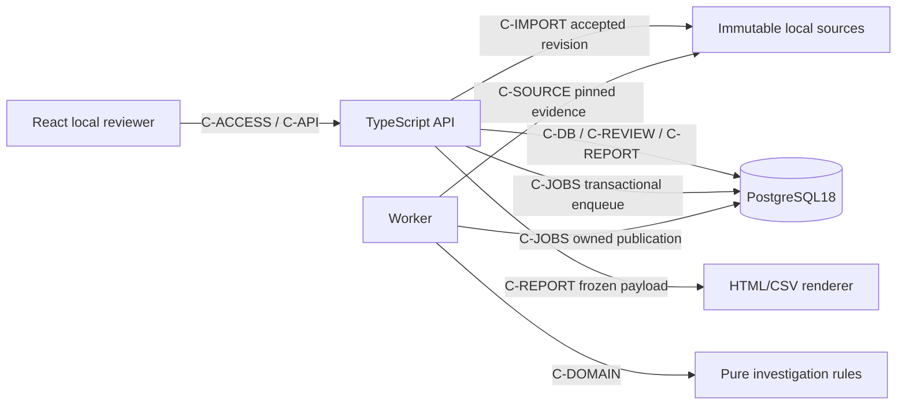
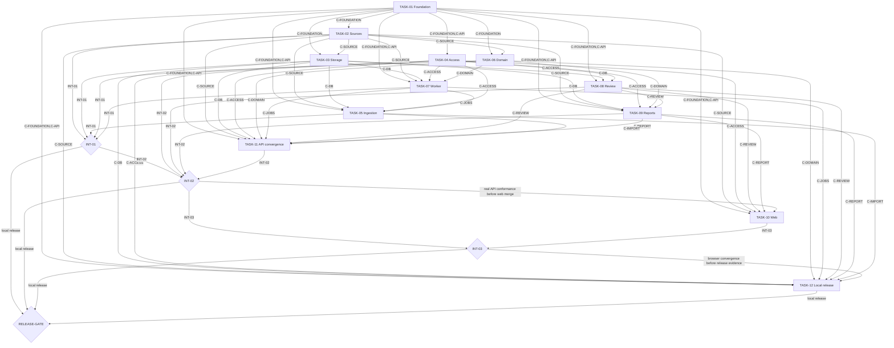

# Equivra — Contract-driven orchestration plan

Status: written planning pack complete; NOT READY for unrestricted delegation or implementation clearance. Only the foundation bootstrap can be considered next after explicit coding authorization. G0 actual runtime/command/provider evidence does not exist. No tracker issues, branches, commits or deployment created.

## 1. Project charter

Goal: a reproducible local synthetic payments investigation workbench, portfolio first and business alongside. A reviewer follows Stripe/bank/book evidence through exact rules, unresolved cases, versioned disposition and immutable report. Capacity10 hours/week. Accepted decisions: D3 payments, D5 synthetic/evidence/local, D7 web, D8 design, D9 HOLD SCOPE, D10 complete-bundle corrections, D11 temporary startup code, D12 up to10000 data rows/10MiB per source, D14 original API/worker/React/PostgreSQL arrangement. Preserve all nine approved acceptance criteria. No AI, hosting, real data, SaaS tenancy, payment movement, journal posting or universal adapters. Success is observable correctness/recovery and a shareable local demonstration; no customer-demand or performance result is assumed.

## 2. Codebase reconnaissance

Verified baseline: root README.md at aaf4eb3, branch main, no application code/package/test/CI/schema. Existing planning sources: docs/PRD.md, docs/designs/equivra-payments-workbench.md, docs/demo-scenarios.md, docs/repo_context.md. New code paths are CREATE. Host commands inspected: node --version=v25.8.1; npm --version=11.11.0; docker --version=29.0.1; git --version=2.50.1. Node24 container baseline and Docker daemon operation remain unverified. No repository unit/integration/E2E/build/typecheck/migration command currently exists. C-FOUNDATION defines proposed exact scripts; TASK-01 must establish evidence before consumers claim them verified. No code graph indexing is necessary for a README-only baseline.

## 3. Architecture Decision Register

Technical choices are frozen for planning under the invoked orchestrator architect role; implementation acceptance remains gated. A failed capability probe reopens an ADR with evidence, never silent builder improvisation.

| ID | Locked planning choice | Evidence/rationale | Rejected alternative | Affected |
|---|---|---|---|---|
| ADR-01 | One backend, API and worker entry points, React UI, PostgreSQL | D7 B/D14 A; avoid separate services and preserve interrupted-worker demonstration | No microservices/serverless pipeline | Contracts/packets for that boundary |
| ADR-02 | Node24LTS/compiled TS ESM, Fastify native JSON Schema, React/Vite | Conventional stack matching approved TypeScript shape; pin exact compatible versions in G0 | No Nest class layers, SSR or extra state framework | Contracts/packets for that boundary |
| ADR-03 | PostgreSQL18/parameterized node-postgres/numbered SQL | Explicit ownership/constraints and locks; no existing ORM to reuse | No alternate DB/ORM | Contracts/packets for that boundary |
| ADR-04 | pg-boss12.38.0 with same-client enqueue and transactional publication | Primary docs expose Db.executeSql and transactional handlers; executable capability proof at G0/T07 | No custom queue/outbox broker/Redis | Contracts/packets for that boundary |
| ADR-05 | Strict selected Stripe subset plus synthetic bank/books profiles | Exact financial/source semantics, supplied-scope-only; fields and fixtures in C-SOURCE | No arbitrary real exports | Contracts/packets for that boundary |
| ADR-06 | Exact BigInt cents internally, integer strings on JSON boundaries | D8 arithmetic; signed gross-fee=net; no floats or inferred fees | No currency conversion | Contracts/packets for that boundary |
| ADR-07 | Immutable whole-bundle revisions and run-owned results | D10 A; hashes cover source bytes+canonical manifest; no amount-only dedup | No file replacement in place | Contracts/packets for that boundary |
| ADR-08 | Run-first lock + case and aggregate review versions | D8 stale review/freeze guards; both completion orders have tests | No last-write-wins | Contracts/packets for that boundary |
| ADR-09 | Separate immutable snapshot payload, safe HTML/CSV rendering | D8 freeze/reproducibility; renderer cannot join mutable latest state | No renderer-time financial recomputation | Contracts/packets for that boundary |
| ADR-10 | Per-start in-memory Bearer code plus loopback/Host/Origin | D11 A; no cookie/password/account system | No public access or persistent token | Contracts/packets for that boundary |
| ADR-11 | Native Node tests; Playwright library for real browser boundaries | No existing test runner; use runtime-native runner for all families | No second test framework | Contracts/packets for that boundary |
| ADR-12 | Bounded10000 rows/10MiB/source, one heavy worker | D12 A; explicit limits/measurements, no invented latency SLA | No100000-row support promise | Contracts/packets for that boundary |

## 4. System invariants

| ID | Statement | Enforcement | Owning tasks / proof |
|---|---|---|---|
| INV-01 | Only the current-start code may access application data/actions; loopback/Host/Origin enforced; worker cannot insert reviewer decisions/snapshots. | Documented guards/constraints/transaction boundary in architecture and copied contracts | TASK-01,TASK-03,TASK-04,TASK-08,TASK-10,TASK-11,TASK-12; packet behavior tests and convergence gate |
| INV-02 | All monetary arithmetic uses exact integer cents, currency usd, source values preserved; gross-fee=net verified; no guessed fees. | Documented guards/constraints/transaction boundary in architecture and copied contracts | TASK-02,TASK-05,TASK-06,TASK-11,TASK-12; packet behavior tests and convergence gate |
| INV-03 | An accepted input pins a complete three-file immutable revision and durable run/job; no acknowledged partial or dangling bundle. | Documented guards/constraints/transaction boundary in architecture and copied contracts | TASK-02,TASK-03,TASK-05,TASK-07,TASK-11,TASK-12; packet behavior tests and convergence gate |
| INV-04 | Source event identities remain distinct; duplicate submission/recovery creates one owning financial result; corrections and stale jobs cannot overwrite other revisions. | Documented guards/constraints/transaction boundary in architecture and copied contracts | TASK-02,TASK-03,TASK-05,TASK-06,TASK-07,TASK-09,TASK-11,TASK-12; packet behavior tests and convergence gate |
| INV-05 | Review and freeze serialize against the same owning run; expected versions reject stale changes; exact-request replay returns the original committed result. | Documented guards/constraints/transaction boundary in architecture and copied contracts | TASK-03,TASK-08,TASK-09,TASK-10,TASK-11,TASK-12; packet behavior tests and convergence gate |
| INV-06 | Frozen snapshot captures all cases/facts/evidence/decisions; renderer uses that payload only; later corrections/reviews never change old facts. | Documented guards/constraints/transaction boundary in architecture and copied contracts | TASK-03,TASK-09,TASK-10,TASK-11,TASK-12; packet behavior tests and convergence gate |
| INV-07 | Incomplete/ambiguous/unsupported evidence remains explicit; a reviewer disposition or balanced supplied subtotal cannot prove complete real books. | Documented guards/constraints/transaction boundary in architecture and copied contracts | TASK-06,TASK-08,TASK-09,TASK-10,TASK-11,TASK-12; packet behavior tests and convergence gate |
| INV-08 | Enforce10000 data rows/10MiB per source and bounded parsing/errors; source text inert; secrets/raw rows absent from logs. | Documented guards/constraints/transaction boundary in architecture and copied contracts | TASK-01,TASK-02,TASK-04,TASK-05,TASK-07,TASK-08,TASK-09,TASK-10,TASK-11,TASK-12; packet behavior tests and convergence gate |
| INV-09 | Only observed command/test/benchmark/recovery outcomes count as evidence; synthetic local scope never implies hosted/real-data acceptance. | Documented guards/constraints/transaction boundary in architecture and copied contracts | TASK-01,TASK-12; packet behavior tests and convergence gate |

## 5. Component graph

| Component | Responsibility/data ownership | Owner |
|---|---|---|
| Protocol/foundation | Runtime/configuration/wire fixtures; no financial authority | TASK-01 |
| Source ingestion | Exact input/lineage and immutable bundle acceptance | TASK-02/TASK-05 |
| Database | Schema/constraints/grants/transaction helper | TASK-03 |
| Local access | Current-start access and browser boundary | TASK-04 |
| Financial rules | Exact supported/unknown facts; no I/O | TASK-06 |
| Jobs/worker | Durable owned processing/retries/publication | TASK-07 |
| Review | Append-only decisions and aggregate version | TASK-08 |
| Workpapers | Freeze/snapshot and inert exports | TASK-09 |
| Web | Accessible local journey; consumes protocol | TASK-10 |
| Assembly/release | Real cross-component evidence and runbook | TASK-11/TASK-12 |

All are modules/processes of one local application, not independently deployed domain services.

## 6. Contract registry

Ten full records follow. Design freeze is not executable freeze. All provider fields, inputs/outputs, pre/postconditions, errors, retry/order/security, lifecycle, fixtures, freeze/change protocol and verification are included.

### C-FOUNDATION — Runtime and verification interface

**Provider Component**
Foundation

**Provider Task**
TASK-01

**Consumers**
TASK-02, TASK-03, TASK-04, TASK-05, TASK-06, TASK-07, TASK-08, TASK-09, TASK-10, TASK-11, TASK-12

**Type**
runtime/config/commands

**Source Of Truth**
docs/architecture.md sections 1-3 and CREATE package.json, package-lock.json, tsconfig.server.json, web/package.json, Dockerfile, compose.yaml

**Inputs**
Node24 container baseline; local PostgreSQL18; DATABASE_URL local/test-only; EQUIVRA_DATA_DIR server-owned; loopback API127.0.0.1:4310. Separate API/worker/migration DB URLs; allow loopback or fixed Compose hostname db, not arbitrary remote hosts. Disposable tests require name equivra_test_<random hex>; never reset the primary DB.

**Outputs**
Pinned package/lockfile; ESM TypeScript build; script names typecheck, build, test:unit, test:integration, test:e2e, verify, db:migrate, start:api, start:worker. Host Node25 is not baseline proof.
Exact proposed package scripts (not current verified commands):
{
  "typecheck": "tsc --noEmit -p tsconfig.server.json && tsc --noEmit -p web/tsconfig.json",
  "build": "tsc -p tsconfig.server.json && npm --workspace web run build",
  "test:unit": "node --test dist/tests/unit/*.test.js",
  "test:integration": "node --test --test-concurrency=1 dist/tests/integration/*.test.js",
  "test:e2e": "node --test --test-concurrency=1 dist/tests/e2e/*.test.js",
  "verify": "npm run typecheck && npm run build && npm run test:unit && npm run test:integration && npm run test:e2e",
  "db:migrate": "node dist/db/migrate.js",
  "start:api": "node dist/server/main.js",
  "start:worker": "node dist/server/worker.js"
}
Test scripts must fail on absent suites; G0 records command definitions and the executable readiness of each family separately. Integration requires a disposable local test DB; browser tests use Playwright library under the Node runner. No automatic zero-test PASS. init:local = node scripts/init-local.mjs; generated .env must be0600, no overwrite/secret print; setup utility may run on host Node>=22 while actual app checks use Node24 container. Shared pure canonicalJson(value: JSONValue):string sorts object keys recursively, preserves array order, emits compact UTF8 JSON with ordinary JSON string escaping; disallow non-JSON/unsafe numeric values. CREATE shared/canonical.ts, used for bundle, request and snapshot hashes. Runtime symbols: server/config.ts loadConfig(env):AppConfig; server/db.ts openDb(url):Pool and withTransaction(pool, fn(client)):Promise<T>; server/app.ts createApp(config,deps:{db:Pool,boss:PgBoss}):Promise<FastifyInstance>. All app money remains strings.

**Preconditions**
No application currently exists. TASK-01 may create only its owned foundation files after implementation authorization.

**Postconditions**
Record exact commands and observed outcomes in docs/repo_context.md. Reject public host publication and wrong DB/test targets; ignore generated data/build/secret directories.

**Error Semantics**
Bad config or incompatible schema/runtime fails startup; never fall back to a remote database/public bind. Missing test families cannot be reported passing.

**Idempotency Retry**
Clean setup repeatable; no automatic destructive reset. migrations serialized.

**Ordering Concurrency**
Own shared root configuration once; later tasks may not casually edit scripts/lockfile.

**Fixture**
docs/contracts/examples/* existing data; CREATE tests/support/mock-api.ts during TASK-01 for the fixed API shapes in C-API.

**Freeze Point**
G0: package script definitions, pinned runtime/dependencies and command invocation results recorded; downstream command readiness remains blocked until this evidence exists.

**Verification**
Current verified host commands: node --version=v25.8.1, npm --version=11.11.0, docker --version=29.0.1, git --version=2.50.1. Planned commands are not repo-verified today. G0 must inspect package scripts and run defined checks in the selected Node24 environment.

**Lifecycle**
v1 is design-frozen after this plan review; executable freeze requires provider conformance and foundation evidence. No implicit backward-incompatible changes.

**Change Protocol**
Identify every consumer; update this record, examples, generated/typed interfaces, affected packets and edges; rerun conformance; re-sequence before merging a breaking change.

**Security**
Local synthetic demo only; protect application routes with current startup code, exact Host/Origin and owning-revision validation. Never expose secrets or local paths.
Binding contract: browser origin/Host127.0.0.1:4310; host-native listener127.0.0.1 only. Fixed Compose image listener0.0.0.0:4310 is internal only and MUST use host publication127.0.0.1:4310:4310; never public host publication. Reject arbitrary bind configuration. Docker peer IP is not authentication; Host/Origin/Bearer remain mandatory. Test published host interfaces and deny hostile Host/Origin.

### C-SOURCE — Three source profiles and exact normalization

**Provider Component**
Source ingestion

**Provider Task**
TASK-02

**Consumers**
TASK-03, TASK-05, TASK-06, TASK-07, TASK-09, TASK-10, TASK-11, TASK-12

**Type**
file/schema/function

**Source Of Truth**
docs/architecture.md sections 8-9; examples/manifest.json,stripe.csv,bank.csv,books.csv,books-corrected.csv,expected.json; CREATE shared/source.ts, shared/money.ts

**Inputs**
Manifest schema_version equivra.bundle.v1, workspace_id demo, source_account_id acct_demo, currency usd, period and per-source half-open date coverage. Exact header arrays in architecture section9. UTF8 CSV, at most10000 data records and10485760 bytes/file; field4096 codepoints, description2048, record32768 bytes. Dates real UTC/RFC3339Z or YYYY-MM-DD as specified. External IDs ASCII [A-Za-z0-9_:-]{1,128}.
###### Manifest v1

`{schema_version:'equivra.bundle.v1',workspace_id:'demo',source_account_id:'acct_demo',currency:'usd',period:{start:YYYY-MM-DD,end_exclusive:YYYY-MM-DD},coverage:{stripe:{start,end_exclusive},bank:{start,end_exclusive},books:{start,end_exclusive}}}`. Dates are real calendar dates, UTC interpretation, start<end, max370 days per range. Period must be contained in each declared coverage; adjacent-period evidence is permitted. These are supplied-scope declarations, not independent proofs that all activity was exported. Actual row event/posting dates must lie within their declared source coverage.

###### Source schemas

| Source | Exact CSV headers and constraints |
|---|---|
| stripe | `balance_transaction_id,created_utc,available_on_utc,currency,gross,fee,net,reporting_category,automatic_payout_id,automatic_payout_effective_at_utc,source_id,charge_id` |
| bank | `bank_row_id,posted_on,currency,amount,payout_ref,description` |
| books | `entry_id,posted_on,currency,amount,processor_ref,description` |

Stripe `created_utc`, `available_on_utc`, `automatic_payout_effective_at_utc` are RFC3339 UTC strings ending Z. created/available required; payout-effective may be empty only when payout_id empty. bank/books posted_on is YYYY-MM-DD. currency must be usd. IDs balance_transaction_id/bank_row_id/entry_id are required and unique within their source; a duplicated ID is invalid even with equal values. Required nonidentity references may be empty and create an incomplete/unsupported relationship; never synthesize references from amounts.

Money accepts a signed decimal with up to10 integer digits and optional1–2 fractional digits, no exponent/thousands/currency symbols/whitespace; normalize to BigInt cents and preserve original text. Bound absolute row amount at9999999999.99 USD. `gross - fee == net` must hold exactly; failure is INVALID_MONEY_BRIDGE rather than an AI-correctable difference. Negative fees are accepted only as supplied exact source values, not invented refunds. Aggregate bounds fit signed64-bit cents for the approved row envelope; check before serialization/storage.

Stripe supported categories: `charge`, `refund`, `dispute`, `dispute_reversal`; all other valid categories remain `unsupported` evidence cases and prevent a claim that the affected payout lifecycle is fully supported. `source_id` identifies related processor object; charge_id groups original-payment lineage, not event identity. Dispute reversal needs an explicit supplied source/charge link; if its exact dispute reference cannot be established, show both movements and limited lineage without asserting same-dispute resolution. No heuristic charge-level identity substitutes for an absent dispute identity.

Books is **net activity in a synthetic processor clearing account**, not a general ledger export. Positive amount increases that clearing balance; negative decreases it. processor_ref must reference a Stripe balance_transaction_id for a supported direct relationship. Multiple book lines with the same processor_ref may sum to that event's net; preserve all entry_ids and compare exact signed totals. This profile excludes bank-transfer/payout-clearing journal lines so it does not double-count settlement. Unlinked or out-of-profile references remain unresolved; no accounting treatment is prescribed.

**Outputs**
ParsedSource={kind:stripe|bank|books,sha256,bytes,row_count,rows:[{row_no,raw_fields,normalized}]}; raw_fields maps exact headers to original strings. Stripe normalized fields preserve IDs/dates/category and gross_minor,fee_minor,net_minor integer strings; bank normalized amount_minor and payout_ref; books normalized amount_minor and processor_ref. parseMoney(decimal:string):string returns signed cents (no exponent; <=10 integer digits,<=2 decimals). Exports validateManifest(value:unknown):Manifest, parseMoney(decimal:string):string and parseSource(kind, bytes:AsyncIterable<Uint8Array>, coverage):Promise<ParsedSource>; callers may not depend on parser private helpers.

**Preconditions**
All three kinds supplied; manifest range start<end_exclusive and <=370 days; period lies in each coverage; each row date inside its declared coverage. No filename/path used as storage authority.

**Postconditions**
Exact gross-fee=net; no unsafe rounding. Header-only source accepted as zero observations with explicit coverage warning; zero-byte/malformed source rejected. Distinct external IDs survive identical amounts; duplicate source identity rejected. No claim of actual complete financial records.

**Error Semantics**
422 INVALID_MANIFEST, INVALID_SOURCE, INVALID_UTF8, INVALID_MONEY_BRIDGE, DUPLICATE_SOURCE_ID, UNSUPPORTED_CURRENCY;413 LIMIT_EXCEEDED; diagnostics<=50 entries plus truncated flag, no accepted partial bundle.

**Idempotency Retry**
Pure normalization repeatable; SHA covers original bytes. Corrected full bundle creates new revision; raw source never edited.

**Ordering Concurrency**
No state mutation. Stable row_no refers to logical CSV record after header, including quoted multiline fields as one record.

**Fixture**
Existing example bundle/expected.json plus corrected-books example; TASK-02 must create remaining S2-S8 cases before their consumers merge.

**Freeze Point**
Design shape now; executable parser/fixture conformance after TASK-02. Consumer may use documented example and schema before provider internals.

**Verification**
Unit table cases for exact money, Unicode/CSV limits, malformed/empty source, duplicate identity; existing example must yield6680 payout subtotal and incomplete refund books evidence. Planned npm run test:unit after G0; never assert it ran now.

**Lifecycle**
v1 is design-frozen after this plan review; executable freeze requires provider conformance and foundation evidence. No implicit backward-incompatible changes.

**Change Protocol**
Identify every consumer; update this record, examples, generated/typed interfaces, affected packets and edges; rerun conformance; re-sequence before merging a breaking change.

**Security**
Local synthetic demo only; protect application routes with current startup code, exact Host/Origin and owning-revision validation. Never expose secrets or local paths.

### C-DB — Revision-owned durable storage and transaction boundary

**Provider Component**
PostgreSQL storage

**Provider Task**
TASK-03

**Consumers**
TASK-05, TASK-07, TASK-08, TASK-09, TASK-11, TASK-12

**Type**
storage/migration

**Source Of Truth**
docs/architecture.md section4; CREATE db/001_initial.sql,db/migrate.ts,server/db.ts

**Inputs**
bundle/files/rows/run/case_record/decision/snapshot/request_result/audit_event fields and constraints exactly listed in architecture section4. UUID owners, immutable source+snapshot+decision facts; raw and normalized JSONB values; money strings.
##### 4. Database Architecture

**CREATE** `db/001_initial.sql` and `db/migrate.ts`. Use `equivra` application schema and pg-boss-owned queue schema. No process edits pg-boss internal tables. Application migration version and expected queue version are checked at startup; migrations run as a separate coordinated step, not silently on every API start. Back up DB and source directory together before upgrades.

All identifiers are server-generated UUIDs except synthetic external IDs. JSONB financial amounts are signed integer-minor-unit strings; never JSON floating-point dollars. Immutable objects have `created_at timestamptz`; chronology is not identity. SQL names snake_case; TypeScript/wire names snake_case at boundaries to avoid conversion wrappers.

| Table | Columns and constraints |
|---|---|
| schema_version | `version integer primary key`, `applied_at timestamptz not null`; ordered migrations |
| bundle | `id uuid pk`, `content_key text unique not null`, `manifest jsonb not null`, `created_at`; content_key covers profile/rules-independent canonical manifest + source kind/hash pairs, not filename |
| source_file | `id uuid pk`, `bundle_id fk bundle`, `kind text check in stripe,bank,books`, `sha256 text`, `storage_key text unique`, `bytes bigint check 0<bytes<=10485760`, `row_count integer check 0<=row_count<=10000`; unique(bundle_id,kind) |
| source_row | `id uuid pk`, `source_file_id fk`, `row_no integer check >0`, `raw_fields jsonb`, `normalized jsonb`; unique(source_file_id,row_no); rows immutable |
| run | `id uuid pk`, `bundle_id fk`, `rule_version text`, `job_id uuid unique`, `state text check queued,running,completed,failed`, `review_version integer default 0 check >=0`, `error_code text nullable`, `result jsonb nullable`; unique(bundle_id,rule_version); completed requires nonnull result; incomplete/ambiguous are result evidence states, not worker failure |
| case_record | `id uuid pk`, `run_id fk`, `case_key text`, `kind text`, `evidence_state text check supported,difference,incomplete,ambiguous,unsupported`, `facts jsonb`, `evidence jsonb`; unique(run_id,case_key); evidence references must resolve within the run's bundle in validated publication transaction |
| decision | `id uuid pk`, `case_id fk`, `version integer >0`, `disposition text check noted,needs_evidence`, `note text <=2000 code points`, `created_at`; unique(case_id,version); append-only; current case version is max decision version or 0 |
| snapshot | `id uuid pk`, `run_id fk`, `review_version integer`, `payload jsonb`, `payload_sha256 text`, `created_at`; unique(run_id,review_version); immutable; includes all case facts, source references, coverage and decisions |
| request_result | `operation text`, `key uuid`, `request_sha256 text`, `response jsonb`, `created_at`; pk(operation,key); durable exact-request replay for review/freeze; mismatched reuse is 409 |
| audit_event | `id uuid pk`, `operation text`, `object_id uuid`, `correlation_id uuid`, `actor text fixed local_reviewer or worker`, `versions jsonb`, `created_at`; no raw notes, secret or source content |

Indexes: source_file(bundle_id,kind); source_row(source_file_id,row_no); case_record(run_id,case_key); decision(case_id,version desc); snapshot(run_id,review_version); run(bundle_id,rule_version); audit_event(object_id,created_at). Existing unique indexes satisfy overlapping lookups; do not duplicate them. No query-per-evidence-row: load one page's referenced rows in a bounded query.

Foreign keys use RESTRICT for history-bearing evidence; no cascade deletion that can erase frozen lineage. API and worker roles have no UPDATE/DELETE on immutable facts/source/snapshot/decision tables after migration; the worker role additionally has no INSERT on decision, snapshot or request_result and cannot change run.review_version; mutable run state/version and replay/audit writes use narrowly required grants. The coordinated migration role is separate configuration. Source/reference integrity is enforced before publication and before freeze; frozen payload references carry source hash/kind/row, not a browser-provided path.

###### Transactions and ordering

- Upload: unique content_key chooses one accepted bundle; create its exactly three file references, normalized rows and run, and enqueue using the same node-postgres client via pg-boss `Db.executeSql`. On duplicate race, roll back loser staging and return the existing identity; changed manifest or bytes means a different bundle. Valid separate external transaction IDs are never collapsed by equal amount.
- Worker: pg-boss transactional worker owns result publication and completion together; all writes use its provided transaction adapter, not another pool. Unique run/case ownership is an additional safety net. If computation exceeds the configured deadline, fail/retry; never silently switch to nontransactional publication. Lost claim must roll back writes. Do not add an application `running` commit that can outlive an unrecorded failed attempt; UI derives active/retry status from the durable queue state plus run outcome.
- Review: begin, lock run row `FOR UPDATE`, validate case belongs to run, compare expected case version, append decision, increment run.review_version, append audit/replay result, commit. Lock order is run first, then case-associated records everywhere.
- Freeze: begin, lock same run row, verify completed and expected review_version, copy canonical sorted facts/evidence/decisions/coverage into snapshot, save replay/audit result, commit. A later review increments the aggregate and yields a new draft/version; old snapshot never mutates.
- Idempotency lookup happens before stale-version validation for a previously committed matching key, so a lost-response retry can return its original result even if newer reviews exist. A key with different request bytes is 409 `IDEMPOTENCY_CONFLICT`.

**Outputs**
openDb(config), withTransaction(fn(client)), parameterized client.query, migration version and local-only connection checks. SQL table/column/index/RESTRICT/grant contract in architecture section4 is authoritative.

**Preconditions**
G0 runtime available; migration role distinct from restricted application role; dedicated disposable test database for integration.

**Postconditions**
No dangling accepted bundle, no cross-revision evidence references, no immutable-row overwrite; completed run has deterministic result; run aggregate review_version coordinates all case decisions/freeze.

**Error Semantics**
FK/unique/check or expected-version violation rolls back; map known ownership/stale conflicts to409 and unknown DB outages to503; no raw SQL/URL to client.

**Idempotency Retry**
Ordered migrations and transaction rollback; never destructive automatic reset. request_result(operation,key) preserves exact committed request replay.

**Ordering Concurrency**
Lock order run row first; review and freeze both SELECT FOR UPDATE same run. No network/filesystem work inside API review/freeze transaction.

**Fixture**
Existing source examples + CREATE tests/support/database.ts isolated test DB helper and source/run seed fixture.

**Freeze Point**
Schema/source-of-truth freeze after migration and grant/concurrency conformance; consumers may start from schema document once G0 is established but may not merge on mocked DB evidence alone.

**Verification**
Real PostgreSQL migration/re-run, unique/FK checks, immutable-role denial and rollback tests; planned npm run db:migrate and npm run test:integration only after G0.

**Lifecycle**
v1 is design-frozen after this plan review; executable freeze requires provider conformance and foundation evidence. No implicit backward-incompatible changes.

**Change Protocol**
Identify every consumer; update this record, examples, generated/typed interfaces, affected packets and edges; rerun conformance; re-sequence before merging a breaking change.

**Security**
Local synthetic demo only; protect application routes with current startup code, exact Host/Origin and owning-revision validation. Never expose secrets or local paths.

### C-DOMAIN — Deterministic evidence investigation

**Provider Component**
Financial domain

**Provider Task**
TASK-06

**Consumers**
TASK-07, TASK-09, TASK-11, TASK-12

**Type**
function/schema

**Source Of Truth**
docs/architecture.md section9; docs/demo-scenarios.md; CREATE shared/investigate.ts

**Inputs**
NormalizedBundle={manifest,sources:{stripe:ParsedSource,bank:ParsedSource,books:ParsedSource}}. Exact refs only. Rule version equivra.rules.v1.
###### Deterministic investigation v1

1. Group source Stripe rows by explicit automatic_payout_id; sum supplied net for a **subtotal of supplied rows**. Unknown categories/missing membership create coverage issues. Same-ID event conflicts reject source; distinct IDs survive equal values.
2. For a payout, candidate bank rows are exact nonempty payout_ref matches. One row with equal currency and amount supports the relation *within supplied scope*. Zero yields missing bank evidence; more than one yields ambiguity, never first match or automatic combination. A mismatched amount creates a difference with both source amounts, not a loss claim. Same-amount rows without a reference remain unlinked/ambiguous evidence; do not create allocations by amount/date.
3. For each Stripe balance event, exact processor_ref book lines sum to its supplied net. Zero linked rows yields missing book evidence; unequal sum yields difference; equal sum supports only that direct source relation. Extra/unreferenced books/bank rows remain explicit unlinked observations. Do not claim a zero subtotal proves complete books.
4. Refund partiality can be shown relative to explicitly linked original charge; sum identified refunds against supplied original gross, never assume original fee was refunded. A missing original charge limits interpretation.
5. Display supplied dispute withdrawal/reversal independently, with exact net movements; principal comparisons use supplied gross, fees separately. No permanent-loss or win inference from only a generic charge link.
6. Label timing using the distinct source dates and declared windows. No arbitrary days-of-tolerance auto-match. A reference and amount can support an adjacent-window relation while its dates differ; missing adjacent evidence stays incomplete.
7. Output sorted deterministic case keys and evidence rows. Supported relations and reviewer dispositions are separate fields. Run coverage always states `supplied_scope_only`; complete run means computation completed, not real financial completeness.

###### Case taxonomy and exact comparison semantics

Kinds: payout_bank, event_books, unlinked_bank, unlinked_books, unsupported_category, refund_lifecycle, dispute_lifecycle, timing. States: supported, difference, incomplete, ambiguous, unsupported. Summary contains a count for each state plus cases_total. For an exact amount comparison with both values present, delta_minor=observed_minor-expected_minor; unequal known amounts use difference, never missing-evidence classification. If observed evidence is absent, observed_minor and delta_minor are null, not zero. Lifecycle metadata need not be a monetary comparison: delta_minor=null when no comparison is meaningful.

Reason codes: MATCHED_REFERENCE, MISSING_BANK_EVIDENCE, AMBIGUOUS_BANK_REFERENCE, UNLINKED_BANK_REFERENCE, BANK_AMOUNT_DIFFERENCE, MISSING_BOOK_EVIDENCE, BOOK_AMOUNT_DIFFERENCE, UNLINKED_BOOK_REFERENCE, UNSUPPORTED_CATEGORY, MISSING_PAYOUT_MEMBERSHIP, PARTIAL_REFUND_IN_SUPPLIED_SCOPE, REFUND_EXCEEDS_SUPPLIED_CHARGE, MISSING_ORIGINAL_CHARGE, DISPUTE_REVERSAL_PRESENT, UNPAIRED_DISPUTE_MOVEMENT, AMBIGUOUS_DISPUTE_LINEAGE, CROSS_PERIOD_TIMING. Case keys follow C-DOMAIN. An unlinked bank row with an amount equal to a payout but no ref remains ambiguous/unlinked; it never consumes an allocation.

Refund lifecycle: for supplied original charge_id, compare sum of absolute negative identified refund gross values with positive original charge gross. At or below original is supported supplied-scope refund metadata, not a bank match; greater is difference. Missing original is incomplete. Do not compare fees as if refunded unless supplied. Dispute lifecycle: only source_id explicitly beginning dp_ plus exactly one withdrawal and one reversal of the same dispute can support reversal-present metadata; gross principal total zero is supported and nonzero is difference. Absent partner is incomplete, multiple candidate withdrawal/reversal records or only a shared charge_id is ambiguous. All underlying movements remain visible; none is labeled a permanent loss or a dispute win. Temporal case uses explicitly linked payout/deposit dates, not a heuristic matching tolerance.

**Outputs**
Investigation={rule_version,coverage:{basis:supplied_scope_only,observed_rows:{stripe,bank,books},warnings:[code]},summary:{cases_total,supported,difference,incomplete,ambiguous,unsupported},cases:[{case_key,kind,evidence_state,facts,evidence}]}. facts={currency:usd,expected_minor:string|null,observed_minor:string|null,delta_minor:string|null,reason_code:string,references:map of allowed payout_id,balance_transaction_id,charge_id,dispute_id}. Evidence={source_kind,row_no,source_sha256}. evidence_state supports five values including difference; exact taxonomy, delta/null and lifecycle rules pasted above are binding. Export investigate(bundle:NormalizedBundle):Investigation. Domain functions have no I/O; persistent case UUID/run/version are added only by worker publication.

**Preconditions**
Validated pinned normalized source bundle; no floats, DB, HTTP, filesystem or model.

**Postconditions**
Bank uses exact payout_ref and exactly one candidate+amount/currency; 0=incomplete,>1=ambiguous, unequal=difference. Books sums exact processor_ref lines for each balance event; missing=no observed/delta amount. Unknown categories=unsupported, same amount alone never supports. All unlinked observations explicit. Sort case_key and evidence deterministically; no duplicate economic allocation.

**Error Semantics**
Domain schema/invariant error fails run, not empty success; known incomplete/ambiguous/unsupported are case states, not exceptions. Never infer permanent loss or invent fee refunds/dispute identity.

**Idempotency Retry**
Same input+rule yields same case keys/facts/evidence. Case UUIDs are persistence identities, not arbitrary matching decisions.

**Ordering Concurrency**
Keys: payout:<payout_id>:bank; event:<balance_transaction_id>:books; event:<balance_transaction_id>:unsupported; bank:<bank_row_id>:unlinked; books:<entry_id>:unlinked; charge:<charge_id>:refunds; dispute:<source_id>:lifecycle only with explicit same dispute identity. No dependence on source order except evidence row locations.

**Fixture**
docs/contracts/examples/expected.json and docs/demo-scenarios.md; TASK-02 supplies normalized S2-S8 fixtures before final conformance.

**Freeze Point**
Shape frozen now; executable freeze after TASK-06 proves every supported rule and uncertainty case against source fixtures.

**Verification**
Unit fixture/properties: S1 subtotal6680 and missing refund, corrected books delta0, S2 principal reversal without invented fee, S3 dates, S4 reordered equal amounts; all gross/fee/net integer strings. Planned test:unit after G0.

**Lifecycle**
v1 is design-frozen after this plan review; executable freeze requires provider conformance and foundation evidence. No implicit backward-incompatible changes.

**Change Protocol**
Identify every consumer; update this record, examples, generated/typed interfaces, affected packets and edges; rerun conformance; re-sequence before merging a breaking change.

**Security**
Local synthetic demo only; protect application routes with current startup code, exact Host/Origin and owning-revision validation. Never expose secrets or local paths.

### C-JOBS — Transactional enqueue, retries and publication

**Provider Component**
Worker/jobs

**Provider Task**
TASK-07

**Consumers**
TASK-05, TASK-11, TASK-12

**Type**
queue/function/config

**Source Of Truth**
docs/architecture.md sections4,5,7; CREATE server/jobs.ts,server/worker.ts

**Inputs**
queue equivra-investigate-v1; payload={schema_version:1,run_id:uuid,bundle_id:uuid,rule_version:equivra.rules.v1}; enqueue(transaction,payload) uses pg-boss db.executeSql bound to same client; no raw file bodies.

**Outputs**
Durable job ID and state; worker writes one result/case set for owned run and completes atomically. API status merges durable queue attempt state with application outcome; eligible retry endpoint creates new job ID on same failed run under lock/replay guard. Exports enqueueInvestigation(client:PoolClient,boss:PgBoss,payload:JobPayload):Promise<{job_id:string}>, readRunStatus(db:Pool,boss:PgBoss,run_id:string):Promise<RunWire>, registerJobRoutes(app,deps:{db:Pool,boss:PgBoss}):Promise<void>. worker.ts owns process startup; handler calls investigate then writes only through queue transaction. Source/file verification failures are terminal integrity errors. configure explicit retentionSeconds315360000 and deleteAfterSeconds0, plus persistent application terminal state before cleanup; test version semantics, never claim infinite queue retention.

**Preconditions**
G0 pinned pg-boss12.38.0 compatibility; C-DB source/run identity and C-DOMAIN behavior; queue schema installed explicitly.

**Postconditions**
Zero acknowledged run-without-job; zero duplicate result on crash/retry; stale/lost queue claim cannot commit; old revision may complete only under itself. Completed snapshot unaffected.

**Error Semantics**
Retry transient connection/interruption only; malformed input/integrity not eligible manual retry. Queued/running/completed run not manually retried. Missing queue state is diagnostic503, never completed. Sanitize exhausted failure; persist terminal application outcome before queue cleanup.

**Idempotency Retry**
RetryLimit2,delay2s,exponential,max30s; expire120s,transaction timeout125s; concurrency1; heartbeat30s if version mode supports. Manual retry requires expected_job_id+Idempotency-Key and visible eligibility. No direct queue-table update.

**Ordering Concurrency**
pg-boss transactional worker uses its supplied transaction for all publication; guard run current job_id and unique case keys. Enqueue atomically with accepted bundle/run via provided Db adapter. Use exact current library contract; stop/intake failure on mismatch, no silent fallback.

**Fixture**
CREATE tests/support/job-contract.ts under TASK-01 documents mock enqueue/status shapes; real DB tests in TASK-07 prove rollback/completion beyond mocks.

**Freeze Point**
Design shapes now; executable freeze after TASK-07 demonstrates enqueue rollback, before/after commit interruption and lost-claim publication rejection.

**Verification**
Real PostgreSQL integration barriers for both publication orders; kill/restart worker with stable result; terminal errors visible; planned test:integration after G0. No queue guarantee is assumed to prove application idempotence by itself.

**Lifecycle**
v1 is design-frozen after this plan review; executable freeze requires provider conformance and foundation evidence. No implicit backward-incompatible changes.

**Change Protocol**
Identify every consumer; update this record, examples, generated/typed interfaces, affected packets and edges; rerun conformance; re-sequence before merging a breaking change.

**Security**
Local synthetic demo only; protect application routes with current startup code, exact Host/Origin and owning-revision validation. Never expose secrets or local paths.

### C-ACCESS — Local current-start access and browser boundary

**Provider Component**
Local API access

**Provider Task**
TASK-04

**Consumers**
TASK-05, TASK-07, TASK-08, TASK-09, TASK-10, TASK-11, TASK-12

**Type**
HTTP/config/security

**Source Of Truth**
docs/architecture.md section6; CREATE server/access.ts; serialized registration into server/app.ts

**Inputs**
Authorization: Bearer <current 32-random-byte base64url code>; Host127.0.0.1:4310; exact Origin http://127.0.0.1:4310 on browser mutations; reject null/cross-site; JSON64KiB, multipart31MiB limits.

**Outputs**
Current code permits protected route processing, not a data/ownership bypass. Static shell and minimal /health are unauthenticated with no application data. Code enters browser memory only; refresh/new tab requires re-entry; API restart invalidates previous code. Export registerAccess(app:FastifyInstance, config:{startup_code:string,origin:string,host:string}):Promise<void>; mounts protected-prefix hook before feature routes.

**Preconditions**
API binds loopback only, does not trust forwarding headers; startup shows code intentionally in terminal, never structured logs, URL or file.

**Postconditions**
Missing/wrong/old code denied; proper Origin/Host still required with valid code; all application reads/actions/downloads protected. No SaaS accounts or real-data claim.

**Error Semantics**
401 INVALID_ACCESS,403 ORIGIN_REJECTED/HOST_REJECTED,429 after30 failed attempts/60s; safe generic response. Constant-time equal-length comparison; do not echo submitted code.

**Idempotency Retry**
New code per API start; no persistent sessions/cookies/storage; no automatic mutation retries after401.

**Ordering Concurrency**
Guard at global protected-route boundary before domain/parser work; worker internal DB access is not a browser session.

**Fixture**
CREATE tests/support/access.ts fixtures for a current/wrong/previous code, allowed/disallowed origins and hosts; consumer tests use injected application runtime code through normal config wiring.

**Freeze Point**
Executable freeze after TASK-04 negative/current restart tests; UI can start from documented responses after G0 mock fixture.

**Verification**
API negative/positive cases and Node-driven browser test: reload code entry, no storage/URL/log leaks, cross-site mutation forbidden. Planned unit/integration/e2e families after G0.

**Lifecycle**
v1 is design-frozen after this plan review; executable freeze requires provider conformance and foundation evidence. No implicit backward-incompatible changes.

**Change Protocol**
Identify every consumer; update this record, examples, generated/typed interfaces, affected packets and edges; rerun conformance; re-sequence before merging a breaking change.

**Security**
Local synthetic demo only; protect application routes with current startup code, exact Host/Origin and owning-revision validation. Never expose secrets or local paths.
Binding contract: browser origin/Host127.0.0.1:4310; host-native listener127.0.0.1 only. Fixed Compose image listener0.0.0.0:4310 is internal only and MUST use host publication127.0.0.1:4310:4310; never public host publication. Reject arbitrary bind configuration. Docker peer IP is not authentication; Host/Origin/Bearer remain mandatory. Test published host interfaces and deny hostile Host/Origin.

### C-API — Browser/API wire protocol and UI state handoff

**Provider Component**
Protocol foundation

**Provider Task**
TASK-01

**Consumers**
TASK-04, TASK-05, TASK-07, TASK-08, TASK-09, TASK-10, TASK-11, TASK-12

**Type**
HTTP/UI/schema

**Source Of Truth**
docs/architecture.md section5; CREATE shared/api.ts (initial interface owned TASK-01; runtime provider TASK-11), server/app.ts (serial assembly)

**Inputs**
Exact method/path/body/header/query definitions in architecture section5, including full bundle multipart, paginated run cases, expected-version decision/freeze, eligible failed-run retry and frozen export. Idempotency-Key UUID required for decision/freeze/retry.
##### 5. API Architecture

All `/api/v1` responses are JSON except download. IDs are UUID strings. All money is minor-unit integer strings with currency `usd`; reject JSON numeric money. Dates/timestamps are strings under the source contract. Success is `{data:<payload>}`. Errors are `{error:{code:string,message:string,correlation_id:uuid,details?:[{source?,row?,field?,code}]}}`; at most 50 detail entries plus `truncated:boolean` when applicable. Never return stack traces, local paths or secrets.

| Method/path | Request | Success payload | Failure codes/status |
|---|---|---|---|
| GET `/health` | None; no auth; no application data | 200 `{status:'ready'|'not_ready'}`; 503 not_ready when DB/schema incompatible | No secret/config dump |
| POST `/api/v1/bundles` | Multipart `manifest` JSON and exactly `stripe`,`bank`,`books` CSV files; contract SOURCE | 202 new `{bundle_id,run_id,state:'queued',reused:false}`; 200 identical accepted bundle `{bundle_id,run_id,state,reused:true}` | 400 MALFORMED_REQUEST; 413 LIMIT_EXCEEDED; 422 INVALID_SOURCE/MANIFEST; 503 DEPENDENCY_UNAVAILABLE |
| GET `/api/v1/bundles/:id` | None | `{id,manifest,sources:[{kind,sha256,bytes,row_count,preview:[{row_no,raw_fields}]} (preview max25 rows/source)],run_id}` | 404 NOT_FOUND |
| GET `/api/v1/runs/:id` | None | `{id,bundle_id,state,attempt,review_version,coverage,result_summary?,error_code?}`; state queued/running/retrying/failed/completed derived from durable queue and run | 404; 503 unavailable; never infer completed from missing queue row |
| GET `/api/v1/runs/:id/cases?after=&limit=` | limit integer 1..100 default25; after opaque validated key from same run | `{items:[Case],next_cursor:string|null,review_version}` sorted by stable case_key | 400 INVALID_CURSOR/LIMIT;404 |
| GET `/api/v1/cases/:id` | None | `Case` plus `evidence_rows:[EvidenceRow]`, `latest_decision:Decision|null`, `case_version:integer` | 404;409 EVIDENCE_INTEGRITY;503 |
| POST `/api/v1/runs/:id/retry` | JSON `{expected_job_id:uuid}`; `Idempotency-Key:uuid`; failed eligible transient job only | 202 `{run_id,job_id,state:'queued'}`; exact replay same | 404;409 NOT_RETRYABLE/STALE_VERSION/IDEMPOTENCY_CONFLICT |
| POST `/api/v1/cases/:id/decisions` | JSON `{expected_case_version:int>=0,disposition:'noted'|'needs_evidence',note:string<=2000}`; `Idempotency-Key:uuid` | 201 `{decision_id,case_version,run_id,review_version}`; matching replay returns same payload/status | 400 schema;404;409 STALE_VERSION/IDEMPOTENCY_CONFLICT |
| POST `/api/v1/runs/:id/snapshots` | JSON `{expected_review_version:int>=0}`; `Idempotency-Key:uuid` | 201 `{snapshot_id,run_id,review_version,payload_sha256}`; matching replay same | 404;409 RUN_NOT_COMPLETE/STALE_VERSION/IDEMPOTENCY_CONFLICT/EVIDENCE_INTEGRITY |
| GET `/api/v1/snapshots/:id` | None | `{id,run_id,review_version,payload_sha256,payload:Snapshot}` | 404;409 integrity |
| GET `/api/v1/snapshots/:id/export?format=html|csv` | Explicit format | 200 attachment `equivra-<snapshot UUID>.html|csv`, correct content type; fixed snapshot facts | 400 INVALID_FORMAT;404;409 integrity;503 EXPORT_UNAVAILABLE |

Common protected-route failures: 401 INVALID_ACCESS, 403 ORIGIN_REJECTED/HOST_REJECTED, 405 method, 415 unsupported content type, 500 INTERNAL_ERROR with safe correlation ID. State-changing GET is prohibited. Browser mutating routes require exact configured Origin and reject `null`; also reject `Sec-Fetch-Site: cross-site`. Do not rely on CORS to reject mutations. Unsupported methods/content types are rejected before any write. JSON request max64 KiB; multipart total max31 MiB, per file10 MiB, manifest64 KiB.

`Case={id,run_id,case_key,kind,evidence_state (supported|difference|incomplete|ambiguous|unsupported),facts,evidence:[{source_kind,row_no,source_sha256}],case_version}`. `EvidenceRow={source_kind,row_no,source_sha256,raw_fields,normalized}`. `Decision={id,version,disposition,note,created_at}`. `Snapshot={schema_version:'equivra.snapshot.v1',run_id,bundle_id,rule_version,review_version,manifest,source_hashes,cases:[Case with latest_decision],summary,coverage}`. All dynamic strings escaped at render; schema-defined maps/lists cannot contain arbitrary instructions or executable content. Every evidence reference is validated against its bundle.

Manual retry uses the documented run retry endpoint, preserving the approved eligible-retry workflow. Lock the run and require a terminal failed current job plus expected_job_id. Reject completed, active, queued, stale, malformed-input or integrity-failed runs as NOT_RETRYABLE/STALE_VERSION. A retryable dependency/interruption failure creates a new job ID in the same transaction as updating that run's current job_id/state; prior job/audit lineage stays intact. Queue payload still pins the same bundle/run/rule. Repeated matching Idempotency-Key returns the original queued response. Never reset a frozen report or accept a silent changed bundle. T07's queue adapter owns terminal-state observation and must prove the pinned library path without direct queue-table mutations.

**Outputs**
JSON {data:payload}; errors {error:{code,message,correlation_id,details?,truncated?}}. UUID IDs; minor amounts strings; null represents absent observed/delta evidence. Case/EvidenceRow/Decision/Snapshot exact shapes in architecture section5. TASK-01 owns the shared wire shape/mock freeze; TASK-11 assembles runtime providers and proves conformance, not a competing schema owner. Facts={currency:usd,expected_minor:string|null,observed_minor:string|null,delta_minor:string|null,reason_code:enum defined in architecture9,references:{payout_id?,balance_transaction_id?,charge_id?,dispute_id?}}. Evidence states supported|difference|incomplete|ambiguous|unsupported. Run result_summary={cases_total,supported,difference,incomplete,ambiguous,unsupported}; coverage={basis:supplied_scope_only,observed_rows:{stripe,bank,books},warnings:[code]}; attempt is0 before claim then positive. Multi-query read responses use one read-only repeatable snapshot, not mixed latest queries. Assembly calls registerAccess, registerImportRoutes, registerJobRoutes, registerReviewRoutes, registerReportRoutes in that order, then serves built static UI. No protected handler is mounted outside access hook. JSON reads needing several SQL statements use one read-only repeatable snapshot. Errors always place truncated inside error, not the outer envelope.

**Preconditions**
C-ACCESS and ownership guards; frozen doc/examples plus TASK-01 mock fixture before UI starts. All future symbols marked CREATE, not existing implementation.

**Postconditions**
No body data on invalid access, no silent partial-complete, no stale override, no bare report generated from current mutable state. limit1..100 default25; source refs validated under owning revision.

**Error Semantics**
400 malformed/schema/query,401 access,403 origin/host,404 missing ID,409 stale/replay/integrity/not-retryable,413 bounds,415 content type,422 source invalid,429 access throttle,500 safe unknown,503 unavailable. UI retains draft and shows recovery action; never retries stale save automatically.

**Idempotency Retry**
Stable bundle replay; exact key+request replay for decisions/freeze/retry; mismatched key body409. Read-only GETs idempotent; exports from frozen snapshot.

**Ordering Concurrency**
Review and freeze serialize on run lock/aggregate version, both completion orders verified; correction creates separate immutable bundle. No implicit latest-pointer reassignment by stale job.

**Fixture**
Existing source example plus existing docs/contracts/examples/api-responses.json and TASK-01 tests/support/mock-api.ts fixed normal/error responses; runtime conformance requires real providers.

**Freeze Point**
Design wire contract now; TASK-01 interface/mock freeze permits UI start after G0; TASK-11 runtime conformance and INT-02 required to merge UI integration.

**Verification**
Provider/consumer wire fixtures, all listed error mappings and real end-to-end API boundary tests; planned test:integration then test:e2e after G0. A mock-only UI check does not prove provider agreement.

**Lifecycle**
v1 is design-frozen after this plan review; executable freeze requires provider conformance and foundation evidence. No implicit backward-incompatible changes.

**Change Protocol**
Identify every consumer; update this record, examples, generated/typed interfaces, affected packets and edges; rerun conformance; re-sequence before merging a breaking change.

**Security**
Local synthetic demo only; protect application routes with current startup code, exact Host/Origin and owning-revision validation. Never expose secrets or local paths.

### C-REPORT — Versioned review, atomic snapshot and safe report

**Provider Component**
Review/workpaper

**Provider Task**
TASK-09

**Consumers**
TASK-10, TASK-11, TASK-12

**Type**
snapshot/function/HTTP

**Source Of Truth**
docs/architecture.md sections4,5,9; CREATE server/reviews.ts (TASK-08),server/reports.ts,shared/report.ts (TASK-09)

**Inputs**
Completed run; expected review aggregate version; snapshots capture manifest/source hashes, rule_version, all sorted case facts/evidence and latest saved decisions. Review changes append version; freeze explicit, not implicit in save.

**Outputs**
Snapshot schema equivra.snapshot.v1 with canonical recursively key-sorted JSON payload SHA256; HTML/CSV use frozen payload only. Stable filenames from UUID; text/html;charset=utf-8 or text/csv;charset=utf-8 with attachment and nosniff. Export registerReportRoutes(app,deps:{db:Pool,data_dir:string}):Promise<void>; shared/report.ts exports renderHtml(snapshot:Snapshot):string and renderCsv(snapshot:Snapshot):string. Canonical payload hash uses shared/canonical.ts. Fixture snapshot.json is wire illustration only; full published cases required in actual payload.

**Preconditions**
C-DB run lock order and C-API expected versions; no immutable input/source missing; unresolved evidence is allowed but explicitly labeled in frozen output.

**Postconditions**
Saving is still draft; freezing pins exact review set; subsequent saves create a new reviewable version and never mutate snapshot. Repeated freeze same(run,review_version) returns stable snapshot; idempotency replay precedes stale checks.

**Error Semantics**
409 stale/incomplete/integrity;503 export failure; no partial snapshot. Unknown/ambiguous remains labeled after reviewer noted disposition; noted does not equal financial support.

**Idempotency Retry**
Repeat render has identical financial facts/evidence/decision text; metadata from snapshot, not current time/latest joins. Corrected complete bundle preserves original export facts.

**Ordering Concurrency**
Review and freeze take same run lock; save-before-freeze conflicts on old expected version; freeze-before-save fixes old snapshot and later save makes new draft. Database constraints/role protect history.

**Fixture**
Existing expected.json scenario; CREATE docs/contracts/examples/snapshot.json and report expectation examples; TASK-09 adds output/adversarial fixtures before consumer merge.

**Freeze Point**
Snapshot shape now; executable freeze after review/freeze concurrency, correction reproducibility and escaping conformance; no current artifact is application output.

**Verification**
HTML escapes untrusted text including attributes; CSV RFC4180 quoting plus prefix apostrophe for free text with formula prefix (=,+,-,@ after whitespace), preserving original raw source separately; typed numeric minor values rendered deliberately as numbers/decimal text. Test dangerous text at UI and actual download boundary, plus unchanged facts after correction.

**Lifecycle**
v1 is design-frozen after this plan review; executable freeze requires provider conformance and foundation evidence. No implicit backward-incompatible changes.

**Change Protocol**
Identify every consumer; update this record, examples, generated/typed interfaces, affected packets and edges; rerun conformance; re-sequence before merging a breaking change.

**Security**
Local synthetic demo only; protect application routes with current startup code, exact Host/Origin and owning-revision validation. Never expose secrets or local paths.

### C-REVIEW — Expected-version saved dispositions

**Provider Component**
Evidence review

**Provider Task**
TASK-08

**Consumers**
TASK-09, TASK-10, TASK-11, TASK-12

**Type**
HTTP/storage/function

**Source Of Truth**
docs/architecture.md sections4-5; CREATE server/reviews.ts

**Inputs**
Case UUID, expected_case_version integer>=0, disposition noted|needs_evidence, note<=2000 codepoints; Idempotency-Key UUID; current access and owning-run identity.

**Outputs**
201 {decision_id,case_version,run_id,review_version}; exact matching committed replay returns same response; Case read shows latest Decision or null plus version0 when unreviewed. Export registerReviewRoutes(app,deps:{db:Pool}):Promise<void>; owns case list/detail and disposition routes. Multi-query reads use one read-only repeatable snapshot so latest decision/version fields agree.

**Preconditions**
C-DB run-first row locking and C-ACCESS/C-API boundary; completed owning run and fixed case facts.

**Postconditions**
Append exactly one decision successor; increment run.review_version atomically; no financial source mutation and no implicit freeze.

**Error Semantics**
400 invalid input;401/403 access/browser;404 missing case;409 stale or mismatched replay key;503 DB unavailable; no write on error.

**Idempotency Retry**
request_result lookup for matching operation/key/hash before stale comparison; different request hash409; lost response safe to repeat exact key.

**Ordering Concurrency**
Lock owning run FOR UPDATE before comparing latest case decision version. Both reviewer orders produce one successor and conflict for loser; same run lock coordinates freeze.

**Fixture**
C-API wire examples; CREATE saved-review seed/response fixture in TASK-08, before TASK-09/TASK-10 merge.

**Freeze Point**
Shape frozen from architecture; executable conformance after TASK-08 real DB conflicting writes and replay check.

**Verification**
Integration: competing equal-version writers, save-before-freeze/freeze-before-save schedules, cross-run ID denial and no snapshot produced by save. Commands planned until G0.

**Lifecycle**
v1 is design-frozen after this plan review; executable freeze requires provider conformance and foundation evidence. No implicit backward-incompatible changes.

**Change Protocol**
Identify every consumer; update this record, examples, generated/typed interfaces, affected packets and edges; rerun conformance; re-sequence before merging a breaking change.

**Security**
Local synthetic demo only; protect application routes with current startup code, exact Host/Origin and owning-revision validation. Never expose secrets or local paths.

### C-IMPORT — Accepted immutable bundle and preview API

**Provider Component**
Source bundle ingestion

**Provider Task**
TASK-05

**Consumers**
TASK-11, TASK-12

**Type**
HTTP/storage handoff

**Source Of Truth**
docs/architecture.md sections4-5,8-9; CREATE server/imports.ts

**Inputs**
Manifest schema_version equivra.bundle.v1, workspace_id demo, source_account_id acct_demo, currency usd, period and per-source half-open date coverage. Exact header arrays in architecture section9. UTF8 CSV, at most10000 data records and10485760 bytes/file; field4096 codepoints, description2048, record32768 bytes. Dates real UTC/RFC3339Z or YYYY-MM-DD as specified. External IDs ASCII [A-Za-z0-9_:-]{1,128}.
###### Manifest v1

`{schema_version:'equivra.bundle.v1',workspace_id:'demo',source_account_id:'acct_demo',currency:'usd',period:{start:YYYY-MM-DD,end_exclusive:YYYY-MM-DD},coverage:{stripe:{start,end_exclusive},bank:{start,end_exclusive},books:{start,end_exclusive}}}`. Dates are real calendar dates, UTC interpretation, start<end, max370 days per range. Period must be contained in each declared coverage; adjacent-period evidence is permitted. These are supplied-scope declarations, not independent proofs that all activity was exported. Actual row event/posting dates must lie within their declared source coverage.

###### Source schemas

| Source | Exact CSV headers and constraints |
|---|---|
| stripe | `balance_transaction_id,created_utc,available_on_utc,currency,gross,fee,net,reporting_category,automatic_payout_id,automatic_payout_effective_at_utc,source_id,charge_id` |
| bank | `bank_row_id,posted_on,currency,amount,payout_ref,description` |
| books | `entry_id,posted_on,currency,amount,processor_ref,description` |

Stripe `created_utc`, `available_on_utc`, `automatic_payout_effective_at_utc` are RFC3339 UTC strings ending Z. created/available required; payout-effective may be empty only when payout_id empty. bank/books posted_on is YYYY-MM-DD. currency must be usd. IDs balance_transaction_id/bank_row_id/entry_id are required and unique within their source; a duplicated ID is invalid even with equal values. Required nonidentity references may be empty and create an incomplete/unsupported relationship; never synthesize references from amounts.

Money accepts a signed decimal with up to10 integer digits and optional1–2 fractional digits, no exponent/thousands/currency symbols/whitespace; normalize to BigInt cents and preserve original text. Bound absolute row amount at9999999999.99 USD. `gross - fee == net` must hold exactly; failure is INVALID_MONEY_BRIDGE rather than an AI-correctable difference. Negative fees are accepted only as supplied exact source values, not invented refunds. Aggregate bounds fit signed64-bit cents for the approved row envelope; check before serialization/storage.

Stripe supported categories: `charge`, `refund`, `dispute`, `dispute_reversal`; all other valid categories remain `unsupported` evidence cases and prevent a claim that the affected payout lifecycle is fully supported. `source_id` identifies related processor object; charge_id groups original-payment lineage, not event identity. Dispute reversal needs an explicit supplied source/charge link; if its exact dispute reference cannot be established, show both movements and limited lineage without asserting same-dispute resolution. No heuristic charge-level identity substitutes for an absent dispute identity.

Books is **net activity in a synthetic processor clearing account**, not a general ledger export. Positive amount increases that clearing balance; negative decreases it. processor_ref must reference a Stripe balance_transaction_id for a supported direct relationship. Multiple book lines with the same processor_ref may sum to that event's net; preserve all entry_ids and compare exact signed totals. This profile excludes bank-transfer/payout-clearing journal lines so it does not double-count settlement. Unlinked or out-of-profile references remain unresolved; no accounting treatment is prescribed.

POST /api/v1/bundles multipart manifest/stripe/bank/books; current access and fixed source scope. GET /api/v1/bundles/:id validates owning UUID.

**Outputs**
202 new {data:{bundle_id,run_id,state:queued,reused:false}};200 same accepted content {data:{bundle_id,run_id,state,reused:true}}. GET data={id,manifest,sources:[{kind,sha256,bytes,row_count,preview:[{row_no,raw_fields}]}],run_id}; preview<=25 rows/source. Export registerImportRoutes(app, deps:{db:Pool,boss:PgBoss,data_dir:string}):Promise<void>; enqueue through server/jobs.ts enqueueInvestigation using the active DB client.

**Preconditions**
C-ACCESS/C-SOURCE/C-DB/C-JOBS executable handoffs; no client filesystem authority.

**Postconditions**
Exactly three finalized immutable source references and same-transaction durable run/job; exact bundle replay stable identity; correction new full bundle; invalid source never accepted partial.

**Error Semantics**
400/401/403/413/415/422/503 safe named errors; no dangling acknowledged revision; retained source bytes never deleted by response failure.

**Idempotency Retry**
content_key over canonical manifest + kind/hash sorted pairs; filename excluded. Repeated same bytes/profile/scope returns original run, even if failed (retry is separate eligible endpoint).

**Ordering Concurrency**
Unique content_key + transaction handles both duplicate acceptance orders. Finalize server-owned files before acceptance; positively unreferenced orphan cleanup only.

**Fixture**
Existing source bundle and api-responses.json; real API upload/preview conformance in TASK-05.

**Freeze Point**
Design schema now; executable freeze after storage-fault/replay/correction conformance; assembly waits that evidence.

**Verification**
Real PG/file/queue import integration including duplicate ordering, disk/DB fault boundaries, exact previews and changed complete bundle preserving prior lineage.

**Lifecycle**
v1 is design-frozen after this plan review; executable freeze requires provider conformance and foundation evidence. No implicit backward-incompatible changes.

**Change Protocol**
Identify every consumer; update this record, examples, generated/typed interfaces, affected packets and edges; rerun conformance; re-sequence before merging a breaking change.

**Security**
Local synthetic demo only; protect application routes with current startup code, exact Host/Origin and owning-revision validation. Never expose secrets or local paths.

## 7. Dependency DAG

Machine-readable complete edges: [index.json](tasks/index.json). Each edge carries start, merge, runtime and verification semantics. Mermaid depicts merge/integration ordering; a later provider merge does not prevent earlier consumer start when its fixture is already frozen.

| From | To | Contract/gate | Start | Merge | Runtime | Verification |
|---|---|---|---|---|---|---|
| TASK-01 | TASK-02 | C-FOUNDATION | G0 + design-frozen shapes and fixtures | Provider executable conformance for C-FOUNDATION | Matching local provider/schema and pinned source/run identities | Required contract/behavior tests in consumer packet under verified G0 commands |
| TASK-01 | TASK-03 | C-FOUNDATION | G0 + design-frozen shapes and fixtures | Provider executable conformance for C-FOUNDATION | Matching local provider/schema and pinned source/run identities | Required contract/behavior tests in consumer packet under verified G0 commands |
| TASK-01 | TASK-04 | C-FOUNDATION,C-API | G0 + design-frozen shapes and fixtures | Provider executable conformance for C-FOUNDATION,C-API | Matching local provider/schema and pinned source/run identities | Required contract/behavior tests in consumer packet under verified G0 commands |
| TASK-01 | TASK-05 | C-FOUNDATION,C-API | G0 + design-frozen shapes and fixtures | Provider executable conformance for C-FOUNDATION,C-API | Matching local provider/schema and pinned source/run identities | Required contract/behavior tests in consumer packet under verified G0 commands |
| TASK-01 | TASK-06 | C-FOUNDATION | G0 + design-frozen shapes and fixtures | Provider executable conformance for C-FOUNDATION | Matching local provider/schema and pinned source/run identities | Required contract/behavior tests in consumer packet under verified G0 commands |
| TASK-01 | TASK-07 | C-FOUNDATION,C-API | G0 + design-frozen shapes and fixtures | Provider executable conformance for C-FOUNDATION,C-API | Matching local provider/schema and pinned source/run identities | Required contract/behavior tests in consumer packet under verified G0 commands |
| TASK-01 | TASK-08 | C-FOUNDATION,C-API | G0 + design-frozen shapes and fixtures | Provider executable conformance for C-FOUNDATION,C-API | Matching local provider/schema and pinned source/run identities | Required contract/behavior tests in consumer packet under verified G0 commands |
| TASK-01 | TASK-09 | C-FOUNDATION,C-API | G0 + design-frozen shapes and fixtures | Provider executable conformance for C-FOUNDATION,C-API | Matching local provider/schema and pinned source/run identities | Required contract/behavior tests in consumer packet under verified G0 commands |
| TASK-01 | TASK-10 | C-FOUNDATION,C-API | G0 + design-frozen shapes and fixtures | Provider executable conformance for C-FOUNDATION,C-API | Matching local provider/schema and pinned source/run identities | Required contract/behavior tests in consumer packet under verified G0 commands |
| TASK-01 | TASK-11 | C-FOUNDATION,C-API | G0 + design-frozen shapes and fixtures | Provider executable conformance for C-FOUNDATION,C-API | Matching local provider/schema and pinned source/run identities | Required contract/behavior tests in consumer packet under verified G0 commands |
| TASK-01 | TASK-12 | C-FOUNDATION,C-API | G0 + design-frozen shapes and fixtures | Provider executable conformance for C-FOUNDATION,C-API | Matching local provider/schema and pinned source/run identities | Required contract/behavior tests in consumer packet under verified G0 commands |
| TASK-02 | TASK-03 | C-SOURCE | G0 + design-frozen shapes and fixtures | Provider executable conformance for C-SOURCE | Matching local provider/schema and pinned source/run identities | Required contract/behavior tests in consumer packet under verified G0 commands |
| TASK-02 | TASK-05 | C-SOURCE | G0 + design-frozen shapes and fixtures | Provider executable conformance for C-SOURCE | Matching local provider/schema and pinned source/run identities | Required contract/behavior tests in consumer packet under verified G0 commands |
| TASK-02 | TASK-06 | C-SOURCE | G0 + design-frozen shapes and fixtures | Provider executable conformance for C-SOURCE | Matching local provider/schema and pinned source/run identities | Required contract/behavior tests in consumer packet under verified G0 commands |
| TASK-02 | TASK-07 | C-SOURCE | G0 + design-frozen shapes and fixtures | Provider executable conformance for C-SOURCE | Matching local provider/schema and pinned source/run identities | Required contract/behavior tests in consumer packet under verified G0 commands |
| TASK-02 | TASK-09 | C-SOURCE | G0 + design-frozen shapes and fixtures | Provider executable conformance for C-SOURCE | Matching local provider/schema and pinned source/run identities | Required contract/behavior tests in consumer packet under verified G0 commands |
| TASK-02 | TASK-10 | C-SOURCE | G0 + design-frozen shapes and fixtures | Provider executable conformance for C-SOURCE | Matching local provider/schema and pinned source/run identities | Required contract/behavior tests in consumer packet under verified G0 commands |
| TASK-02 | TASK-11 | C-SOURCE | G0 + design-frozen shapes and fixtures | Provider executable conformance for C-SOURCE | Matching local provider/schema and pinned source/run identities | Required contract/behavior tests in consumer packet under verified G0 commands |
| TASK-02 | TASK-12 | C-SOURCE | G0 + design-frozen shapes and fixtures | Provider executable conformance for C-SOURCE | Matching local provider/schema and pinned source/run identities | Required contract/behavior tests in consumer packet under verified G0 commands |
| TASK-03 | TASK-05 | C-DB | G0 + design-frozen shapes and fixtures | Provider executable conformance for C-DB | Matching local provider/schema and pinned source/run identities | Required contract/behavior tests in consumer packet under verified G0 commands |
| TASK-03 | TASK-07 | C-DB | G0 + design-frozen shapes and fixtures | Provider executable conformance for C-DB | Matching local provider/schema and pinned source/run identities | Required contract/behavior tests in consumer packet under verified G0 commands |
| TASK-03 | TASK-08 | C-DB | G0 + design-frozen shapes and fixtures | Provider executable conformance for C-DB | Matching local provider/schema and pinned source/run identities | Required contract/behavior tests in consumer packet under verified G0 commands |
| TASK-03 | TASK-09 | C-DB | G0 + design-frozen shapes and fixtures | Provider executable conformance for C-DB | Matching local provider/schema and pinned source/run identities | Required contract/behavior tests in consumer packet under verified G0 commands |
| TASK-03 | TASK-11 | C-DB | G0 + design-frozen shapes and fixtures | Provider executable conformance for C-DB | Matching local provider/schema and pinned source/run identities | Required contract/behavior tests in consumer packet under verified G0 commands |
| TASK-03 | TASK-12 | C-DB | G0 + design-frozen shapes and fixtures | Provider executable conformance for C-DB | Matching local provider/schema and pinned source/run identities | Required contract/behavior tests in consumer packet under verified G0 commands |
| TASK-04 | TASK-05 | C-ACCESS | G0 + design-frozen shapes and fixtures | Provider executable conformance for C-ACCESS | Matching local provider/schema and pinned source/run identities | Required contract/behavior tests in consumer packet under verified G0 commands |
| TASK-04 | TASK-07 | C-ACCESS | G0 + design-frozen shapes and fixtures | Provider executable conformance for C-ACCESS | Matching local provider/schema and pinned source/run identities | Required contract/behavior tests in consumer packet under verified G0 commands |
| TASK-04 | TASK-08 | C-ACCESS | G0 + design-frozen shapes and fixtures | Provider executable conformance for C-ACCESS | Matching local provider/schema and pinned source/run identities | Required contract/behavior tests in consumer packet under verified G0 commands |
| TASK-04 | TASK-09 | C-ACCESS | G0 + design-frozen shapes and fixtures | Provider executable conformance for C-ACCESS | Matching local provider/schema and pinned source/run identities | Required contract/behavior tests in consumer packet under verified G0 commands |
| TASK-04 | TASK-10 | C-ACCESS | G0 + design-frozen shapes and fixtures | Provider executable conformance for C-ACCESS | Matching local provider/schema and pinned source/run identities | Required contract/behavior tests in consumer packet under verified G0 commands |
| TASK-04 | TASK-11 | C-ACCESS | G0 + design-frozen shapes and fixtures | Provider executable conformance for C-ACCESS | Matching local provider/schema and pinned source/run identities | Required contract/behavior tests in consumer packet under verified G0 commands |
| TASK-04 | TASK-12 | C-ACCESS | G0 + design-frozen shapes and fixtures | Provider executable conformance for C-ACCESS | Matching local provider/schema and pinned source/run identities | Required contract/behavior tests in consumer packet under verified G0 commands |
| TASK-06 | TASK-07 | C-DOMAIN | G0 + design-frozen shapes and fixtures | Provider executable conformance for C-DOMAIN | Matching local provider/schema and pinned source/run identities | Required contract/behavior tests in consumer packet under verified G0 commands |
| TASK-06 | TASK-09 | C-DOMAIN | G0 + design-frozen shapes and fixtures | Provider executable conformance for C-DOMAIN | Matching local provider/schema and pinned source/run identities | Required contract/behavior tests in consumer packet under verified G0 commands |
| TASK-06 | TASK-11 | C-DOMAIN | G0 + design-frozen shapes and fixtures | Provider executable conformance for C-DOMAIN | Matching local provider/schema and pinned source/run identities | Required contract/behavior tests in consumer packet under verified G0 commands |
| TASK-06 | TASK-12 | C-DOMAIN | G0 + design-frozen shapes and fixtures | Provider executable conformance for C-DOMAIN | Matching local provider/schema and pinned source/run identities | Required contract/behavior tests in consumer packet under verified G0 commands |
| TASK-07 | TASK-05 | C-JOBS | G0 + frozen enqueue/status mock; consumer may start before provider implementation | Provider executable conformance for C-JOBS | Matching local provider/schema and pinned source/run identities | Required contract/behavior tests in consumer packet under verified G0 commands |
| TASK-07 | TASK-11 | C-JOBS | G0 + frozen enqueue/status mock; consumer may start before provider implementation | Provider executable conformance for C-JOBS | Matching local provider/schema and pinned source/run identities | Required contract/behavior tests in consumer packet under verified G0 commands |
| TASK-07 | TASK-12 | C-JOBS | G0 + frozen enqueue/status mock; consumer may start before provider implementation | Provider executable conformance for C-JOBS | Matching local provider/schema and pinned source/run identities | Required contract/behavior tests in consumer packet under verified G0 commands |
| TASK-08 | TASK-09 | C-REVIEW | G0 + frozen review shape/mock; provider implementation needed for merge | Provider executable conformance for C-REVIEW | Matching local provider/schema and pinned source/run identities | Required contract/behavior tests in consumer packet under verified G0 commands |
| TASK-08 | TASK-10 | C-REVIEW | G0 + frozen review shape/mock; provider implementation needed for merge | Provider executable conformance for C-REVIEW | Matching local provider/schema and pinned source/run identities | Required contract/behavior tests in consumer packet under verified G0 commands |
| TASK-08 | TASK-11 | C-REVIEW | G0 + frozen review shape/mock; provider implementation needed for merge | Provider executable conformance for C-REVIEW | Matching local provider/schema and pinned source/run identities | Required contract/behavior tests in consumer packet under verified G0 commands |
| TASK-08 | TASK-12 | C-REVIEW | G0 + frozen review shape/mock; provider implementation needed for merge | Provider executable conformance for C-REVIEW | Matching local provider/schema and pinned source/run identities | Required contract/behavior tests in consumer packet under verified G0 commands |
| TASK-09 | TASK-10 | C-REPORT | G0 + frozen snapshot/export fixture; provider implementation needed for merge | Provider executable conformance for C-REPORT | Matching local provider/schema and pinned source/run identities | Required contract/behavior tests in consumer packet under verified G0 commands |
| TASK-09 | TASK-11 | C-REPORT | G0 + frozen snapshot/export fixture; provider implementation needed for merge | Provider executable conformance for C-REPORT | Matching local provider/schema and pinned source/run identities | Required contract/behavior tests in consumer packet under verified G0 commands |
| TASK-09 | TASK-12 | C-REPORT | G0 + frozen snapshot/export fixture; provider implementation needed for merge | Provider executable conformance for C-REPORT | Matching local provider/schema and pinned source/run identities | Required contract/behavior tests in consumer packet under verified G0 commands |
| TASK-05 | TASK-11 | C-IMPORT | G0 + design-frozen shapes and fixtures | Provider executable conformance for C-IMPORT | Matching local provider/schema and pinned source/run identities | Required contract/behavior tests in consumer packet under verified G0 commands |
| TASK-05 | TASK-12 | C-IMPORT | G0 + design-frozen shapes and fixtures | Provider executable conformance for C-IMPORT | Matching local provider/schema and pinned source/run identities | Required contract/behavior tests in consumer packet under verified G0 commands |
| TASK-02 | INT-01 | INT-01 | Named upstream handoffs available | Real provider/PG fixtures agree, no duplicate/partial published result. | Real local provider composition | Three sources/revision/replay/correction; enqueue rollback and before/after-commit worker interruption; stale owner; exact supported/unknown facts. |
| TASK-03 | INT-01 | INT-01 | Named upstream handoffs available | Real provider/PG fixtures agree, no duplicate/partial published result. | Real local provider composition | Three sources/revision/replay/correction; enqueue rollback and before/after-commit worker interruption; stale owner; exact supported/unknown facts. |
| TASK-05 | INT-01 | INT-01 | Named upstream handoffs available | Real provider/PG fixtures agree, no duplicate/partial published result. | Real local provider composition | Three sources/revision/replay/correction; enqueue rollback and before/after-commit worker interruption; stale owner; exact supported/unknown facts. |
| TASK-06 | INT-01 | INT-01 | Named upstream handoffs available | Real provider/PG fixtures agree, no duplicate/partial published result. | Real local provider composition | Three sources/revision/replay/correction; enqueue rollback and before/after-commit worker interruption; stale owner; exact supported/unknown facts. |
| TASK-07 | INT-01 | INT-01 | Named upstream handoffs available | Real provider/PG fixtures agree, no duplicate/partial published result. | Real local provider composition | Three sources/revision/replay/correction; enqueue rollback and before/after-commit worker interruption; stale owner; exact supported/unknown facts. |
| INT-01 | INT-02 | INT-02 | Named upstream handoffs available | Real assembled API conformance passes, no mocked-provider-only credit. | Real local provider composition | Full API wire/errors and access/Host/Origin; cross-revision denial; both review/freeze orders; immutable safe report and diagnostics. |
| TASK-04 | INT-02 | INT-02 | Named upstream handoffs available | Real assembled API conformance passes, no mocked-provider-only credit. | Real local provider composition | Full API wire/errors and access/Host/Origin; cross-revision denial; both review/freeze orders; immutable safe report and diagnostics. |
| TASK-08 | INT-02 | INT-02 | Named upstream handoffs available | Real assembled API conformance passes, no mocked-provider-only credit. | Real local provider composition | Full API wire/errors and access/Host/Origin; cross-revision denial; both review/freeze orders; immutable safe report and diagnostics. |
| TASK-09 | INT-02 | INT-02 | Named upstream handoffs available | Real assembled API conformance passes, no mocked-provider-only credit. | Real local provider composition | Full API wire/errors and access/Host/Origin; cross-revision denial; both review/freeze orders; immutable safe report and diagnostics. |
| TASK-11 | INT-02 | INT-02 | Named upstream handoffs available | Real assembled API conformance passes, no mocked-provider-only credit. | Real local provider composition | Full API wire/errors and access/Host/Origin; cross-revision denial; both review/freeze orders; immutable safe report and diagnostics. |
| INT-02 | INT-03 | INT-03 | Named upstream handoffs available | Real local API/worker/PG browser journey and download facts pass. | Real local provider composition | Actual browser import/evidence/review/freeze/download; reload/code/stale/error and keyboard/narrow states. |
| TASK-10 | INT-03 | INT-03 | Named upstream handoffs available | Real local API/worker/PG browser journey and download facts pass. | Real local provider composition | Actual browser import/evidence/review/freeze/download; reload/code/stale/error and keyboard/narrow states. |
| INT-02 | TASK-10 | real API conformance before web merge | G0 + fixed API/access/review/report fixtures permit W2 start | INT-02 actual API provider conformance passed | Real local API/worker/PG | C-API conformance and UI provider boundary |
| INT-03 | TASK-12 | browser convergence before release evidence | Release docs may draft; actual browser checks need INT-03 | INT-03 completed real browser journey | Real local app | Local release checks |
| INT-01 | RELEASE-GATE | local release | All checkpoint/evidence prerequisites | Mandatory checks have actual passing evidence | Compatible app/schema/source archive | Build/typecheck/unit/integration/browser, access/limits/recovery/output/redacted logs/runbook; no hosting |
| INT-02 | RELEASE-GATE | local release | All checkpoint/evidence prerequisites | Mandatory checks have actual passing evidence | Compatible app/schema/source archive | Build/typecheck/unit/integration/browser, access/limits/recovery/output/redacted logs/runbook; no hosting |
| INT-03 | RELEASE-GATE | local release | All checkpoint/evidence prerequisites | Mandatory checks have actual passing evidence | Compatible app/schema/source archive | Build/typecheck/unit/integration/browser, access/limits/recovery/output/redacted logs/runbook; no hosting |
| TASK-12 | RELEASE-GATE | local release | All checkpoint/evidence prerequisites | Mandatory checks have actual passing evidence | Compatible app/schema/source archive | Build/typecheck/unit/integration/browser, access/limits/recovery/output/redacted logs/runbook; no hosting |

## 8. Workstreams and execution waves

| Start wave | Safe starts after G0 and frozen fixture | Merge condition |
|---|---|---|
| W0 | TASK-01 bootstrap | Coding authorization first; baseline/interface/command evidence established |
| W1 | TASK-02 sources, TASK-03 storage, TASK-04 access | Storage schema tests consume frozen source shape; real conformance before merge |
| W2 | TASK-05 ingestion, TASK-06 domain, TASK-08 review, TASK-10 web | Ingestion waits TASK-07 enqueue implementation; web waits INT-02 actual providers; review waits DB/access |
| W3 | TASK-07 worker, TASK-09 workpapers | Need source/domain/DB and review conformance as declared; source consumers remain pinned |
| W4 | TASK-11 assembly and INT-01/INT-02 convergence | All runtime handlers plus real PG/queue/source agreement |
| W5 | INT-03 and TASK-12 release | Real browser journey then all recovery/limits/runbook/CI evidence |

One maintainer with10h/week may execute sequentially; parallel starts are opportunities for separately authorized agents/workspaces, not a claim that multiple people exist or a requirement to spawn agents. Do not launch worktrees/agents from this plan alone.

Serial shared files: server/app.ts TASK-01 -> TASK-04 -> TASK-11; server/main.ts TASK-01 -> TASK-11; server/worker.ts TASK-01 -> TASK-07; web/src/App.tsx TASK-01 -> TASK-10; root scripts/lockfile stay TASK-01-owned unless architect approves explicit update. Same-wave ownership was mechanically checked disjoint.

## 9. Task index

| ID | Outcome | Workstream/wave | Dependencies | Contracts | Days | Critical merge path |
|---|---|---|---|---|---:|---|
| [TASK-01](tasks/TASK-01.md) | Establish pinned local runtime, shared wire fixtures and command gate | Foundation/W0 | — | C-FOUNDATION,C-API | 1.5 | Yes |
| [TASK-02](tasks/TASK-02.md) | Normalize exact source profiles and freeze scenario fixtures | Sources/W1 | TASK-01 | C-FOUNDATION,C-SOURCE | 1.5 | Yes |
| [TASK-03](tasks/TASK-03.md) | Create revision-owned schema, role grants and migration boundary | Storage/W1 | TASK-01,TASK-02 | C-FOUNDATION,C-SOURCE,C-DB | 1.5 | No |
| [TASK-04](tasks/TASK-04.md) | Enforce current-start local access and browser boundary | Access/W1 | TASK-01 | C-FOUNDATION,C-API,C-ACCESS | 0.75 | No |
| [TASK-05](tasks/TASK-05.md) | Accept immutable whole bundles and preview validated sources | Ingestion/W2 | TASK-01,TASK-02,TASK-03,TASK-04,TASK-07 | C-FOUNDATION,C-SOURCE,C-DB,C-JOBS,C-ACCESS,C-API,C-IMPORT | 2 | Yes |
| [TASK-06](tasks/TASK-06.md) | Investigate supported and unresolved financial evidence deterministically | Domain/W2 | TASK-01,TASK-02 | C-FOUNDATION,C-SOURCE,C-DOMAIN | 2 | Yes |
| [TASK-07](tasks/TASK-07.md) | Execute transactional jobs and eligible retries with recovery proof | Worker/W3 | TASK-01,TASK-02,TASK-03,TASK-04,TASK-06 | C-FOUNDATION,C-SOURCE,C-DB,C-DOMAIN,C-API,C-ACCESS,C-JOBS | 2 | Yes |
| [TASK-08](tasks/TASK-08.md) | Save auditable review decisions with expected versions | Review/W2 | TASK-01,TASK-03,TASK-04 | C-FOUNDATION,C-DB,C-ACCESS,C-API,C-REVIEW | 1.5 | No |
| [TASK-09](tasks/TASK-09.md) | Freeze complete immutable snapshots and export inert reports | Reports/W3 | TASK-01,TASK-02,TASK-03,TASK-04,TASK-06,TASK-08 | C-FOUNDATION,C-SOURCE,C-DB,C-DOMAIN,C-REVIEW,C-ACCESS,C-API,C-REPORT | 2 | No |
| [TASK-10](tasks/TASK-10.md) | Build the complete accessible local React investigation journey | Web/W2 | INT-02,TASK-01,TASK-02,TASK-04,TASK-08,TASK-09 | C-FOUNDATION,C-SOURCE,C-ACCESS,C-API,C-REVIEW,C-REPORT | 2.5 | Yes |
| [TASK-11](tasks/TASK-11.md) | Assemble providers and prove API/component conformance | API convergence/W4 | TASK-01,TASK-02,TASK-03,TASK-04,TASK-05,TASK-06,TASK-07,TASK-08,TASK-09 | C-FOUNDATION,C-SOURCE,C-DB,C-DOMAIN,C-JOBS,C-ACCESS,C-API,C-REVIEW,C-REPORT,C-IMPORT | 1.5 | Yes |
| [TASK-12](tasks/TASK-12.md) | Verify clean setup, restore, input envelope and local release evidence | Local release/W5 | INT-03,TASK-01,TASK-02,TASK-03,TASK-04,TASK-05,TASK-06,TASK-07,TASK-08,TASK-09 | C-FOUNDATION,C-SOURCE,C-DB,C-DOMAIN,C-JOBS,C-ACCESS,C-API,C-REVIEW,C-REPORT,C-IMPORT | 2 | Yes |

## 10. Full implementation packets

Every linked file contains the full required packet and complete consumed/produced contract records, including schema/API fields, invariants, ownership, errors, tests, exact future command interface, acceptance and handoff. These are self-contained authored files, not a flat backlog.

- [TASK-01 — Establish pinned local runtime, shared wire fixtures and command gate](tasks/TASK-01.md)
- [TASK-02 — Normalize exact source profiles and freeze scenario fixtures](tasks/TASK-02.md)
- [TASK-03 — Create revision-owned schema, role grants and migration boundary](tasks/TASK-03.md)
- [TASK-04 — Enforce current-start local access and browser boundary](tasks/TASK-04.md)
- [TASK-05 — Accept immutable whole bundles and preview validated sources](tasks/TASK-05.md)
- [TASK-06 — Investigate supported and unresolved financial evidence deterministically](tasks/TASK-06.md)
- [TASK-07 — Execute transactional jobs and eligible retries with recovery proof](tasks/TASK-07.md)
- [TASK-08 — Save auditable review decisions with expected versions](tasks/TASK-08.md)
- [TASK-09 — Freeze complete immutable snapshots and export inert reports](tasks/TASK-09.md)
- [TASK-10 — Build the complete accessible local React investigation journey](tasks/TASK-10.md)
- [TASK-11 — Assemble providers and prove API/component conformance](tasks/TASK-11.md)
- [TASK-12 — Verify clean setup, restore, input envelope and local release evidence](tasks/TASK-12.md)

No consumer is ready solely because a packet exists. G0 verified commands and upstream executable freeze remain required. TASK-01 is the bootstrap exception: it owns G0 and must not wait for itself before it can begin after coding authorization.

## 11. Integration checkpoints

### INT-01

- Owner: TASK-11; provider defects return to the provider packet owner.
- Requires: TASK-02,TASK-03,TASK-05,TASK-06,TASK-07 via C-SOURCE,C-DB,C-DOMAIN,C-JOBS,C-IMPORT.
- Environment: pinned Node24, disposable local PG, fixed source/API fixtures, current local code; no live service/model.
- Positive and negative scenarios: Three sources/revision/replay/correction; enqueue rollback and before/after-commit worker interruption; stale owner; exact supported/unknown facts.
- Compatibility: source/rule/API/schema version alignment; past snapshot unchanged after corrections.
- Proposed exact checks after G0: node --test --test-concurrency=1 dist/tests/integration/storage.test.js dist/tests/integration/imports.test.js dist/tests/integration/jobs.test.js. Commands are specifications until their owner creates/validates them.
- Artifacts: test command/runtime versions, safe correlation/job/run/snapshot IDs and asserted fact output; no raw secrets/source rows in logs.
- Exit: Real provider/PG fixtures agree, no duplicate/partial published result.

### INT-02

- Owner: TASK-11; provider defects return to the provider packet owner.
- Requires: INT-01,TASK-04,TASK-08,TASK-09,TASK-11 via C-ACCESS,C-API,C-REVIEW,C-REPORT.
- Environment: pinned Node24, disposable local PG, fixed source/API fixtures, current local code; no live service/model.
- Positive and negative scenarios: Full API wire/errors and access/Host/Origin; cross-revision denial; both review/freeze orders; immutable safe report and diagnostics.
- Compatibility: source/rule/API/schema version alignment; past snapshot unchanged after corrections.
- Proposed exact checks after G0: node --test --test-concurrency=1 dist/tests/integration/api-contract.test.js dist/tests/integration/reviews.test.js dist/tests/integration/snapshots.test.js. Commands are specifications until their owner creates/validates them.
- Artifacts: test command/runtime versions, safe correlation/job/run/snapshot IDs and asserted fact output; no raw secrets/source rows in logs.
- Exit: Real assembled API conformance passes, no mocked-provider-only credit.

### INT-03

- Owner: TASK-12; provider defects return to the provider packet owner.
- Requires: INT-02,TASK-10 via C-API,C-REVIEW,C-REPORT.
- Environment: pinned Node24, disposable local PG, fixed source/API fixtures, current local code; no live service/model.
- Positive and negative scenarios: Actual browser import/evidence/review/freeze/download; reload/code/stale/error and keyboard/narrow states.
- Compatibility: source/rule/API/schema version alignment; past snapshot unchanged after corrections.
- Proposed exact checks after G0: npm run test:e2e. Commands are specifications until their owner creates/validates them.
- Artifacts: test command/runtime versions, safe correlation/job/run/snapshot IDs and asserted fact output; no raw secrets/source rows in logs.
- Exit: Real local API/worker/PG browser journey and download facts pass.

## 12. Test matrix

| Requirement/contract | Unit | Integration | Contract | E2E | Regression | Owner/checkpoint |
|---|---|---|---|---|---|---|
| C-FOUNDATION | Pure fixtures/shape | Real boundary failure/version proof | Provider-consumer shape/error proof | At convergence | S1-S8 relevant invariant | TASK-01;  |
| C-SOURCE | Pure fixtures/shape | Real boundary failure/version proof | Provider-consumer shape/error proof | At convergence | S1-S8 relevant invariant | TASK-02; INT-01 |
| C-DB | Boundary helper where useful | Real boundary failure/version proof | Provider-consumer shape/error proof | At convergence | S1-S8 relevant invariant | TASK-03; INT-01 |
| C-DOMAIN | Pure fixtures/shape | Real boundary failure/version proof | Provider-consumer shape/error proof | At convergence | S1-S8 relevant invariant | TASK-06; INT-01 |
| C-JOBS | Boundary helper where useful | Real boundary failure/version proof | Provider-consumer shape/error proof | At convergence | S1-S8 relevant invariant | TASK-07; INT-01 |
| C-ACCESS | Boundary helper where useful | Real boundary failure/version proof | Provider-consumer shape/error proof | Critical local journey | S1-S8 relevant invariant | TASK-04; INT-02 |
| C-API | Boundary helper where useful | Real boundary failure/version proof | Provider-consumer shape/error proof | Critical local journey | S1-S8 relevant invariant | TASK-01; INT-02,INT-03 |
| C-REPORT | Pure fixtures/shape | Real boundary failure/version proof | Provider-consumer shape/error proof | Critical local journey | S1-S8 relevant invariant | TASK-09; INT-02,INT-03 |
| C-REVIEW | Boundary helper where useful | Real boundary failure/version proof | Provider-consumer shape/error proof | Critical local journey | S1-S8 relevant invariant | TASK-08; INT-02,INT-03 |
| C-IMPORT | Boundary helper where useful | Real boundary failure/version proof | Provider-consumer shape/error proof | Critical local journey | S1-S8 relevant invariant | TASK-05; INT-01 |
| INV-01 | Relevant pure edges | Enforcing mechanism + negative case | Owning contract | Critical journey as relevant | Only the current-start code may access application data/actions; loopback/Host/Origin enforced; worker cannot insert reviewer decisions/snapshots. | TASK-01,TASK-03,TASK-04,TASK-08,TASK-10,TASK-11,TASK-12 |
| INV-02 | Relevant pure edges | Enforcing mechanism + negative case | Owning contract | Critical journey as relevant | All monetary arithmetic uses exact integer cents, currency usd, source values preserved; gross-fee=net verified; no guessed fees. | TASK-02,TASK-05,TASK-06,TASK-11,TASK-12 |
| INV-03 | Relevant pure edges | Enforcing mechanism + negative case | Owning contract | Critical journey as relevant | An accepted input pins a complete three-file immutable revision and durable run/job; no acknowledged partial or dangling bundle. | TASK-02,TASK-03,TASK-05,TASK-07,TASK-11,TASK-12 |
| INV-04 | Relevant pure edges | Enforcing mechanism + negative case | Owning contract | Critical journey as relevant | Source event identities remain distinct; duplicate submission/recovery creates one owning financial result; corrections and stale jobs cannot overwrite other revisions. | TASK-02,TASK-03,TASK-05,TASK-06,TASK-07,TASK-09,TASK-11,TASK-12 |
| INV-05 | Relevant pure edges | Enforcing mechanism + negative case | Owning contract | Critical journey as relevant | Review and freeze serialize against the same owning run; expected versions reject stale changes; exact-request replay returns the original committed result. | TASK-03,TASK-08,TASK-09,TASK-10,TASK-11,TASK-12 |
| INV-06 | Relevant pure edges | Enforcing mechanism + negative case | Owning contract | Critical journey as relevant | Frozen snapshot captures all cases/facts/evidence/decisions; renderer uses that payload only; later corrections/reviews never change old facts. | TASK-03,TASK-09,TASK-10,TASK-11,TASK-12 |
| INV-07 | Relevant pure edges | Enforcing mechanism + negative case | Owning contract | Critical journey as relevant | Incomplete/ambiguous/unsupported evidence remains explicit; a reviewer disposition or balanced supplied subtotal cannot prove complete real books. | TASK-06,TASK-08,TASK-09,TASK-10,TASK-11,TASK-12 |
| INV-08 | Relevant pure edges | Enforcing mechanism + negative case | Owning contract | Critical journey as relevant | Enforce10000 data rows/10MiB per source and bounded parsing/errors; source text inert; secrets/raw rows absent from logs. | TASK-01,TASK-02,TASK-04,TASK-05,TASK-07,TASK-08,TASK-09,TASK-10,TASK-11,TASK-12 |
| INV-09 | Relevant pure edges | Enforcing mechanism + negative case | Owning contract | Critical journey as relevant | Only observed command/test/benchmark/recovery outcomes count as evidence; synthetic local scope never implies hosted/real-data acceptance. | TASK-01,TASK-12 |

All rows are planned obligations, not passing evidence. Unit/contract mocks do not prove real DB atomicity, browser authorization or recovery. No existing application tests are retired; no model evals apply. Behavior tests remain with their packet, cross-component checkpoints alone own convergence.

## 13. Critical path and parallelization plan

Longest weighted merge path (gate execution included in owner task estimates): TASK-01 -> TASK-02 -> TASK-06 -> TASK-07 -> TASK-05 -> TASK-11 -> INT-02 -> TASK-10 -> INT-03 -> TASK-12 -> RELEASE-GATE. At8h/day its illustrative dependency weight is120.0 engineer-hours if independent lanes really have operators.

Total serial packet sizing is20.75 engineer-days = 166.0 engineer-hours, roughly17 weeks at10h/week before contingency. This replaces the earlier unvalidated60–100h rough allowance with packet-level sizing; scope has not expanded. AI may reduce hands-on time, but no measured compression factor or completion date is promised. Re-estimate after TASK-01/TASK-02 and the first integration.

Source/schema/access ownership permits bounded parallel starts; domain/UI can use frozen fixtures. Queue/file/DB/review/report merge proofs cannot be parallelized away. User remains one maintainer unless additional execution is explicitly authorized.

## 14. Release, migration, rollback, and observability gates

RELEASE-GATE consumes INT-01, INT-02, INT-03 and TASK-12. Require observed build/typecheck/unit/integration/browser checks, source/byte/row bounds, local access/Origin/Host and safe output, before/after-commit replay/recovery, paired DB+file restore and immutable report facts, clean setup and sanitized correlated failure UI/logs. CI must invoke the actual suites, not substitute smoke-only or zero-test success.

Migrate while API/worker stopped; install compatible app/schema/queue versions; preserve history and test disposable upgrades. On source/report/version/access invariant failure stop, preserve failed state, restore matching prior DB+files/app, rerun synthetic smoke and reproduce prior snapshot. No data-volume reset as rollback. Recovery time/hardware are measured later.

Day-one operations use local run/job status and a documented safe diagnostic/retry procedure. No monitoring cluster, cloud alerts, production URL or deployment acceptance exists. Publication/real data/payment actions are not authorized. Lint is N/A as a separate existing tool: no linter currently exists; TypeScript/build/tests are mandatory, no fake lint command is invented.

## 15. Risks and true blockers

True execution-readiness blocker: no selected-runtime app, lockfile, runnable project commands, Docker daemon proof, provider code or executable tests exist. TASK-01 owns that bootstrap. It does not block completing the written plan, but it blocks unrestricted downstream delegation.

Financial source/profile limitations are explicit: bank/books synthetic clearing activity; supplied-scope only; dispute identity may remain ambiguous; no universal Stripe/bank/accounting coverage. Capability/transaction/grant assumptions must be tested by their owner before executable freeze. A failed current-library probe reopens its ADR, not an unrecorded builder choice.

Outside review availability is recorded in engineering-review.md; absence is not clean-review credit. Commercial demand/data access/pricing remain unknown and do not gate the portfolio-first synthetic demo. No unasked product choice is hidden in a packet.

## 16. Delegation readiness report

| Gate | Result today | Evidence / next action |
|---|---|---|
| Bounded objectives, inputs/outputs, dependencies, ownership, failures/security/observability/migration/tests/acceptance/rollback/handoff | PASS as document structure | Twelve full packet files, each <=3-day sizing; foundation atomic bootstrap exception documented |
| Verified existing paths / new CREATE labels | PASS for listed planning paths; source paths explicitly future | repo_context and generated owned-file labels; never pretend future code exists |
| Full one-owner contracts, consumers, errors/order/lifecycle/fixtures/freeze/change/conformance | PASS as design records | Ten complete records; source examples exist; remaining executable fixtures owned before consumer merge |
| Acyclic graph, edge contracts/gates, same-wave write safety | PASS static validation | Machine-readable index.json;66 edges; serial shared-file ownership stated |
| Downstream-consumer document test | YES for shape/fixture-based implementation design; NOT YET for executable consumption | Each packet copies full consumed contract and concrete error/schema/invariant semantics; real provider/command checks required |
| Exact repository-verified build/test/migration commands | FAIL today | None exists; G0 creates and records actual script definitions/executions. Proposed names are not verified evidence |
| Executable fixture/provider conformance and release evidence | NOT RUN | Owning packets and INT-01/02/03/RELEASE-GATE |
| Architecture ordinary choices assigned upstream | PASS for written decisions; capability proof pending | ADRs/architecture/contracts lock the design; incompatible installed API stops for architect |
| Overall delegation readiness | NOT READY | Do not create tracker issues or dispatch downstream builders until the relevant gates pass |

This is a complete planning deliverable with honest staged readiness. It is not implementation completion. No issues, branches, commits, worktrees, application code or deployed service were created by this planning phase.
